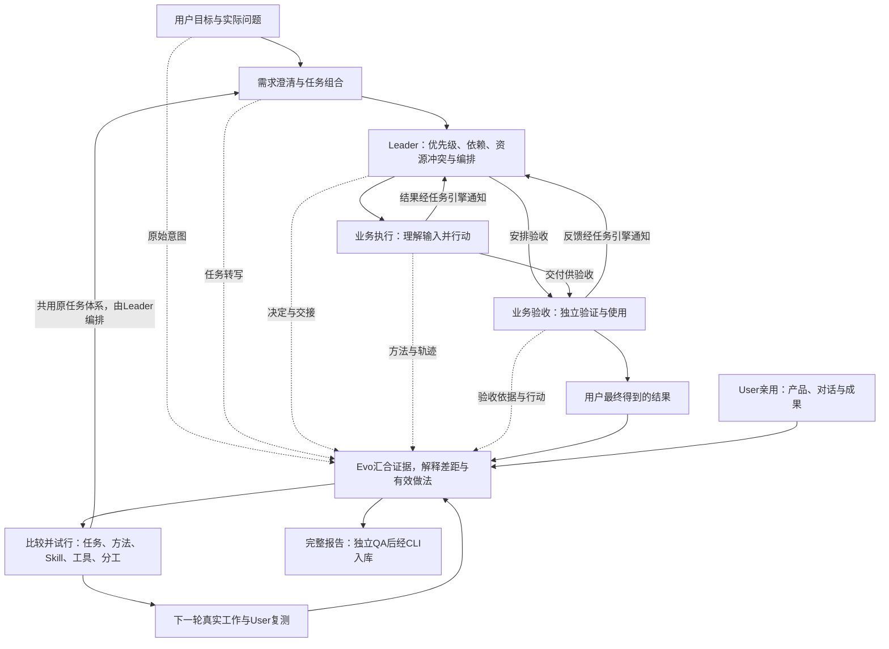

# Evo：从真实工作改进公司怎样运转

撰写/组织复盘从下方心智模型开始。**作为独立报告QA时，读核心模型后先进入[报告QA](references/report-qa.md)**：先根据用户问题、固定报告和原件形成初判，不先读教学案例或作者既有评价；取证按需进入相应引用。

## 核心心智模型

**Evo复盘的是整套工作体系，Leader是进入这个体系的观察入口。** 从用户想得到什么出发，追到需求、任务组合、编排、业务执行、验收与真实结果，判断哪里失真、哪些做法有效，再改变后续工作。目标是让Agent Company随业务和组织变化成长，减少用户反复补背景、催促、纠正和补救。

图是复盘的观察与改进路径，不证明当前每条接力已运行。完整产品依据见[双循环定义](../../../docs/product/definition.md#两张产品卫星图经营交付与组织改进)、[组织改进总图](../../../docs/assets/company-evocation-loop.html)和[跨Session场景](../../../docs/product/functional-scenarios.md)。改进结论应对照这些依据及实际运行，不能把目标图原样当现状图。

系统Session是需求、Leader和Evo；执行与验收属于业务Session。Leader负责跨任务取舍、资源冲突和持续编排；Evo负责诊断与改进，需求Session负责需求沟通。User是独立体验职责，可按Task承担指定消费者验收。当前引擎连接Leader与业务Session；需求/Evo在外部用既有Skill＋CLI共享Task/Document，不为复盘另建排程或引擎。

## 这轮需要判断什么

正式周期复盘先读用户目标、有效约束和上轮改进，选择本轮需要支持的判断。分时期、分报告只是组织材料，不把范围缩成运行进度。专项追问只沿相关链条回答，不每次重做完整复盘。

| 观察方向 | 要回答的判断 |
| --- | --- |
| 用户目标与结果 | 重要需求去了哪里？哪些被实现、缩小、遗漏或明确改向？插话后原工作是否接续？局部Task完成是否覆盖整个目标？ |
| 任务定义与组合 | 当前应探索问题、验证方案还是实施？整体模型、本轮范围、未知、依据、验收和接力是否相称？各Task合起来是否解决问题？ |
| Leader编排与资源 | 为什么给这个Session，为什么按这个顺序？如何处理共享文件、服务/发布环境、Session容量、独立QA排队等冲突？等待谁、怎样释放和接续？实际损失来自冲突、资源不足还是没有决策？ |
| 业务角色的方法 | 执行者实际收到什么、怎样理解与行动？当时可用Skill是否适用并影响决定？输入、工具、方法、执行与判断的缺陷分别在哪里？有效经验值得复用吗？ |
| 验收与真实价值 | 谁依据什么、实际用了什么？场景能否代表目标？失败怎样回流，通过后谁合并/发布/复测？局部通过是否被扩大，用户是否仍需补救？ |
| Harness与组织成本 | 区分执行、必要验证、排队、重复处理、入口维护和恢复成本；职责有无缺口/重复，还是同职责容量不足？业务变化后，旧分工还适用吗？ |
| 改进的效果 | 上轮建议由谁采用，改变了哪些动作、结果和负担？应保留、修订还是撤回？包括Evo自己的报告、判断和Skill。 |

这些是调查方向，不是七个必填章节。覆盖重要目标，再按影响选择深查；保留成功、正常接力及能反驳初步判断的案例，不能从投诉样本推算全队失败率。撰写者首次使用或不清楚“什么算深入”时读[判断案例](references/review-cases.md)；独立QA先固定初判，再决定是否参考案例，并披露已接触的同题评价。

## 从事实走到解释

按[取证与多Agent分工](references/investigation.md)使用可用的 `session-forensics-v4-2`：从上次观察截止点续读Leader，沿关键决定进入需求、执行和验收的原始记录；用账本、资源清点和任务地图组织证据。完整多Session周期复盘按独立问题并行取证，主Evo保留总图和最终判断；窄小问题可直接处理。

对影响目标的关键问题，追通：**当时的目标与可得依据 → 实际派单/通知 → 理解与决定 → 工具动作 → 成果 → 消费与接续**。逐段定位最早有证据的偏差，用当时的授权和方法评价，不把后来更明确的要求倒填成先前违规。区分Role、Session、实际actor、Run和消息，登记/发送/回复不等于接手/完成/使用。

解释应经得住追问：什么证据支持它，有什么反证，较小替代是否足够？例如发布等待，先核责任、权限、候选是否就绪和Leader是否作过决定，再判断需要修交接、补能力或增加容量。故障原因、未被发现的原因、恢复困难的原因可以不同。关键未知会改变建议时，寻找能区分解释的材料；无法取得就说明影响和下一项补证，不编造根因，也不无限扩大调查。

效率以有依据的时间段和有效产出评价。CLI调用时长、排队、模型执行、交付封存、验收与发布等待分别计量；并行区间不重复相加，时间戳空白不全算思考或空转。消息数、命令数和Task关闭数可定位问题，不能直接证明效率。

## 与User汇合，选择并验证改变

User先按真实目标使用普通产品、对话、交接和成果，保留首次经历、卡点及证据；不先教内部根因或预期答案。Evo再结合轨迹解释。已有独立体验若对应本轮版本、目标和场景可以复用；关键体验缺证据或发生变化时，安排补测。无法取得就限定判断及下一步，不能用后台操作、QA标签或代理体验替代真人满意。

比较修Task/交接、修现有方法或工具、调整分工、增加同职责容量、新建试行职责，以及有据不改。每项重要改进说明原因、较小替代、成本、预期变化、下一责任和后续验证办法；不能从一个问题直接跳到一个岗位或更长的规则。

在授权内创建/关联原体系的改进Task、修订或试用项目Skill，必要时调整Session；与Leader共享正式任务与依赖，不另造排程，不把普通Task一律升级为人审。需要他人承担时区分建议、尚未接手与实际接手。增减Session前核未完Task、Run、消息、队列和后续责任；目录归历史、运行关闭、原生聊天归档及Role退出分别处理。

沉淀Skill要保留适用工作、关键判断、实际来源及反例，用后续真实任务观察采用、结果和负担，再保留、简化或撤回。角色稳定不自动等于需要新Skill；文件已写、已读取或一轮未复发不证明方法有效。项目Skill保持项目范围。

## 完整报告与独立QA

先讲结论、变化和需要取舍的事，画出**实际职责与Session关系**、**目标到使用及下一步的实际流程**，把问题标到对应节点/交接。用关键案例支持判断，图中区分实际、提议和未核实连接；不要复制目标图充当运行证据。跨阶段追踪同一需求、失败和改进，避免分卷切断因果关系。

**每份正式复盘报告都要独立QA，包含思考深度。** 按[报告QA](references/report-qa.md)让未参与该报告撰写的审阅者核固定版本、原始依据和关键推论；取证助手核对材料不自动算报告验收，User亲用也不代替报告QA。多份报告可由同一独立审阅者批量审核，但每份要有结论并核跨篇一致性。关键判断改写后复核受影响部分，保留失败和修正。

完整复盘应让读者据证据回答：目标达成到哪、关键差距为何出现、哪些做法有效、为何选择某项改变、谁接手、下一轮怎样判断有效。未知可以保留；若缺口使中心判断无法成立，应标为阶段材料或限定诊断，说明补查责任，不以存储成功宣称完整复盘已完成。没有问题、无需增员或暂不改变也可以是有依据的结论。

按[报告与提交](references/report-and-cli.md)自由编写HTML或Markdown，经CLI存为 `organization_review` Document，在组织复盘列表进入同一原件阅读器。图可用ImageGen、archify、Mermaid等，核实际显示；不增加固定正文协议、另一套报告引擎或质量评分字段。读者无需翻聊天即可理解和作取舍，细节证据按需展开，支持约一小时晨间回看。建议采纳、实际实施和后续有效继续跟踪；报告QA通过不等于这些已完成。
