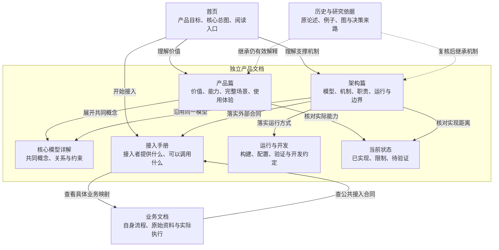
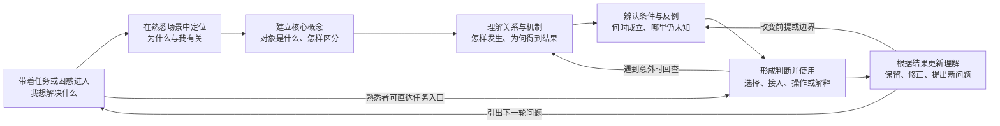

# 以读者理解组织文档

**文档是帮助读者建立、检验和更新产品理解的界面。**

把“读者带着什么问题，读完以后能够解释、判断或完成什么”作为组织内容的依据。从这些理解之间的关系推导篇章、图和链接。文件布局与代码目录是实现安排。

用任务和已有材料确定深度：一个小工具可以只需一篇；成熟系统可以有相互配合的多篇。以下结构提供可调整的示例，不规定每个项目必须有相同目录、对象分类或人工角色。

## 先建立产品与读者的共同起点

从当前用户要求、权威目标、已有好文档、代码与验证记录中确认：

- 产品希望改变什么，核心能力怎样产生价值，对什么负责，依赖什么外部条件。
- 读者此刻熟悉什么、误解什么、带着什么任务进入；不要凭空新增岗位或多角色交接。
- 哪些是长期目标、设计选择、已实现行为、实际验证与未知。代码存在不证明读者理解或业务有效。
- 现有内容中哪些解释、图、例子、条件与细节仍有价值，哪些因定位或功能变化而失效。

优先利用已确认信息，处理可逆编辑选择。遇到会改变产品定位或承诺的缺口，明确指出并询问；可以继续整理不依赖该答案的内容。不要把每个小编辑都变成重做全项目研究的前置条件。

## 一、组织总体文档：画解释关系

为每篇拟议文档说清：读者的问题、应获得的理解、主要解释、必要前提、下一步。初稿可用短列表，不必制造维护台账。

当任务涉及整体文档规划、跨篇重建或职责拆分，提供一张 Mermaid 总图。节点表达文档要解释的事情；边表达具体的阅读、解释依赖、共享模型或依据关系。明确说明这是文档地图；系统调用另画架构图。

下面是“通用产品从业务中独立”的**结构示例**。按实际产品合并、删减、改名或补充：

这张图的关键取舍：

- 产品篇与架构篇共同解释一个产品，引用相同核心概念；每篇仍应有足够摘要供读者读懂自己的主线。
- 易变状态有明确维护位置。小项目可以是同页的有日期小节，无须强拆文件。
- 业务与核心通过接入合同连接，保留具体例子；归属改变不应删除帮助理解的内容。
- 历史支撑主文。仍有效的解释应进入主文，读者不必翻档案补齐基本理解。

需要逐篇职责、内部章节或跨仓重建时，读 [references/document-architecture.md](references/document-architecture.md)。

## 二、设计读者的理解过程

先定义具体的认知变化，例如：“从把它理解成报告仓库，变为能解释旧认识如何参与新问题研究，并知道何时需要回查依据。”用可观察的复述、比较、预测或操作验证变化。

在整体重建或核心产品解释中，再画一张**读者理解过程图**。这是读者在阅读中形成理解的过程；作者的资料收集、起草与校对步骤另述。

这是一种可调整的阅读路径。熟练读者可以从操作、错误或状态进入，解释层应可回到。每章需要完成一个明确的理解任务，并连接下一步，而非反复复述总目标。

## 三、从理解任务选择表现形式

问“读者此刻需要完成哪种思考”，再决定媒介。文字负责定义、推论、理由和限定；图适合把空间关系、路径、反馈或变化展开；表格适合逐项对齐同维度差异；连续例子把抽象机制落到可追踪的具体变化。

| 读者要完成的思考 | 优先表达 | 配套解释 |
| --- | --- | --- |
| 理解一个概念或选择的理由 | 文字＋具体例子 | 定义、为什么、条件、反例 |
| 看清组成、职责和边界 | 架构图或关系图 | 关系含义、拥有者、边界理由 |
| 跟踪顺序、分支和失败恢复 | 流程图／时序图／状态图，按问题选择 | 触发、动作、改变的对象与结果 |
| 比较多方案或新旧版本 | 同维度表格，少量方案也可用短段落 | 可比条件、取舍依据、未知 |
| 理解机制如何在现实成立 | 一个连续案例＋必要小图 | 输入、旧状态、变化理由、结果与下一轮 |
| 完成已知任务 | 有序步骤、必要代码或真实界面截图 | 前提、预期结果、验证与恢复 |
| 理解实际页面的位置或现象 | 当前版本截图或短演示 | 版本、标注及截图能证明的范围 |

为每张拟议图写一句“读者看它是为了回答什么”。如果无法回答，先删图或改题。每幅图只突出一个主要关系问题；多个视角可共享对象身份，但应分别标明内容、操作、运行或时间维度，避免混成固定加工阶梯。

图旁解释一次关键路径或分支，带出条件与不确定性；不要逐字复述所有节点，也不要让图承担未写明的推理。长列表、精确参数和完整字段通常保留为文字或表格。

详细媒介判断、反例及呈现检查见 [references/representation.md](references/representation.md)。

## 四、用完整场景承载机制

选择一个能贯穿目标、核心概念、关系、实际使用及限制的场景。保留它的对象和条件，展示前后具体变化。用第二个不同业务的短例子检验通用性；不为每个抽象词另造无关联的小故事。

可用的场景骨架是：**读者问题与初始理解 → 具体输入和条件 → 系统中的动作与推理 → 结果与理由 → 读者如何使用 → 反馈如何改变下一次**。一次性工具不必强加反馈循环；持续学习系统则需真正展开下一轮。

明确区分真实记录、教学假设、设计目标与已验收实现。示例的结果应随证据变化，不能规定新证据必然改版、任务受理必然成功、生成内容必然成为事实。

需要示范内部内容怎么展开时，读 [references/worked-examples.md](references/worked-examples.md)。

## 五、重建与持续维护

跨仓拆分或改写前，阅读与本次任务相关的旧正文、图和例子；需要“改写前原文”时用准确历史版本。逐段判断哪些仍成立、哪些需修订、哪些仅保留历史。让内容依据可追溯，工作量以读者得到的理解衡量。

旧内容仍可能有解释价值但使用过时术语：保留其论证，转换到新模型并明确差异。旧对象分类、旧产品边界和历史测试结果不能无核对地继承。新功能要进入相关机制与场景，不能只堆在更新清单。

不强迫重做目录，不把历史保全等同于必须全文塞进主文；用主文的充分解释与完整历史的可回查同时满足理解和追溯。

## 六、按理解结果审阅

先读一条完整主线，再核对事实、图和链接。按任务挑选有区分力的检查：

- 读者能否用自己的话解释目标、关键机制、条件与未知，并指出依据？
- 给一个输入变化或反例，读者能否判断流程、结论或适用性会怎样变化？
- 新业务能否说清需要提供什么、由谁负责，及接入后的验证方法？
- 读者能否完成目标任务，遇到问题能回到必要解释，区分目标和现实状态？

独立读者或评估者可在有价值时检验；作者自己的走查只是代理证据。Mermaid 渲染、链接、桌面／窄屏阅读和生成检查验证表现与完整性，不单独证明理解或产品有效。

## 按用户请求交付

- 只要规划：交付总体文档图、读者理解图、主文内容架构，以及影响写法的关键取舍；不自动执行全量改写。
- 要求写作：按已确定范围完成正文和必要图表，沿用项目生成与验证方式。
- 要求审阅：给出阻碍理解或事实错误的具体段落、影响与修订建议；别用文风偏好替代问题证据。
- 小修订：直接完成相关修改，仅在理解路径或整体分工被改变时更新相应图。

技能不授予跨仓写入、发布、付费操作、全局安装或外部通信权限。优先项目既有权威位置；不因可用 Pages、站点或其他连接工具就另造一套文档来源。
