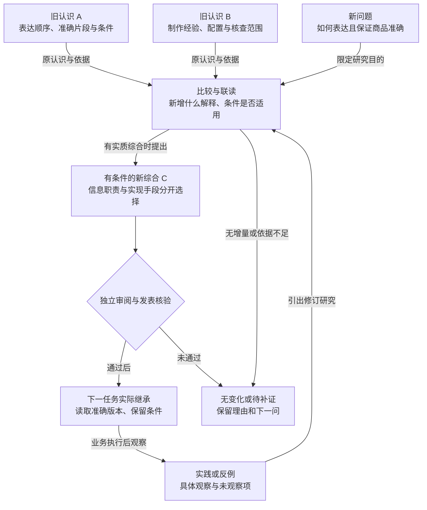

# 用完整例子检验内容架构

以下是写法示范，业务结果均为假设。它们说明选择解释的方式，不要求其他产品采用相同术语或功能。

## 例一：独立知识产品

### 产品篇的主线

**读者起点。** 研究过不少内容，但新任务仍重新读报告，之前的条件、失败和取舍没有可靠继承。读完后应能解释：“系统怎样保留理解，在新问题下发展理解，并让后续任务用到修正后的认识。”

**核心概念。** 用同一场景区分原始资料、观察、来源说法、解释、方法与综合。认识带条件、反例和未知；原件、派生报告和综合的数量不等于独立证据数量。

**已有认识 A。** 某些视频先展示可辨认的结果，再解释过程。准确片段支持画面顺序观察；“帮助建立理解”是一项需说明依据的解释，不证明观看或成交提升。

**已有认识 B。** 一次制作中某配置生成的包装文字失真，换用准确实拍后通过检查。记录输入、配置、失真位置和核查范围，不能泛化成“生成工具永远不能展示商品”。

**新问题。** 数字人口播怎样借鉴结果前置，又保证商品准确？研究联读 A/B，比较结果是否可识别、哪些信息需口头解释、哪些细节需准确呈现。

**新综合 C。** 先确定镜头的信息职责，再按准确性与资源选择数字人、实拍或组合方式。它增加了一项迁移取舍，沿用 A/B 的依据，不增加独立验证。没有足够解释增量时，可有据不变或保留待研究问题。

**下一轮。** 新任务实际读到 C 的准确版本，由口播解释用途、实拍展示商品。假设理解测试出现“听懂讲解但未认出商品”，应关联当时采用和改编的版本，研究识别线索是否不足。一次观察不证明某形式普遍有效或无效。候选经审阅后才可能成为新的正式认识；历史采用仍可查。

### 图怎样帮助这个场景

这张图回答“新综合怎样形成并被继承”，不会替代来源内容模型或 API 架构。正文解释 C 新增的判断与条件，反例检验其边界；只画 A＋B→C 会漏掉成立理由。

### 产品、架构与接入怎样分工

产品篇保留场景和用户理解过程。架构篇用相同对象解释来源读取、准确版本、查询研究、审阅发表、使用反馈和维护；再显示独立前端、公共合同、应用层、核心与设施怎样协作。

电商负责取得原件、专业分析、制作与经营执行；知识产品负责可维护认识及其公共能力。普通文档业务提供固定修订、段落锚点和反馈，也可走同一机制。接入成功、真实语义研究、生产部署和经营效果分别需要证据。

## 例二：把备份模块独立为恢复服务

这是迁移到另一产品时的方法检验。不要把知识库的候选发表、认知成长或视频案例带过来。

**读者起点。** 业务团队把“最近备份任务成功”理解为“故障后一定可恢复”。希望读者能解释可恢复性的条件，并能接入服务、验证一次恢复。

**产品篇。** 从误删数据场景开始，区分备份任务、可用恢复点、恢复请求、恢复目标与恢复验证。解释希望恢复什么和可接受范围，再走完一次：选定准确恢复点、确认目标、恢复到隔离位置、核对结果、决定后续切换。实际指标需有产品依据，不能自行发明承诺。

**架构篇。** 图展示业务来源、备份执行、记录/对象存储、恢复编排、目标写入与验证的实际职责；仅在先后影响正确性时展开时序。密钥、权限、并发和跨系统失败按实现查证，不从功能名推定。

**接入篇。** 业务提供来源身份、允许读取范围与恢复目标政策；服务返回可用恢复点与任务状态。示例包含最小备份和隔离恢复验证，让接入者知道哪些动作由业务完成，以及怎样确认没有写错目标。

**表现形式。** 恢复点与备份成功的区别用文字和反例；职责图解释边界；前后状态与验证结果用小表格；操作用有序步骤。一次失败恢复比几张互不相干的功能图更能检验理解。

**状态篇。** 明确当前是否只有备份完成记录，是否已有实际恢复与校验，自动切换是否仍未实现。图中出现恢复箭头不代表产品已提供恢复保证。

## 评价写法

让读者在没有作者口头补充时解释关键概念、追踪一次变化，并判断条件改变时能否继续使用。只能复述标题时，补机制、依据或反例；能解释但无法行动时，补接入或操作桥梁；能照步骤运行却误解承诺时，补成功条件与验证范围。

先纠正造成理解错误的缺口，再调整表现。不要以统一文风、更多图、更多页面或更短篇幅替代这个判断。
