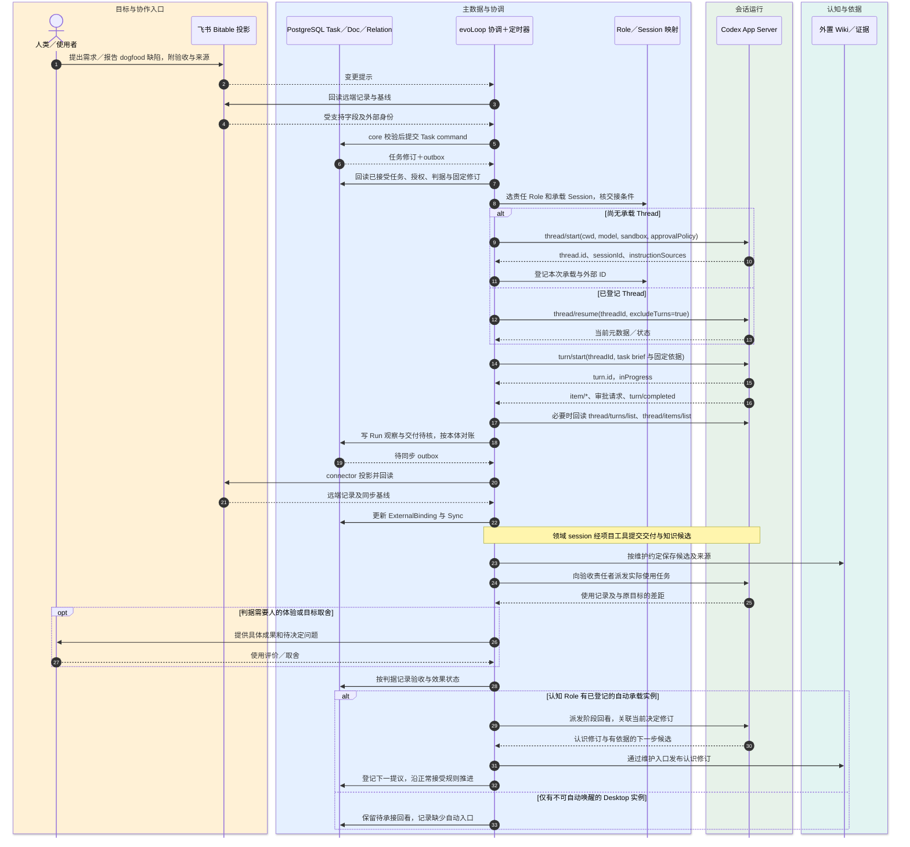

# Codex App Server 接入边界与最小切片

> 状态：**本机受限接入已运行，生产与 Desktop 自动桥接未验**。本页把[SessionRuntime 领域合同](contracts.md)映射到 Codex App Server；2026-10-20 的协议调查与隔离实测保留为当时证据，见[调查报告](../research/codex-app-server-20261019.md)和[隔离闭环实测](../research/codex-app-server-proof-20261019.md)。当前 owned Turn、重启回读和终态纠错的范围见[本机运行](../development/local-run.md)，目标与责任仍以[产品定义](../product/definition.md)和[架构总览](overview.md)为准。

## 位置与权威

Codex App Server 是对话执行边界，不是 evoLoop 任务数据库、知识 Wiki 或调度器。第一切片由 evoLoop 启动并管理一个本地 stdio 子进程，按 `initialize`／`initialized` 握手，与其自己创建的 Thread 通信。每个 Thread 包含多个 Turn；Item 和事件说明过程与运行结果。适配器保存外部 ID 与本地对账检查点，不能用 Codex 的“Turn 已完成”替代 PostgreSQL 任务验收。文档说明的 `thread.sessionId` 是 Codex 会话树根；项目的 `RoleId` 和承载 `SessionId` 另立稳定 ID。

人类日常讨论可以继续在 Codex Desktop 中的分工／认知聊天发生。Agent 现可使用项目内 `evoloop-workflow` 业务技能与 CLI 读取固定依据、提交授权内的常规修改；MCP 是按需增加的同类工具入口。CLI 或将来的 MCP 变更操作先进入统一协调服务，由 core 核对身份、授权、状态和基线，再调用 TaskStore／KnowledgeRepository；工具不得自行实例化适配器直写。飞书原生人工编辑是 connector 的设计入口，真实租户接入已延后；受支持字段将经回读、身份／基线／状态校验后成为 core command，出站由 outbox 投影并回读确认。自动承接任务的 worker 使用 evoLoop 管理的 App Server Thread。两种宿主以任务 ID、知识修订和交接说明显式衔接；同一 Role 可在不同宿主有先后承载实例，却不能靠映射复制桌面聊天历史或推断其运行状态。这样无需先造第二个聊天前端，也不会让 Desktop 成为第二个任务或知识权威。桌面聊天的自动唤醒、sidebar 注册、状态监听与统一控制留给独立的宿主适配验证。

首期拟将自动认知回看和分工检查绑定已登记、可派发的自管 App Server 承载实例；桌面宿主桥接作为另一路能力单独登记和验证，不能默认提供给独立 coordinator。若某 Role 只有 Desktop 实例且没有可用自动入口，接续任务保留“待承接”，可在人类下次打开该会话时领取，不能宣称已自动完成闭环。为同一 Role 增设自动工作实例时，工作说明区分“后台证据准备/已授权回看”和“人类日常讨论/目标取舍”，每个任务有一个当前责任实例；重大结论更新仍走同一知识维护与任务接受入口。日常讨论产生的新决定有明确修订，受影响的自动任务重新核对，不能两端各自覆盖当前方向。

下面的时序图用于核对**拟议 App Server 线程怎样承接一次已接受任务，以及运行事件何时回到主数据和验收**。它画的是自管 Thread 路径；Desktop 的人工讨论入口与限制见上文。若只需理解工作目的，先读[总览的工作回路](overview.md#3-沿一轮工作理解系统)。

图例：人类＝目标与使用；飞书＝协作投影；PostgreSQL＝任务／文档／关系主数据；协调层＝派发与定时恢复；Codex＝运行事件；Wiki＝有来源的认识。图中 `turn/completed` 到 PostgreSQL“交付待核”之间保留任务约定的责任者核验，不自动判任务完成。图表达**拟议流**，没有端到端运行记录。

## 受管 worker 自动接续候选

第一条自动接续的代码使用独立的 Loop/Inbox/Dispatch/Submission 记录，Task 仍只有四态。Loop 明确项目 Goal/Stage、起始来源、认知与可用业务职责、运行与并发预算；独立入站从自己的订阅去重读取，不领取飞书投影的回执，也不自动开始历史 todo。认知评审与下一动作使用同一来源下不同 purpose 的入站，业务子派发显式引用父认知派发；父运行有实际署名封存交付后才开始子工作。业务终态结果通过一次来源事件进入下一认知，排除认知自己的完成事件，避免自唤醒。

独立消费者的使用观察也是来源。订阅校验真实 applied operation、签名 actor、Observation 和 Delivery；依 Delivery 固定 Task 修订的 Stage/Goal 路由，排除生产者自报和本 Loop 的认知自反馈，后移 Task 不转移旧交付归属。独立观察证明使用及效果，不是所有下一步的批准条件；技术故障和系统缺口仍可支持有据修复或补证。缺署名意图目前只形成持久缺口，尚不自动建立恢复任务；已确认终态释放并发占用，原生 unknown 继续占用并按原意图核对。

首次自动启动显式封存 Task 选定关联过程文档的已采纳修订；未发布、已归档或超过额外来源上限时阻断，已有 basis 则保留固定选择与适用决定。后续认知读取过程报告时，必须由正式 Delivery 的项目内固定 Document 路由、修订与真实原文哈希精确匹配，不能因此取得全项目文档访问权。

执行者得到绑定 Loop/Task/Run/Session 的独立短期身份，通过共同 API/CLI 读取固定材料、提交授权内修改。密钥留在外部私有注册目录，原生输入只给 wrapper 路径与业务 skill。每次 HTTP 请求核对项目、职责、固定输入及对象关系；本机目录权限不能宣称为同 Unix 用户恶意进程的隔离。网络能力来自原 Session 行为者的明确 profile，不借同职责其他身份的许可；CLI 回执留在获准写入的私有工作目录，令牌不进入回执或 prompt。

worker 文档路由仅接受显式修订及原件读取，拒绝无版本详情和修订列表。曾经创作、关联或交付某个版本，不授权读取别人后来修订的正文；这种限制也避免了先查当前指针、再取正文期间的版本竞态。普通负责人身份仍沿正常文档权限读取。

运行期间不能调用终态 Delivery 登记，因此执行者在 Run 活跃时提交不可变交付意图，固定实际 Run 修订/hash、产物、检查、原 actor 和稳定 operationId。终态回收者验证受托身份，在同一业务 core 下以原 actor/同意图封存，并核实际 journal 与 Delivery；封存身份单独记录，模型 final 不代写。无动作、等待、失败、停止也是有署名决定。暂停阻止新准入，既有 Run 可收尾；原生启动未知只回查，纯 PostgreSQL 封存命令按原 ID 幂等恢复，不能借此重发原生 Turn。缺少意图、撤权与未知结果保留可追责缺口。

这是第一条旅程的候选实现与验收边界；真实运行和负责人验收以对应版本证据为准。首片逐派发新建受管 Session，未做正常归档或池化复用；尚未完成持续业务巡检、真实跨职责研究、试行成本/效果回看与 Desktop 自动桥接。配置与操作见[本机运行](../development/local-run.md#受管自动循环候选)和[Agent CLI](../development/agent-cli.md#受管执行与自动接续)。

## 任务、职责与定时触发

一条 PostgreSQL Task 可经历多个 Codex Turn、换 Thread 接续，甚至由多个业务 session 分工；一条 Thread 也可处理多个相关 Turn。关系通过 `taskId`、`roleId`、项目 `sessionId`、原生 `threadId`／`turnId`、操作 ID 和有效时间段串联，不能把任一外部 ID 当另一层的主键。新持续 Role 需要缺口证据、试行与回看；`thread/start` 和 `thread/fork` 只创建运行实例／历史分支。

需求与 dogfood 缺陷先说明复现、预期、实际结果、影响范围和证据；尚未决定的问题可留在 issue/spec 或讨论，明确的授权工作创建 todo Task。开始时固定主正文和必要材料，再进入 in_progress；验收默认留原任务内。飞书可作为协作入口，但入站编辑先转为受验证的 command。责任 session 可以自行修复所在领域问题、提交成果与知识候选；需要跨领域承接时协调者按 Role 范围派发并回收。专门认知 session 综合使用反馈、冲突与下一步，但不是局部行动的必经审批环节。任务的交付状态、派发操作状态和实际使用效果分别记录。

定时器属于 evoLoop：日程定义、触发实例、去重与恢复水位存 PostgreSQL，具体归属以 [ScheduleStore 合同](contracts.md#7-schedulestore-与触发实例)为准；每次需要执行的到期工作形成独立 Task。飞书日程视图若需要则经 connector 投影，不成为另一权威。触发先回读 PostgreSQL 当前状态、知识固定修订和已登记在途 Turn，再决定是否派发；定时通知或 `turn/start` 回执不证明工作被采用。协调服务由事件加对账触发完成回收与认知下一步，不能等 worker 自己想起发消息。App Server 文档没有提供供此设计依赖的通用 cron 方法；宿主产品自身“计划任务”需要独立接入与验证，不隐式代替此调度器。无人值守任务碰到审批或权限不足时进入待人处理；可安全运行范围与 SDK 批处理选择留给试点决定。

## 状态与恢复规则

适配器至少区分 `requested`、`accepted`、`running`、`turn_completed`／`turn_failed`／`turn_interrupted`、`unknown`；任务层使用 PostgreSQL TaskStore 的状态机，飞书同步另有 Sync 状态。`turn/completed.status = completed` 只表示 Codex Turn 结束，随后仍需核对 Item 最终状态、文件／检查结果、交付物和使用反馈。`item/completed` 是 Item 的最终观察，增量 delta 不是最终文本。审批请求由客户端按既有授权及服务端策略路由，记录决定依据；需要人的判断时才转交授权人，不能擅自放宽权限或默认接受未知请求。[官方事件与审批说明](https://learn.chatgpt.com/docs/app-server#approvals)

断线或超时后按 `operationId` 回读 PostgreSQL Journal、Task 与 outbox → 对已知 `threadId` 用 `thread/read`／分页历史定位 Turn／Item → 将证据落到操作状态。能证实效果已发生则续跟踪；能证实未发生才考虑重发；没有足够 ID 或证据则保持 `unknown`，不盲重试。App Server 的请求 ID 仅用于连接上的请求／响应匹配；本机 schema 中可选的 `clientUserMessageId` 未经验证为跨重试的去重机制。重启先处理未知派发和待验收成果，再领取新任务。通知无已验证全局重放游标；持久历史分页与 PostgreSQL 本体对账是恢复依据；飞书绑定按需另行对账。

第一版只管理该适配器自己创建、登记的 Thread。本页固定实验已观察到独立 App Server 可读桌面线程元数据、桌面可读新建线程历史及一次宿主通知的真实消费；UI 同步、自动控制、跨进程审批及多写行为仍**未验证**。`thread/list` 提供发现能力，但不授权扫描或接管用户全部历史。部署形态从本地 stdio 改为远程、需要修改账号认证或使用实验 API 时，先做版本固定、权限与协议验证，再扩大承诺。

## 端口合同（拟议）

| evoLoop 能力（跨运行时） | Codex 适配器内部方法与观察 | 项目侧必须保存／判断 |
| --- | --- | --- |
| `create(spec)` | `thread/start`；接 `thread/started`，保存返回 `thread.id`、`thread.sessionId`、`instructionSources` | `RoleId`、项目、任务、实例目标、输入修订、权限、交接／退出条件；仅实际回执后标“已建”。原生 ID 放在适配器的 `nativeIds`。 |
| `resume(sessionId)` | 从映射取 `threadId`，`thread/resume(excludeTurns: true)` | 不因续窗或恢复生成新 Role；检查宿主、权限和已知在途 Turn。 |
| `inspect(sessionId)` | `thread/read`、分页 `thread/turns/list` 与 `thread/items/list` | 授权读范围、历史锚点、去重 ID；若后端不支持分页或历史不可达，返回 `unsupported`／`unknown`。 |
| `run(sessionId, taskId, brief, operationId)` | `turn/start` 返回初始 `turn.id`；通知 `item/*`、`turn/completed` | 派发意图与唯一操作 ID、任务和知识基线、请求 ID／时间、返回的 Turn ID、实际终态；重复请求无强幂等保证。 |
| 运行中修正（Codex 扩展） | `turn/steer(expectedTurnId)` | 仅针对已确认仍进行的 Turn；新任务走 `turn/start`。该能力是宿主可选扩展，不强制所有运行时实现。 |
| `interrupt(sessionId, runId)` | 适配器把项目运行映射到原生 `threadId`／`turnId`，调用 `turn/interrupt` 并继续等最终 `turn/completed` | “请求已收”与“实际停止”分开；仍须核对已发生副作用。 |
| `observe`／`reconcile` | 消费通知；断线后分页回读 | 运行记录、水位、未知结果与下次对账时间；不能把通知当完整持久事件流。 |

本机 `codex-cli 0.154.0` 的 v2 schema 显示：`TurnStartParams` 必需 `threadId` 和 `input`，`TurnSteerParams` 必需 `threadId`、`expectedTurnId`、`input`，`TurnInterruptParams` 必需 `threadId` 与 `turnId`。`thread/start` 的 `cwd`、`model`、`sandbox`、`approvalPolicy` 可选；选择时遵守项目授权与运行环境，而不是用固定高权限配置求方便。官方 [App Server 方法说明](https://learn.chatgpt.com/docs/app-server#api-overview)和[Turn 生命周期](https://learn.chatgpt.com/docs/app-server#turns)是实现时的外部合同；每次 CLI 升级重生 schema 并检查实验字段门控。

正常结束已有 owned Session 时，`runtime.session.close` 只接受已绑定且空闲的 `ready` Session；同项目事务把它改为 `closing`，立即阻止新 Run。受管执行器先保存关闭操作 ID 和归档尝试时间，再对固定 0.154.0 `thread/archive` 发一次请求；空回包不是结束证据。只有受限分页的 `thread/list` 在 `archived:true`、原目录下核到相同 thread/session 身份才记为 `closed`。原生 `source` 是宿主分类，不是 owned 创建权威；本系统保存的 `thread/start` 回执与不可变绑定才是归属依据。丢回包、重启、查询不完整或身份不符时保留 `closing` 和原 ID，只读对账，不自动重发归档。原 Session、Run、事件及 Task/Knowledge 历史不删改；旧未知只读 Run 放弃仍是独立特例。适配器的 `close()` 仅关闭共享 App Server 子进程，不代表逐 Session 关闭。关闭后原生 trace 的历史读取尚未开放，须在关闭前固定需要的实际证据；真实原生归档仍待指定样本联测。

## 隔离实测与生产能力分开

[独立 PR #2](https://github.com/cyl19970726/evoLoop/pull/2) 的隔离成果经本轮冲突协调后随本提交纳入；证据仍固定到原实验 `9c095fce`，见[实测报告](../research/codex-app-server-proof-20261019.md)。它补充了首次调查仅握手的范围，本轮仅重跑离线协议检查，没有重跑模型实验。实验未连接真实 Task/Document 主数据、飞书 connector 或生产 Wiki。

| 实际观察（CLI 0.154.0／本机隔离夹具） | 可据此采用的设计依据 | 仍未证明 |
| --- | --- | --- |
| 自管线程创建、两轮执行、重启后分页历史与第三轮续做；独立认知线程核算产物 | 按明确 Thread/Turn ID 保存映射并对账；交付后以可检查产物核消费 | 真实业务主数据、生产 SessionRuntime、长期无人值守和认知收益 |
| 忽略已收到完成事件后，以已知 Turn ID 修复本地状态；收据确认前重连后抑制重复派发 | 本地检查点可能落后于历史；回读与收据是恢复依据 | 网络断线漏事件、没有 Turn ID 的派发回执丢失、在途进程崩溃、跨驱动去重 |
| 独立协议读授权桌面线程元数据，桌面宿主读自建线程历史 | 两端有受限持久历史可见性；须明确 ID 和权限范围 | Desktop 实时状态、sidebar/UI 同步、接管既有聊天、双写和跨进程审批 |
| 一次桌面宿主通知后，接收会话实际读取、重算并给出限定收据 | 可在经授权且宿主提供工具时验证桌面消费 | 独立 daemon 自带同一消息入口、持续监听/唤醒或可靠投递保证 |

上方流程图包含本机已接通的受控 Turn 与尚待验证的自动承接、对账和生产恢复；2026-10-19 研究中的本地 outbox 与夹具本身不等于后来接入的 PostgreSQL 运行记录，也不能充作生产持久化证据。

## 进入实现的切片与验收

1. **协议薄适配。** 当时的 PR #2 只证明隔离 Thread、Turn 与恢复；后来 TS 接入已在本机运行受控 owned Turn，完成、重启回读与误判终态后的追加纠错有记录。进程退出、审批等待、断线和升级后的 schema 仍须按实际版本继续核验，不能把本机样本推成生产保证。
2. **一条主数据任务。** PostgreSQL Task 与 owned Turn 已有本机关联、交付及后续 Agent 消费观察；技术检查、目标消费者使用和 Task 关闭分别核对。向真实飞书测试表投影及受支持的入站编辑仍未实连，不能把 fake HTTP 测试算作租户验收。
3. **多 session 与 dogfood。** 外置 OpenViking 0.5.1 已受限写读、重启回读，并有知识候选审阅发布与 Task 显式采用；正式语义索引、长期恢复和知识净收益未验。继续测同职责续开、新职责试行，以及真实使用缺陷怎样改变知识与下一步。
4. **调度与失败恢复。** 测重复触发、派发成功但响应丢失、断线漏通知、停止请求、审批无人接手、协调者重启；每项保存任务与运行观察，不能以模拟事件代替真实宿主行为。

本机试用只覆盖已记录的任务链与恢复案例；生产接入、Desktop 自动控制和长期实际效果仍须单独验收。历史实验的门槛与当时证据见[研究报告的证据矩阵](../research/codex-app-server-20261019.md#最小验收设计与当前证据)。
