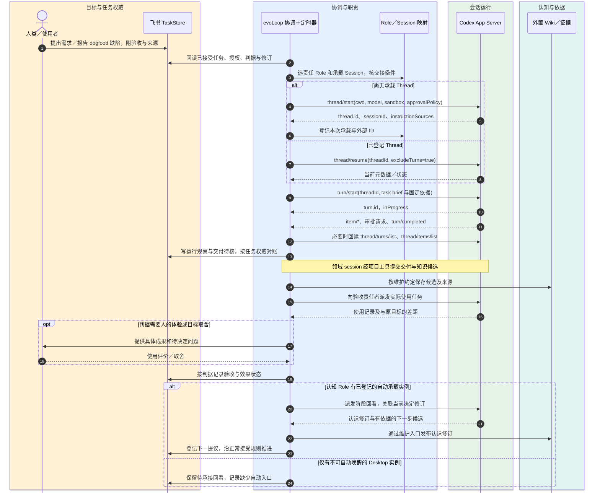

# Codex App Server 接入边界与最小切片

> 状态：2026-10-19 **架构提议，尚未实现**。本页把[SessionRuntime 领域合同](contracts.md)映射到 Codex App Server 候选。协议证据、固定版本和未运行项目见[调查报告](../research/codex-app-server-20261019.md)；目标与责任仍以[产品定义](../product/definition.md)和[架构总览](overview.md)为准。

## 位置与权威

Codex App Server 是对话执行边界，不是 evoLoop 任务数据库、知识 Wiki 或调度器。第一切片由 evoLoop 启动并管理一个本地 stdio 子进程，按 `initialize`／`initialized` 握手，与其自己创建的 Thread 通信。每个 Thread 包含多个 Turn；Item 和事件说明过程与运行结果。适配器保存外部 ID 与本地对账检查点，不能用 Codex 的“Turn 已完成”替代飞书任务验收。文档说明的 `thread.sessionId` 是 Codex 会话树根；项目的 `RoleId` 和承载 `SessionId` 另立稳定 ID。

人类日常讨论可以继续在 Codex Desktop 中的分工／认知聊天发生。初期给这些聊天提供项目内的窄 CLI／MCP 工具，让人和 Agent 明确读取任务与知识、提交有来源的观察／决定／任务提议；CLI／MCP 变更操作先进入统一协调服务，由 core 核对身份、授权、状态和基线，再调用 TaskStore／KnowledgeRepository；工具不得自行实例化适配器直写。飞书原生人工编辑是显式入口，由协调服务回读、检测冲突并对账。自动承接任务的 worker 则使用 evoLoop 管理的 App Server Thread。两种宿主以任务 ID、知识修订和交接说明显式衔接；同一 Role 可在不同宿主有先后承载实例，却不能靠映射复制桌面聊天历史或推断其运行状态。这样无需先造第二个聊天前端，也不会让 Desktop 成为第二个任务或知识权威。桌面聊天的自动唤醒、sidebar 注册、状态监听与统一控制留给独立的宿主适配验证。

自动认知回看和分工检查必须绑定已登记、可派发的 App Server 承载实例。若某 Role 只有 Desktop 实例且没有可用自动入口，接续任务保留“待承接”，可在人类下次打开该会话时领取，不能宣称已自动完成闭环。为同一 Role 增设自动工作实例时，工作说明区分“后台证据准备/已授权回看”和“人类日常讨论/目标取舍”，每个任务有一个当前责任实例；重大结论更新仍走同一知识维护与任务接受入口。日常讨论产生的新决定有明确修订，受影响的自动任务重新核对，不能两端各自覆盖当前方向。

图例：人类＝目标与使用；飞书＝任务权威；协调层＝派发与定时恢复；Codex＝运行事件；Wiki＝有来源的认识。图中 `turn/completed` 到飞书“交付待核”之间保留任务约定的责任者核验，不自动判任务完成。图表达**拟议流**，没有端到端运行记录。

## 端口合同（拟议）

| evoLoop 能力（跨运行时） | Codex 适配器内部方法与观察 | 项目侧必须保存／判断 |
| --- | --- | --- |
| `create(spec)` | `thread/start`；接 `thread/started`，保存返回 `thread.id`、`thread.sessionId`、`instructionSources` | `RoleId`、项目、任务、实例目标、输入修订、权限、交接／退出条件；仅实际回执后标“已建”。原生 ID 放在适配器的 `nativeIds`。 |
| `resume(sessionId)` | 从映射取 `threadId`，`thread/resume(excludeTurns: true)` | 不因续窗或恢复生成新 Role；检查宿主、权限和已知在途 Turn。 |
| `inspect(sessionId)` | `thread/read`、分页 `thread/turns/list` 与 `thread/items/list` | 授权读范围、历史锚点、去重 ID；若后端不支持分页或历史不可达，返回 `unsupported`／`unknown`。 |
| `run(sessionId, taskId, brief, operationId)` | `turn/start` 返回初始 `turn.id`；通知 `item/*`、`turn/completed` | 派发意图与唯一操作 ID、任务和知识基线、请求 ID／时间、返回的 Turn ID、实际终态；重复请求无强幂等保证。 |
| 运行中修正（Codex 扩展） | `turn/steer(expectedTurnId)` | 仅针对已确认仍进行的 Turn；新任务走 `turn/start`。该能力是宿主可选扩展，不强制所有运行时实现。 |
| `interrupt(sessionId, runId)` | 适配器把项目运行映射到原生 `threadId`／`turnId`，调用 `turn/interrupt` 并继续等最终 `turn/completed` | “请求已收”与“实际停止”分开；仍须核对已发生副作用。 |
| `observe`／`reconcile` | 消费通知；断线后分页回读 | 运行记录、水位、未知结果与下次对账时间；不能把通知当完整持久事件流。 |

本机 `codex-cli 0.154.0` 的 v2 schema 显示：`TurnStartParams` 必需 `threadId` 和 `input`，`TurnSteerParams` 必需 `threadId`、`expectedTurnId`、`input`，`TurnInterruptParams` 必需 `threadId` 与 `turnId`。`thread/start` 的 `cwd`、`model`、`sandbox`、`approvalPolicy` 可选；选择时遵守项目授权与运行环境，而不是用固定高权限配置求方便。官方 [App Server 方法说明](https://learn.chatgpt.com/docs/app-server#api-overview)和[Turn 生命周期](https://learn.chatgpt.com/docs/app-server#turns)是实现时的外部合同；每次 CLI 升级重生 schema 并检查实验字段门控。

## 任务、职责与定时触发

一条飞书任务可经历多个 Codex Turn、换 Thread 接续，甚至由多个业务 session 分工；一条 Thread 也可处理多个相关 Turn。关系通过 `taskId`、`roleId`、项目 `sessionId`、原生 `threadId`／`turnId`、操作 ID 和有效时间段串联，不能把任一外部 ID 当另一层的主键。新持续 Role 需要缺口证据、试行与回看；`thread/start` 和 `thread/fork` 只创建运行实例／历史分支。

需求与 dogfood 缺陷由领域 session 提出后进入飞书待判断状态，保留复现、预期、实际结果、影响范围和证据。责任 session 可以自行修复所在领域问题、提交成果与知识候选；需要跨领域承接时协调者按 Role 范围派发并回收。专门认知 session 综合使用反馈、冲突与下一步，但不是局部行动的必经审批环节。任务的交付状态、派发操作状态和实际使用效果分别记录。

定时器属于 evoLoop：日程定义拟存同一飞书 Base 的独立表，触发实例、去重与恢复水位由运行记录保存，具体归属以 [ScheduleStore 合同](contracts.md#7-schedulestore-与触发实例)为准；每次需要执行的到期工作形成独立任务，运行日志外置且不复制可编辑业务状态。触发先回读飞书当前状态、知识固定修订和已登记在途 Turn，再决定是否派发；定时通知或 `turn/start` 回执不证明工作被采用。协调服务由事件加对账触发完成回收与认知下一步，不能等 worker 自己想起发消息。App Server 文档没有提供供此设计依赖的通用 cron 方法；宿主产品自身“计划任务”需要独立接入与验证，不隐式代替此调度器。无人值守任务碰到审批或权限不足时进入待人处理；可安全运行范围与 SDK 批处理选择留给试点决定。

## 状态与恢复规则

适配器至少区分 `requested`、`accepted`、`running`、`turn_completed`／`turn_failed`／`turn_interrupted`、`unknown`；任务层继续使用飞书自己的状态机。`turn/completed.status = completed` 只表示 Codex Turn 结束，随后仍需核对 Item 最终状态、文件／检查结果、交付物和使用反馈。`item/completed` 是 Item 的最终观察，增量 delta 不是最终文本。审批请求由客户端按既有授权及服务端策略路由，记录决定依据；需要人的判断时才转交授权人，不能擅自放宽权限或默认接受未知请求。[官方事件与审批说明](https://learn.chatgpt.com/docs/app-server#approvals)

断线或超时后按 `operationId` 查本地派发记录 → 回读飞书 → 对已知 `threadId` 用 `thread/read`／分页历史定位 Turn／Item → 将证据落到操作状态。能证实效果已发生则续跟踪；能证实未发生才考虑重发；没有足够 ID 或证据则保持 `unknown`，不盲重试。App Server 的请求 ID 仅用于连接上的请求／响应匹配；本机 schema 中可选的 `clientUserMessageId` 未经验证为跨重试的去重机制。重启先处理未知派发和待验收成果，再领取新任务。通知无已验证全局重放游标；持久历史分页与飞书对账是恢复依据。

第一版只管理该适配器自己创建、登记的 Thread。另起 `codex app-server` 进程对既有 Codex 桌面聊天的可见性、UI 同步、跨进程审批及多写行为**未验证**。`thread/list` 提供发现能力，但不授权扫描或接管用户全部历史。部署形态从本地 stdio 改为远程、需要修改账号认证或使用实验 API 时，先做版本固定、权限与协议验证，再扩大承诺。

## 进入实现的切片与验收

1. **协议薄适配。** 固定 CLI／schema；单连接握手、请求 ID 匹配、通知和服务器请求处理；只在隔离测试项目创建 Thread 与一个只读 Turn。验证进程退出、超时、审批等待和重启回读。当前只有初始化握手通过。
2. **一条飞书任务。** 从真实测试表读取任务，关联 Role／Session／Thread／Turn，执行可观察产物；用实际检查和人类亲用分别记录交付与效果。Feishu adapter 当前未部署，此项尚未运行。
3. **多 session 与 dogfood。** 一条需求和一条真实使用缺陷分别经历提出、分工、交接、修复、结果核对及知识候选修订；测同职责续开与新职责试行的差别。外置生产 Wiki 尚未选择，知识链需先用受控实验接口。
4. **调度与失败恢复。** 测重复触发、派发成功但响应丢失、断线漏通知、停止请求、审批无人接手、协调者重启；每项保存任务与运行观察，不能以模拟事件代替真实宿主行为。

采纳门槛是首条真实任务链和恢复案例通过，且能够清楚报告无法保证的边界。当前架构仍是设计；详情见[研究报告的证据矩阵](../research/codex-app-server-20261019.md#最小验收设计与当前证据)。
