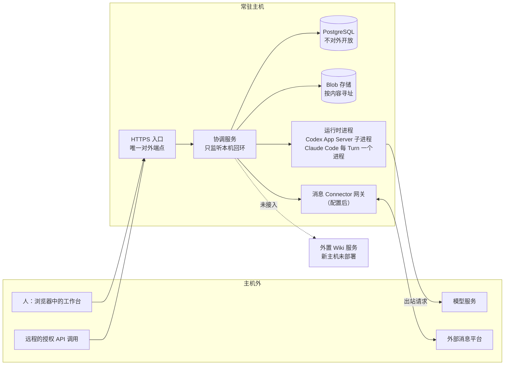

# 部署与迁移

2026-11-09 · 本页回答：evoLoop 实际跑在什么样的环境里；发布新版本时怎样保护数据；换一台主机时搬什么、不搬什么，以及搬完之后要重新做什么。依据是 DEC-041。

本页只写部署形态和迁移规则，不写域名、主机、端口、路径和私有配置，这些只留在私有部署记录里。新主机现在跑的版本、打开的配置和迁移后的验收进度，见[阶段路线的当前基线](../roadmap.md#当前基线)。

## 1. 部署形态

evoLoop 部署在**一台常驻主机**上，经**唯一一个 HTTPS 入口**访问（DEC-041）。



图里每一条边都是“谁能访问谁”。要点：

- **唯一入口。** 前端页面和已授权的 API 走同一个 HTTPS 站点。协调服务只监听本机回环地址，由 HTTPS 入口转发。
- **内部服务不开公共端口。** PostgreSQL、存储以及运行时与模型相关的控制端口都不对外开放。运行时进程是协调服务在本机启动的子进程，它们访问模型服务是出站请求，不需要对外监听。
- **身份沿用应用自己的。** 登录、项目范围和读写审阅权限仍由协调服务的身份配置判断，HTTPS 入口不另设一套业务权限。多人账户与按项目授权按 [issue #219](https://github.com/cyl19970726/evoLoop/issues/219) 另行决定。
- **单活写者。** 同一份数据只有一个活动的协调服务在写；协调服务用一条专用数据库连接持有 advisory lock，拿不到或连接丢失就停止写入。这条规则不因换主机而放松，见[技术选型](technology-selection.md#5-数据与部署边界)。
- **外置 Wiki 未部署。** OpenViking 在旧开发机上做过受限写读，没有部署到新主机；当前实例没有知识服务，知识相关入口按“未接入”处理。

## 2. 发布新版本

每个版本单独构建、单独存放，切换时只换“当前运行哪个版本”。数据库、Blob 存储和备份必须放在发布目录之外，这样切换版本不会搬动或覆盖数据。

一次发布按下面的顺序走，每一步失败就停下：

1. **先排空，再停写。** 持续工作的团队里实例永远等不到“整体空闲”，所以先用排空模式截住**新**工作：维护者运行 `node scripts/release-drain.mjs start --reason "<这次发布>"`（等价于 CLI `drain start --reason`）。排空期间不再启动新的 Run 和消息 Turn；新消息、新 Run 照常保存并排队，已经开始的工作正常做完；Leader 不用也不能被要求“暂停”，它的通知和派发只是记录、排队。脚本一直等到实例报告“已排空”（没有在途或结果未知的 Run 和消息 Turn）才返回；超时不会自动解除排空，由人决定继续等还是 `release` 取消。排空状态写在数据库里，期间重启服务也不会重新开工。已排空后停止当前协调服务，暂停其他写者。
   - **停服完成的判据是进程与锁真正释放。** 端口先释放，旧协调服务可能还在关闭子进程、仍持有数据库咨询锁，此时备份会被拒绝（“Coordinator is still writing”）。停服后运行 `node scripts/release-drain.mjs wait-stopped`，它查询 `pg_locks` 里协调服务的咨询锁，直到没有任何后端持有才返回；之后才备份。
   - 回退时重新加载原 LaunchAgent 可能因系统还没卸载完旧实例而失败（“Bootstrap failed: 5”）：重试并核对 `/health`，不要把一次失败当作已恢复。
   - 发布完成并核对健康后，用 `node scripts/release-drain.mjs release --reason "<完成>"` 解除排空：排队的消息和 Run 按原顺序继续。排空、解除和各自的操作者、时间、原因都留记录（`drain history`）。
2. **再备份。** 备份 PostgreSQL 与 Blob（启用了 Wiki 时再加 Wiki 外部快照），得到带逐文件哈希的清单。三者没有共同的原子快照，一致性靠停写保证。脚本与恢复要求见[停写备份与空目标恢复](../development/local-run.md#停写备份与空目标恢复)。
3. **迁移数据库。** 由单一步骤按编号顺序执行新增的 schema 迁移；已执行过的迁移不改。
4. **启动新版本并核对。** 先做只读检查，再恢复写入和运行时。

**可复用脚本。** 通用步骤在仓库的 `scripts/release/release.mjs`：准备（新建独立的版本目录）、构建、测试、预检、等空闲、停写、备份、迁移、原子切换、重指 CLI 包装、启动、发布后检查；回滚用同一入口的 `rollback`。主机、路径、服务名和身份文件只写在仓库外的私有配置（`EVOLOOP_RELEASE_CONFIG`，配置位于仓库内会被拒绝），其中“等空闲、停写、启动、发布后检查”必须由配置给出命令，配置还须写明预期的数据库，与实际连接的库不一致就拒绝发布。停写之前失败不改任何东西；停写之后失败会先停掉可能还在运行的新版本，再把旧版本切回、启动并检查，结果和“数据库可能已迁移”的提示写入发布记录，停服及其后的步骤标为已撤销，续跑只能从等空闲重新开始；计数在服务停止期间取。发布提交必须已在远端主分支上，记录里留有迁移、备份清单和提交核对。默认只打印计划；加 `--execute` 才执行，每步写入仓库外状态目录的记录，并给出停写到结束的耗时。任一步失败即停止，不继续后面的步骤。回滚只把**代码**切回上一个版本，不撤销已写入新 schema 的数据，数据恢复仍按下文的备份恢复办法。用法见 [本机运行](../development/local-run.md)。脚本不替发布负责人决定何时发布。

个别迁移在这几步之外还有要求，写在下面：

- **069（文档修订序号）。** 迁移给每条过程文档修订补序号，日志里看不到它的提示，所以在第 3 步之前先用只读查询看有没有修订不成一条链的文档：
  ```sql
  SELECT project_id, document_id, count(*) AS revisions,
    count(*) FILTER (WHERE previous_revision_id IS NULL) AS roots,
    count(DISTINCT previous_revision_id) AS parents
  FROM document_revision GROUP BY project_id, document_id
  HAVING count(*) FILTER (WHERE previous_revision_id IS NULL) <> 1
     OR count(DISTINCT previous_revision_id) <> count(*) - 1;
  ```
  - 查不出行：所有文档都沿修订链编号。
  - 查出的文档改按创建时间编号，在发布记录里列出；它们在下一次修订之前，当前修订的序号不一定等于总修订数（[合同](contracts.md#2a-documentstore-与-relationstore)）。
  - 迁移会重写 `document_revision` 的每一行。第 3 步完成后执行一次 `VACUUM (ANALYZE) document_revision;`，收回旧行版本并更新统计；普通 `VACUUM` 不阻塞读写，恢复写入之后再执行也可以。

旧版本保留，可以把**代码**切回去；但已经写入新 schema 或新版本产生的**数据**不能靠切回旧代码撤销。数据要回到过去，只能把备份恢复到一个新的空数据库和新的空 Blob 目录，并单独列出备份之后发生的操作。

## 3. 对象按内容寻址

Blob 存储按内容的 SHA-256 保存对象：同样的字节只存一份，读取时再算一次哈希核对；业务上使用的是稳定的 Blob ID，ID 到内容哈希的对应单独记录（`packages/adapter-local-blobs/src/index.ts`）。这带来三个好处：

- **发布不碰数据。** 换版本只换代码，对象不移动，也不会被覆盖。
- **迁移可核对。** 搬到新主机后逐个重算哈希，就能确认每个对象完整；对不上的对象不能被读成“完整正文”。
- **孤儿可清点。** 没有任何 ID 引用的内容哈希可以列出来，按保留策略处理。

过程文档较大的原件与资源包放在 Blob 里，PostgreSQL 只保存引用和哈希。存储层的约束见[存储](storage.md#原件权限删除和恢复)。

## 4. 迁移主机：搬什么，不搬什么

迁移只搬**业务历史**，不搬**运行现场**（DEC-041）。

| 搬 | 不搬 |
| --- | --- |
| Task 及其全部修订 | 旧 Session 与原生 Thread／会话 |
| 过程 Document 及其全部修订 | 访问令牌、授权与执行配置 |
| 固定的 Blob 原件 | 锁、队列与在途占用 |
| 交付链：Delivery（交付登记）、Observation（消费者的使用观察）、Closure（Task 关闭记录） | 运行日志与原始会话 |
| — | 旧 Role：目标主机按重新讨论的分工另建（见第 5 节） |
| — | 历史 Discussion（负责人讨论记录）不迁成活动对象，只以只读归档保留；不为它伪造 Session |

**迁移怎样做。** 迁移是按上表有选择地把业务历史导入目标主机，**不是**把整个数据库原样恢复过去。第 2 节的停写备份与空目标恢复，用于同一套数据的发布保护和事故恢复，会连同 Session、令牌、队列一起恢复，不能拿来当迁移。迁移前旧主机先停止写入；迁移后只有目标主机的协调服务写入，单活写者规则不变。

导入的 Task 不再指向旧 Role，负责职责标为待重新指定，由新主机上的 Leader 按新分工安排。上表没有列出的其他对象（例如 Run、普通消息与通知的历史、Schedule、外部绑定），DEC-041 没有逐项规定，以迁移 Task（`7db2326e`）的记录为准。

**为什么运行现场不搬。** Session、Thread、令牌、锁和队列都绑定在旧主机的原生进程、登录状态和本机目录上。把它们原样搬过去，新主机上就会出现“正在运行”“已占用”“已授权”的记录，却没有任何真实进程或凭据支撑；恢复门、队列和对账规则会把这些假状态当作真事实继续处理。业务历史则不依赖旧主机：Task、Document 和交付链有稳定 ID 和固定修订，Blob 有内容哈希，搬过去之后可以逐项核对。

**版本不同不是拒绝迁移的理由。** 目标主机按当时可用的 Codex 版本继续；版本不同本身不构成拒绝迁移的依据（DEC-041）。所选版本仍要按[Codex 接入](codex-integration.md#协议版本与可选能力)核对协议与指纹。

## 5. 迁移之后重新接入

业务历史到位后，先核对导入结果，再重新建立新主机上的“谁来做事”，而不是从旧主机继承：

0. **核对导入。** Blob 逐个重算内容哈希，Task、Document 修订和交付链按 ID 与修订对数；对不上的对象保持“不完整”，不当作完整正文使用。
1. **重新讨论分工。** 在目标主机上重新确定要哪些 Role、各自绑定哪种运行时（见[Session 运行时](session-runtime.md#6-一个-role-只绑定一种运行时)），并为导入的 Task 重新指定负责职责。
2. **重新 onboarding。** 新建受管 Session，重新签发令牌、执行授权和消息授权，重新配置运行时登录。
3. **先处理导入带来的通知。** 导入业务链会经过与正常写入相同的数据库触发器，可能为导入的历史结果生成新的待投递 Leader 通知；这些不是旧主机遗留的待办，打开 Leader 通知前要先核对并处置，做法见[运行接线手册](../development/runtime-operations.md#迁移之后先处理导入的通知)。
4. **逐项打开集成。** Leader 通知、即时输入、消息 Connector、普通 Task 的定时与每日复制等各自按私有配置显式打开，打开前先核对配置和身份。

## 6. 尚未决定的事

| 事项 | 现状 |
| --- | --- |
| 备份周期与保留期限 | 未定（DEC-041）。在定下之前，发布前的停写备份是唯一的固定备份点。 |
| 外置 Wiki 的去向 | 新主机未部署 OpenViking；是否部署、部署哪个版本另行决定。 |
| 多人账户与按项目授权 | 按 [issue #219](https://github.com/cyl19970726/evoLoop/issues/219) 另行决定。 |
| 对象存储 | 当前用本机目录；何时改用对象存储见[存储](storage.md#evoloop-何时接入对象存储)。 |

## 下一步读什么

- Session、Thread 为什么属于运行现场：[Session 运行时](session-runtime.md)
- 数据库表与原件的约束：[存储](storage.md)
- 部署相关的技术取舍：[技术选型](technology-selection.md#5-数据与部署边界)
- 备份与恢复的操作步骤：[本机运行](../development/local-run.md#停写备份与空目标恢复)
