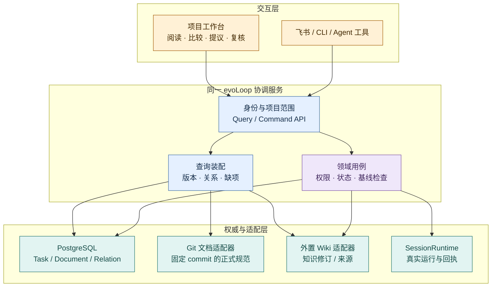
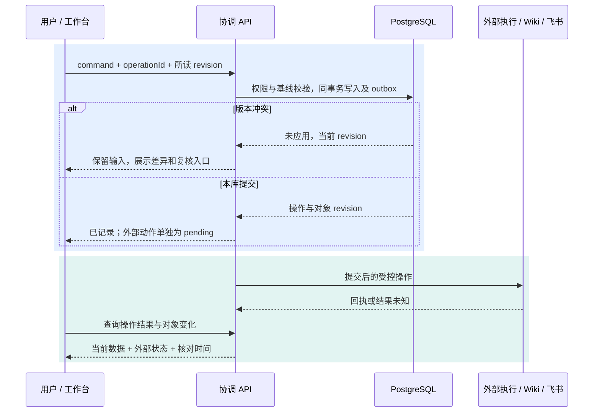

# 前端架构：项目工作台与共同 API

状态：2026-10-20 **设计提议，尚未实现**。用户要求补齐前端产品与架构，因此修订此前“先只用飞书、Codex 和静态站”的入口建议。页面和使用验收见[工作台产品设计](../product/workbench.md)，存储设计见[存储层](storage.md)，资料如何进入 Wiki 见[知识关联流程](knowledge-flow.md)。本文不表示已选定前端依赖或已上线业务界面。

## 1. 工作台的职责与部署位置

工作台让人看清当前目标、下一步选择、工作依据、分工和需要处理的例外，并经共同命令接口推进工作。它读取和组合各权威数据，不在浏览器中再维护一套任务状态机。飞书继续是移动协作入口，Codex 继续承载真实会话，公开文档站继续发布 Git 正式文档。

黄＝入口；蓝＝协议与读取；紫＝业务决定的约束；青＝数据和运行边界。图中箭头是调用关系，Wiki 写入仍走受控维护/发布流程；不是浏览器直接修改上游。

首期本机单活 coordinator 同源提供 `/app/` 静态构建与 `/api/v1/`，本地开发可用 Vite 代理到同一 API。公开文档域名和工作台认证空间分开：用户同意可发布文档公开，不意味着任务、会话和 Wiki 公开。手机访问真实工作台需要后续常在线主机、HTTPS 和登录部署；在此之前手机日常入口仍可用飞书。响应式原型通过不等于手机已经能够连接本机服务。

## 2. 推荐前端技术与取舍

| 责任 | 推荐 | 对本项目的理由及代价 |
| --- | --- | --- |
| 页面和组件 | React + TypeScript | 版本比较、关联详情和表格能组合成明确组件；与拟议 TS 合同衔接。版本与依赖在实现时锁定，本轮不安装 |
| 构建 | Vite，客户端 SPA | 拟议 coordinator 负责 API 和业务；公开内容另有静态站。无需为了内部工作台新增一个服务端渲染运行时，但需自行配置路由、缓存、错误页和部署 fallback |
| 路由 | React Router 的库模式 | URL 表示项目、对象、修订与过滤条件，刷新和深链可以恢复阅读位置；不同时建第二套请求缓存 |
| 服务数据 | TanStack Query | 按用户/项目/对象/修订组织查询；变更后失效相关缓存再回读。缓存是读取优化，不能裁定当前版本或批准状态 |
| 表格与编辑 | 首片原生语义表格、表单和 Markdown 编辑/预览 | 先做分页、筛选、差异与采纳；不为首片引入协同富文本/CRDT。大数据量确有证据时再选表格虚拟化工具 |
| 样式与组件 | 项目内 CSS tokens + 小型可访问组件 | 沿用文档配色但区分交互层级；先在 `apps/workbench` 内复用，不先造独立设计系统包 |

React 官方说明从构建工具开始的 SPA 需补齐路由和数据获取，并提示框架能减少后续集成工作。本项目选择 SPA 的理由是架构已规划独立协调 API、工作台需认证且不承担公开文档 SEO；这是项目取舍，并非官方默认推荐所有应用这样构建。[React 建议](https://react.dev/learn/build-a-react-app-from-scratch) · [Vite](https://vite.dev/guide/) · [Router 模式](https://reactrouter.com/start/modes) · [Query 缓存失效](https://tanstack.com/query/latest/docs/framework/react/guides/query-invalidation)

如果需要统一公网内容、服务端渲染或更复杂的全栈表单，重新比较 React Router framework/Next.js；如果团队已有成熟 Vue 工作台，则优先评估复用成本。目前没有证据需要同时维护两种前端。上述选型属于 PROP-009，不改变 PostgreSQL 已选、Wiki 候选仍需验证的状态。

Wiki 前端明确参考 nashsu/llm_wiki 的知识树、类型/来源筛选、完整阅读、双链、图谱和 Review 结构；单独的[知识工作区架构](wiki-workspace.md)说明固定源码、组件迁移与服务数据模型。知识浏览是独立入口，不能缩成认知讨论旁的一条 Wiki 链接。

### nashsu 的技术组合如何取舍

[逐文件核查](../research/nashsu-llm-wiki/frontend-reuse.md)记录 v0.6.12 的锁定版本。下面是 evoLoop 的实现建议，不能把上游锁文件当成本项目已经验证的依赖集。

| 能力 | evoLoop 推荐使用方式 | 与 nashsu 的差异和采用条件 |
| --- | --- | --- |
| React / TypeScript / Vite | 沿用相同技术方向，首个实现切片再锁兼容版本 | 移除 Tauri 专用开发/HMR/文件入口，构建普通同源 Web 工作台 |
| Markdown 阅读 | 优先评估 `react-markdown` + `remark-gfm`；公式按需要加 `remark-math` / `rehype-katex`；图块按需加载 Mermaid | 拆取只读展示布局，重写链接/图片解析为授权 API 和稳定 ID；原文 HTML 不启用，插件输出与危险 URL 另验 |
| 图关系展示 | 在真实子图规模需要时采用 Graphology + Sigma + ForceAtlas2 worker | 保留焦点、高亮和布局交互；输入由 API 限量提供，浏览器不扫描全库；小型首片可用文字关系/简单 SVG，图算法不证明关系成立 |
| 状态 | TanStack Query 管服务数据，URL/组件 state 管导航与临时交互 | 不移植 `useWikiStore`；只有跨组件临时交互确有负担才增 Zustand，它不再持凭据、文件树和模型队列 |
| UI 基元与样式 | 先保持项目 CSS tokens；需要复杂交互基元时单独评估 Base UI | 上游 Button/Panel 依赖 Tailwind/CVA/token，不整包拖入；要复制组件时连同样式依赖计算成本，不声称原样可用 |
| 知识编辑 | 首片 Markdown 候选表单、预览与版本差异 | Milkdown 可在富文本确有需求时引入；编辑只创建候选，不自动保存到现行知识页 |

`react-markdown` 提供自定义组件与 URL 转换，但自定义插件仍可破坏默认安全边界。采用时保持授权图片入口和受控链接解析；Mermaid 单独封装严格配置、错误状态和懒渲染，避免把上游 SVG 注入逻辑直接当作已安全。具体复用须按[移植验证约定](../development/standards.md#上游前端复用与工作台验证)执行。[Markdown 官方安全说明](https://github.com/remarkjs/react-markdown#security) · [Mermaid 配置](https://mermaid.js.org/config/usage.html)

## 3. 组件、路由与查询模型

`apps/workbench` 按页面领域组织：`project`、`inbox`、`tasks`、`documents`、`knowledge`、`roles`、`schedules`、`evaluations`、`operations`。共用组件包括对象引用、修订标签、差异阅读、依据列表、关系路径、状态标签和命令结果。仅浏览器可用的公开 schema 从 `contracts` 单独出口导入；浏览器不得引入 core、数据库驱动、平台 SDK、凭据或上游客户端。

| 页面路由示意 | 页面装配的读取模型 | 常见命令 |
| --- | --- | --- |
| `/app/p/:projectId` | 阶段目标、待判断事项、两个讨论入口、最近影响与数据新鲜度 | 创建讨论准备任务、记录反馈 |
| `/inbox` | 提议类型/来源、接受状态、证据、判断责任者、需补内容 | 提交 dogfood/需求、归并依据、接受/补证/暂缓/拒绝；不直接派发 |
| `/tasks/:taskId` | 当前 Task、执行基线、交付/验收、关系与投影状态 | 提议、接受、提交交付、复核基线；按权限开放 |
| `/documents/:documentId?revision=...` | 当前已采纳版、所选历史版、草稿、维护位置、使用者 | 保存新修订、提交审阅、采纳；Git 引用只提出变更任务 |
| `/knowledge`、`/knowledge/topics/:knowledgeId` | 按类型、专题和来源分组的知识卡片，主题说明、近期变化和待审入口 | 筛选、搜索、打开专题与知识页 |
| `/knowledge/:knowledgeId?revision=...` | 认识、适用条件、反例、来源、当前与任务使用版差异 | 提交纠正、请求维护；不直接接受其关联任务 |
| `/roles`、`/roles/:roleId` | 责任约定、承载会话、历史证据、试行与待回看 | 提出职责调整、记录试行评审 |
| `/schedules/:scheduleId` | 定义修订、时区、下次计划、错过/重叠策略、触发实例与 Task | 修改或暂停后续触发；停止在途工作须另发命令 |
| `/evaluations/:evaluationId` | 冻结协议/条件、输入与知识修订、case 产物、独立判据、成本与缺项 | 记录观察、提出复核或补证；不把模型评分直接改成已证明收益 |
| `/operations/:operationId` | 已接受的操作、业务提交、外部结果和下一核对 | 查看恢复进展；授权范围内请求对账 |

子路径均位于项目路由下。对象目录使用稳定 ID；标题变化或 Git 路径移动不改变应用链接。历史修订 URL 不跳到最新版，另给“比较当前版本”。列表查询返回有边界的游标页；不要首次加载全项目 Wiki 和所有 trace。搜索按任务、文档、知识分组，分别给来源、命中字段、版本和新鲜度，不把不同后端分数直接排名成统一正确率。

QueryService 返回 `observedAt`、对象及 revision、权限能力、分源状态和缺项。PG 部分在一致的只读事务内取得；Wiki/Git 是分别读取的固定版本，标明校验结果，不能声称跨系统原子快照。知识服务不可用时显示“依据暂不可核对”，任务本体仍可读；需要该依据的接受/派发由服务端规则阻止。后端只对已授权的对象装配标题、摘要、链接和关系，前端隐藏按钮不是授权。

所有列表/详情围绕同一稳定对象查询，列表不能保留已被详情推翻的旧状态。Review 按候选 revision 读取差异；决定已记录、正文已回读发布、索引已更新、消费者实际采用是独立字段。日程暂停只失效日程/后续计划查询，不把在途 Run 改为停止。评价读取模型保留每个 case 与条件、不比较不可比后端分数；具体记录见[评价合同](contracts.md#6a-evaluationrecord评价证据与条件)。前端复用代码和三端接入落点见[Wiki 集成方案](wiki-integration.md)。

## 4. 修改、刷新与失败如何呈现

蓝＝命令接受与本库变化；青＝外部副作用和读取恢复。认知发布、任务接受、文档采纳和派发使用确认后的服务端状态，不做乐观“已完成”。普通编辑可本地显示未保存草稿，但成功回包丢失时按同一 operationId 查询结果，保留原输入；不得产生新 ID 盲重发。`unknown` 的命令可显示“正在核对”，不能显示成失败后鼓励重复点击。

首片以前台有界轮询和操作后回读实现刷新：只有当前页面/未结束操作轮询，退到后台降低频率，失败退避并显示最后核对时间。后续确有需求再加 SSE 变化提示；提示只使缓存失效，重连仍回读当前对象，不以事件到达替代业务状态。浏览器关闭不停止服务端任务，也不丢恢复责任。

服务端数据不默认长期存入 localStorage/离线缓存。未提交草稿首片保留在当前页面内，离开前提示；登出或切身份清除查询缓存。新文档修订出现时不要替换正在编辑的草稿，显示基线过期与比较入口。

## 5. 会话与权限边界

“与认知 session 讨论”先准备带固定版本的上下文包，记录目标和要讨论的问题，再打开已有绑定会话或在运行时能力允许、授权覆盖的情况下创建/继续。已有 Desktop 会话只提供已验证的跳转/工具衔接；没有宿主能力时展示可复制的上下文引用和人工打开入口。前端不假装嵌入 Codex Desktop，也不通过剪贴板自动发送未获授权消息。

由会话提交的讨论结果仍是候选；采纳后经共同命令写入 Task/Document/Role 约定。会话正在运行、消息已投递、交付可核对、用户效果已验证分别展示，不能用流式回答结束代表任务完成。

首片 API 限本机，浏览器通过一次性启动凭据换取 HttpOnly 会话 cookie；启动凭据不留在长期 URL，写请求验证会话、Origin/CSRF 与项目权限。公网工作台须另行落实 HTTPS、登录和身份映射后开放，不把 localhost 假设扩展成远程部署保证。Git/Wiki/飞书凭据只留服务端。Markdown 预览禁用不可信原始 HTML/脚本和危险 URL；附件下载经授权定位并限定允许的内容类型。这些是待实现的边界。

## 6. 实现切片与验收

1. **可导航的读取切片：** 项目首页、Task 详情、原生/Git 文档版本、依据链、知识不可用的缺项状态。分页、深链、键盘和手机阅读真实可用。
2. **受控工作切片：** 提交 dogfood/需求、保存文档修订、审阅、变更基线；覆盖旧版本提交、重复点击、回包丢失、权限收紧与输入保留。所有入口复用 core。
3. **认识与分工切片：** 来源更新后的复核收件箱、认知讨论准备、真实运行回执、职责试行比较；先使用已有责任者，不为页面创建固定角色。

当前[可点击原型](../assets/workbench-prototype.html)只有示例状态，用来评审信息层级和路径，不证明 API、鉴权、同步或认知有效。正式验收须让用户从普通入口定位旧任务当时依据、看懂新纠正影响、完成有依据的复核，再由新 session 使用正确基线；自动检查和真人使用反馈分别报告。
