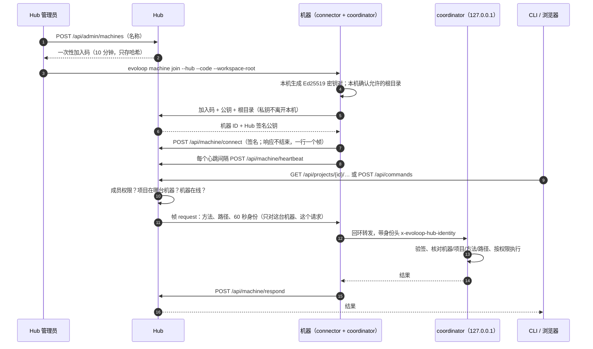

# Hub 账号、邀请与项目成员

状态：2026-11-14 实现 H1 PR2 的独立 Hub 骨架。它管理人类账号、邀请、登录会话、个人令牌、服务身份、项目元数据、项目成员与审计；**PR2 本身尚未接入机器，也不转发请求**；PR1（三类权限）已合入，PR3（机器加入、长连接与转发）见[第 12 节](#12-机器加入长连接与按项目转发h1-pr3task-93307c7a)（本 PR 合入后才算已合入），PR4（正式登录与项目列表）仍按 DEC-048 的顺序推进。决定依据见 [DEC-048](../decisions.md)（PR #428；在它合入前以该 PR 的正文为准）与 [issue #219](https://github.com/cyl19970726/evoLoop/issues/219)。

## 1. 为什么单独做 Hub

今天的 coordinator 身份来自静态令牌文件。多人使用时，需要先回答：谁是账号、谁邀请了谁、登录是否过期、智能体用哪个身份、某个成员能看哪些项目和 Session。Hub 先只承担这些账号与成员事实；项目内容仍归 coordinator 的 PostgreSQL。这样可以在不改变在途运行时的前提下，把“人是谁”和“智能体是谁”从项目数据中分开。

Hub 是一个独立进程，也是独立 PostgreSQL 数据库。它**不保存** Task、Document 正文、附件、Delivery、原生 Session、Thread 或工具输出。它只保存引用这些对象的元数据，例如项目 ID、成员权限和一个可限定的 Session ID 列表。

## 2. 进程、数据库与代码边界

| 项 | 当前做法 |
| --- | --- |
| 进程 | `apps/hub` 的 Fastify 服务；默认只监听 `127.0.0.1:4319`，由同站 HTTPS 入口反向代理 |
| 数据库 | `HUB_DATABASE_URL` 指向**独立** Hub 数据库；若同时设置 `EVOLOOP_DATABASE_URL`，两者相同会拒绝启动 |
| 迁移 | `apps/hub/migrations/NNN_name.sql`，从 `001` 开始，由 Hub 自己的 runner 记录到 `hub_schema_migrations`；不占用 coordinator 的迁移号 |
| 公共地址 | `HUB_PUBLIC_ORIGIN` 是唯一允许的写请求 Origin，例如 `https://hub.example`；不能带路径、凭据或查询串 |
| 与 coordinator | PR2 不连接、不代理、不共享数据库；机器加入、目录确认与请求转发见第 12 节（PR3）。Hub 项目的 ID 与机器上 coordinator 的项目 ID 相同，Hub 项目的 `machine_id` 指向已登记的机器 |

`apps/hub` 只依赖 Fastify 与 `pg`，不导入 `core`、`contracts` 或 coordinator。账号和成员规则因此不会反向污染业务核心，也不会让 Hub 成为第二个运行时协调者。

## 3. 数据模型与权威边界

| 表 | 保存的事实 | 不保存 |
| --- | --- | --- |
| `hub_account` | 人类账号、`actor_id`、邮箱、显示名、Argon2id 密码哈希、是否为 Hub 管理员 | 明文密码、项目内容 |
| `hub_invite` | 邮箱绑定的邀请、一次性 token 的 SHA-256、创建者与过期时间 | 邀请明文（响应只显示一次） |
| `hub_login_session` | 登录会话的 token 哈希、所属账号、到期与撤销时间 | 浏览器可读的会话内容 |
| `hub_personal_token` | 个人令牌名称、项目范围、token 哈希、撤销与最后使用时间 | 令牌明文 |
| `hub_service_identity` | 服务身份的 actor、显示名、人类所有者、用途、token 哈希与吊销 | 密码、网页登录会话 |
| `hub_service_identity_project` | 服务身份可进入的项目范围 | 项目内容 |
| `hub_project` | 项目 ID、名称、机器占位、创建者 | Task、文档正文、Session 记录 |
| `hub_project_member` | 账号 × 项目 × 任务/文档/Session 三类权限 × Session 列表 × 项目管理员 | 对象级读权限、项目正文 |
| `hub_project_actor` | 每个项目里 actor 的身份种类；`(project_id, actor_id)` 唯一 | 密码或令牌 |
| `hub_audit` | 账号、邀请、登录、令牌、服务身份、项目与成员的审计事件 | 密码、令牌、原始请求正文 |
| `hub_login_throttle` | 连续登录失败的计数、窗口与封禁截止 | 密码错误细节 |

**Session 列表的语义**：`session_ids=[]` 表示该成员在该项目中不额外限制 Session；非空数组表示只允许列出的 Session。这里只存 ID，不存原生 Session 记录。H1 不实现对象级读权限；如果以后确有“某份文档只给部分人看”的需要，再另加保密标记。

**同一 actor 的两种身份**：人类账号与服务身份都有稳定的 `actor_id`。把人类加入项目、或把服务身份限定到项目时，都会写入 `hub_project_actor`。主键使同一项目不能同时把同一 actor 记为人类和智能体；应用层在创建服务身份和添加成员时都先检查并返回 `ACTOR_IDENTITY_CONFLICT` 或 `ACTOR_ID_TAKEN`。当前实现还把 actor 的唯一性扩展到 Hub 全局，避免同一字符串在另一个项目里被静默当成另一个人。

## 4. 身份、登录与浏览器会话

### 4.1 第一位 Hub 管理员

第一位 Hub 管理员只能由服务器上的初始化命令创建：

```sh
HUB_DATABASE_URL=postgres://.../evoloop_hub \
HUB_PUBLIC_ORIGIN=https://hub.example \
npm run hub:init -- --email admin@example.test --name "Hub Admin" --password-file /private/hub-initial-password
```

命令会先应用 Hub 迁移，再在事务和 advisory lock 内确认没有其他 Hub 管理员。已有管理员时拒绝，不能用网页或普通 API 绕过。密码只从私有文件或 stdin 读取，不进入命令行参数、日志或数据库明文。

### 4.2 邀请注册

- Hub 管理员创建邀请，邮箱由邀请固定；响应只显示一次邀请链接。
- 注册在事务中锁定邀请，检查未使用、未过期、邮箱无账号，然后创建账号并标记邀请已使用。
- 重复使用同一邀请返回 `INVITE_USED`；过期返回 `INVITE_EXPIRED`；无效 token 不返回内部差异。
- 邀请 token 在库里只存 SHA-256。

### 4.3 密码与登录

- 密码用 Node 24 的 Argon2id（`m=32768,t=2,p=1`，16 字节随机 salt，32 字节 tag）哈希；库里只存 `$argon2id$...` 字符串。
- 每次登录创建新的随机会话 token；会话 token 的 SHA-256 存在 `hub_login_session`。数据库不存浏览器 token 明文。
- 连续失败按邮箱计数，默认 5 次、15 分钟窗口、封禁 15 分钟；失败响应不区分“账号不存在”和“密码错误”。成功登录清除计数。
- 修改密码要求当前密码和浏览器会话；保留当前会话，撤销该账号的其他登录会话。
- 登出撤销当前会话。

### 4.4 Cookie、Origin 与 CSRF

登录和注册成功后设置：

```text
__Host-hub_session=<opaque-token>; Path=/; HttpOnly; Secure; SameSite=Strict; Max-Age=43200
```

- `HttpOnly` 使脚本读不到登录 cookie；`__Host-` 前缀要求 Secure、Path=/ 且无 Domain。
- 所有没有 Bearer token 的写请求（POST/PUT/PATCH/DELETE）必须带与 `HUB_PUBLIC_ORIGIN` 完全相同的 `Origin`。缺失或跨站都返回 403。
- 浏览器 cookie 的写请求还要带 `X-Hub-CSRF`（API）或表单里的 `csrf`（最小页面）。CSRF token 从会话 token 派生，不额外存明文，也不放在可被脚本读取的 cookie 里。
- Bearer token 写请求不依赖 Origin/CSRF，因为它们不携带浏览器环境凭据；这使未来的 coordinator 到 Hub 的机器请求不必伪造浏览器 Origin。

## 5. 个人令牌与服务身份

### 5.1 个人令牌

- 人类账号可以创建不限定项目或限定一个项目的个人令牌；限定项目时必须是该项目成员。
- 创建响应只显示一次 token；库里只存 SHA-256、名称、项目范围、创建/最后使用/撤销时间。
- 请求携带 `Authorization: Bearer <token>`。撤销后下一次请求即返回 401；限定项目的令牌访问其他项目返回 403。项目范围令牌不能使用 Hub 全局管理接口，读取审计时也只能读到该项目的记录。
- 个人令牌不能替代浏览器会话执行改密码或登出。
- 个人令牌的创建、列出与撤销只接受浏览器 cookie 会话；Bearer 令牌不能管理自己或其他令牌，也不能借此扩大项目范围。

### 5.2 服务身份

- 只有 Hub 管理员能创建；必须填写人类所有者、显示名、用途和一个或多个项目范围。
- 服务身份没有密码、邮箱登录或网页会话；只能以 Bearer token 认证。响应不设置 cookie。
- 吊销只影响该服务身份；它的项目范围记录保留用于审计。
- 服务身份只能读取自己的项目元数据与 Session 身份视图；不能读取成员管理、项目审计或项目内容。PR3 才会用它做受控转发。

## 6. 两层管理与成员权限

| 身份 | 可以做什么 | 不能做什么 |
| --- | --- | --- |
| Hub 管理员 | 建项目、指定第一位项目管理员、邀请账号、管理项目元数据、创建/吊销服务身份、读取全局审计 | 因 Hub 管理员身份自动获得项目成员权限；读取项目成员或项目内容（除非另行被加入项目） |
| 项目管理员 | 管理本项目成员、三类权限、Session 列表、项目管理员集合 | 管理其他项目、创建服务身份、改 Hub 全局账号或审计范围 |
| 项目成员 | 读取自己所属项目元数据；持有被授予的三类权限和 Session 列表 | 管理成员；读取不属于自己的项目 |

项目必须始终保留至少一位项目管理员。修改或移除最后一位项目管理员会在事务中返回 `LAST_PROJECT_ADMIN`。第一位项目管理员由 Hub 管理员创建项目时指定；Hub 管理员自己的账号不会被自动加入该项目。

## 7. 最小 API 合同

以下路径是 PR2 的稳定骨架。JSON 请求使用 `application/json`；响应错误统一为 `{ "error": { "code", "message", "details" } }`。除登录、注册和健康检查外，都需要浏览器 cookie 或 Bearer token。

| 方法与路径 | 作用 | 认证 |
| --- | --- | --- |
| `GET /api/health` | 进程健康 | 公开 |
| `POST /api/auth/register` | 用邀请 token 注册并建立会话 | Origin |
| `POST /api/auth/login` | 邮箱密码登录并建立会话 | Origin |
| `GET /api/session` | 当前 principal、项目范围与 CSRF token | cookie 或 Bearer |
| `POST /api/auth/logout` | 撤销当前浏览器会话 | cookie + CSRF |
| `POST /api/account/password` | 改密码并撤销其他会话 | cookie + CSRF |
| `GET /api/projects` | 我的项目元数据（服务身份返回其项目范围） | cookie 或 Bearer |
| `GET /api/projects/:projectId` | 项目元数据 + 我的成员权限 | cookie 或 Bearer |
| `GET /api/projects/:projectId/members` | 成员与权限 | 项目管理员 |
| `POST /api/projects/:projectId/members` | 加成员、三类权限、Session 列表 | 项目管理员 |
| `PATCH /api/projects/:projectId/members/:accountId` | 改成员权限/管理员标记 | 项目管理员 |
| `DELETE /api/projects/:projectId/members/:accountId` | 移除成员，拒绝移除最后管理员 | 项目管理员 |
| `GET /api/tokens` | 列出个人令牌 | 浏览器 cookie 会话 |
| `POST /api/tokens` / `DELETE /api/tokens/:tokenId` | 创建/撤销个人令牌 | 浏览器 cookie 会话 + CSRF |
| `GET /api/audit?projectId=&limit=` | 审计查询 | Hub 管理员；项目管理员仅限自己的项目 |
| `GET /api/admin/accounts` | 人类账号列表（无密码哈希） | Hub 管理员 |
| `POST /api/admin/invites` | 创建一次性邀请 | Hub 管理员 |
| `GET /api/admin/projects` / `POST /api/admin/projects` | 项目元数据与建项目 | Hub 管理员 |
| `PATCH /api/admin/projects/:projectId` | 改项目名称/机器占位 | Hub 管理员 |
| `GET /api/admin/service-identities` / `POST /api/admin/service-identities` | 服务身份列表/创建 | Hub 管理员 |
| `DELETE /api/admin/service-identities/:id` | 单独吊销服务身份 | Hub 管理员 |

示例（省略真实值）：

```json
{
  "email": "member@example.test",
  "permissions": { "task": true, "document": false, "session": true },
  "sessionIds": ["session-id-1"],
  "isProjectAdmin": false
}
```

项目创建的第一个管理员使用同样的权限结构；省略 `permissions` 时默认三类全开。`sessionIds` 留空表示不额外限定 Session。

## 8. 最小页面

`/login`、`/register?invite=...`、`/app`、`/admin` 与 `/projects/:projectId` 只提供无 JavaScript 的最小管理表单：登录、注册、创建/撤销个人令牌、邀请账号、建项目、创建服务身份和调整项目成员。正式登录页、完整导航和项目列表属于 PR4；这些页面不作为产品体验验收。

## 9. 审计与日志

- 审计记录账号注册、邀请创建、登录成功/失败、登出、改密码、令牌创建/撤销、服务身份创建/吊销、项目创建/更新、成员新增/更新/移除。
- 审计 `detail` 只放对象 ID、范围、权限和原因，不放密码、token、cookie、请求正文或私密路径。
- Fastify 请求日志只记录不含查询串的请求路径，不记录 JSON 请求体；启动日志只打印监听地址与公共 Origin，不打印数据库 URL。
- 错误响应不返回 SQL 语句、数据库 URL 或 token。

## 10. 备份与恢复

Hub 数据库是独立数据库；备份也必须独立。下面的演练在**一次性测试实例**上做，不能使用正式 coordinator 的端口 `55432`，也不能在项目库上执行。

```sh
# 1. 备份（Hub 服务停写或停止后）
pg_dump --format=custom --file=/private/hub.dump "$HUB_DATABASE_URL"

# 2. 在空的新库里恢复
createdb "$HUB_RESTORE_DATABASE_URL"
pg_restore --dbname="$HUB_RESTORE_DATABASE_URL" --clean --if-exists --no-owner /private/hub.dump

# 3. 起服务指向恢复库，确认 hub_account 数量、审计水位与登录
HUB_DATABASE_URL="$HUB_RESTORE_DATABASE_URL" HUB_PUBLIC_ORIGIN=... npm run start:hub
```

恢复后必须用至少一个恢复的人类账号实际登录一次；只检查表存在不算恢复演练通过。备份包含密码哈希、令牌哈希与审计数据，按密钥材料保护；不要把 dump、数据库 URL 或恢复后的会话带进公开仓库。

当前没有自动备份调度、跨主机复制或密钥轮换；H1 只验证手工备份/恢复路径。正式主机上的备份周期和保留期仍属于需求 Session 的发布决定。

## 11. 验证与未验证范围

已实现并有自动测试覆盖：

- 邀请一次性/过期/重复注册；未登录读防护。
- Argon2id 密码哈希；HttpOnly + Secure + SameSite cookie；缺 Origin/跨站写拒绝；连续失败限流；登出与改密后旧会话失效。
- 个人令牌只显示一次、库中只有哈希、项目范围隔离、撤销后立即拒绝。
- 服务身份仅 Hub 管理员创建、有所有者/用途/范围、无密码登录、不能拿 cookie、actor 冲突拒绝、单独吊销。
- Hub 管理员不自动获得项目成员权限；项目管理员加人/改权限/限定 Session；非管理员改成员被拒；最后一位项目管理员不可移除。
- 我的项目只返回所属项目元数据；审计不含密码或 token 明文。

未验证或未实现：

- PR2 本身没有连接机器、目录确认或请求转发；PR3 的实现与它自己的验证范围见第 12 节。
- 没有正式主机部署、自动备份、密钥轮换、邮件发送、密码找回或两步验证（H2）。
- 没有在真实多人、真实浏览器 HTTPS 入口或真实机器上做使用验收；候选阶段只证明自建 Hub 与真实 PostgreSQL 的账户路径。
- 外部 Wiki、Task、Document 与 Session 原生记录仍不在 Hub 数据库内；PR3 之后也不能把 Hub 当成内容库。

## 12. 机器加入、长连接与按项目转发（H1 PR3，Task 93307c7a）

状态：代码与自动测试已写，**本 PR 合入后才算已合入**；没有在真实机器、真实 HTTPS 入口或正式实例上使用过，候选验收另记。本节说明一台机器怎样主动连上 Hub，浏览器和 CLI 怎样经 Hub 读写机器上的项目，以及这条路径上每一步为什么不能被借用。本节只管 H1 的一台机器；多台机器共载一个项目、网页上建项目和选机器（H2）、跨项目汇总（H3）、正式部署都不在内。



### 12.1 机器命令与保存的凭据

| 命令 | 做什么 |
| --- | --- |
| `evoloop machine join --hub URL --code CODE --workspace-root DIR[,DIR] [--yes]` | 用一次性加入码加入。本机生成密钥对，只上传公钥与允许的根目录；保存机器 ID、Hub 公钥（可有多把）与根目录。根目录必须是真实存在的绝对目录、不能是文件系统根；每个根在加入时**在这台机器上确认一次**（终端里回答 y，非交互必须加 `--yes`，没有确认就什么也不写）。`--hub` 必须是 https（只有指向本机回环的 Hub 可用 http）且不带路径、凭据或片段 |
| `evoloop machine status` | 只写公开事实：机器 ID、名称、Hub 地址、根目录、加入时间；再用机器自己的签名问 Hub 当前状态与是否在线。永不打印私钥；Hub 不可达只写 `hubReachable:false` |
| `evoloop machine leave [--local-only]` | 先用签名通知 Hub 移除，再删除本机凭据。Hub 不可达时什么也不删，除非 `--local-only`（那时 Hub 管理员必须另行移除机器）。**不碰项目数据库、项目数据和 coordinator** |

凭据只有一个文件：`$EVOLOOP_MACHINE_DIR/machine.json`（`machine join` 在没指定目录时写到 `~/.evoloop/machine/`），目录 0700、文件 0600，不在任何仓库里。**coordinator 只读 `EVOLOOP_MACHINE_DIR` 指的目录，没有默认**：没设这个变量的 coordinator（测试、隔离或本地实例）不读默认位置的凭据，也不连 Hub，启动时若默认位置有凭据会写一行说明；这台机器自己的那个 coordinator 必须带 `EVOLOOP_MACHINE_DIR` 启动（Task b8460d62，原因见下一节）。这些命令不需要 coordinator 令牌，也不经过 `EVOLOOP_API_URL`。coordinator 每次用到凭据都先看文件（只在变化时重读），所以 `machine leave` 对下一次请求就生效：没有凭据就不接受任何 Hub 身份，连接器也停下。

Hub 侧（迁移 `002_machines.sql`，Hub 自己的迁移号）：`hub_machine`（机器、公钥、状态 `pending|active|removed`、根目录、最后在线）、`hub_machine_join_code`（只存 SHA-256、10 分钟、一次）、`hub_signing_key`（签发身份的 Ed25519 密钥，`kid` 为日后换钥留位），以及 `hub_service_identity_project` 新增的每项目权限列。移除机器会立即把该机器标为 `removed`、删掉未用的加入码、关闭它的连接，并把放在它上面的项目的机器占位清空（项目记录和机器上的数据都保留）。

### 12.2 连接器与在线状态

连接器在 coordinator 进程里，**只向外连，不监听任何端口**。它向 Hub 发一个带签名的 `POST /api/machine/connect`，Hub 的响应一直不结束：每行一个 JSON 帧（`hello`、`ping`、`request`、`bye`）。这样不需要新依赖，也能穿过普通反向代理；它不是 WebSocket。Hub 的请求从这条连接发出，机器的结果用单独的签名 `POST /api/machine/respond` 送回。机器每个心跳间隔（默认 15 秒）发 `POST /api/machine/heartbeat`；三个间隔没有心跳，Hub 认为机器离线并关闭这条连接。连接器侧三个间隔没有收到任何帧就自己断开重连。断线按 1 秒起、最长 30 秒指数退避重连；Hub 说机器已被移除（`MACHINE_REMOVED`）就不再重连，直到凭据文件变成另一台机器。

**一台机器同一时间只有一个存活连接，第二个进程得到明确冲突。** 两个进程共用一份机器凭据时（例如隔离实例读到了正式机器的默认凭据），旧实现里每次新连接都静默替换旧连接：两边每隔约一秒互相踢掉对方再重连，机器端的 connect 与 heartbeat 从每分钟个位数升到约 50 次，转发请求一半落在没有这个项目的那个进程上，得到 401“转发身份未被接受”或 502。2026-11-17 正式 Hub 验收里见到的就是这个（Task 48417d4f 观察 3c6ba3b3；自建 Hub 加两个真实 coordinator 复现：connect 由 0 升到每分钟约 570 次，24 次转发读 12 次 200、12 次 401）。现在：连接器每个进程自生成一个随机 `instance` ID（不是凭据）随每个机器请求发送（`x-evoloop-machine-instance`）。Hub 对同一机器：同一 instance 重连，立即替换它自己的旧链路；另一个 instance 在现有连接仍存活（三个心跳间隔内有心跳）时被拒，返回 `409 MACHINE_CONNECTION_CONFLICT`，现有连接不动；现有连接静默超过三个心跳间隔后，另一个 instance 可以接管（记为“替换了已静默的旧连接”），所以不会永久锁死；没有发 instance 的旧版连接器视为另一个进程。心跳与答复只对自己 instance 的连接有效，被拒进程的心跳不会让对方“续命”。被拒的 coordinator 写一行可读的话（机器 ID、不要共用 `EVOLOOP_MACHINE_DIR`），以最长退避重试，对方退出后自己接上；老 Hub 反复替换同一连接时，连接器在一分钟内第 3 次被替换会写出同样的提示。冲突与替换的记录：Hub 日志里的 `machine connection REFUSED …`、`replaced: the previous connection had gone quiet`（只有机器 ID、连接 ID 与 instance 前 8 位，没有密钥、令牌或签名），管理员接口 `GET /api/admin/machines` 每台机器的 `connectionConflicts`（自 Hub 启动起被拒次数与最近时间，只在内存里），以及 coordinator 的日志。已知取舍：连接异常断开而 Hub 还没发现时，从另一个进程重启的 coordinator 最多要等三个心跳间隔（默认 45 秒）加一次退避才能接上。

机器每个请求都带签名：机器 ID、动作、毫秒时间、一次性 nonce 和请求体 SHA-256，用机器私钥签；Hub 用加入时上传的公钥验，时间窗 ±60 秒，nonce 只用一次。未加入、已移除、签名不对、时间过期、重放，各自拒绝，已移除的机器哪怕签名正确也立即被拒。Hub 的连接表在内存里：Hub 重启后没有连接，机器会自己重连；Hub 只部署一个进程。

### 12.3 转发

Hub 只转发两类请求：`/api/projects/{projectId}/…`（除成员管理 `members`，那是 Hub 自己的）和 `POST /api/commands`（按请求体里的 `projectId` 路由）。`/api/session` 由 Hub 自己回答，并带上该调用者经 Hub 能到达的 `projectIds`（CLI 绑定意图用的就是这个字段）。其它 coordinator 路径（`/api/instance/…`、`/api/orchestration/commands` 等）不转发。

每个转发请求，Hub 依次：认证（个人令牌、服务身份令牌或浏览器会话，会话的写请求仍要同源与 CSRF）→ 按项目成员权限算出该请求的权限（Hub 管理员不因此自动是项目成员）→ 找到项目所在的**已登记且在线**的机器（没有登记 409，离线 503，超时 504，机器中途断开 502，答复超过上限 502）→ 签发身份 → 经连接发出 → 把状态码和 `content-type` 与正文原样返回。路径只能由普通段组成：空段、`.`、`..`（含百分号编码）、编码的斜杠与反斜杠、空白、控制字符、`#` 一律 400。只转发 JSON 正文（请求体上限默认 128 KB，与 coordinator 的限制一致）；流式接口（如事件流）不经 Hub 转发。非 GET 的转发写入 Hub 审计（方法、不含查询的路径、机器、状态码，不含正文）。

连接器在机器这一端再检查一次：方法必须是 GET/POST/PUT/PATCH/DELETE，路径必须是上面两类且段规则相同，请求只会发往本 coordinator 的回环地址（再核对 origin），所以即使 Hub 被攻破，也不能借转发打到这台机器上的任意端口或路径。

### 12.4 签名身份与 coordinator 验签

身份是 `v1.<载荷>.<签名>`，Ed25519 签名，载荷含：`kid`、`aud`（目标机器 ID）、`jti`、`iat`/`exp`（有效期不超过 60 秒）、`sub`（原始请求者：账号或服务身份的 `actorId`、种类、认证方式）、`projectId`、三类权限与项目管理权限、决定类权限、可操作的 Session 列表（空表示项目内不额外限定）、请求方法，以及请求路径与查询的 SHA-256。身份随请求一起作废：一个身份只能用于它签发的那一个请求，不能换方法、路径、项目，也不能在别的机器上用。

coordinator 收到带 `x-evoloop-hub-identity` 头的请求时，**只**按身份处理（同时带 `Authorization` 视为含糊，拒绝），逐项核对：机器已加入且有凭据、`kid` 对应保存的 Hub 公钥、签名、`aud` 是本机、未过期且未来自未来、有效期合法、方法与路径摘要一致、路径里的项目与身份一致、路径是转发允许的类别、`sub.actorId` 不是本机令牌文件里的任何身份（不让 Hub 账号冒用本机智能体的名字）、项目确实在本机数据库里、`jti` 未用过。全部通过后得到一个 PR1 的 `Principal`：`projectIds` 只含该项目，权限即身份里的三类与管理，人类身份带决定权，服务身份只在明确授予时带；`sessionIds` 限定 Session。之后与本机令牌走同一套权限检查与审计，操作记录里的 `actor` 是**原始请求者**，不是机器或连接器。任何一项不通过都只回 401“转发身份未被接受”，原因只写进机器自己的日志。

服务身份的权限：服务身份没有账号成员行，所以创建时（`POST /api/admin/service-identities`）可以带 `permissions`（`task`/`document`/`session`）、`sessionIds` 与 `decisions`，按项目范围下发；不带就是只读，决定类只在明确 `decisions:true` 时才有（DEC-048）。

### 12.5 机器上的 Agent 团队与目录

机器上的 Agent 团队继续用本机令牌文件里的身份，走 `127.0.0.1`，**不经过 Hub**：coordinator 的执行、Run、队列、泵都不读 Hub，Hub 停止、断网或机器被移除时它们照常运行，只是暂时不能远程查看。机器加入后 coordinator 的监听地址不变（仍只听 `127.0.0.1`），没有新增任何监听端口。

目录：机器加入时确认的根目录（真实路径）是这台机器给 Hub 设的上限。coordinator 加载本机配置时，每一处目录绑定——运行授权的 `cwd`、委派模板的 `cwd`、仓库 `root`——都必须按真实路径（先解析符号链接）落在某个允许根里，按路径段比较（`/work-evil` 不在 `/work` 内），否则整份配置被拒绝；每次启动与恢复的 `allowedRuntimeCwd`、`getDelegationTemplate` 还会再问一次。原有的“真实路径等于配置路径”与“精确工作目录”规则没有放松，只是多了一层。没有加入 Hub 的机器没有根目录，行为与以前完全相同。

### 12.6 本 PR 的已知限制

- **本机“当前写入者”检查不认 Hub 账号。** 个别路径（如 Session 消息发送者授权）按本机令牌文件里的身份查当前写入者；Hub 账号不在那份文件里，这些路径对它们会按“未配置”处理而被拒。已验证的是 HTTP 路由上的三类权限与 Session 限定；没有扩展这些检查，也没有改方向，待需求 Session 决定。
- 没有流式转发（事件流）、没有多台机器共载、没有网页建项目选机器、没有工作台登录页（PR4）、没有正式部署；Hub 连接表是内存的，只支持单个 Hub 进程。
- 签名密钥存在 Hub 库里（备份按密钥材料保护），支持多把公钥并存，但没有轮换流程。
- 没有在真实机器、真实 HTTPS 入口或使用者手里验证；候选阶段只证明自建 Hub 与真实 PostgreSQL。

## 13. 工作台经 Hub 登录（H1 PR4，Task 9ea06625）

状态：代码与自动测试已写，**本 PR 合入后才算已合入**；没有在真实 HTTPS 入口、真实机器或使用者手里验证，正式阶段（Hub 正式部署后使用者本人登录一次）另记。

- **Hub 托管工作台。** `HUB_WEB_ROOT`（默认是检出里的 `apps/workbench/dist`，没有 `index.html` 就不托管）里的文件由 Hub 在 `/`、`/ui`、`/p/…`、`/assets/…`、`/favicon.svg`、`/theme-init.js` 提供，`index.html` 里加一条 `<meta name="evoloop-auth" content="hub">`，页面据此用 Hub 登录。工作台页面用与 coordinator 相同的内容安全策略；Hub 自己的页面（`/login`、`/app`、`/admin`……）仍是严格策略，也还在，作回退与管理用。一个旧版本的页面块文件已不在服务器上时，脚本得到一个“工作台已经更新，请刷新页面”的模块（登录仍然有效，不需要重新填写令牌），别的文件 404；文件名只允许普通字符，没有路径穿越。
- **登录。** 登录页是邮箱与密码，走 `POST /api/auth/login`（同源 `Origin`），Hub 设 HttpOnly + Secure + SameSite=Strict 的 cookie，页面读不到；CSRF 令牌放在页面内存里，写请求带 `X-Hub-CSRF`。令牌、密码、cookie 都不进 URL、localStorage 或 sessionStorage。会话 12 小时（`HUB_SESSION_TTL_SECONDS`）；刷新页面不需要重新登录；登出结束 Hub 上的会话；过期或 401 回到登录页并写“登录已失效”。本地令牌模式（没有 meta 标签的页面）原样保留。
- **会话与项目列表。** `GET /api/session` 除原有字段外还带 `permissions`、`projectPermissions`、`identityKind`、`capabilities`（工作台的 session 形状）；`GET /api/projects` 与 `GET /api/projects/{id}` 带 `machine`（`{machineId,name,state,online}`，没有登记机器时为 `null`）。人只看到自己是成员的项目，Hub 管理员不因此看到任何项目；别人的项目 403。
- **离线。** 项目所在的机器没有连上时，项目仍然列出，写“机器 名称 · 离线 · 暂不可读写（不代表运行失败）”，转发请求得到 `503 MACHINE_OFFLINE`；这是对连接的描述，**不改写任何 Run 或交付的状态**（机器上的运行不依赖 Hub）。机器被移除后项目不再指向它。
- **查看规则（DEC-048 第 1 项）。** 项目成员能看项目里的任务、文档，以及 Session 的存在、状态、摘要和一般对话；完整原生记录与工具输入输出需要对这个 Session 的 Session 权限（`session` 类别，且成员的 Session 列表不限定到别的 Session）。这条规则在 coordinator 一侧，用 PR3 的签名身份里带来的权限与 Session 列表判断（`session-timeline` 对 `originalToolDetail` 与完整原生记录的检查）；没有 Session 权限时页面写“完整原生记录需要此 Session 的 Session 权限”。
- **Hub 账号发送消息要显式授权。** 本机“当前写入者”检查只认本机令牌文件里的身份。经 Hub 来的 Hub 账号要给 Session 发消息，需要私有配置 `sessionMessages.grants` 里有一项把 `senderActorId` 写成这个 Hub 账号的 actor ID 并带 `"senderKind":"hub"`（其余字段与本机授权相同：Session、接收方身份、职责、目录）；没有这一项仍然被拒，并提示要加什么。这只放宽**发送者**的“当前写入者”检查，不把 Hub 账号当成任何本机身份，接收方与别处的写入者检查不变；请求本身仍要带 Session 权限的签名身份。**这一项只对经 Hub 签名身份进来的请求生效：** `HubIdentityVerifier` 验过签名后给 principal 标 `origin: "hub"`（本机令牌文件的身份没有这个字段，也写不出来），发送者检查按这个来源分两条路——本机来源只走本机写入者检查，同名的 hub 授权对它没有任何作用；Hub 来源只看 hub 授权，不看令牌文件。来源不由 actor ID 的写法推断（Task e1f2b996）。
- **签名身份重启后仍只能用一次。** PR3 的单次使用记录在内存里。现在 coordinator 拒绝**早于它启动时间签发**的身份：重启前抓到的、用过的或没用过的身份，重启后都不能再用；代价是重启瞬间在途的请求会失败一次，重试时重新签发。Hub 与机器的时钟若相差数秒，重启后头几秒签发的身份也会被拒一次。
- **服务身份**按项目授权、默认只读，不变（需求 Session 已确认）。
- **深链。** 交付里记的工作台链接若写着页面当前打开的地址（Hub 的地址），在同一标签里打开；别的主机与相似的主机仍是外部链接（`shared/api.ts` 的 `ownWorkbenchAddress`）。

**没有做的 / 没有验证的**：Hub 正式部署与使用者本人登录；流式接口（事件流）不经 Hub；密码找回与两步验证；多机共载；真实受管 Session 在 Hub 断线时继续跑；Hub 账号消息授权只做了单元层验证，没有经真实 Session 发出一条。
