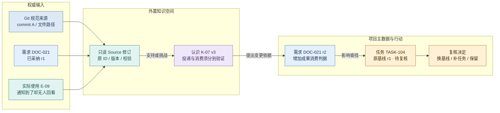
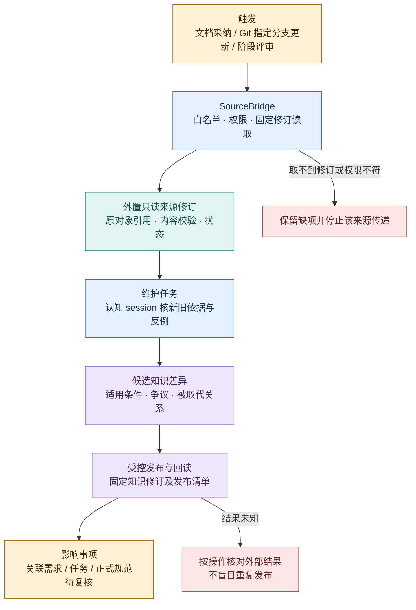

# 知识关联：Task、Document、Git 文档怎样进入认知循环

状态：**目标流程与受限本机实现并存**。过程文档候选、审阅发布、来源撤回和固定引用读取已有实现；本轮补上原生摄入/检索调用及结构 lint，尚未以真实后端验证新增语义处理与检索效果。完整自动 SourceBridge 和跨对象影响闭环仍是目标。实际运行证据见[阶段路线](../roadmap.md#当前基线)。本文将 [项目数据边界](project-data.md)落实为资料登记、维护、读取和影响复核流程；[存储设计](storage.md)说明持久结构，[工作台](../product/workbench.md)说明用户怎样操作。示例 ID 是设计说明。

本页从任务消费者出发，沿“读依据 → 传递新材料 → 维护与发布 → 影响复核”走一圈；对象归属先见[项目数据](project-data.md)，知识内部怎样综合见[Wiki 维护](wiki-maintenance.md)。

### 当前怎样使用 ingest、query 和 lint

Agent 经业务 skill＋CLI 使用下面的受控路径。当前仍由现有 Agent 综合材料和旧知识、提出候选，由有权维护者审阅发布；没有另启一个可直写正式知识的 Bot 编译者。OpenViking 原生资源处理不等于已经形成可采纳的 Wiki 认识。

原生协议固定核对 OpenViking 0.5.1 的[资源摄入](https://github.com/volcengine/OpenViking/blob/e855796c83f9eb575d9b0f3082926660730f6a63/openviking/server/routers/resources.py)、[任务状态](https://github.com/volcengine/OpenViking/blob/e855796c83f9eb575d9b0f3082926660730f6a63/openviking/server/routers/tasks.py)和[检索](https://github.com/volcengine/OpenViking/blob/e855796c83f9eb575d9b0f3082926660730f6a63/openviking/server/routers/search.py)入口；源码核对与下面实际测试范围分别记录。

| 工作 | 当前实现与作用 | 必须保留的边界 |
| --- | --- | --- |
| 摄入固定材料 | `knowledge.ingest` 只接受本项目已采纳、完整核验的内联 Markdown Document 修订；上传原字节，调用 OpenViking 0.5.1 的临时上传及资源摄入接口，跟踪原生 task ID。 | 不接受任意 URL、服务端文件路径或未经核验正文；原件、派生处理结果与 Wiki 候选分别保存。submitted/completed 不证明检索质量或知识正确。 |
| 发现相关材料或认识 | `knowledge-query` 使用原生语义 find，只检索本项目已登记且处理完成的来源，或已发布的当前知识修订；命中重新校验来源、权限与有效性，返回固定 ID/修订/hash。 | 当前最多选择 100 个有权目标；返回有界结果，索引效果仍标 unverified。空结果不证明不存在；不能用标题、分数或摘要代替固定全文，也不会自动修改 Task 依据。 |
| 检查候选或旧知识 | `candidate-lint` / `knowledge-lint` 调用 core 的只读结构检查：来源缺失/重复/变化/撤回、固定关系不可达及待复核状态。 | 返回 semantic:not_run。OpenViking 0.5.1 未提供此处可用的原生 lint HTTP 接口；矛盾、限定条件、遗漏与概念整合仍需现有 Agent 阅读原件后作语义审查，发现不自动发布修订。 |

摄入意图、原生 task ID 和处理观察与 Wiki 发布状态一样保存在仓库外 manifest；正文/派生资源在外置 OpenViking。先持久记录意图再调用上游，回包丢失后按原操作查询；若连 task ID 都未收到，保持 unknown 并人工核对，不换 ID 重建同一来源，也不自动再次调用原生摄入。原生 task 明确 failed/cancelled 时保留失败。当前该来源修订的重摄入需要单独核清旧资源及恢复方案，不提供绕过去重的重试按钮。

普通入口和原操作恢复见[业务 CLI](../development/agent-cli.md)。实现落点是 `packages/contracts/src/knowledge.ts`、`packages/adapter-wiki-openviking/src/index.ts`、`packages/core/src/knowledge/index.ts` 和 `apps/coordinator/src/knowledge/routes.ts`。自动语义 lint、完整跨页编纂和查询答案自动沉淀仍未接通；查询与 lint 产生的修订继续走同一个候选→审阅→发布入口。

## 1. 连起来的含义

用户需要从一个任务回答“为什么做、依据哪版需求和规范、哪些认识支持它、实际结果是否推翻了前提”，也需要从一条认识找到受影响的需求、任务和正式文档。为此要有**固定修订的双向追溯与受控变更**；把所有文本复制进 Wiki 不能提供这些保证。

| 资产 | 正文与修订权威 | Wiki 可以拿到什么 | 更改从哪里发起 |
| --- | --- | --- | --- |
| Task / Delivery / Review | PostgreSQL 对象与版本，成果按受控地址定位 | 已判断的任务目标、交付、亲用评审等固定快照；保留任务状态的发生时间 | Task 命令；当前进度仍查 TaskStore |
| 过程 Document | PostgreSQL 的不可变 DocumentRevision；仅含任务关联的需求、详述、讨论等过程文档 | 被选中的过程修订与采纳状态；草稿须显式标记 | Document 命令创建修订，再审阅采纳 |
| Git 正式文档 | 独立 Git 来源：受管仓库中的文件和固定 commit；可登记 GitSourceRef 元数据 | 白名单文件在该 commit 的只读来源及内容校验 | 原仓库修改/PR/审阅，登记合入后的 repo/path/commit/hash |
| Wiki Knowledge | 开发仓库外的知识正文、来源、修订和内部依赖 | 它自身维护的判断、反例、适用条件和纠正历史 | 贡献 → 综合维护 → 审阅/发布 |

PostgreSQL 的 Document table 只保存任务关联过程文档的正文与修订；Task↔Document 普通导航链接指向稳定 documentId，任务接受或执行时的依据集合再固定实际使用的 DocumentRevision。Git `docs/` 正式文档不创建 Document 行；Relation/TaskBasis 可将 GitSourceRef 作为独立固定来源引用，KnowledgeRef 只登记外部知识身份与版本。Wiki 内的来源副本是只读材料，不是可回写的第二份需求或规范。公开 HTML 是 Git 文档的派生阅读视图，摄入优先读取 Git 正文及 commit，避免同时把 HTML 当另一份独立证据。

## 2. 一条可回查的依据链

下图沿一个具体更正追踪 **Git/过程文档/亲用观察的固定来源，如何关联知识修订、需求新版和旧任务的复核**；它回答“能否回查这次变化为何发生”，不替代[总览的通用改版机制](overview.md#依据改版保留旧基线并复核后续)。

蓝＝正式约定/需求；青＝可回查材料；紫＝认识；黄＝行动及其复核。此图的边是有作者与依据的关联，不自动证明因果或批准关系。TASK-104 原来按 r1 完成的验收保留；若新判据适用于后续工作，则形成新基线或补充任务。已完成任务不会被后台悄悄改写成“当时按 r2 完成”。

关系定义和方向统一使用[领域合同](contracts.md)：Task 可导航关联 Document，再由 TaskBasis 固定所采用的 DocumentRevision；TaskBasis 也可固定 GitSourceRef。Task/DocumentRevision `justified_by` KnowledgeRevision；Review `validates` Delivery；新修订 `supersedes` 旧修订。来源与知识内部的支持/反驳依赖由知识系统维护，PG 关系不再复制一份。可导航的对象关系与可复现的执行依据分开：派发/验收只使用任务已固定的来源版本。

## 3. 任务执行时怎样读取

`ContextQuery` 为当前工作返回一份有大小上限、可逐层展开的上下文包：

1. 目标、验收、责任和 Task 固定基线。
2. TaskBasis 固定的过程 DocumentRevision、GitSourceRef（repo/path/commit/hash）、所引用 Knowledge 修订及可核对校验。
3. 与这些旧基线有关的当前变化、重要反例、撤回/争议和待复核结论。
4. 所需原始材料入口、相关交付及亲用反馈；权限过滤后的缺项与各源读取时间。

包内每项有稳定引用、revision、所选理由、来源状态，记录装配版本与内容摘要校验。该记录证明交出了哪些材料，不证明 session 阅读或采用。消费证据须来自后续产物/解释：例如实际使用了新判据，或说明为何旧认识不适用于当前任务。生产验收按[Wiki 有效性](../product/wiki-evaluation.md)与直接读原始材料对照。

跨 PG、Git、Wiki 没有共同事务，包是“固定引用组合”而非同一瞬间的全局快照。发起任务前重新检查当前权限、接受状态和基线有效性；关键依据缺失、已撤回或需复核时停止该派发并给可行动原因。背景影响扫描用于补齐待办，不能作为唯一防线；来源变化与派发之间的竞态仍须用后端能力/发布约束核验，不宣称跨系统线性一致。

## 4. 从材料变化到 Wiki 发布

下图只看**资料传递和发布的步骤及异常出口**：每一步要记录结果，来源缺失或发布结果未知时停下核对。候选由谁审阅、发布后是否被新 session 使用，继续读[Wiki 维护](wiki-maintenance.md)。

黄＝触发与待办；蓝＝读取和维护；青＝来源；紫＝知识版本；红＝缺项/恢复。每一步记录结果，资料送达、索引就绪、知识发布、后续消费是不同状态。

### 来源桥接的最小协议

`SourceBridge` 是 evoLoop 内的用例组合，不新增第二套知识库。读取 PG 的固定业务/过程文档修订、GitSourceRef 指定的固定文件，以及已授权的成果原件；把来源类型与身份（过程文档为 `projectId + documentId + revisionId`；Git 为 repo/path/commit/hash）、片段、内容 hash、policyVersion 和来源状态传给外置知识空间。过程文档保留采纳/撤回状态，Git 来源保留可达/撤回状态。传递去重键再包含目标知识空间和转换器版本，允许明确的重处理，不因标题改变重复登记。同一原始固定修订与片段重新读取却得到不同内容 hash 时，先报告来源漂移并复核；不能用新 hash 将它悄悄当成合法新事实。

过程文档原件可为 Markdown 或 HTML，读取 PG 内联正文或该修订唯一的受控载荷引用。给 Wiki 的可索引文本是派生物，记录源 hash、提取器版本、片段定位和缺项；HTML 提取不运行脚本，动态生成而未保存的内容须标为未取得。完整报告阅读仍回到原修订及资源包，提取文本不能替换它。此类 HTML 原件与 Git 文档构建出的 HTML 阅读页属于不同来源，不能仅按扩展名归为重复材料。

外置来源修订保存内容、原始定位和权限约束；PG 只保存连接所需的投递映射、源引用和处理回执。原内容不可访问时显示不可核对；禁止改从搜索摘要生成“原文”。权限收紧时先禁止后续读取/发布，追踪已发送来源、索引、摘要及导出的处理，未验证清除范围时标明限制。

材料入库优先覆盖**被采纳的需求修订、正式规范、已审阅的阶段总结和交付/实际使用证据**。普通任务状态抖动只更新任务查询，不触发全库重新综合。用户提出的未接受需求可以作为“提议”来源进入，但不得被编成“已决定实施”。原始 session 历史按明确范围授权导入，不能自动扫描所有聊天和整个仓库。

### Git 文档怎样接入

每个受管项目登记仓库稳定身份、允许的文档路径、跟踪分支和当前已登记 commit。首次显式登记；后续 webhook 可提示变更，周期比较 commit 补漏。以 Git blob 原文和内容 hash 读取指定修订，不采集未提交工作区、私有目录或自动跟随未知链接。

Git 来源身份由 repo/path/commit/hash 固定；路径移动或内容更新时登记新的 GitSourceRef，旧来源引用继续可回查。无法确认新旧路径关系时不强行合并。检测 force push、文件删除、白名单移除与权限变化时保留旧引用和不可访问/已撤回状态，不把旧知识继续标成当前有效。若合法保留旧内容供审计，可在受控材料存储留固定快照；当前权限仍约束历史读取。

Wiki 提出“架构规范应调整”时，先创建文档变更任务并关联理由、受影响路径和原 commit；由原仓库的正常流程修改。合入并登记新 commit 后，才作为新正式来源重新维护知识。生成一段 Wiki 文本不会直接改 Git 规范，未合入 PR 可以作为明确标注的候选来源。

任务关联的需求、详述和技术讨论同样可经[内容整理](project-data.md#6-工作文档怎样沉淀为仓库正式文档)更新 Git 正式文档。来源过程 DocumentRevision 和目标 repo/path/commit 分别保留，用 `incorporated_into` 关联 GitSourceRef 并由整理记录说明具体采纳范围；目标不成为 Document 行，也不做原文搬迁或两边正文同步。知识查询应区分历史讨论、已采纳工作要求与现行正式约定。正式约定后续改变时，历史工作来源仍可回读，但不能覆盖新规范。

## 5. 纠正与撤回怎样回来

知识服务查内部来源—知识依赖，PG Relation 查 KnowledgeRef—Document/GitSourceRef/Task/Delivery 等跨对象关系；两段查询组合成有边界的影响集合。每条影响记录包含触发来源/修订、受影响对象及基线、原因、责任者、处理状态和复核决定。按“触发修订＋受影响基线”去重，重试不反复开同一事项；后续新的纠正是新的事件。

- **未执行任务：** 根据影响程度暂缓派发或要求换基线；接受新基线仍有决定记录。
- **正在执行：** 把变化通知责任 session 并记录是否处理；是否停止由授权和风险判据决定，不因发送成功就当任务已经停下。
- **已完成任务：** 保留当时基线和验收，必要时提出补救任务或阶段回看。
- **正式文档：** 提出原仓库修订，采纳关系保留 commit；Wiki 不能替它批准规范。
- **知识来源撤回：** 先使受影响结论不再作为无条件有效依据，再重新维护、核对检索与旧摘要；单纯删除来源不算完成。

收到更正、受影响页已修订、任务已复核、后续 session 已采用分别有证据。若外置后端不能提供可靠依赖/修订/撤回能力，保持受限试点，并在适配器报告缺口，不能把上表流程写成 OpenViking 原生已经支持。

## 6. 贯穿产品和存储的验收

页面查询、来源 envelope、发布命令及 OpenViking 路由映射由[具体集成方案](wiki-integration.md)细化。它实现本页语义，不新增第二份来源或知识权威。

在[包架构 S4](packages.md#切片与验证)首次接入知识闭环时，使用一份过程需求、一份独立 Git 规范 GitSourceRef、一条 Task 和一个 Wiki 主题，完成：登记固定来源 → 认知维护 → 任务链接过程文档并固定过程修订/GitSourceRef 后执行 → 亲用发现问题 → 纠正 → 新过程文档/知识修订 → 影响复核 → 新 session 使用。记录哪个对象改变、谁批准、依据哪版、回执是否核对。

故障场景至少包含：Git 路径移动与来源删除、已采纳文档出现新草稿、维护完成前重复触发、写 Wiki 成功后回执丢失、来源权限收紧、执行中出现更正、Wiki 不可用时读取旧任务。通过标准是能解释并恢复真实状态、没有悄悄换基线、没有把旧来源当当前决定；不是链接数量或 Wiki 页数增加。
