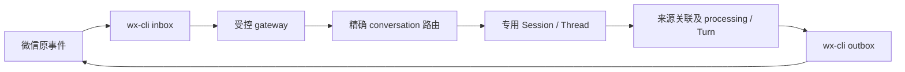

# 消息 Connector：微信标准模式

## 在整体中的位置

外部消息平台经统一的消息 Connector 接入，微信是第一个；通道合同不绑定具体平台，以后可接其他平台（DEC-040）。外部消息按外部来源处理，不冒充用户或内部 Agent 获得权限；订阅不等于任意发送授权。Agent 仍可直接用 skill 加平台 CLI 查询或发送，不必先注册路由。

- 在系统里的位置：[架构总览](overview.md#2-四部分如何组成系统)的结构图；代码分在 `packages/connector-wechat`（网关命令封装）与 `apps/coordinator/src/message-connectors/`（路由、资格与泵），见[包架构](packages.md#当前工作区与目标责任)。
- 网关作为本机进程运行，平台凭据与原始事件留在网关；部署形态见[部署与迁移](deployment.md)。
- 表结构见[存储](storage.md#迁移-054-到-068-新增的表)（schema 063–066），实现合入于 PR #221。

**支持哪些运行时。** 以代码为准（2026-11-09 核对）：标准模式的资格检查 `qualifyStandardConnectorRoute`（`apps/coordinator/src/message-connectors/qualification.ts`）不区分运行时；入站消息作为该 Session 的普通消息，由消息泵经普通消息的原生准入启动 Turn，而 Codex 与 Claude 两个适配器都实现了这条准入（见[Session 运行时](session-runtime.md#7-codex-与-claude-能力对照)）。因此代码上 Claude Session 也能作为标准模式的接收方；但现有测试用的是不区分运行时的替身，没有专门覆盖 Claude Session 作为接收方，也没有实际用过，按“待核”处理。受限接收只在 Codex 固定 `0.166.0-alpha.6` 上有对应的只读配置，而且适配器在无法证明内置 shell 已关闭时总是回答不可用，首版不启用。

## 标准模式的组成

Task b698cd37 的首个 provider 是微信。wx-cli 持有原事件、inbox、发送尝试与共享 outbox；evoLoop 持有精确 conversation 到受管 Session 的路由、平台消息及来源关联。路由保存、订阅、消息处理、回复和独立收件分别核对。

## 路由合同与权限

路由固定 `projectId`、`bindingId`、`provider/connectionId/conversationId`、群/私聊类型、便于人工识别的会话名称、目标 Session 及原生 Thread、接收及发送 actor、wx `owner/epoch/sessionRef`、`mode`、项目 `readScope`、`sendTargets`、允许触发 Session 的 `senderIds`、`internalTargets`、能力、策略哈希、状态和版本。Conversation ID 与 Thread ID 才是机器身份，名称只作识别。`senderIds` 至少一项，未列出的群成员或私聊对方只留下拒绝记录，不能触发 Session。`sendTargets` 是允许发送的 conversation ID，标准模式必须包括来源；`internalTargets` 是允许内部转交的受管 Session UUID，空数组即禁止。目标变更仅在 disabled 状态和新审核策略哈希下进行。来源、来源类型、接收 Session、Thread 和模式不可变；一个启用或暂停的来源及接收 Session 不能被另一自动路由复用。保存路由不授予发送权，正文也不构成授权。

项目 reader 可经 `GET /api/projects/:projectId/message-connectors/routes` 分页、`GET .../routes/:bindingId`、`GET .../routes/:bindingId/deliveries`、`GET .../routes/:bindingId/deliveries/:deliveryId` 和 `GET .../operations/:operationId` 读回。项目 reviewer 兼 write 可用 `POST .../routes` 创建 disabled 路由，或以 `PUT .../routes/:bindingId` 按 `expectedVersion` 和下一版本更新状态。每次写入带稳定 `operationId`；操作回执保存 actor、意图哈希和结果。写响应未知时先查原 operation；未找到仍为未确认，保留原 ID 和原意图。Workbench 的“微信 Connector”页提供列表、创建、启用、暂停、恢复和回读入口，浏览器会话保存一个待核对操作 ID。服务端仍做最终权限和资格检查。

## 两种接收模式

**标准模式**允许已授权的专用完整权限 Session。启用 API 核对 exact owned Session 的 ready 状态、actor、原生 session/thread 与路由保存值逐字相等、`danger-full-access/never`、原 Session 已有授权范围、active 且修订一致的 execution profile、当前 runtime/message grant、原生 Thread 资格与真实 gateway binding；gateway 的 `owner_session_ref` 和 `thread_id` 都必须非空并分别匹配路由 `sessionRef/targetThreadId`。任一缺失时保持 disabled/paused 并给拒绝回执。gateway 还须按固定来源和 `sendTargets/internalTargets` 执行授权。标准模式拥有完整工具能力，因此应使用单独 Session、受控凭据及明确目标；浏览器 UI 显示这些限制，不能把配置成功解释为安全隔离或来源消息处理成功。新路由先 disabled；active 可暂停为 paused，停订不抹去已入队消息或在途 Turn。

**首版不启用受限接收。** Contract 为后续 transport 留出模式字段，但当前数据库仍只允许 full-access Session 新建，受限 active/paused 拒绝。现有 `thread/read`、`config/read` 与无凭据探针不足以证明有认证 Turn 的工具及凭据边界；Workbench 不提供受限激活操作。不得用标准模式冒充受限隔离。

## 来源处理与恢复

wx `deliveryId`、事件 cursor 范围、`eventCursor`、可选 participant/reply cursor 定位原来源；`connector_message_link` 关联平台 `messageId`、`messageOperationId`、decision、route version 和 gateway 身份。平台 `session_message` 与 processing 的 state、operation ID、native Turn ID 是另一层证据。每个已关联 delivery 的这些状态及原出站请求 ID 可经 delivery API 和 Workbench 路由卡片读回；它们不证明收件人已收到。

标准模式在入队前按原 delivery 查询 `transport_status` 并 `reserve_turn`；`connector_transport_attempt` 在 reserve、record、finish 各次外部写入前保存首次尝试，未知时不重复调用，而沿原 delivery 读回。同一 delivery 的来源事件各有平台消息，平台队列串行处理。网关只能为一个 delivery 固定一个 Turn，因此记录该 delivery 中首个已绑定的代表 Turn；全部事件消息都保留各自 processing 和 Turn 关联，等它们结束后才 `finish_turn`。不支持的内容和空/超长 incoming 文本会作为不含正文的不可变 `connector_unhandled_event` 保存，并让该 delivery 的最终决定为 `defer`；游标只有在平台消息或拒绝记录落库后才推进。回复文字由这些已保存的响应组成；超出 wx 文本限制或无发送资格时保存为 draft。`connector_delivery_decision` 在任何 `send_text` 前冻结原 request ID、内容和唯一尝试状态。`pending` 只保留为 attempted，`ui_observed` 也只表示本地可观察，不证明对方收到；发送回执未知时只调用 `result` 查询原请求。`complete` 调用前先持久化 `complete_attempted`，随后只从原 `inbox_status` 的完整 delivery/owner/epoch/session/cursor 身份读回终态。重启后使用原 delivery 和原操作继续核对。

暂停、恢复或停用配置会推进路由版本，但已经 claim/reserve 的 delivery 继续使用冻结的 route version、policy hash、允许目标和原 wx 身份完成或保留 unknown；暂停后不 claim 新 delivery。只有 policy、来源、Session/Thread、actor 或允许目标发生变化时，在途记录停止并进入人工对账。

可信入口按精确 binding/delivery 和 owner/epoch/sessionRef 重验；unknown claim 和 unknown Turn 只按原 ID 与网关状态恢复，不换 ID 重送。`finish_turn` 后原 transport status 可能不再列出 delivery，缺行不能证明完成。停订时先暂停路由及入口，再核对 wx inbox/transport、来源关联、平台消息/processing/Turn 和 outbox；保持历史记录。直接获准的 Skill＋wx-cli 操作不经过此路由合同。

内部转交通过 `POST .../routes/:bindingId/transfers` 使用原来源消息 ID、新消息 ID、原操作 ID 和目标 Session ID。服务端要求来源属于该路由、调用者是原接收 Session 的 actor、目标在 `internalTargets`，然后用原 `session.message.post` 写入内部队列；内容显式标注外部来源，接收方仍须有自己的普通消息授权。该调用不代替实际接收方处理。

当前代码与定向测试覆盖路由、资格围栏、来源入队、拒绝事件留痕、代表 Turn、文本回复、暂停后在途结算和内部转交准入。迁移 `063–066` 在最新主线 `062` 后追加，并演练 058/062→head 及整批失败回滚；微信实机入站、回复、主动发送、转交和独立收件尚未验收。项目当前缺少专用测试 conversation、应用 grant、固定 Session/Thread 与私有客户端配置，不能据此启用正式路由。正式迁移、配置和运行版本由负责运行的维护者单独核验。最小配置与检查步骤见[标准模式接入](../development/wechat-standard-connector.md)。
