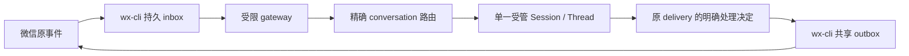

# 消息 Connector 首版接入边界

此页记录 Task b698cd37 的候选接入合同及尚未开放的执行路径。微信是首个 provider；其他通道只有能力合同，没有实连声明。微信事件、inbox 处理决定和 outbox 尝试仍由 wx-cli 保存；evoLoop 保存自己到受管 Session 的路由和后续原生处理证据。

## 关联与权限

- Leader 已确定每个获准 conversation 绑定一个固定的受限接收 Session/Thread。同一 Role 可有多个隔离实例；原完整权限工程或 Leader Session 不直接接收不可信微信原文。新接收 Session 与原业务 Session 是不同身份，转交要单独授权和留证。
- 激活或暂停的路由应使 `(provider, connection, conversation)` 和接收 Session 各只有一个自动驱动方；迁移 055 的唯一索引只覆盖这两种状态。当前 disabled 候选允许重复配置，启用前须核对并消除冲突。一个业务 Role 可以通过多个 Session 覆盖多个群或私聊，各自保留上下文。
- 通道的 `owner/epoch/session_ref` 与平台 Session/Thread 身份分别核对。`delivery_id` 和冻结的 cursor 范围定位微信源，`session_message`、processing 与 native Turn 定位平台处理；回复和转交另存各自原操作。入队、Turn 开始、业务决定、`ui_observed` 与独立收件分别报告。
- 授权由服务端固定 conversation、读/搜索、inbox 领取、send/result、内部收件人和工具能力。订阅不是发送权。跨群读取或发送须在模型调用前由网关与平台两侧拒绝；外部正文不构成授权。
- 发送先冻结目标、正文和稳定 request ID；结果未知时按原 ID 查询，不能换 ID 重发。微信桌面执行器仍只有 wx-cli 原共享实例。
- 直接安装并获准的 Skill＋wx-cli 查询、搜索、发送不经 evoLoop 注册或订阅；本 Connector 不更改这些入口。

## 当前实现门槛

迁移 055 的 `connector_route` 保存精确来源、接收 Session、owner/epoch、能力、策略哈希和版本。项目 reviewer 可通过 `/api/projects/:projectId/message-connectors/routes` 保存 disabled 配置并以版本 CAS 更新；请求须带固定 `operationId`，事务内的 `connector_route_operation` 保存 actor、意图哈希与回执。写响应未知时查询 `/api/projects/:projectId/message-connectors/operations/:operationId`；暂未查到记录仍是未确认，保留原 ID 和意图，仅用相同请求重放。项目 reader 可经路由 API 或 `work connectors`、`work connector BINDING_UUID`、`work connector-operation OPERATION_UUID` 读取。数据库和 adapter 同时拒绝 active/paused；disabled 配置本身不启动订阅、Turn 或发送。`targetActorId`、wx `sessionRef` 与原生受限执行的真实身份仍需后续证据，不能把已保存配置当激活证明。

当前 `SessionMessageService.admission`、`SessionMessagePump` 和 Codex App Server adapter 的普通 Turn 路径要求 `danger-full-access/never`，且运行配置含原项目工程能力。隔离原生探针在 Codex App Server `0.166.0-alpha.6` 上看到 `thread/start` 报告 `readOnly` 或 `workspaceWrite`、`config/read` 报告 `features.shell_tool=false`；无凭据的探针没有启动模型 Turn，`thread/read` 也不返回有效工具清单。启用前须扩展并实际验证受限宿主：独立的文件/凭据边界、无通用 shell/管理员 SSH、精确动态工具与接收人限制、原 Thread 执行配置回读及旧消息/未知 Turn 对账。不能靠提示词、只传 sandbox 字段或进程配置回执代替。原工程 Session 的 full-access 路径保持原权限。

微信客户端已支持原 `transport_status`、`reserve_turn`、`record_turn`、`finish_turn` 请求。网关 mutation 回执没有全部 owner/epoch/token 字段；`transport_status` 用原 conversation 查询尚为 reserved/recorded 的 delivery，并核对原 delivery ID。`finish_turn` 后该列表可能不再包含此行，缺行不能证明完成；结果 unknown 时保留原 delivery/token/Turn，用网关原状态与事件对账，不换 ID 盲重试。此客户端尚未接平台消息泵，故不代表消息已到 Session、同会话已回复或独立收件已发生。

固定接口依据：wx-cli `cc30d03a` 的 `docs/architecture.md`、`docs/CHANNEL_SUBSCRIPTIONS.md`、`docs/APPLICATION_CLIENT.md`；当前 checkout 的这三份正文与固定版相同。接入实测须另核实际网关授权、宿主版本、专用测试会话和独立收件，不以这些文档的旧样本代替。
