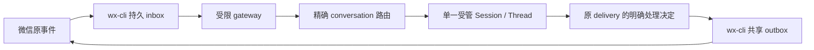

# 消息 Connector 首版接入边界

此页记录 Task b698cd37 的候选接入合同及尚未开放的执行路径。微信是首个 provider；其他通道只有能力合同，没有实连声明。微信事件、inbox 处理决定和 outbox 尝试仍由 wx-cli 保存；evoLoop 保存自己到受管 Session 的路由和后续原生处理证据。

## 关联与权限

- Leader 已确定每个获准 conversation 绑定一个固定的受限接收 Session/Thread。同一 Role 可有多个隔离实例；原完整权限工程或 Leader Session 不直接接收不可信微信原文。新接收 Session 与原业务 Session 是不同身份，转交要单独授权和留证。
- 激活或暂停的路由应使 `(provider, connection, conversation)` 和接收 Session 各只有一个自动驱动方；迁移 055 的唯一索引只覆盖这两种状态。当前 disabled 候选允许重复配置，启用前须核对并消除冲突。一个业务 Role 可以通过多个 Session 覆盖多个群或私聊，各自保留上下文。
- 通道的 `owner/epoch/session_ref` 与平台 Session/Thread 身份分别核对。`delivery_id` 和冻结的 cursor 范围定位微信源，`session_message`、processing 与 native Turn 定位平台处理；回复和转交另存各自原操作。入队、Turn 开始、业务决定、`ui_observed` 与独立收件分别报告。
- 授权由服务端固定 conversation、读/搜索、inbox 领取、send/result、内部收件人和工具能力。订阅不是发送权。跨群读取或发送须在模型调用前由网关与平台两侧拒绝；外部正文不构成授权。
- 发送先冻结目标、正文和稳定 request ID；结果未知时按原 ID 查询，不能换 ID 重发。微信桌面执行器仍只有 wx-cli 原共享实例。
- 直接安装并获准的 Skill＋wx-cli 查询、搜索、发送不经 evoLoop 注册或订阅；本 Connector 不更改这些入口。

## 当前实现门槛

迁移 055 的 `connector_route` 保存精确来源、接收 Session、owner/epoch、能力、策略哈希和版本。项目 reviewer 可通过 `/api/projects/:projectId/message-connectors/routes` 保存 disabled 配置并以版本 CAS 更新；请求须带固定 `operationId`，事务内的 `connector_route_operation` 保存 actor、意图哈希与回执。写响应未知时查询 `/api/projects/:projectId/message-connectors/operations/:operationId`；暂未查到记录仍是未确认，保留原 ID 和意图，仅用相同请求重放。项目 reader 可经路由 API 或 `work connectors`、`work connector BINDING_UUID`、`work connector-operation OPERATION_UUID` 读取。数据库和 adapter 同时拒绝 active/paused；disabled 配置本身不启动订阅、Turn 或发送。`targetActorId`、wx `sessionRef` 与原生受限执行的真实身份仍需后续证据，不能把已保存配置当激活证明。

迁移 056 增加来源关联。可信入口把 wx delivery/event cursor、原消息和 operation journal 一次写入；消息泵仍使用原平台队列，按关联在事务内重验路由、Session、执行 profile 和授权。只对精确 `connector-receiver:<bindingId>` 增加 `read-only/never` 候选；普通 Session 的 full 权限合同不变。候选入口泵在协调器租约及显式 `messageConnectors.enabled` 下运行，先核原 binding/delivery，再核原生接收者。未知 claim 不自动重领；来源关联用于回查原消息，不等于回复或微信收件。

**自动入站仍关闭。** 迁移 055 仍禁止路由激活；alpha.6 的 `thread/read` 不提供足以证明内置 shell 已移除的工具清单，因此适配器的受限资格返回 unavailable，在任何受限 `turn/start` 前拒绝。此前无凭据隔离探针的 `thread/start` 报告 `readOnly`／`workspaceWrite`、`config/read` 报告 `features.shell_tool=false`，均不能替代有认证模型 Turn 的工具隔离证明。不能靠提示词、sandbox 字段或进程配置回执代替。原工程 Session 的 full 路径保持原权限。

微信客户端已支持原 `transport_status`、`reserve_turn`、`record_turn`、`finish_turn` 请求。网关 mutation 回执没有全部 owner/epoch/token 字段；`transport_status` 用原 conversation 查询尚为 reserved/recorded 的 delivery，并核对原 delivery ID。`finish_turn` 后该列表可能不再包含此行，缺行不能证明完成；结果 unknown 时保留原 delivery/token/Turn，用网关原状态与事件对账，不换 ID 盲重试。入口已接原平台消息队列，但上述资格和激活围栏仍阻止自动实连，故不代表消息已到 Session、同会话已回复或独立收件已发生。

## 受限承载准备与预检

1. 在宿主维护窗口为每个获准 conversation 准备固定 OS 身份、私有 HOME/cwd 与独立原生 Thread；文件和网络只能访问该 conversation 所需范围。认证材料由可信 broker 持有，以私有路径引用，不写入仓库、模型输入或报告。业务工程 HOME、管理员 CLI/SSH 和通用 shell 不进入接收者。
2. 固定项目、binding、接收 Session/actor/Role、`connector-receiver:<bindingId>`、`read-only/never`、模型、预算、policy hash 与 wx owner/epoch/session_ref。接收者与允许的内部转交目标分别授权；full 目标默认拒绝自动转交。
3. 在**隔离** PostgreSQL 执行 055、056 迁移，用真实 alpha.6 的 `thread/read` 和有认证隔离 Turn 核工具清单及允许/拒绝调用、文件/网络/凭据边界。当前适配器在 `qualifyConnectorReceiver` 返回 unavailable；必须先增加可核的原生或 OS 隔离证明和可回读的资格状态，才可修改 055 的激活围栏。之后分别验证允许链、越权拒绝、原消息/原 operation 恢复、busy、撤权和停订。
4. 维护者再在受保护窗口登记真实路由并启用入口。诊断依次读原 wx binding/inbox_status/transport_status、`connector_route_operation`、`connector_message_link`、`session_message`/processing/Turn；未知写入只按原 ID 对账。回退先停 `messageConnectors.enabled`、暂停路由，保留原 delivery 和全部关联，核没有在途原生 Turn 后再清理隔离宿主。正式服务迁移、配置与重启由 Root 安排。

上述步骤中的 1、2 是待授权的宿主准备，3 的原生工具隔离证明和可激活受限路由仍是代码与实测缺口。当前实现与夹具测试不证明微信实机入站、回复、转交或独立收件。

固定接口依据：wx-cli `cc30d03a` 的 `docs/architecture.md`、`docs/CHANNEL_SUBSCRIPTIONS.md`、`docs/APPLICATION_CLIENT.md`；当前 checkout 的这三份正文与固定版相同。接入实测须另核实际网关授权、宿主版本、专用测试会话和独立收件，不以这些文档的旧样本代替。
