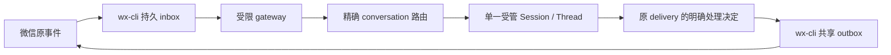

# 消息 Connector 首版接入边界

此页记录 Task b698cd37 的候选接入合同及尚未开放的执行路径。微信是首个 provider；其他通道只有能力合同，没有实连声明。微信事件、inbox 处理决定和 outbox 尝试仍由 wx-cli 保存；evoLoop 保存自己到受管 Session 的路由、原生处理和业务转交证据。

## 关联与权限

- 路由以 `(provider, connection, conversation)` 唯一；一个受管 Session 的原生 Thread 只接一个外部 conversation。一个业务 Role 可以通过多个 Session 覆盖多个群或私聊，各自保留上下文。原 Session 若作为目标，只能绑定一个获准 conversation。
- 通道的 `owner/epoch/session_ref` 与平台 Session/Thread 身份分别核对。`delivery_id` 和冻结的 cursor 范围定位微信源，`session_message`、processing 与 native Turn 定位平台处理；回复和转交另存各自原操作。入队、Turn 开始、业务决定、`ui_observed` 与独立收件分别报告。
- 授权由服务端固定 conversation、读/搜索、inbox 领取、send/result、内部收件人和工具能力。订阅不是发送权。跨群读取或发送须在模型调用前由网关与平台两侧拒绝；外部正文不构成授权。
- 发送先冻结目标、正文和稳定 request ID；结果未知时按原 ID 查询，不能换 ID 重发。微信桌面执行器仍只有 wx-cli 原共享实例。
- 直接安装并获准的 Skill＋wx-cli 查询、搜索、发送不经 evoLoop 注册或订阅；本 Connector 不更改这些入口。

## 当前实现门槛

当前 `SessionMessageService.admission`、`SessionMessagePump` 和 Codex App Server adapter 的普通 Turn 路径要求 `danger-full-access/never`，且运行配置含原项目工程能力。将不可信微信正文直接投给这一权限的原 Thread 不满足受限执行。候选 gateway 客户端与路由合同本身不开放自动处理；启用前须实现并实际验证受限宿主：独立的文件/凭据边界、无通用 shell/管理员 SSH、精确动态工具与接收人限制、原 Thread 执行配置回读及旧消息/未知 Turn 对账。不能靠提示词或只改配置白名单代替。

如果必须保留现有完整权限的原 Thread，同时要求它自动读取任意获准微信群消息，这是需要产品/Leader 明确处理的冲突。可选路径为：原 Thread 在可验证的受限配置下只绑定一个会话；或由同一 Role 的独立受限 Session 分别绑定会话，再以明确内部消息把有用结论转交原 Session。后一条会改变“新消息直达原 Thread”的体验，不能由实现者静默替换。

固定接口依据：wx-cli `cc30d03a` 的 `docs/architecture.md`、`docs/CHANNEL_SUBSCRIPTIONS.md`、`docs/APPLICATION_CLIENT.md`；当前 checkout 的这三份正文与固定版相同。接入实测须另核实际网关授权、宿主版本、专用测试会话和独立收件，不以这些文档的旧样本代替。
