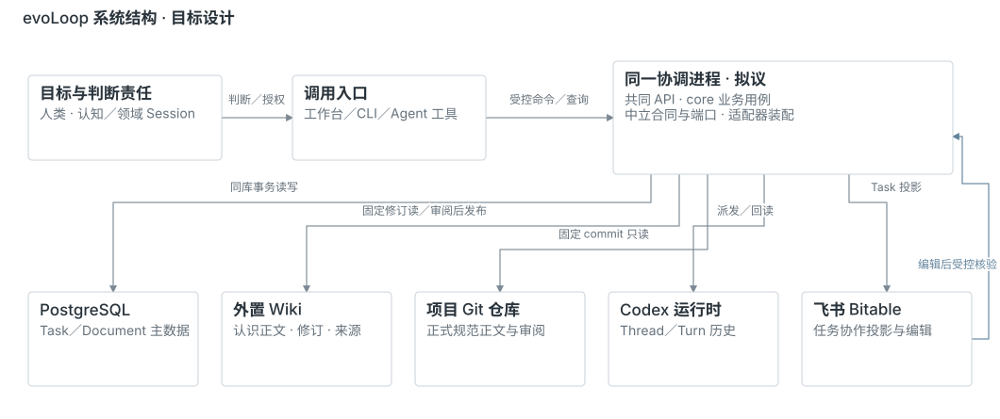
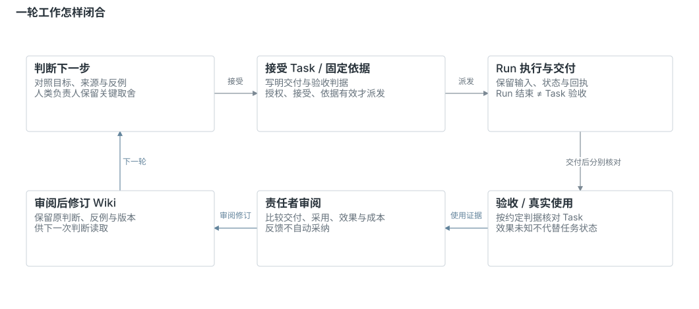
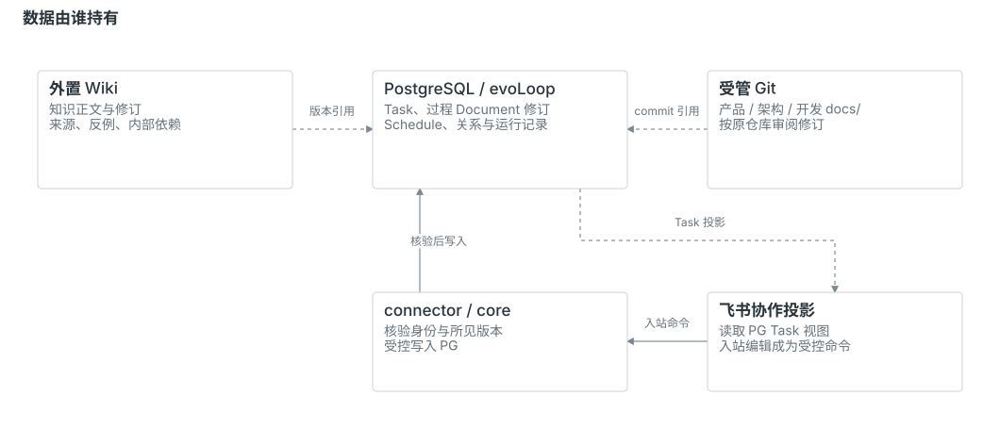
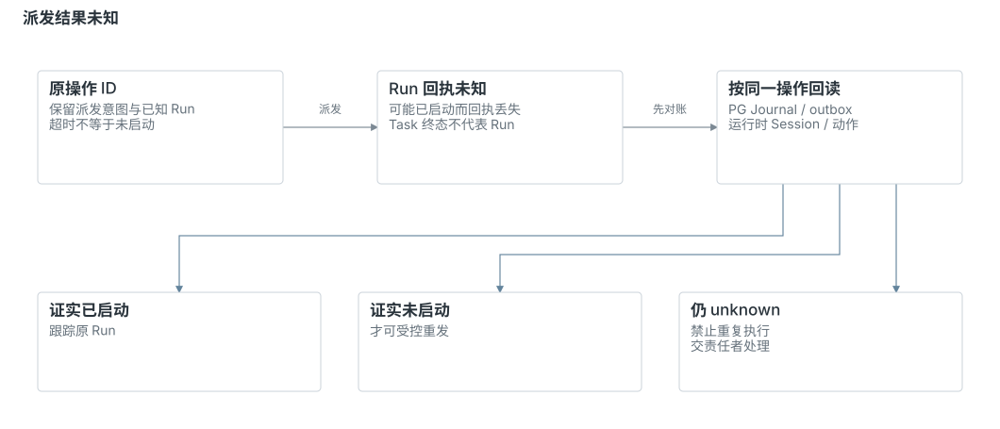
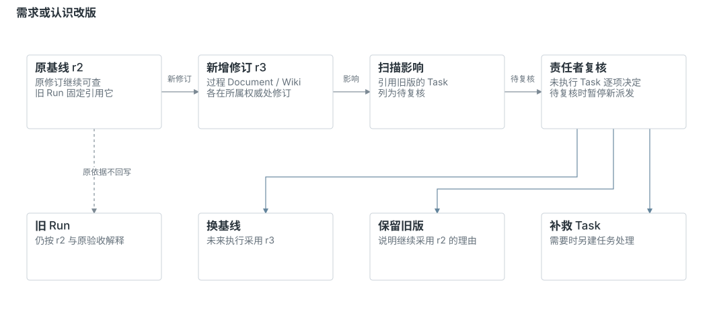

# evoLoop 架构总览

2026-10-29 · **目标架构；本机主数据、API、人类工作台与 Agent 业务 skill/CLI 已接通，完整系统尚未部署。** PostgreSQL 主数据归属与飞书 connector 方向已确定；本机受限验证和未接能力见[阶段路线](../roadmap.md)。本页先解释整个系统为什么这样组成，再沿一轮工作进入对象、失败处理和实现边界；产品目标与场景以[产品定义](../product/definition.md)为准。

## 1. 架构要接住什么

evoLoop 要把真实工作中的认识持续带进下一次行动。一个 session 可以判断和完成眼前任务，但项目还需要在换会话、目标变化、成果交接和用户纠正之后，继续知道：为什么做、谁负责、依据哪一版、实际效果怎样，以及接下来为什么值得做。

这给架构带来三项相互依赖的要求：

- **判断能够继续。** 新 session 能找到当前目标、依据与反例，分清曾经的判断和后来修订；领域 session 保留自己的认知与修复责任。
- **工作能够接续。** 任务和责任不随聊天窗口消失；运行中断、消息丢失或请求结果未知时，仍能查清发生了什么。
- **反馈能够改变后续。** 交付之后的实际使用要能影响认识、需求、下一任务和必要的分工调整；完成数量不能自动代表项目成长。

系统需要同时连接**认知演进**和**协作执行**。[产品卫星图](../product/definition.md#两张产品卫星图经营交付与组织改进)先确定经营交付、组织方法改进的演员与交接；本页解释共同服务和四种支撑能力怎样承载两循环。暂时无需先记接口、数据库表或候选库名。

## 2. 四部分如何组成系统

人类负责人给出目标、成功条件、授权与关键取舍。各领域 session 理解自己负责的问题，提出并完成授权内的工作。围绕它们，四部分提供项目持续成长所需的支撑：

日常使用有两个入口，各自服务不同的使用者：

| 使用者 | 默认入口 | 在工作中的作用 |
| --- | --- | --- |
| 人类负责人 | 工作台 + 与现有 Agent 会话沟通 | 观察进展、阅读依据与变化、作必要取舍、核对结果并反馈；人工直接操作按需保留。 |
| 承接工作的 Agent | 项目内业务 skill → CLI → 共同 API | 按工作约定读取固定依据，在真实授权内执行当前支持的业务命令，再回读对象与操作结果。 |

业务 skill 规定如何开展工作，CLI 提供机器操作入口；权限、版本和状态规则仍由同一 API/core 校验。MCP 是可选扩展，当前未建，不是 Agent 日常工作的前置条件。具体命令与恢复范围见[业务技能与 CLI](../development/agent-cli.md)。

下图先回答**系统由谁组成、各自守住什么边界**：人和 session 作判断，协调软件约束并接续行动，PostgreSQL、Git 和外置 Wiki 各守自己的主数据或正文。连线表示协作与受控读取，不表示已经部署了这些服务。

[交互查看结构与各节点来源](../assets/evoloop-system.html)：可按需展开责任和跨边界关系；完整模块索引见[包架构](packages.md)。

| 部分 | 承担的责任 | 与其他部分怎样配合 |
| --- | --- | --- |
| **① 认知循环** | 各 Agent 在职责内比较目标、来源、相反解释和反馈；Human Requirement 按需澄清用户方向，Evocation 综合方法与组织问题。 | 有依据的行动进入共同 Task；判断依据及变化按需进入 Wiki，真实效果再检验判断。 |
| **② 动态多 session** | Leader 组织承接与容量事实，Evocation 对照 User Session 亲用研究交接、方法和职责，比较工具、容量、临时专项或新职责试行。 | 改进任务与业务任务共用排期；后续亲用、成果和成本决定保留或撤回。 |
| **③ Task 与状态机** | 软件机制持有任务、接受条件、责任、交付和接续记录，并核对真实运行。 | 把已授权、已接受的选择变成可恢复的工作；完成判据由任务约定，运行结束不自动通过验收。 |
| **④ Wiki 与 evaluator** | 外置 Wiki 保存有来源、适用条件和修订的认识；评价检查其是否被正确采用、是否改善实际成果及成本。 | session 按任务读取相关认识；纠正和评价发现的问题进入维护、复核和下一步选择。 |

判断由承担相应责任的 Session 或人完成；协调软件负责权限、版本、触发、派发、记录与对账。Leader 负责跨 Task 顺序和承接，Evocation 负责组织与方法改进，User Session 提供独立体验；领域内常规修复不逐项经过中央会话审批。Wiki 存储、编译或检索也不能自行决定产品下一步。

**Role 是持续的逻辑职责，Session 是承载它的一次实例。** 同一职责可以续开窗口、换承载或增加经授权的并行实例。只有实际工作显示持续独立责任缺口时，才提出新 Role，并约定试行、收益和退出。四部分因而不等于四个固定岗位、四个包或四个进程。

## 3. 沿一轮工作理解系统

用“交付通知已送达，但接续 session 没有核对成果”贯穿说明。此通知场景用于解释目标机制，不代表整条链已经运行；本机已有能力与各自证据见[当前基线](../roadmap.md#当前基线)。

下图只追踪**一轮工作如何从观察走到下一次判断**。它把 Run 结束、Task 验收和成果实际使用分开；具体对象与权威在下一节解释。

[交互追踪工作回路及节点依据](../assets/evoloop-system.html#read=loop)。图中“运行与交付”包含不同状态：受管执行者按授权可在活跃 Run 内署名提交，协调器在原生终态确定后封存 Delivery；声明的消费者实际使用、任务关闭和下一项接续再分别核对。具体演员与失败返工见[唯一完整协作场景](../product/functional-scenarios.md#场景-2业务-session-怎样接任务提交结果并带回问题)，原生线程时序见[Codex 接入](codex-integration.md#位置与权威)。本图保持系统责任和回路层级，不复制命令序列。

### 从观察到有依据的任务

领域 Session 保留实际通知、成果和未接续的观察，比较“接收者未醒来”“读到消息但未取成果”“成果不可达”等解释。Leader 对账待接工作，领域责任者修复本领域缺口；Evocation 仅在交接模式反复出现时结合 User Session 体验研究方法问题，例如先补成果消费核验，而非只增加通知次数。

需求或技术讨论先成为一份**过程 Document**，保存目标、讨论与验收。准备执行的 **Task** 指定责任者、接受范围和验收，并固定采用的需求修订及相关认识；创建一条任务还不代表已接受执行。

### 从任务到执行与交付

协调机制读取已接受任务、当前授权和责任约定，准备固定版本的上下文，选择承载 session 并记录派发意图。**Run** 表示这次实际运行；一个 Task 可以因续做或返工经历多次 Run，旧运行仍保留当时的依据。

领域 session 提交具体成果和技术检查；受管普通执行者可在活跃 Run 内本人署名结果意图，协调层待原生终态确定后才封存固定交付。消费者另行完成使用核验；消息已送达、Turn 已结束、产物存在都只是各自的观察。任务的验收若要求接续方实际读取并核对成果，就需要相应消费证据才能完成。

### 从实际使用到认识与下一步

新的消费者沿真实路径使用成果，报告核对是否发生、是否仍需人类提醒。维护者据此修订 Wiki 中“通知与消费之间关系”的认识，保留原判断、反例、适用条件与历史。独立评价还要检查：消费者是否采用修订、成果是否改善、总成本是否值得。

接受“必须核对成果”的需求新修订后，关联旧任务逐项复核：有的换基线，有的保留旧版并说明理由。领域责任者和 Leader 按任务结果选择继续、补证或停止；缺少有价值动作时可以等待。若交接负担持续暴露方法或职责缺口，Evocation 才结合独立体验提出有试行和退出条件的调整。

这条链的关键是**判断、行动和反馈之间都有可查的连接**：谁选择了什么，任务采用哪版，谁实际承接，交付怎样被使用，哪些认识与后续动作因此改变。完整行为与接受规则见[Agent loop](../product/agent-loop.md)和[日常工作闭环](../product/daily-loop.md)。

## 4. 为什么要有这些对象和权威边界

上面的过程跨越聊天、任务、文档、代码和知识。标题、窗口名或“完成”标记不足以复现当时发生的事，因此要分开对象身份、固定修订和各自状态：

下图专门回答**正文在哪里改、什么只是引用或投影**。任务与过程 Document 的修订由 evoLoop/PostgreSQL 管理；仓库正式文档在 Git，活 Wiki 正文与修订在仓库外，飞书提供协作投影。对象细节和引用规则以[项目数据](project-data.md)为唯一主解释。

[交互核对各权威与跨边界关系](../assets/evoloop-system.html#read=authority)。

| 对象 | 为什么单独存在 | 正文或主记录归属 |
| --- | --- | --- |
| Task 与过程 Document | Task 表达接受的工作、责任与验收；Document 保留较完整的需求、详述和讨论。一份文档可关联多个任务。 | evoLoop/PostgreSQL 管主数据与修订；较大文档原件可通过唯一受控载荷引用保存。 |
| Role、Session 与 Run | 职责可以延续，实例会更换，每次运行有独立结果；分开后才能交接和恢复。 | evoLoop 保存约定引用、实例映射和运行记录；真实聊天与运行历史仍由运行时承载。 |
| Knowledge 与来源证据 | 认识可以被支持、挑战或取代；来源与模型解释需要分开核对。 | Wiki 正文、来源、修订及内部依赖在开发仓库外；原件在各自受控来源位置。 |
| Git 正式文档 | 表达仓库当前采纳的产品、架构和开发约定，按原仓库流程审阅。 | 各项目 Git 仓库；**不进入 Document Table**。任务或 Wiki 以路径与固定 commit 引用。 |
| 关系与固定依据 | 导航回答“相关对象在哪”，执行依据回答“当时按哪版做”。普通链接不会自动采纳对方正文。 | PG 保存跨对象关系与任务依据；Wiki 内部知识依赖仍归 Wiki。 |
| 操作和外部绑定 | 记录一次请求与远端对象的对应关系，区分本库提交、外部显示和未知效果。 | PG 保存操作、投影意图及同步观察；飞书只持协作投影。 |

例如，Task 链接 `DOC-1` 表示“这里有相关文档”；本次任务依据固定为 `DOC-1 r2` 才表示“这次按 r2 执行”。另建一条 `implements` 关系只是声明实现目标，仍要交付和验收证明是否符合。文档出现 r3 后，链接可带人看新版，本次 Run 的 r2 历史依据仍保留，是否改用 r3 另作复核。

默认的人机路径是：工作台让人观察进展、变化与依据；人在现有会话中与 Agent 沟通目标和需要自己决定的取舍；Agent 带固定证据在授权内经业务技能+CLI 执行；人从共同查询回看结果并提供必要亲用反馈。工作台主要承担观察、阅读、追溯和反馈，仍可保留按需人工操作，不承担与 CLI 对等的日常全量 CRUD。必要时 Agent 可使用同类受控 MCP 入口；前端开发技能不是业务入口。工作台、CLI 与未来 Agent 工具共用 API/core 的身份、权限、读入版本、状态规则和操作回执；技能不能自行增权，客户端也不能自行认定验收、亲用或未知写入可盲目重试。飞书编辑需转换为带身份和所见版本的命令，由核心校验后才改变 PG 主记录；飞书掉线不会删掉核心任务。Wiki 和 Git 的正文各有自己的维护路径，读取或投影不产生第二份可改写权威。Agent 具体入口见[业务技能与 CLI](../development/agent-cli.md)。

过程文档保留 Markdown、HTML 原件与必要资源，全文阅读和给 Wiki 的文本提取是不同用途。成立的过程结论可以经审阅整理到 Git 正式正文，原件保留历史；任务完成、PR 合入、文档构建和部署分别记录。对象与原件细节从[项目数据](project-data.md)继续读，再按需查[合同](contracts.md)与[存储约束](storage.md)。

Task 与 Document 的当前分工采用[单一正文和四态](../product/tasks-and-documents.md)：Task 保存责任、进度与验收，正文 content 从固定的主 DocumentRevision 读取。一次创建保存两者，开始工作时发布主正文并封存依据；默认在原 Task 内完成验证。历史状态、运行快照和操作结果分别保留，简化客户端流程不放松授权和恢复约束。

## 5. 变化和失败如何处理

这些边界还用于处理真实工作中的变化。架构需保持“原来发生了什么”和“现在允许怎样继续”都可解释。

### 派发结果未知：先对账再决定

派发超时后，保留原操作并按已知运行 ID 和历史回读；不能排除已经执行时，维持 `unknown` 并暂停重复派发。本库去重不能代替运行时去重，下图只说明这个恢复分岔，具体回执与事务约束见[领域合同](contracts.md#5-coordinator派发交接与恢复)和[存储](storage.md#事务幂等和读取)。

[交互查看 unknown 恢复路径](../assets/evoloop-system.html#read=recovery)。

### 依据改版：保留旧基线并复核后续

需求、来源或知识发生纠正时，先查受影响对象：未执行任务复核基线，执行中由责任者判断是否停止，已完成任务保留原验收并在必要时补救。固定依据保护历史，当前有效性和影响记录约束后续动作；通知成功不代表已采用。下图说明版本如何影响任务，完整的来源链和复核规则见[知识流](knowledge-flow.md#5-纠正与撤回怎样回来)。

[交互追查修订与受影响任务](../assets/evoloop-system.html#read=revision)。

其他变化仍要按各自权威边界处理：

| 变化或失败 | 系统怎样继续 | 为什么需要前面的设计 |
| --- | --- | --- |
| 飞书旧版本编辑或投影丢失 | 保留双方意图和同步基线，经核心处理冲突；远端删除不默认删除本体。 | 主数据和投影、业务状态和同步状态分别维护。 |
| Wiki 发布中断或来源不可达 | 回读已发布修订与指针，核对部分副作用；无法确认关键依据时停止相关新派发。 | 正文、审核决定、发布、索引和采用分别观察；固定修订不能由摘要补造。 |
| 日程暂停或进程重启 | 暂停禁止后续触发，在途工作另发停止并核对；重启先对账，再开始新工作。 | Schedule 定义、触发实例、Task 与 Run 有独立身份。 |

PG 事务能约束本库变更与待发意图，无法与飞书、Wiki、Codex 组成一个跨系统事务。第一版拟采用单活协调者；多写者发布、自动接管和恰好一次外部执行都需额外证据。通用规则在[合同](contracts.md)，来源纠正的完整去回路径在[知识流](knowledge-flow.md)，原件与跨系统恢复在[存储](storage.md)。

## 6. 从逻辑责任到运行装配

理解逻辑责任后，再看实现方案：人的工作台主要读共同状态，Agent 的业务技能+CLI 承担大多数常规写入，可选 MCP 工具仍经同一 API；协调进程装配数据库、飞书、Wiki、Git 和运行时适配器。人和 Agent 的沟通给出任务意图与授权，技能是工作过程约定，CLI 是机器操作客户端；授权范围、版本冲突、操作 ID、未知结果对账和业务状态由服务端统一约束。直接人工写入仍可按需存在，不成为所有 Agent 行动的审批关口。核心保留业务判断约束，平台包负责实际协议映射。npm 包是源码依赖边界，进程是运行单位，Role/Session 是责任与承载关系。

目标装配是一个协调进程、它管理的 Codex App Server 子进程、PG 服务及独立知识服务。本机已有受限的 Codex owned Turn、OpenViking 0.5.1 固定修订读写、主数据与工作台路径；业务 CLI 和项目 skill 已接入共同 API，生产部署与长期效果尚未验证。能力、版本与证据边界以[阶段路线的当前基线](../roadmap.md#当前基线)为准。PG 引擎及主数据归属已选；OpenViking 是首个知识接入后端，保留替换路径（DEC-027）。

工作台组合各权威的授权视图和操作结果，不接管现有 Codex Desktop 聊天。自管 App Server 线程与桌面宿主是两个接入面，历史互读或一次宿主通知消费不代表独立 daemon 已具备桌面控制能力。

接下来读[包架构](packages.md)可把责任映射到源码和进程；读[技术选型](technology-selection.md)判断为何推荐、替代方案与采用条件；读[Codex 接入](codex-integration.md)核具体协议与固定实验范围。

## 7. 当前做到哪里，怎样继续实现

当前能力与证据不在总览另存一份会过时的清单：[阶段路线](../roadmap.md#当前基线)维护实际基线，[固定验证摘要](../references/validation-summary.md)与[Codex 证据范围](codex-integration.md#隔离实测与生产能力分开)解释局部观察。Agent 业务 CLI 与项目 skill 已实现，当前可用范围与未验边界按[CLI 帮助与验证边界](../development/agent-cli.md)核实。受限实跑、合成测试、工作台消费和真人长期效果分别记录；检索、模型自评或局部协议通过尚不能证明产品成长收益。

[包架构的切片与验证](packages.md#切片与验证)集中维护推荐实现顺序：主数据及首次投影 → 受控编辑与执行恢复 → 日程 → 知识与真实使用。专题的“首片”是该能力首次接入，不意味着全部专题同时实现。Wiki 固定候选可独立补验，但不成为最小任务主数据的前置条件。

每一小任务交付具体可审阅结果；一个阶段还需核目标与实际使用，整个工作台则包含更多路径。下一步选择依据有效工作和反馈，允许缩小范围、转向或停止。[决定记录](../decisions.md)保留已确认方向、提案和取代链，不以文档完成代替采纳或部署。

## 8. 按问题深入专题

本页形成整体模型后，按当前问题选择下钻，不必把所有专题当成一次必读清单。

| 阅读路径 | 读者应能作出的判断 | 细节参考 |
| --- | --- | --- |
| 对象与权威：[项目数据](project-data.md) | 一条工作关系应连谁，正文在哪里，何时固定修订 | [领域合同](contracts.md)、[存储设计](storage.md) |
| 认识怎样回来：[知识流](knowledge-flow.md) → [Wiki 维护](wiki-maintenance.md) | 来源如何被理解，修订怎样影响旧页、任务和下一消费者 | [Wiki 集成](wiki-integration.md)的 DTO、端口与候选后端接缝 |
| 实现怎样装配：[包架构](packages.md) → [技术选型](technology-selection.md) | 一项能力属于哪个模块/进程，为何选它、采用前缺什么 | [Codex 接入](codex-integration.md)与具体适配合同 |
| 人怎样阅读与决定：[前端架构](frontend.md) → [Wiki 工作区](wiki-workspace.md) | 用户从哪里找依据、作取舍、核对后果，哪些仅为界面视图 | [工作台产品](../product/workbench.md)、[Wiki 集成](wiki-integration.md) |

若要检验自己是否理解，可解释上面的通知场景，画出主要责任与数据归属，再推演“需求改版且飞书断线”会改变哪些记录、保留哪些历史、阻止哪些动作。找不到答案时应能定位到具体专题和缺项，而不是依赖作者重新讲一遍。
