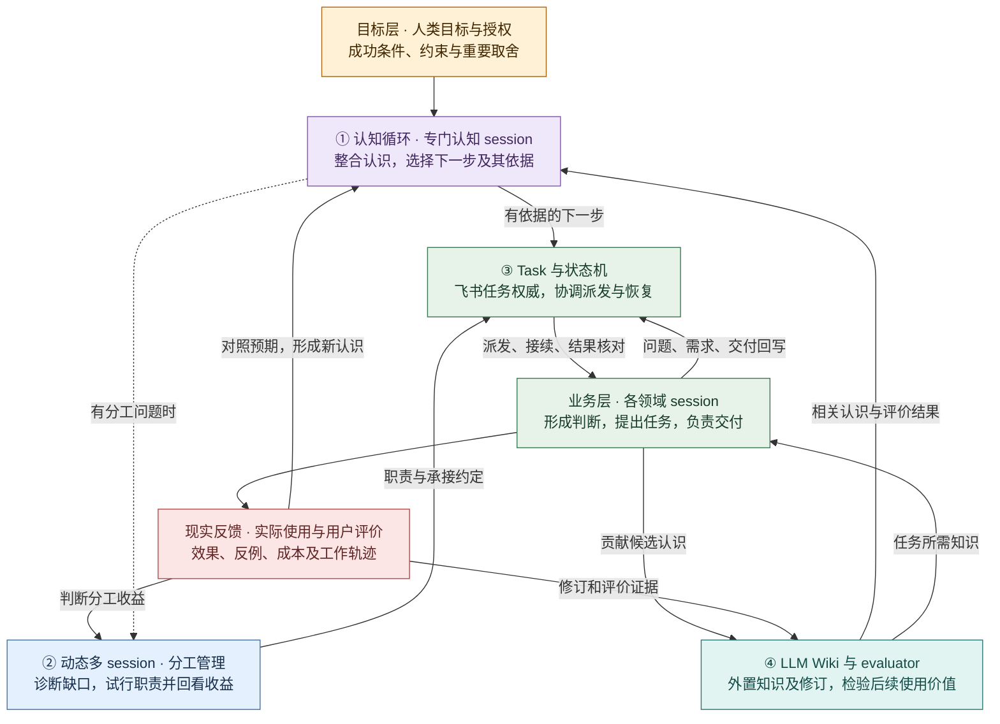

# evoLoop 架构总览

> 状态：产品架构定义，2026-10-19，按两个维度、四部分修订。本文记录已确定方向与待实现设计，不代表服务已部署。产品目标见[产品定义](../product/definition.md)，工作过程见[Agent loop](../product/agent-loop.md)，已确认方向见[决策记录](../decisions.md)，协作语义见[领域合同](contracts.md)，工程约束见[开发规范](../development/standards.md)。

## 1. 目标、决定与当前事实

evoLoop 是帮助项目从真实工作形成并改进协作方式的 **project harness**。它把“材料与实际使用 → 形成认识 → 任务与阶段推进 → 效果回看 → 分工演进”连成可追溯循环。价值不以任务数、Wiki 页数或角色数衡量，而看下一次行动是否采用了较可靠的认识、交付是否在真实使用中更接近目标、用户是否少做传话和补洞。

| 层次 | 当前内容 |
| --- | --- |
| **用户已定方向** | 飞书多维表格是第一阶段任务的唯一权威和人类原生界面；认知 Wiki 独立于开发仓库，Markdown 格式可用；所有 session 都能形成认识、发现并在授权范围内负责修复；专门认知 session 整合认识、推动下一步并承担初期 Wiki 维护，分工管理职责评估角色演进；角色由工作证据逐渐分化；正式产品/架构/开发规范留在仓库并构建为可发布文档。 |
| **本文设计提议** | 薄协调层、领域端口、任务/知识/会话的关联标识、单写入调度、阶段使用记录、修订与失效检查。具体字段、入口、部署形态须通过切片验证。 |
| **已观察事实** | OpenViking 0.5.0 在八条合成材料上能将资源及归档 session 编译为外置 Wiki，纠正与未决解释案例通过；同基线普通页并发写可丢更新，删源后需显式维护编译。nashsu/llm_wiki 也能外置存储与程序写读，但本轮旧页传播、来源忠实性、并发和撤回未达到共享权威要求。两者均未被采用为正式底座。 |
| **尚未实现/验证** | 飞书真实租户读写与权限、协调服务、正式 Wiki、角色注册与调度、通知和结果回收、实际阶段亲用、生产备份、跨项目权限、公开站点。仓库当前主要是设计、调研与有限试验记录。 |

试验结论见[候选验证摘要](../references/validation-summary.md)。样本是需求重建材料，生成模型不同，八条材料上 Wiki 消费没有显示优于直接读原料；不能据此推断真实规模效果。OpenViking 0.5.0 的并发失败不能泛化到未经运行的新版本；新版本源码有条件写迹象，但**未经同协议测试不算通过**。

## 2. 分层与依赖

两个维度是**认知演进**与**协作执行**，下图按用户指定的四部分表达能力组成。第①部分决定下一步为什么值得做，第②③部分组织并接续行动，第④部分支撑认识的积累、使用和评价。层次是职责和信息依赖，不是审批链，也不要求四个独立进程或固定会话。

图例：黄＝目标；紫＝认知循环；蓝＝分工；绿＝任务与执行；青＝Wiki 与评价；红＝实际使用反馈。实线为主要工作/信息关系，虚线为条件触发或回看依据。评价看到了问题后，仍经责任者判断和任务机制安排处理，不能把评分当成自动真值或实施授权。

**人类目标层**决定做什么、成功与限制是什么，以及超出既有授权的取舍。**业务层**可从单个开发 session 起步；产品、架构、体验、运维等只在有独立责任和可验证收益时分化。业务 session 能主动发现任务并承担处理与验收责任，委派不转移整体结果责任。

**认知与协作支持层**包括专门认知、Wiki 维护和分工管理的责任。专门认知 session 比较来源、整合领域判断并推动下一步，初期可同时维护 Wiki；是否进一步拆分按实际证据决定。分工管理者根据工作轨迹、任务负荷、亲用、代码运行结果和未来阶段诊断职责缺口。它们都能提出并处理自己范围内的任务，不是所有业务工作的审批总控；专业判断仍由相应责任 session 作出，项目目标与资源取舍归人类 owner。

**共享资产层**保存任务、原材料、认知页、正式文档和职责约定；各类资产各有权威，不通过同步副本争夺真相。每个受管项目有隔离的任务、知识与 Role 命名空间。evoLoop 仓库拥有 harness、接口适配、工具和自身正式文档；受管业务项目的代码及其正式产品/架构文档仍在各自仓库，不迁入 evoLoop。**运行层**只负责把已决定的规则落实为状态查询、关联、派发、恢复和结果回收。**阅读发布层**向人和 Agent 提供当前版本，反馈重新进入任务与认识循环。

代码责任划分见[包架构与依赖图](packages.md)，运行时协议与 Desktop 入口边界见[Codex 接入](codex-integration.md)。业务实现前先确认[技术选型](technology-selection.md)：当前推荐 TypeScript/Node 模块化单体、SQLite 运行记录、OpenViking 独立知识服务，尚未将建议记为用户已采纳。真实使用暴露的 dogfood issue 与新需求进入同一飞书提议/判断路径；定时检查也经同一任务规则接续，具体见[日常工作闭环](../product/daily-loop.md)。

## 3. 数据归属和引用

| 数据 | 权威位置 | 其他地方保存什么 |
| --- | --- | --- |
| 项目目标、正式产品/架构/开发规范、已采纳的系统约定 | evoLoop 自身文档在本仓库；受管项目的正式文档和代码在各自仓库 | 任务和 Wiki 引用文档 ID/版本；网页是只读构建视图。 |
| 任务需求、优先级、责任、处理状态、交付与复核 | 第一阶段飞书多维表格 | 协调层只留映射、水位和恢复所需运行记录，不另建可写任务清单。 |
| 一次性/周期性日程定义与启停 | 提议使用同一飞书 Base 的日程表，需现场验证 | 触发实例和检查水位由运行记录保存，每次实际工作关联独立任务。 |
| 原始会话、用户纠正、产物和使用证据 | 原始档案或受控材料存储 | 稳定来源 ID、片段位置、内容校验、采集/事件时间、可见范围；摘要不替代原件。 |
| 跨来源综合认知、假设、决定、反例、适用范围与修订 | 开发仓库之外的独立 Wiki/知识空间 | 任务、文档和运行记录仅引用知识 ID、修订、状态；可发布导出是只读快照。 |
| 逻辑职责约定 | 正式职责定义及其修订；存储介质待切片确认 | 运行时保留 Role→Session 当前映射和历史，不把临时窗口当新 Role。 |
| session 实例、派发操作、租约/水位、回执和结果未知 | 协调层的运行记录及原运行时 | 飞书任务保留可读结果/待处理链接；运行时记录不得冒充任务权威。 |
| 公开 HTML 与可发布 Wiki 视图 | 从固定文档/Wiki 修订构建的发布产物 | 标识源修订和构建时间，不在发布端另开可编辑正文。 |

公开仓库中的正式文档默认可读；飞书任务、私有材料和完整 session 归档不随站点自动公开。跨端引用应解析到有权限的证据入口，不能把本机路径当作公开网址。发布前筛掉私有正文与原始凭据。旧设计与验证的来源脉络经[公开来源说明](../references/lineage.md)追溯，可公开研究由[研究入口](../research/README.md)统一纳入文档站；原始实验数据仍外置。

## 4. 工作与知识闭环

1. **阶段开工。** 人类目标转为可检查的交付、预期效果和需要弄清的问题。责任 session 读取相关正式文档、当前知识修订和关键反例；任务记录引用这些基线。
2. **材料进入。** 用户纠正、实际工具动作、成果、CI/运行结果和使用反馈被保留为可定位来源。session 可提交“观察→解释→建议变更”，写明反证与未知；不能因提交就自动成为已采纳认识。
3. **任务推进。** 任何有责任的 session 都可发现、登记并处理问题/需求；跨领域影响按范围协作，委派记录目标、责任和回收条件。飞书是行动状态权威，协调层在实际运行时能力内派发并核验回执。
4. **认知维护。** Wiki 维护职责回读关键来源与既有页，形成合并、修订、争议或失效；记录稳定知识 ID、旧/新修订、依据、适用范围和受影响任务。来源撤回触发影响检查，不默认为自动真值反转。自动编译若被采用，也必须经过同一维护入口，避免两套无协调写者。
5. **实际使用与回看。** 交付后由责任者或目标使用者沿真实路径亲用，记录与原预期的差距、用户评价、时间和成本。仅“代码/文档完成”不能证明阶段目标达成；效果未知时明确写未知并安排观察。
6. **影响下一阶段。** 将效果支持或挑战的认识反映到下一阶段目标、任务优先级、方法和职责；下轮 session 验证是否读到并正确采用修订。使用失败也进入材料，不靠页数证明系统有效。

阶段退出至少要能回答：交付了什么修订、谁实际使用、观察到什么、哪些结论改变或仍未知、下一阶段为何这样安排。没有效果证据时可以关闭实现任务，但阶段效果保持“待验证”。

专门认知 session 应将这些结果变成有依据的下一步选择；协调机制在既有授权内让任务被承接，回看触发不依赖执行 session 临时记得通知。业务任务状态、运行操作结果和阶段效果分别维护，不能用一个“完成”字段替代。[完整工作流程与状态图](../product/agent-loop.md) · [Wiki 构建与评价](../product/wiki-evaluation.md)

## 5. 角色与 session 的关系

**Role 是可持续的逻辑责任；Session 是某运行时的一次承载实例。** 一个角色可换窗口、恢复或增加同职责实例；这些不是自动新增角色。创建新维度要说明独立目标、观察范围、输入输出、可写资产、与旧职责的交接、试行成本和退出条件。

分工管理职责先区分知识缺口、工具/权限问题、容量不足、一次性专项和持续独立责任，再比较修方法/工具、增加同职责实例、临时专项、新角色试行、合并或撤回。所有 session 都能提出建议；管理者把提议、反例、试行与回看关联到任务与 Wiki。在授权范围内推进试行；新增资源、权限或目标改变由 owner 决定。方向出处见[来源说明](../references/lineage.md)。

## 6. 可靠运行是待实现的能力

飞书普通记录更新和变更事件尚不能证明原子领取或完整投递。第一切片若无经实测的条件写，自动派发由**单活协调者**串行处理；人与 Agent 的原生编辑发生交错时重读并处理冲突。事件作“有变化”的提示，定期对账补漏。不能将观察到一条记录、向它写一个 owner 字段称作独占锁。

运行时派发、通知和结果回收都可能超时且结果未知。每次动作应有稳定操作 ID、任务 ID、Role ID、Session ID、目标和时间；超时先回读任务与运行时，再决定重试或保留 unknown，避免重复启动或重复外部副作用。完成写入、通知送达、接收者已处理和成果被采用是不同观察。重启先对账未结束派发和待验证成果，再开始新工作。具体运行时支持哪些查询、唤醒、停止或订阅，必须逐项实测；语义合同见[contracts.md](contracts.md)。

Wiki 发布也有并发边界。OpenViking **0.5.0** 试验中两个普通页同基线写均成功却丢了一方；来源删除不自动改旧综合页。第一试点只能有一个维护发布者串行写当前页，其他 session 提交来源/候选变更；发布前重读基线、快照并核对影响。新版本若提供条件写，需以固定版本实测后才能扩大写者数。受限试点与正式采用/上线是不同状态。

## 7. 待验证取舍与实施切片

| 决策点 | 当前方向 | 进入下一步前的证据 |
| --- | --- | --- |
| 独立 Wiki 底座 | 推荐 OpenViking 为目标基座；0.5.0 保留实测基线，0.5.1 为下一固定候选；尚未正式采用 | 新版批量条件写不等于所有入口安全。重跑来源撤回、旧页修订、同页并发、人工纠错、恢复与独立消费；计入摄入/维护/读取成本，并与直接读来源比较。 |
| 飞书任务布局与权限 | 单一权威，优先原生编辑 | 真实租户 scope、字段/视图、并发编辑、分页、事件延迟与重放、配额及备份。 |
| 会话自动化 | 首个候选为自管 Codex App Server stdio；桌面讨论通过项目工具显式衔接，详见接入报告 | 创建/查询/通知/停止/重连逐项能力探测；未知结果及重复恢复演练。 |
| 职责注册和管理 | 逻辑 Role 与 Session 实例分离 | 一次真实职责缺口从提案到试行/撤回，比较任务遗漏、交接等待与成本。 |
| 正式文档与 Wiki 发布 | 仓库正式文档建站；Wiki 固定修订只读发布 | 断链、修订标识、私有材料脱敏、手机阅读和人的纠错流程。 |

建议实施顺序：**A** 建正式文档与固定版本来源引用；**B** 用测试飞书表实现最小 TaskStore 和单写入对账；**C** 跑独立 Wiki 受限试点及来源/修订/撤回；**D** 连起一个真实业务 session 的任务、交接、结果未知恢复；**E** 完成一次交付后亲用与知识更新，再让分工管理者提出一项有退出条件的职责试行。首个真实试点建议选择 evoLoop 自身的文档与协作任务，这是实施提议，尚未接入飞书或正式 Wiki。每片都保留“声明的能力、实测的能力、仍未知”三栏；后片不以设计文档存在替代前片验收。

定时能力随任务接入切片验证：先验证一次到期产生一次可追溯工作，再验证重复、漏触发、停机恢复和暂停。负责人日常主要与分工管理及认知 session 讨论，常规结果回收由运行机制负责；这是目标使用方式，尚未成为已部署流程。
