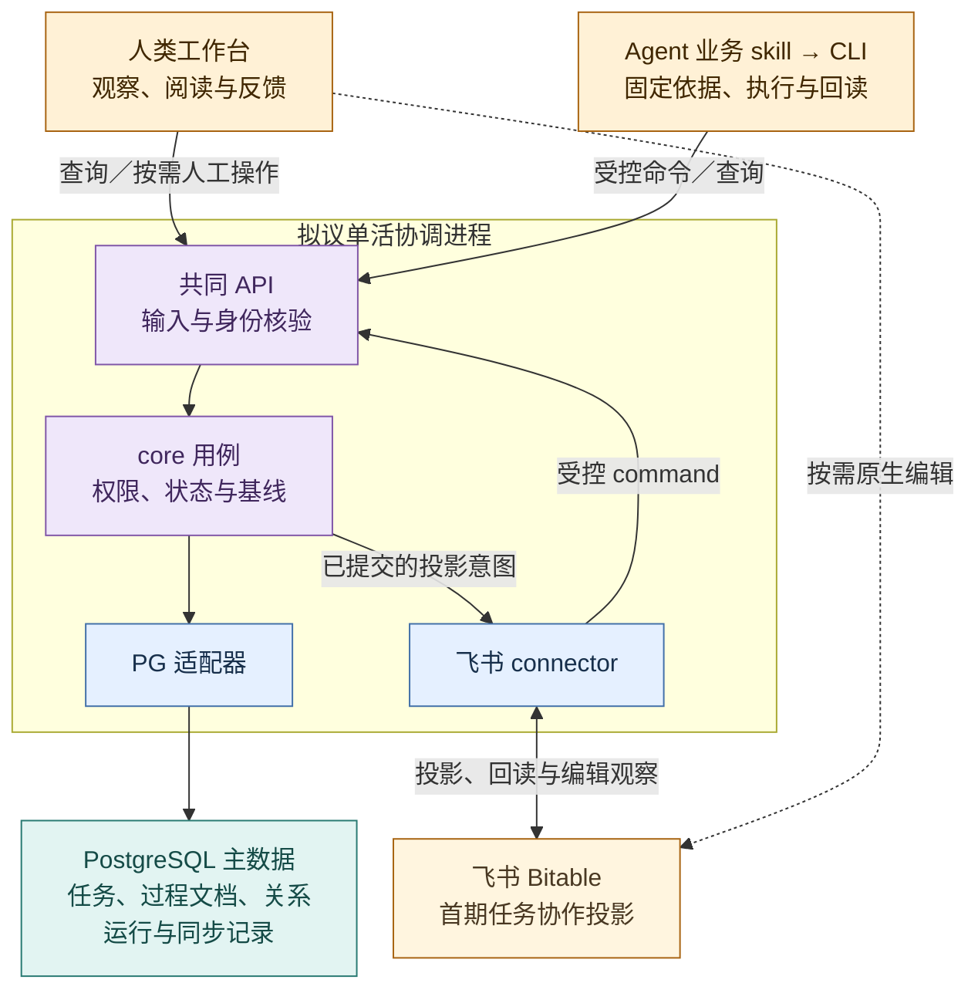
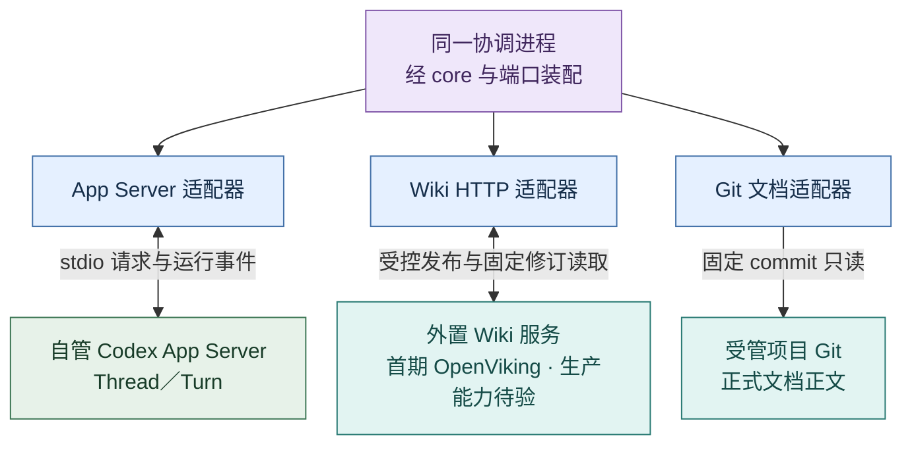
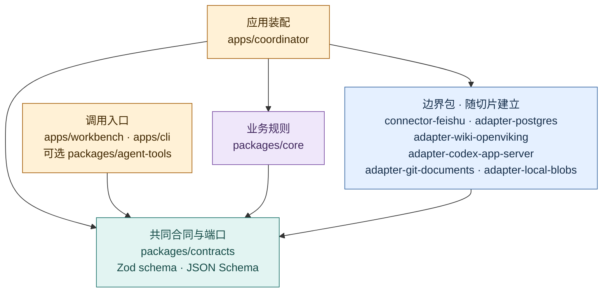

# 包架构：实现边界与运行装配

推荐包架构 v0.6 · **当前源码有 11 个 npm 工作区，包分层已落地；整体首版及外部协作仍未验收。** PostgreSQL 主数据、飞书 connector 方向及首个 Wiki 后端 OpenViking 已由用户选定；独立协议调查见 PR #2。技术选择的依据见[技术选型](technology-selection.md)；本页规定包如何协作。[领域合同](contracts.md)定义状态与失败语义，[日常工作闭环](../product/daily-loop.md)定义产品行为，[架构总览](overview.md)定义权威归属，[Codex 接入](codex-integration.md)说明运行时映射。

本页把[总览](overview.md)的逻辑责任映射到拟议实现。先看核心模块承担什么、它们怎样装配到运行单位，再查源码依赖和完整包表。包是代码边界，进程是部署单位，Role/Session 是职责与承载关系，三者不逐一对应。

TypeScript/Node 核心、共同协调 API、PostgreSQL 主数据及六个边界适配包已有代码；它们的运行证据各不相同。Git 固定来源、本机 Blob、Codex App Server 与外置 OpenViking 已有受限实跑，飞书仍只有 fake HTTP 与真实 PG 测试。默认由人通过工作台观察、与现有 Agent 会话沟通；Agent 带固定依据经业务 skill+CLI 完成大多数常规写入；人再在工作台核对结果。工作台与 CLI 共用 API/core，人工直接操作可按需存在，不是每次 Agent 写入的前置审批。skill 是过程约定，不是第 12 个 npm 包，也不是前端开发技能；CLI 已提供具名命令与未知结果恢复，具体用法和未验边界见[业务技能与 CLI](../development/agent-cli.md)。CLI 已覆盖共同命令 schema，但具名专项请求以帮助清单为准，当前未提供协作投影/入站处理的 CLI 入口。未知写入须保留原操作；只有可核验的服务端回执才能确认，部分请求仍需人工对账。各包落地不等于跨系统首版或真人使用通过；其余技术范围见[技术选型](technology-selection.md)。

## 四部分映射到一个 `core`

| 产品部分 | 目标 `core` 模块（非当前目录清单） | 主要责任 |
| --- | --- | --- |
| ① 认知循环 | `cognition/`、`reviews/` | 装配目标、来源和反例，形成有依据的回看任务；记录责任 session 的选择及下一动作，检查是否被后续工作实际采用。 |
| ② 动态多 session | `roles/`、`sessions/` | 逻辑 Role 与承载 Session 分离，职责试行、交接、回看与撤回；新聊天窗口不自动生新 Role。 |
| ③ Task 与状态机 | `tasks/`、`documents/`、`relations/`、`connectors/`、`coordination/`、`scheduling/` | Task 与原生 Document 的提议/审核/交付，跨对象关系、飞书投影命令、派发与 `unknown` 恢复、到期实例和周期对账；主状态在 PostgreSQL。 |
| ④ Wiki 与 evaluator | `knowledge/`、`evaluation/` | 来源与相反解释、候选/审核/修订/撤回依赖、独立消费和真实效果评价；正文通过外置 Wiki 端口读取，PG 只登记知识引用与跨对象关系。 |

四部分是**产品能力**，不是四个进程或四个固定 Role。项目和架构 session 是责任承载者，软件模块只是使其工作可追溯。模块间经包内清晰接口协作；只有实际独立发布、团队边界或依赖冲突出现后再考虑拆 `core`。

## 完整模块索引

[打开可折叠的完整模块索引](../assets/evoloop-system.html#view=modules)，按责任查 12 个目标包、`core` 子模块、端口与外部权威。可逐层展开、搜索，再切换运行协作、源码依赖与权威归属；折叠后的汇总连线仍可追到原端点和固定来源。索引表示**目标职责与关系**；当前有 11 个工作区，`packages/agent-tools` 是可选 MCP 目标、尚未建立，也无需为凑齐目标图而造空包；图中的 `core` 子模块不是当前目录结构。下面的运行装配图和源码依赖图分别解释两种不同的边。

## 进程与权威边界

这里分两幅目标装配图：先看**受控写入如何到 PG 主数据、飞书如何成为投影**，再看**同一进程怎样接入运行时和外部正文**。箭头表示运行调用、投影或回读，和后文源码依赖箭头的含义不同。两幅图中的协调服务是**同一个单活进程**。当前 PG/API、运行时、外置 Wiki、Git、Blob 路径已有不同范围的本机证据；飞书投影仍未在真实租户实连。图细化目标边界，不能代替[总览的责任结构图](overview.md#2-四部分如何组成系统)或后文的现状表。

### 主数据与协作投影

业务 skill 是项目内工作约定，不是图中的第三个服务；CLI 是其使用的客户端。可选 MCP 仍未实现，后续若接入也经共同 API。黄＝人/工具入口与外部投影；紫＝协调进程内规则；蓝＝边界包；青＝本体持久化。虚线是人在飞书的编辑，仍需经 connector、API 和核心规则才能改变本体；PostgreSQL 适配器按同库事务保存对象、操作与投影意图。

### 执行与外部正文

紫＝同一协调进程；蓝＝其中的边界适配包；绿＝独立执行运行时；青＝外部正文权威。首期 OpenViking 的上游 Python/Rust 部署留在独立服务，evoLoop 通过 HTTP 接入。Git 正式正文与外置 Wiki 不迁入 PG；PG 只记录固定引用和跨对象关系。完整包名与依赖范围在后文表中查阅。

**统一写路径。** 人在工作台观察进展、变化和依据，与现有 Agent 会话沟通目标或取舍；Agent 经业务 skill+CLI 承担大多数常规写入，必要时可用同类 MCP 工具，人工直接写入按需保留。它们经同一 API 提交操作 ID、行为者/Session、对象 ID、读入基线与证据 → 协调 API 校验输入与身份 → `core` 读取 PG 当前版本并检查授权、接受/文档审核状态与冲突 → PG 同一事务提交 Task/Document/Relation 变更及出站 outbox → connector 投影到飞书并回读同步结果 → 人再从共同查询核对后果。业务 skill 不提供旁路写入、另一个状态机或额外授权；CLI 负责机器调用和未知回执恢复，不要求 Agent 模拟人在 GUI 点击。飞书原生编辑是受控入口：事件提示回读，connector 将变化映射为带可核验行为者与基线的 command，仍经 `core` 审核后写 PG；身份或基线不足、字段冲突时停下并显式复核，不采用最后写入覆盖。Task、文档审核、运行、同步、实际效果状态分别维护；投影成功不等于交付或效果完成。

Wiki 候选和不可变修订正文存于**开发仓库外的 OpenViking 服务**，evoLoop 的外置 manifest 固定修订、来源和关系；这层语义由适配器提供，不是 OpenViking 原生跨系统事务。PostgreSQL 只记知识引用、任务/文档与知识的跨对象 Relation、操作结果与水位，不复制 Wiki 正文或内部知识依赖权威。0.5.1 的外置写读、重启回读和候选→审阅→发布产品路径已在受限环境实跑；语义索引、多写者条件发布和生产恢复尚未验。贡献先成候选，由单一维护发布者回读基线、审阅冲突与撤回影响、发布经审阅的修订、再核对结果；必须关闭 OpenViking 及其他工具的旁路写入。知识存入、通知成功、认知 session 实际使用及目标消费者效果分别核验。

首期认知执行由已登记的 Codex App Server Session 承载，不同时启用 VikingBot 再养一套默认派发、权限和恢复栈。OpenViking 只承担本方案明确验证过的知识服务能力；若它的原生工作流参与写入，也必须走同一候选审核与单维护者发布规则。

调度采用确定性状态表：从 PostgreSQL 当前 `ScheduleStore` 计算到期 UTC 实例，以稳定触发键记意图，按错过/重叠策略创建或关联独立 Task；重启先对账 `unknown`、outbox 和水位，周期对账补外部事件遗漏。PG 事务可原子提交本库 Task 与 outbox，不能把飞书、Wiki 或 App Server 副作用变成跨系统原子操作。定时器响起本身不接受新需求，也不证明任务完成。首期保持一个活动协调者，不额外引入 Redis 或 Temporal；工作台是该协调服务的客户端；多协调者仍需独立验证资格和副作用恢复。

受管日程接续复用 `ScheduleStore` 与现有 Loop：日程新修订可选固定 Loop/Stage，物化时保存同一业务 Task 的 Stage；PG 来源查询与 core 共同核验 occurrence、原操作和固定修订，再交认知选择现有 child 派发。旧无目标日程维持只产 todo；不向所有同范围 Loop 广播，也不新增调度服务。暂停、未知和旧排队边界见[日程合同](contracts.md#可选的受管目标)。

前端组件与 Query/Command 读写分工见[前端架构](frontend.md)。目标中的 `core/knowledge` SourceBridge 将组合各来源端口，`core/queries` 将装配有限上下文与页面读取模型；目前这些目录尚未建立，现有读取由协调 API 授权后装配来源和知识端口。Git 文档接入与 Wiki 回写影响见[知识关联](knowledge-flow.md)，数据库内部约束见[存储设计](storage.md)。

工作文档结论整理到正式文档的 `DocumentIncorporation` 归 `core/documents`，跨对象来源关系归 `core/relations`，页面进度由 `core/queries` 组合；不为此新增独立服务。PostgreSQL 只记过程文档来源、仓库目标基线、差异/PR 和核实的合入结果；目标是独立 Git 来源而非 Document 行，`adapter-git-documents` 继续只读。正式正文写入及审阅交给获授权的仓库任务，构建与部署独立记录。详见[整理流程](project-data.md#6-工作文档怎样沉淀为仓库正式文档)。

## 源码依赖

箭头 `A --> B` 仅表示 **A 可在源码中依赖 B**；不表示运行请求、数据复制或权威转移。`contracts` 持有跨包语义和端口；平台生成类型、鉴权和协议细节留在适配器。应用负责装配端口实现，`core` 不导入适配器。

图例：黄＝装配/调用入口；紫＝核心规则；青＝中立合同与端口；蓝＝边界适配器/连接器。边界包合框展示共同依赖，每包独立实现自己的端口。`cli` 只依赖协调 API 的公开合同，不导入 `apps/coordinator`；图中的 Agent 工具包仍是目标。平台包由应用装配；端口的完整领域字段只在[合同](contracts.md)维护。

## 当前工作区与目标责任

根 `package.json` 采用 `packages/*`、`apps/*` 工作区；各目录的 `package.json` 实有 **11 个**：8 个 `packages`、3 个 `apps`。下表保留 12 个目标责任，其中 `packages/agent-tools` 只是可选 MCP 扩展、尚未建立；项目本地业务 skill 也不属于 npm 工作区。已建包不表示整行目标均已完成。“可依赖”列给出边界，实际 package 依赖为 `core`→`contracts`、六个边界包→`contracts`、`cli`/`workbench`→`contracts`，coordinator 装配 core、contracts 与所需边界包。平台依赖留在适配器：PG 的 `pg`/迁移工具、coordinator 的 Fastify、浏览器的 React；core 不导入平台包。

当前 `packages/core/src/` 的实际边界是根 `index.ts`/`workflow.ts`/`discussions.ts`，以及 `documents/`、`roles/`、`runtime/`、`scheduling/`、`delivery/`、`references/`。`knowledge/`、`evaluation/`、`queries/`、`cognition/` 等仍是目标责任名称；知识 HTTP 路由现由 coordinator 装配适配器，不能把目标图读成这些目录已实现。运行装配分布在 coordinator 的 `runtime/`、`scheduling/`、`collaboration/`、`knowledge/`、`documents/` 与 `references/` 路由/泵。

| 工作区／包 | 对外接口与责任 | 可依赖 | 禁止承担 |
| --- | --- | --- | --- |
| `packages/contracts` | 当前 Zod 命令 schema、中立对象/结果类型与 `UnitOfWork`、`ScheduleStore`、`RoleReader/Transaction`、`RuntimePort`、`CollaborationConnector`、`KnowledgeRepository`、`DocumentSource`、`BlobStore` 等端口；更多独立存储端口与 JSON Schema 仍属目标范围 | Zod | 飞书列 ID、Codex 生成类型、OpenViking DTO、数据库 schema 或运行时业务判断 |
| `packages/core` | 当前 `WorkflowService` 和上述实际目录处理任务/文档、职责、执行预留、调度、投影入站审核与来源引用；认知编纂、SourceBridge、ContextQuery 等仍是目标用例 | `contracts`；纯业务规则 | 平台 SDK、HTTP/PostgreSQL 的直接调用、把模型回答视作已批准决定 |
| `packages/connector-feishu` | `CollaborationConnector` 实现：Bitable 任务投影、绑定映射、出站与入站编辑观察；候选由协调层审核，分页与结果未知回读已在 fake HTTP 中验证 | `contracts`、HTTP | 持有 Task/Schedule 主数据、绕过 core 写库、以最后写入覆盖冲突；飞书云文档 API 不在首期 Bitable 范围 |
| `packages/adapter-wiki-openviking` | 当前实现 `KnowledgeRepository`：OpenViking HTTP 映射、外置 manifest、固定修订读取、候选/审核/发布与能力报告；未来更完整的认知维护由目标 `core/knowledge` 用例承接 | `contracts`、HTTP/文件客户端 | 自建第二个认知执行栈、把普通写页当自动 compile、直接认定搜索摘要为原始证据 |
| `packages/adapter-codex-app-server` | `RuntimePort` 实现；自管 stdio 子进程、握手、Thread/Turn 请求与事件、断线回读和版本能力探测 | `contracts`、局部协议类型 | 任务验收、调度权威、推断 Desktop 聊天已受控 |
| `packages/adapter-postgres` | 实现 `UnitOfWork`、日程存储和投影/引用读取；保存 Task、过程文档修订、负责人讨论、职责历史、运行、触发、外部绑定、journal/outbox 与水位；包内维护至 011 的 SQL 迁移 | `contracts`、`pg`（node-postgres）、迁移工具 | 复制 Git 正式文档正文，或接管 Wiki 正文/来源/知识内部依赖的权威 |
| `packages/adapter-git-documents` | `DocumentSource` 实现：按项目登记仓库、白名单路径和固定 commit 读取原文/hash，报告不可达；引用登记与审核由协调 API/PG 承担 | `contracts`、受控 Git 子进程 | 自动采纳 PR、读取未授权目录、把 HTML 当第二份正式正文、擅自修改源仓库 |
| `packages/adapter-local-blobs` | 首个本机切片的 `BlobStore`：受控目录、临时写入/hash核验、发布及孤儿对账；后续远程存储另做适配 | `contracts`、受限文件 I/O | 持有知识综合正文、绕过权限暴露路径、假定文件与PG同事务 |
| `apps/workbench` | 已有任务/过程文档/知识/职责/运行/日程/协作与复核页面，按权限调用共同 API；更完整的导航和独立消费仍待验 | 浏览器安全的 `contracts` 出口、React、Vite；Router/Query 仍为目标 | 导入 core/平台 SDK、持有服务凭据、直接写库、嵌入或假定控制 Desktop 会话 |
| `packages/agent-tools`（未建） | 可选目标：若确需 MCP，提供窄工具调用协调 API；不为与工作台平行而强制建包 | `contracts`、API 客户端、MCP SDK | 常驻自动协调进程、直接写适配器、假定独立 daemon 能调用当前桌面宿主工具或自动唤醒/监听 Desktop |
| `apps/coordinator` | 单活进程；同源工作台静态资源、Fastify Query/Command API、身份/凭据与数据库连接装配、入站 command、到期计算循环、outbox 与周期对账、健康状态 | `core`、`contracts`、所需边界包 | 绕过 `core` 的快速写入路径，或把飞书投影当主数据 |
| `apps/cli` | Agent 的机器操作入口：按权限读固定依据、查询命令 schema、提交已支持请求与恢复未知回执，经同一 API 调用用例；已实现具名读写与恢复，以[实际帮助](../development/agent-cli.md)核可用范围 | `contracts`、API 客户端 | 再启动一个写入协调者、独立实现业务状态机，或让技能绕过服务端授权和版本规则 |

`packages/testkit` 仅在出现跨适配器故障测试的重复夹具时新增，可提供可控时钟、故障注入和合同测试；它不属于生产依赖。现有 `scripts/docs/` 保持文档工具，不因 npm workspaces 自动成为业务包。

Wiki 前端代码按[集成方案](wiki-integration.md)拆为组件、数据 hooks 和共同 DTO：显示组件只收 props/事件；服务数据走共同 API；OpenViking DTO、目录及发布清单细节只留适配器。`SourceBridge` 仍是拟放在 `core/knowledge` 的组合用例，尚无该目录；不把它再造为独立服务。上游可抽取代码须登记固定来源与依赖闭包，不直接导入 nashsu 的整个 Zustand/Tauri/摄入链。评价记录暂由 PG 适配器随真实切片支持，复用 Task/Run/Review 的固定引用，不能把 Wiki 正文移入评价表。

对象存储接入时，可新增实现同一 `BlobStore` 的适配包（拟名 `adapter-object-storage`），由协调应用装配；SDK、上传方式、物理 key 与访问 URL 只留该包，不渗入 `core`、前端或业务 ID。当前不创建空包。OpenViking 自身内容存储由其服务配置管理，`adapter-wiki-openviking` 仍走知识 API，不借 BlobStore 直接改它的私有对象；即使共用同家对象存储，也要隔离命名空间、访问与生命周期策略。部署时机、源文件归属及迁移条件见[存储设计](storage.md#evoloop-何时接入对象存储)。

## 知识图谱与后端替换的包边界

按 DEC-027，先接 OpenViking，保留以后自研替换的路径。图谱是知识读取的一种表现；前端依赖 evoLoop 的知识合同，后端更换通过适配和数据迁移完成。这里细化现有包职责，不增加图数据库、独立图谱服务或第二套知识权威。

| 现有包内的落点（拟议） | 应持有的逻辑 | 替换 OpenViking 时 |
| --- | --- | --- |
| `contracts` 的浏览器出口 | KnowledgePage、来源/链接、有界图视图及状态；稳定业务 ID 与修订 | 保持页面与深链合同；不包含 `viking://`、上游 DTO 或数据库行类型 |
| `contracts` 的服务端端口 | KnowledgeRepository 的读取、受控写入、能力与迁移分组 | 新后端实现同一语义，缺能力明确返回；详见[可替换合同](contracts.md#知识后端可替换合同) |
| 知识界面：`apps/workbench/knowledge` | 导航/查询 hooks、阅读与来源面板、GraphScene 和可替换渲染器；布局算法包只在这里依赖 | 页面继续读共同 API；Graphology/Sigma 的渲染细节也不成为后端合同 |
| `core/knowledge` | 来源桥接、候选/审阅/发布用例和迁移编排；决定哪些变更允许生效 | 保留业务规则，按能力决定开放范围；不出现按供应商名称分支的知识规则 |
| `core/queries` | 将外置知识页/内部边与 PG 跨对象关系组合成授权、有界的页面视图 | 保留读取语义，报告不同来源水位；无图库扫描或私有协议解析 |
| `adapter-wiki-openviking` | HTTP、URI 绑定、外置修订/关系清单、可重建索引、迁移导入导出及故障回读；包内可分 client / mapping / revisions / relations / transfer | 替换供应商实现；可移植知识格式由合同定义、在外置空间持久化，不藏进上游专属 DTO |
| `adapter-postgres` | Task/Document/Review/Relation、KnowledgeRef、操作及切换记录 | 不迁入 Wiki 正文；旧任务仍引用原 knowledgeId/revision |
| 协调装配：`apps/coordinator` | 选择一个活动知识端口实现，配置空间绑定、能力和数据代次 | 停写、核对、切换绑定和失效缓存；不让新旧后端同时接收生产写入 |

将来确实自研时，再新增实现相同端口的适配包；先跑同一合同套件和迁移演练，包名及自研服务技术由当时证据决定。当前不预建空适配器，也不为“以后可能替换”抽象通用向量数据库或解析引擎。如外置修订格式的公共实现实际被两个后端重复使用，再提取共同库；现在先固定格式与测试样例。具体停写、验收和回退边界见[迁移流程](wiki-integration.md#9-以后替换知识后端怎样保留前端与历史)。

## 切片与验证

下表描述当前源码与截至 2026-10-20 的受限验证，不把目标图、合成测试、部署和实际消费混为一项。S1—S4 的目标实施顺序仍由[阶段路线](../roadmap.md)维护；对应模块可以先落地而尚未完成该阶段的产品验收。

| 能力边界 | 当前代码与已观察证据 | 尚不能据此声称 |
| --- | --- | --- |
| 主数据与工作流 | PG 迁移至 011；目标→阶段→提案判断→接受 Task→交付→使用观察→阶段复核及负责人讨论由 API/工作台与真实 PG 集成测试覆盖，操作 journal、固定依据和出站意图可回读 | 声明式使用观察等于真实消费者使用；完整首版由真人验收 |
| 文档、Git 与原件 | 固定 Git commit/hash 只读，过程 Markdown/HTML 元数据和本机 Blob 原件由各边界包处理；HTML/Blob 上传、静态阅读和下载仍在独立消费者核验 | 任意 HTML 脚本安全、外部资源长期可用或整理结果已经合入正式文档 |
| 飞书协作 | connector、PG 投影/回读/候选复核在 fake HTTP + 真实 PG 下验证，未知结果不盲目重发 | 真实飞书租户的权限、字段、限流、事件和双向协作已验；目前尚未实连 |
| Codex 运行 | 自管 App Server 0.154.0 的 owned Thread/Turn 已用可见模型 `gpt-6-astra` 实际完成，重启后回读完整答复；运行记录与交付、消费分开 | 默认 `gpt-6.1-sol` 可用（当前账号返回 400）；Turn 完成等于 Task 验收；Desktop 既有聊天受控。结果展示的 CSS 重写缺陷仍在修复 |
| 日程与职责 | PG 到期实例、单活 pump、职责试行/交接/退役约束已有本机和集成测试；未配置受管目标时到期只产生 todo Task；显式目标的自动接续另按固定来源验收 | 自动接受、执行或人的长期分工效果 |
| 外置 Wiki | OpenViking 0.5.1 的外置写读、重启回读、候选→审阅→发布产品路径已实跑；适配器保持正文在 repo 外 | 语义索引、生产多写者、长期恢复、独立认知消费和效益；这些仍未验 |

包边界验证基于各 `package.json` 与当前源码目录；本轮不修改目标图。局部检查、真实外置服务试验和人类亲用应分别记录。具体失败语义见[领域合同](contracts.md)，启动、测试及停写恢复见[本机运行](../development/local-run.md)。
