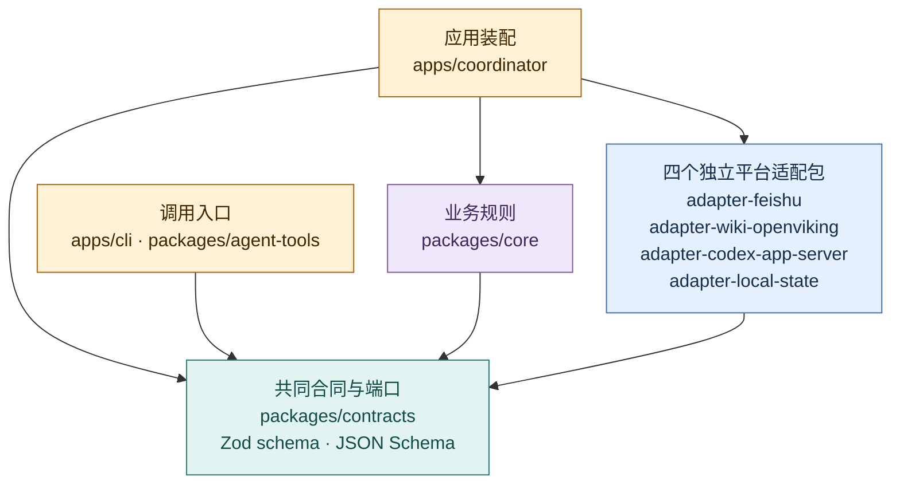
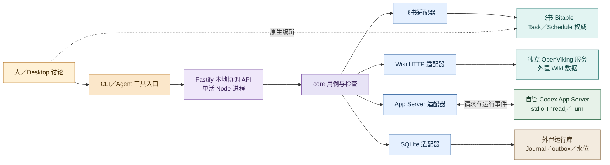

# 包架构：实现边界与运行装配

推荐包架构 v0.2 · **拟议实现架构，待确认，尚未实现或部署。** 当前分支是文档与 `scripts/docs/` 工具，协议实测代码另见 PR #2。技术选择的依据见[技术选型](technology-selection.md)；本页规定若采用该方案，包如何协作。[领域合同](contracts.md)定义状态与失败语义，[日常工作闭环](../product/daily-loop.md)定义产品行为，[架构总览](overview.md)定义权威归属，[Codex 接入](codex-integration.md)说明运行时映射。

首期推荐 TypeScript `strict`、Node.js 24 LTS、npm workspaces：一个模块化 `core` 包，Fastify 本地协调 API，SQLite（`better-sqlite3`）运行记录，飞书任务与日程适配器，独立 OpenViking 服务的 HTTP 适配器，以及 evoLoop 自管的 Codex App Server stdio 适配器。**这是待确认的实现提案，不是已批准技术栈或已运行系统。** OpenViking 的固定版本、补丁和升级条件由[技术选型](technology-selection.md)与验证记录确定，本页不锁版本。本机 Python 证明已在[独立 PR #2](https://github.com/cyl19970726/evoLoop/pull/2)跑通，是运行机制的研究证据，不决定生产实现语言。

## 源码依赖

箭头 `A --> B` 仅表示 **A 可在源码中依赖 B**；不表示运行请求、数据复制或权威转移。`contracts` 持有跨包语义和端口；平台生成类型、鉴权和协议细节留在适配器。应用负责装配端口实现，`core` 不导入适配器。

图例：黄＝装配/调用入口；紫＝核心规则；青＝中立合同与端口；蓝＝边界适配器。四个适配包合框展示共同依赖，每包独立实现自己的端口。`cli` 与 Agent 工具只依赖协调 API 的公开合同，不导入 `apps/coordinator`，也不持有飞书或 Wiki 的写入凭据。适配器实现端口，由应用注入 `core`；端口的完整领域字段只在[合同](contracts.md)维护。

## 拟议 npm 工作区与包责任

目录按首个切片逐步建立，不预造空包。每行的“可依赖”是源码允许范围，第三方库只在实际负责的包引入。

| 工作区／包 | 对外接口与责任 | 可依赖 | 禁止承担 |
| --- | --- | --- | --- |
| `packages/contracts` | Zod 版本化输入/输出边界 schema、由其导出的 JSON Schema、中立 ID/结果类型及 `TaskStore`、`ScheduleStore`、`EvidenceStore`、`KnowledgeRepository`、`RoleRegistry`、`SessionRuntime`、`OperationJournal` 端口；对外提供协议版本与校验入口 | Zod 等校验库 | 飞书列 ID、Codex 生成类型、OpenViking DTO、数据库 schema 或运行时业务判断 |
| `packages/core` | `proposeTask`、`reviewProposal`、`planDispatch`、`reconcileRun`、`computeDueOccurrences`、`proposeKnowledgeRevision`、`reviewStage` 等用例；接收端口与时钟；确定性状态转换和授权/基线检查 | `contracts`、cron-parser 等纯计算依赖 | 平台 SDK、HTTP/SQLite 的直接调用、把模型回答视作已批准决定 |
| `packages/adapter-feishu` | `TaskStore` 与 `ScheduleStore` 实现，租户鉴权、列/身份映射、分页、回读、变更提示与全量对账；对未验证能力报告 `unsupported` | `contracts`、飞书 SDK/HTTP | 第二份任务状态、日程权威或虚构 CAS/原子领取保证 |
| `packages/adapter-wiki-openviking` | `EvidenceStore`/`KnowledgeRepository` 的 OpenViking HTTP 映射；外置 immutable revision 文件和 manifest 的存取；读取、检索、发布及能力报告；原生 compile 仅在另行验证后启用；贡献、候选、审核、修订、撤回依赖进入 `core` 的维护流程 | `contracts`、HTTP/文件客户端 | 自建第二个认知执行栈、把普通写页当自动 compile、直接认定搜索摘要为原始证据 |
| `packages/adapter-codex-app-server` | `SessionRuntime` 实现；自管 stdio 子进程、握手、Thread/Turn 请求与事件、断线回读和版本能力探测 | `contracts`、局部协议类型 | 任务验收、调度权威、推断 Desktop 聊天已受控 |
| `packages/adapter-local-state` | SQLite `OperationJournal`、outbox、运行 ID 关联、检查水位、到期实例和 `RoleRegistry` 引用；职责正式说明保留在受管项目配置，SQLite 仅引用其修订；为重启对账保存意图与结果 | `contracts`、`better-sqlite3` | 飞书任务/日程状态、Wiki 来源或修订正文的可编辑副本 |
| `packages/agent-tools` | 窄 MCP/Agent 工具：查询、提议、交付、审阅和贡献，调用协调 API；可供 Desktop 与自管线程配置使用，Codex 宿主专有桥接单独声明能力 | `contracts`、API 客户端、MCP SDK | 常驻自动协调进程、直接写适配器、假定独立 daemon 能调用当前桌面宿主工具或自动唤醒/监听 Desktop |
| `apps/coordinator` | 单活进程；Fastify 本地 API、身份/凭据装配、事件接收、到期计算循环、outbox 与周期对账、健康状态 | `core`、`contracts`、所需适配器 | 第二个可编辑业务权威、绕过 `core` 的快速写入路径 |
| `apps/cli` | 本地检查、提出和管理命令，经同一 API 调用用例 | `contracts`、API 客户端 | 再启动一个写入协调者或独立实现业务状态机 |

`packages/testkit` 仅在出现跨适配器故障测试的重复夹具时新增，可提供可控时钟、故障注入和合同测试；它不属于生产依赖。现有 `scripts/docs/` 保持文档工具，不因 npm workspaces 自动成为业务包。

## 四部分映射到一个 `core`

| 产品部分 | `core` 内部模块 | 主要责任 |
| --- | --- | --- |
| ① 认知循环 | `cognition/`、`reviews/` | 装配目标、来源和反例，形成有依据的回看任务；记录责任 session 的选择及下一动作，检查是否被后续工作实际采用。 |
| ② 动态多 session | `roles/`、`sessions/` | 逻辑 Role 与承载 Session 分离，职责试行、交接、回看与撤回；新聊天窗口不自动生新 Role。 |
| ③ Task 与状态机 | `tasks/`、`coordination/`、`scheduling/` | 提议/判断/交付、派发意图与 `unknown` 恢复、到期实例和周期对账；接受状态以飞书回读为准。 |
| ④ Wiki 与 evaluator | `knowledge/`、`evaluation/` | 来源与相反解释、候选/审核/修订/撤回依赖、独立消费和真实效果评价；正文通过外置 Wiki 端口读取。 |

四部分是**产品能力**，不是四个进程或四个固定 Role。项目和架构 session 是责任承载者，软件模块只是使其工作可追溯。模块间经包内清晰接口协作；只有实际独立发布、团队边界或依赖冲突出现后再考虑拆 `core`。

## 进程与权威边界

下图箭头表示**运行调用或回读**，与源码依赖图不同；虚线表示人可在权威系统中原生编辑，协调者必须回读并对账。OpenViking 是独立服务与独立数据位置，Python/Rust 留在其上游部署，evoLoop 通过 HTTP 接入；不是 npm 包、`core` 子进程或本仓库的 fork。

图例：黄＝人/入口；紫＝evoLoop 进程与规则；蓝＝适配器；青＝外部业务权威；绿＝外部执行运行时；棕＝仅供恢复的本地状态。源码 npm 包、操作系统进程、业务 Session/Role、上游 OpenViking 仓库是四种不同边界，不能用包数推断部署数或职责数。

**统一写路径。** Desktop 工具、CLI 和自管 App Server 工作线程提交操作 ID、行为者/Session、对象 ID、读入基线与证据 → 协调 API 校验输入与当前身份 → `core` 重读飞书/知识修订并检查授权、接受状态和冲突 → `OperationJournal` 记录意图 → 适配器执行写入 → 回读确认 `applied`、标 `pending` 或保留 `unknown` → outbox/对账接续。飞书中人的原生编辑是例外入口；事件只是回读提示，协调者需按修订/字段比较，冲突时停止并交给责任者复核。没有实测条件写时不承诺排除并发覆盖；自动写由单活协调者串行，飞书的人类旁路通过字段归属、回读和恢复限制风险。

Wiki 的来源和不可变修订正文拟存**开发仓库外的 Wiki 数据位置**，以 immutable revision 文件及 manifest 记录固定修订和依赖；这是 evoLoop 需实现的版本层设计，不能假定 OpenViking 原生提供相同事务。SQLite 只记修订引用、操作结果与对账水位，不存正文。贡献先成候选，由单一维护发布者回读基线、审阅冲突与撤回影响、发布经审阅的修订、再核对结果；必须关闭 OpenViking 及其他工具的旁路写入。若无法关闭旁路或缺少经验证的原子条件写，安全多写者发布仍不支持。知识存入、通知成功、认知 session 实际使用及目标消费者效果分别核验。

首期认知执行由已登记的 Codex App Server Session 承载，不同时启用 VikingBot 再养一套默认派发、权限和恢复栈。OpenViking 只承担本方案明确验证过的知识服务能力；若它的原生工作流参与写入，也必须走同一候选审核与单维护者发布规则。

调度采用确定性状态表：从飞书当前 `ScheduleStore` 计算到期 UTC 实例，以稳定触发键记意图，按错过/重叠策略创建或关联独立任务；重启先对账 `unknown`、outbox 和水位，周期全量对账补事件遗漏。定时器响起本身不接受新需求，也不证明任务完成。首期无需 Redis、Temporal、Postgres 或 Web 前端；若将来出现多协调者、租约或高吞吐要求，再以真实负载和条件写证据修订。

## 切片与验证

1. **提议与判断：** 创建 `contracts`、`core/tasks`、飞书适配器、最小 SQLite Journal、协调 API/CLI；用真实测试表验证原生人工编辑交错、分页/事件丢失和接受决定。此时不建空 Wiki/Codex 包。
2. **一次执行与恢复：** 加 Codex App Server、扩展 Journal/outbox 与 `core/coordination`；验证写成后丢响应、已知/未知 Turn ID、重启回读与成果核验。`turn/completed` 只推进运行状态。
3. **一次日程：** 加 `core/scheduling` 与 `ScheduleStore`；以可控时钟验证到期、漏触发、重叠、暂停/改期、时区和恢复，再用真实飞书表/进程验证对账。
4. **知识与真实使用：** 加 OpenViking HTTP 适配器、外置修订层、`core/knowledge` 与 evaluation；验证相反解释、同基线写、来源撤回、审阅发布、独立 session 消费，以及与直接读原始材料的成本/效果比较。Desktop 工具桥接随真正需要的人类讨论操作加入。

核心规则用端口替身和固定时钟验证；每个适配器以固定版本/测试环境做合同测试；跨系统用故障与恢复演练；用户面对的效果由真实消费者亲用单独记录。通过局部测试不等于部署或整个认知闭环有效。具体失败语义和验收范围以[领域合同](contracts.md)及[开发规范](../development/standards.md)为准。
