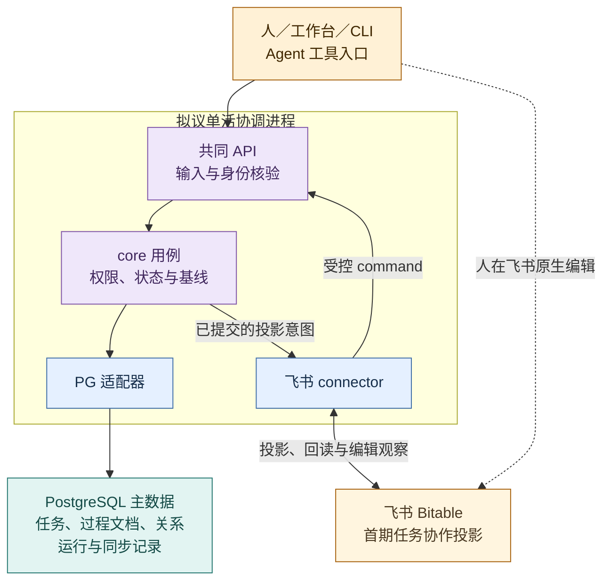
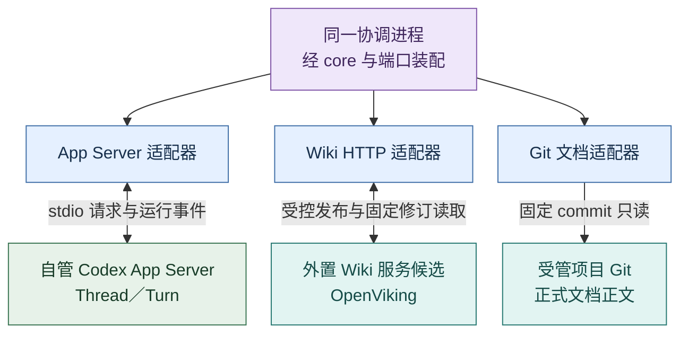
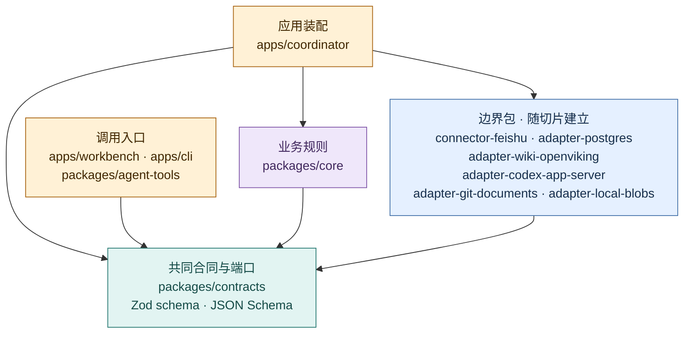

# 包架构：实现边界与运行装配

推荐包架构 v0.5 · **主数据与连接器方向已由用户选定，具体实现仍是提案；尚未实现或部署。** 当前分支是文档与 `scripts/docs/` 工具，协议实测代码另见 PR #2。技术选择的依据见[技术选型](technology-selection.md)；本页规定若采用该方案，包如何协作。[领域合同](contracts.md)定义状态与失败语义，[日常工作闭环](../product/daily-loop.md)定义产品行为，[架构总览](overview.md)定义权威归属，[Codex 接入](codex-integration.md)说明运行时映射。

本页把[总览](overview.md)的逻辑责任映射到拟议实现。先看核心模块承担什么、它们怎样装配到运行单位，再查源码依赖和完整包表。包是代码边界，进程是部署单位，Role/Session 是职责与承载关系，三者不逐一对应。

推荐方案是 TypeScript/Node 的模块化核心及同一协调 API，PG 保存主数据，飞书、Git、Wiki 和 Codex 经适配器连接。其余技术仍是[选型提案](technology-selection.md)，不把 Python 隔离夹具算成生产包实现。

## 四部分映射到一个 `core`

| 产品部分 | `core` 内部模块 | 主要责任 |
| --- | --- | --- |
| ① 认知循环 | `cognition/`、`reviews/` | 装配目标、来源和反例，形成有依据的回看任务；记录责任 session 的选择及下一动作，检查是否被后续工作实际采用。 |
| ② 动态多 session | `roles/`、`sessions/` | 逻辑 Role 与承载 Session 分离，职责试行、交接、回看与撤回；新聊天窗口不自动生新 Role。 |
| ③ Task 与状态机 | `tasks/`、`documents/`、`relations/`、`connectors/`、`coordination/`、`scheduling/` | Task 与原生 Document 的提议/审核/交付，跨对象关系、飞书投影命令、派发与 `unknown` 恢复、到期实例和周期对账；主状态在 PostgreSQL。 |
| ④ Wiki 与 evaluator | `knowledge/`、`evaluation/` | 来源与相反解释、候选/审核/修订/撤回依赖、独立消费和真实效果评价；正文通过外置 Wiki 端口读取，PG 只登记知识引用与跨对象关系。 |

四部分是**产品能力**，不是四个进程或四个固定 Role。项目和架构 session 是责任承载者，软件模块只是使其工作可追溯。模块间经包内清晰接口协作；只有实际独立发布、团队边界或依赖冲突出现后再考虑拆 `core`。

## 进程与权威边界

这里分两幅图读同一套推荐装配：先看主数据和飞书投影，再看执行与外部正文。箭头表示运行调用、投影或回读，和后文源码依赖箭头的含义不同。两幅图中的协调服务是**同一个单活进程**；所有服务仍待实现，OpenViking 是候选。

### 主数据与协作投影

黄＝人/工具入口与外部投影；紫＝协调进程内规则；蓝＝边界包；青＝本体持久化。虚线是人在飞书的编辑，仍需经 connector、API 和核心规则才能改变本体；PostgreSQL 适配器按同库事务保存对象、操作与投影意图。

### 执行与外部正文

紫＝同一协调进程；蓝＝其中的边界适配包；绿＝独立执行运行时；青＝外部正文权威。若采用 OpenViking，其上游 Python/Rust 部署留在独立服务，evoLoop 通过 HTTP 接入。Git 正式正文与外置 Wiki 不迁入 PG；PG 只记录固定引用和跨对象关系。完整包名与依赖范围在后文表中查阅。

**统一写路径。** 工作台、Desktop 工具、CLI 和自管 App Server 工作线程提交操作 ID、行为者/Session、对象 ID、读入基线与证据 → 协调 API 校验输入与身份 → `core` 读取 PG 当前版本并检查授权、接受/文档审核状态与冲突 → PG 同一事务提交 Task/Document/Relation 变更及出站 outbox → connector 投影到飞书并回读同步结果。飞书原生编辑是受控入口：事件提示回读，connector 将变化映射为带可核验行为者与基线的 command，仍经 `core` 审核后写 PG；身份或基线不足、字段冲突时停下并显式复核，不采用最后写入覆盖。Task、文档审核、运行、同步、实际效果状态分别维护；投影成功不等于交付或效果完成。

Wiki 的来源和不可变修订正文拟存**开发仓库外的 Wiki 数据位置**，以 immutable revision 文件及 manifest 记录固定修订和内部依赖；这是 evoLoop 需实现的版本层设计，不能假定 OpenViking 原生提供相同事务。PostgreSQL 只记知识引用、任务/文档与知识的跨对象 Relation、操作结果与水位，不复制 Wiki 正文或内部知识依赖权威。贡献先成候选，由单一维护发布者回读基线、审阅冲突与撤回影响、发布经审阅的修订、再核对结果；必须关闭 OpenViking 及其他工具的旁路写入。若无法关闭旁路或缺少经验证的原子条件写，安全多写者发布仍不支持。知识存入、通知成功、认知 session 实际使用及目标消费者效果分别核验。

首期认知执行由已登记的 Codex App Server Session 承载，不同时启用 VikingBot 再养一套默认派发、权限和恢复栈。OpenViking 只承担本方案明确验证过的知识服务能力；若它的原生工作流参与写入，也必须走同一候选审核与单维护者发布规则。

调度采用确定性状态表：从 PostgreSQL 当前 `ScheduleStore` 计算到期 UTC 实例，以稳定触发键记意图，按错过/重叠策略创建或关联独立 Task；重启先对账 `unknown`、outbox 和水位，周期对账补外部事件遗漏。PG 事务可原子提交本库 Task 与 outbox，不能把飞书、Wiki 或 App Server 副作用变成跨系统原子操作。定时器响起本身不接受新需求，也不证明任务完成。首期保持一个活动协调者，不额外引入 Redis 或 Temporal；工作台是该协调服务的客户端；多协调者仍需独立验证资格和副作用恢复。

前端组件与 Query/Command 读写分工见[前端架构](frontend.md)。`core/knowledge` 中的 SourceBridge 组合各来源端口；`core/queries` 装配有限上下文与页面读取模型，后端通过同一授权层供工作台和 Agent 使用。Git 文档接入与 Wiki 回写影响见[知识关联](knowledge-flow.md)，数据库内部约束见[存储设计](storage.md)。

工作文档结论整理到正式文档的 `DocumentIncorporation` 归 `core/documents`，跨对象来源关系归 `core/relations`，页面进度由 `core/queries` 组合；不为此新增独立服务。PostgreSQL 只记过程文档来源、仓库目标基线、差异/PR 和核实的合入结果；目标是独立 Git 来源而非 Document 行，`adapter-git-documents` 继续只读。正式正文写入及审阅交给获授权的仓库任务，构建与部署独立记录。详见[整理流程](project-data.md#6-工作文档怎样沉淀为仓库正式文档)。

## 源码依赖

箭头 `A --> B` 仅表示 **A 可在源码中依赖 B**；不表示运行请求、数据复制或权威转移。`contracts` 持有跨包语义和端口；平台生成类型、鉴权和协议细节留在适配器。应用负责装配端口实现，`core` 不导入适配器。

图例：黄＝装配/调用入口；紫＝核心规则；青＝中立合同与端口；蓝＝边界适配器/连接器。边界包合框展示共同依赖，每包独立实现自己的端口；本机 Blob 适配器仅在首次保存原件时建立。`cli` 与 Agent 工具只依赖协调 API 的公开合同，不导入 `apps/coordinator`，也不持有飞书或 Wiki 的写入凭据。平台包由应用装配；端口的完整领域字段只在[合同](contracts.md)维护。

## 拟议 npm 工作区与包责任

目录按首个切片逐步建立，不预造空包。每行的“可依赖”是源码允许范围，第三方库只在实际负责的包引入。

| 工作区／包 | 对外接口与责任 | 可依赖 | 禁止承担 |
| --- | --- | --- | --- |
| `packages/contracts` | Zod 版本化输入/输出边界 schema、由其导出的 JSON Schema、中立 ID/结果类型及 `TaskStore`、`ScheduleStore`、`DocumentStore`、`RelationStore`、`UnitOfWork`、`Connector`、`EvidenceStore`、`KnowledgeRepository`、`DocumentSource`、`BlobStore`、`RoleRegistry`、`SessionRuntime`、`OperationJournal` 端口；对外提供协议版本与校验入口 | Zod 等校验库 | 飞书列 ID、Codex 生成类型、OpenViking DTO、数据库 schema 或运行时业务判断 |
| `packages/core` | `proposeTask`、`reviewProposal`、`reviseDocument`、`linkObjects`、`applyConnectorChange`、`planDispatch`、`reconcileRun`、`computeDueOccurrences`、`proposeKnowledgeRevision`、`reviewStage`、`SourceBridge`、`ContextQuery` 等用例；接收端口与时钟；确定性状态转换和身份/授权/基线检查 | `contracts`、cron-parser 等纯计算依赖 | 平台 SDK、HTTP/PostgreSQL 的直接调用、把模型回答视作已批准决定 |
| `packages/connector-feishu` | `Connector` 实现：Bitable 任务投影、ExternalBinding 映射、出站投影与入站编辑观察；入站变化转为带身份/基线的 command 交协调 API；分页、限流和对账 | `contracts`、飞书 SDK/HTTP | 持有 Task/Schedule 主数据、绕过 core 写库、以最后写入覆盖冲突；飞书云文档 API 不在首期 Bitable 范围 |
| `packages/adapter-wiki-openviking` | `EvidenceStore`/`KnowledgeRepository` 的 OpenViking HTTP 映射；外置 immutable revision 文件和 manifest 的存取；读取、检索、发布及能力报告；原生 compile 仅在另行验证后启用；贡献、候选、审核、修订、撤回依赖进入 `core` 的维护流程 | `contracts`、HTTP/文件客户端 | 自建第二个认知执行栈、把普通写页当自动 compile、直接认定搜索摘要为原始证据 |
| `packages/adapter-codex-app-server` | `SessionRuntime` 实现；自管 stdio 子进程、握手、Thread/Turn 请求与事件、断线回读和版本能力探测 | `contracts`、局部协议类型 | 任务验收、调度权威、推断 Desktop 聊天已受控 |
| `packages/adapter-postgres` | 实现 `TaskStore`、`ScheduleStore`、`DocumentStore`、`RelationStore`、`UnitOfWork`、`OperationJournal` 与同步元数据端口；保存原生文档版本、ExternalBinding、outbox、运行/触发关联、水位及 `RoleRegistry` 修订引用；包内维护版本化 SQL 迁移 | `contracts`、`pg`（node-postgres） | 复制 Git 正式文档正文，或接管 Wiki 正文/来源/知识内部依赖的权威 |
| `packages/adapter-git-documents` | `DocumentSource` 实现：按项目登记仓库、白名单路径和固定 commit 读取原文/hash，观察变化及路径映射，报告不可达/撤回 | `contracts`、受控 Git/HTTP 客户端 | 自动采纳 PR、读取未授权目录、把 HTML 当第二份正式正文、擅自修改源仓库 |
| `packages/adapter-local-blobs` | 首个本机切片的 `BlobStore`：受控目录、临时写入/hash核验、发布及孤儿对账；后续远程存储另做适配 | `contracts`、受限文件 I/O | 持有知识综合正文、绕过权限暴露路径、假定文件与PG同事务 |
| `apps/workbench` | 项目首页、任务/文档/知识/分工与复核页面；按权限调用 Query/Command API，处理版本差异、缺项和操作结果 | 浏览器安全的 `contracts` 出口、React/Router/Query、Vite 构建 | 导入 core/平台 SDK、持有服务凭据、直接写库、嵌入或假定控制 Desktop 会话 |
| `packages/agent-tools` | 窄 MCP/Agent 工具：查询、提议、交付、审阅和贡献，调用协调 API；可供 Desktop 与自管线程配置使用，Codex 宿主专有桥接单独声明能力 | `contracts`、API 客户端、MCP SDK | 常驻自动协调进程、直接写适配器、假定独立 daemon 能调用当前桌面宿主工具或自动唤醒/监听 Desktop |
| `apps/coordinator` | 单活进程；同源工作台静态资源、Fastify Query/Command API、身份/凭据与数据库连接装配、入站 command、到期计算循环、outbox 与周期对账、健康状态 | `core`、`contracts`、所需边界包 | 绕过 `core` 的快速写入路径，或把飞书投影当主数据 |
| `apps/cli` | 本地检查、提出和管理命令，经同一 API 调用用例 | `contracts`、API 客户端 | 再启动一个写入协调者或独立实现业务状态机 |

`packages/testkit` 仅在出现跨适配器故障测试的重复夹具时新增，可提供可控时钟、故障注入和合同测试；它不属于生产依赖。现有 `scripts/docs/` 保持文档工具，不因 npm workspaces 自动成为业务包。

Wiki 前端代码按[集成方案](wiki-integration.md)拆为组件、数据 hooks 和共同 DTO：显示组件只收 props/事件；服务数据走共同 API；OpenViking DTO、目录及发布清单细节只留适配器。`SourceBridge` 是 `core/knowledge` 的组合用例，所用来源/知识端口属于 contracts；不把它再造为独立服务。上游可抽取代码须登记固定来源与依赖闭包，不直接导入 nashsu 的整个 Zustand/Tauri/摄入链。评价记录暂由 PG 适配器随真实切片支持，复用 Task/Run/Review 的固定引用，不能把 Wiki 正文移入评价表。

## 切片与验证

本节集中维护**推荐实施顺序**，不是新增路线或任务状态表；产品阶段和验收仍见[阶段路线](../roadmap.md)。S1—S4 是包含多个可独立审阅交付的小切片组，实际任务只取其中有明确输入、产物和验收的一项。专题页的“首片”指该专题首次接入，不表示所有专题必须在 S1 同时完成。技术栈提案未采纳前不据此自动开始业务实现。

1. **S1 主数据与首次投影：** 创建 `contracts`、`core/tasks`、`core/documents`、`core/relations`、PostgreSQL 适配器（SQL 迁移推荐 node-pg-migrate）、最小协调 API/CLI；使一条 Task、原生需求 Document 修订及关系按基线写入，并经 `UnitOfWork` 将对象、关系、操作记录与 outbox 原子提交；最后一步失败应全部回滚。再加飞书 connector 的 Bitable Task **出站投影**，核对 ExternalBinding、重复发送与回读。飞书 API 能力未验证时，先由核心 CLI 写主数据，不把入站回写当作首片前置条件。

   S1 的最小依据只需可核对的过程 DocumentRevision 和 GitSourceRef；Wiki 未接通时报告缺项，不伪造知识修订或宣称 Wiki 场景通过。原件起步可用内联 Markdown；一旦承接较大报告或资源包，BlobStore 必须随该阅读切片接入并验证，不能先收真实原件再补持久化。Run/Session 恢复随 S2 接入，Schedule 随 S3，知识引用与发布/评价随 S4；未接功能不预建完整空表。

   在第一片主数据合同可用后，增加 `apps/workbench` 的读取/提议/复核页面，首片先覆盖原生需求、Git 固定引用和 Task 的依据导航；Wiki 尚未接入时显式显示能力缺项。页面缓存不承担服务端业务规则。

2. **S2 受控编辑与执行恢复：** 在真实测试表验证飞书字段权限、行为者、版本标记、分页与事件；仅能获得足够身份/基线的字段开放入站 command，冲突保留待处理。另加 Codex App Server、扩展 Journal/outbox 与 `core/coordination`；验证丢响应、已知/未知 Turn ID、重启回读与成果核验。`turn/completed` 只推进运行状态。
3. **S3 一次日程：** 加 `core/scheduling` 与 PG `ScheduleStore`；以可控时钟验证到期、漏触发、重叠、暂停/改期、时区和恢复。若需飞书日程投影，单独验证字段与同步语义；不把首期 Bitable Task 投影扩写成日程权威。
4. **S4 知识与真实使用：** 加 OpenViking HTTP 适配器、外置修订层、`core/knowledge` 与 evaluation；验证相反解释、同基线写、来源撤回、审阅发布、独立 session 消费，以及与直接读原始材料的成本/效果比较。飞书云文档 connector 属另一套 API，待明确文档映射与审核边界后单独验证；Agent 工具随真实操作需要加入。

核心规则用端口替身和固定时钟验证；每个适配器以固定版本/测试环境做合同测试；跨系统用故障与恢复演练；用户面对的效果由真实消费者亲用单独记录。通过局部测试不等于部署或整个认知闭环有效。具体失败语义和验收范围以[领域合同](contracts.md)及[开发规范](../development/standards.md)为准。
