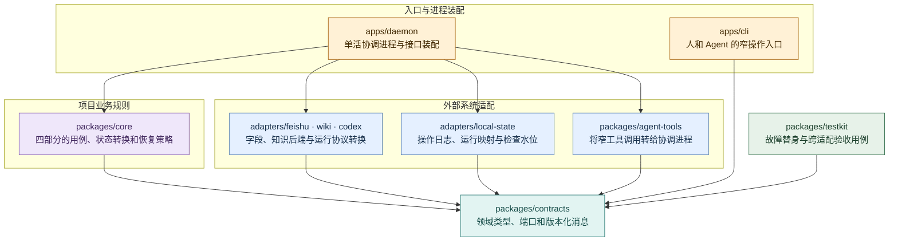
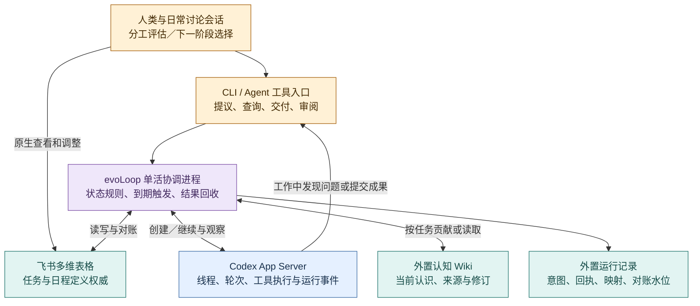

# 包架构：把项目规则与运行时分开

2026-10-19 · 拟议实现结构。当前仓库有文档、`scripts/docs/` 工具及 `scripts/research/` 隔离验证工具；本页列出的应用、包和接口尚未实现，也未部署。包名表达责任边界，应用语言、构建框架和运行存储选型仍待首个切片确认。产品行为见[日常工作闭环](../product/daily-loop.md)，Codex 的协议映射见[运行时接入](codex-integration.md)。

## 四部分如何落到代码

| 产品部分 | 所属模块 | 要做的事 |
| --- | --- | --- |
| ① 认知循环 | `core/cognition`、`core/reviews` | 准备阶段目标与证据引用，生成认知任务，接收并核对结构化判断，形成下一步或结束决定；判断由责任 session 完成。 |
| ② 动态多 session | `core/roles`、`core/sessions` | 职责与实例关联、分工评估任务、试行和退出条件；决定是否拆角色仍依据实际工作。 |
| ③ Task 与状态机 | `core/tasks`、`core/coordination`、`core/scheduling` | 提议与接受、派发、交付核对、定时实例、对账和恢复。 |
| ④ Wiki 与 evaluator | `core/knowledge`、`core/evaluation` | 知识贡献/修订/消费约定，评价任务与证据；通过外置知识适配器访问正文。 |

这些先是一个 `core` 包内的模块，随真实复杂度再拆包；角色数量不决定包数量。产品和架构 session 是责任者，不能等同于某个固定软件服务。

## 包依赖与层级

图中箭头表示**源码依赖**，不是调用顺序。平台适配器和核心都依赖中立合同，核心不引用飞书字段或 Codex 生成类型。运行时由应用装配实现并注入接口。



图例：黄＝入口和装配；紫＝项目规则；蓝＝平台与持久化适配；青＝共享合同；绿＝验证工具。`apps/cli` 和 `agent-tools` 使用合同定义的协调服务接口；图中没有 CLI 直接导入整个 daemon 实现。集成测试在应用边界组合 core、真实或替身适配器；testkit 自身不依赖生产包来制造循环依赖。

建议目录如下，实施时按切片创建，不预先生成空包：

```text
apps/
  daemon/                  单活协调、事件接收、调度、装配、运行健康
  cli/                     inspect / propose / deliver / review 等窄入口
packages/
  contracts/               领域消息与端口；不导入平台 SDK
  core/
    tasks/                 提议、分流、接受、交付、验收
    coordination/          派发意图、结果回收、对账、接续
    scheduling/            到期计算、错过与重叠策略、触发实例
    roles/                 职责说明、试行、回看与撤回
    sessions/              逻辑实例、工作说明和运行关联
    cognition/             目标/证据装配与下一步选择约定
    reviews/               阶段回看和需求判断的责任路由
    knowledge/             贡献、修订、失效与当前知识引用
    evaluation/            独立消费和真实效果评价约定
  adapters/
    feishu/                TaskStore 与 ScheduleStore；字段/身份映射
    wiki/                  KnowledgeRepository；候选后端独立实现
    codex/                 SessionRuntime；App Server 客户端及版本类型
    local-state/           OperationJournal 与 RoleRegistry 的首期实现
  agent-tools/             CLI/MCP 等工具封装，统一走协调服务
  testkit/                 可控时钟、事件与故障模拟、合同验收
scripts/docs/              现有文档构建，继续保持独立
```

## 每个包拥有什么

| 包／入口 | 拥有 | 边界 |
| --- | --- | --- |
| `contracts` | Task、TaskProposal、ReviewDecision、Schedule、Occurrence、Role、Session、Run、KnowledgeRef、Delivery 等语义；外部端口及版本 | `threadId`、`turnId`、飞书列 ID 等平台细节由适配器映射，业务合同只保留可追溯的运行引用。 |
| `core` | 状态转换、接受条件、责任路由、派发和恢复策略、证据包约定 | 通过注入的端口调用系统；不从某个数据库、模型字符串或聊天标题推断真值。认知策略准备任务和检查结果，不把确定性代码包装成自动认知。 |
| `adapters/feishu` | 平台鉴权、字段映射、分页、读写、事件转换、能力声明 | 飞书仍是任务权威；适配器不能用本地缓存悄悄接管业务状态。无实测条件写则明确不支持。 |
| `adapters/codex` | 进程连接、握手、请求/事件分发、线程/轮次映射、审批请求和断线观测 | 固定版本协议类型只在该包；不得把一次 `turn/completed` 自动解释为任务验收通过。 |
| `adapters/wiki` | 项目知识命名空间、读修订、贡献/发布与后端能力映射 | 活 Wiki 正文、修订和索引在仓库外；后端不支持的维护语义上报缺口，不能静默降级。 |
| `adapters/local-state` | 操作意图和回执、运行 ID 映射、触发实例、对账水位、待处理服务器请求、职责登记 | 这是恢复与配置记录。任务优先级、接受和完成状态回读飞书；不维护另一份可编辑任务表。职责说明在受管项目正式配置中，运行登记引用其版本。 |
| `agent-tools` / `apps/cli` | 接收可校验的提议、交付、认知贡献、查询和审阅操作 | 携带项目、实例、任务和操作身份，经统一服务检查权限与当前基线；不能凭模型自报角色获得权限。不会各自启动第二个自动写入协调者。 |
| `apps/daemon` | 注入配置与适配器、服务启动/停止、单活控制、事件与周期对账、运行限额 | 可以首期合为一个常驻进程，不要求微服务。凭据与私有运行记录在用户指定的外置运行目录，不进公共仓库。 |

任务、日程和触发实例的具体字段由[领域合同](contracts.md)维护。本页只说明代码责任，避免另建一份可冲突的协议定义。

## 运行时怎样合作

以下是目标调用关系，与上面的源码依赖图分开阅读。图中入口与服务尚未建设。



各领域 session 只需承担自己的目标、发现、交付和实际使用责任；协调进程统一核对完成及接续。它不要求工作 session 记住“完成后再去通知认知会话”，也不能只依赖某一条完成事件。结果丢失时通过操作记录、运行时回读和任务对账补回；缺少可核验证据时保留未知。

桌面中的日常讨论会话与系统管理的 App Server 工作线程是两种入口。前者可通过拟建工具读取依据、提交决定，后者由协调进程派发和观察；上下文通过任务和知识修订明确传递。当前没有桌面聊天自动接管或侧栏同步的保证，详见[Codex 接入边界](codex-integration.md)。

## 最小切片怎么落包

1. **任务提议与判断。** contracts、core/tasks、feishu 与窄工具入口支持一条 dogfood issue，从证据到接受/拒绝/调查；用真实测试表验证人和 Agent 的编辑冲突。先不加自动调度。
2. **一次 Codex 工作及回收。** 接入 codex 和 operation journal，记录派发意图、线程/轮次关联；事件完成后核成果，独立使用通过后更新任务。模拟响应丢失，确认不会盲目重发。
3. **一次定时任务。** 加入 scheduling 的可控时钟和飞书日程定义，每个到期生成独立实例；验证重启、重复触发、重叠、错过、暂停和取消。不会另起绕过接受条件的执行路径。
4. **认知与分工接续。** 加 wiki、认知评估和分工试行用例，把实际使用变为下一阶段选择；让两类日常讨论读取现行依据。使用者负担是否下降需独立验证。

完成一个切片才把相应包标为已实现。核心逻辑可用端口替身测试；真实平台合同必须用固定版本/环境实测。协议握手、任务验收、用户体验与长期收益分别报告，具体验证见[开发规范](../development/standards.md)。
