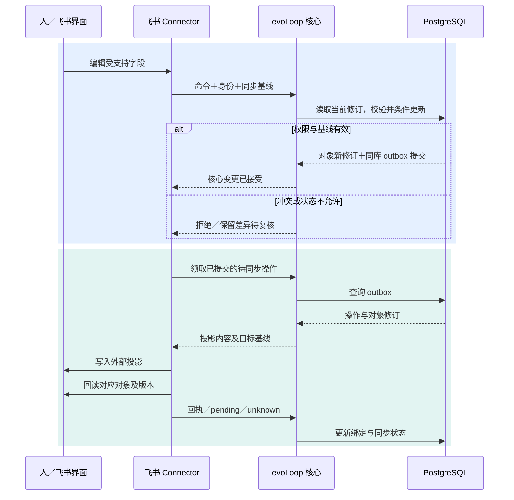
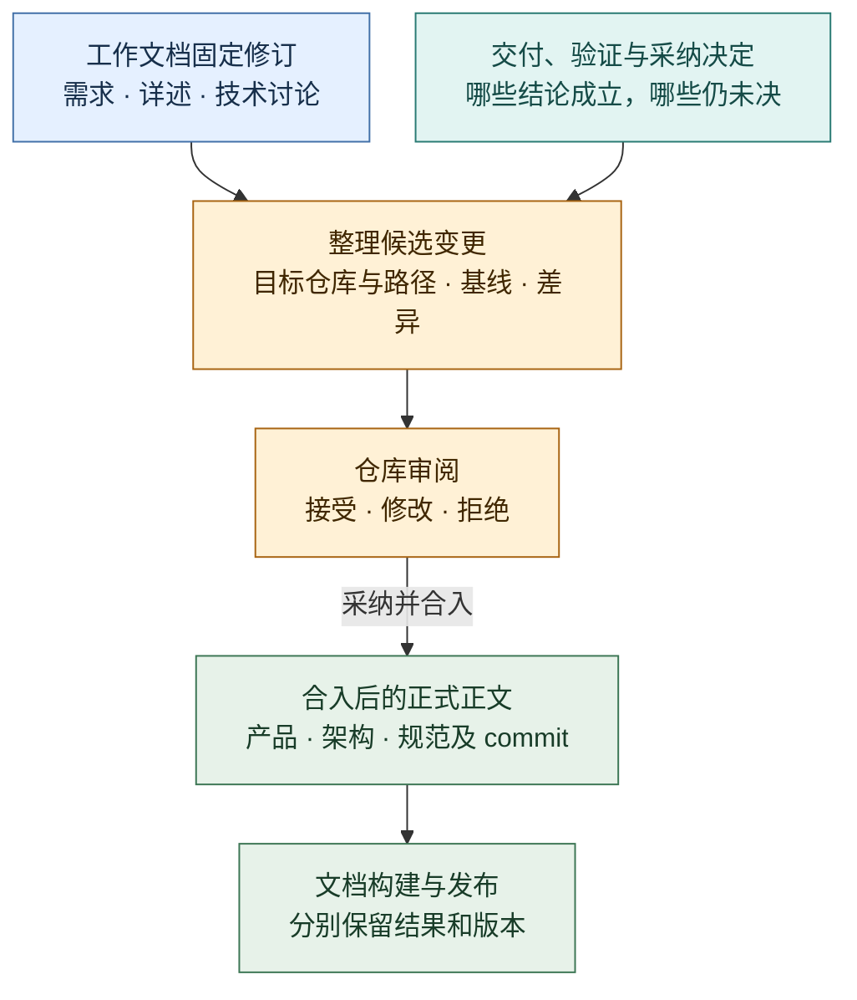

# 项目数据：任务、需求文档、Wiki 与 Connector

状态：**主数据归 evoLoop，飞书作为 connector 和协作入口；当前为本机试用，尚无生产部署。** PostgreSQL 已实现目标、阶段、Task、过程文档与修订、职责、日程和执行记录；固定来源与外置 OpenViking 已做受限实测，真人亲用和长期效果仍待核。飞书实连按使用者取舍延后。本文落实 [DEC-018](../decisions.md)，替代“飞书持有唯一任务主数据”的早期方向；具体端口见[领域合同](contracts.md)，代码责任见[包架构](packages.md)，试用证据与未验范围见[路线图](../roadmap.md)。

读完[总览的一轮工作](overview.md#3-沿一轮工作理解系统)后，本页先回答对象怎样关联、何时固定依据，再展开过程文档、外部投影和正式沉淀。具体字段在合同与存储维护。

## 1. 为什么需要一起管理

认知 session 决定下一步时，需要同时知道：我们希望达成什么、依据是什么、已经做了什么、实际效果如何，以及哪里仍有冲突。孤立的任务表只表达行动，文档描述目标与约定，Wiki 保存可修订的解释；缺少关系和版本，Agent 仍需靠聊天历史猜测它们怎样连接。

evoLoop 因而维护稳定的对象身份与关系，让一次查询能得到相关需求修订、任务状态、关键认识、来源及结果。统一的是项目范围、身份、版本、权限和读取入口；各类正文保留明确的维护位置。它是原有四部分的共同数据基础，不新增一个固定 Agent 角色。

| 对象 | 持续回答的问题 | 主数据与正文位置 |
| --- | --- | --- |
| Task | 谁在什么依据、业务领域下做什么，如何验收，四态进度到哪一步？ | evoLoop PostgreSQL；飞书记录是协作视图，编辑通过核心规则接收 |
| BusinessDomain / BusinessDomainRevision | 稳定业务领域怎样命名、映射哪项持续职责、为何改变？ | evoLoop PostgreSQL 保存独立领域 ID、修订与 Role 映射；领域不是 `Task.kind` |
| Role / HostLink | 持续职责由哪个受管 Session 或经核实的外部承载承担？ | evoLoop PostgreSQL 保存 Role 修订、正式 Session 绑定及分开的 host link 和能力核实记录 |
| Document / DocumentRevision | 任务主正文及 issue/spec/discussion/report 的完整内容是什么？ | PostgreSQL 管理过程文档修订及内联正文或唯一受控载荷引用；Git 正式文档独立按 repo/path/commit/hash 引用 |
| Discussion / DiscussionEvent | 负责人带什么固定依据讨论分工或方向，承接、决定及后续对象怎样追证？ | PostgreSQL 保存状态、固定引用与追加事件；交接和人工登记正文只存过程 DocumentRevision，不另存一份聊天正文 |
| Knowledge | 为什么这样判断，哪些证据支持或挑战，适用条件是什么？ | 外置 Wiki / KnowledgeRepository；evoLoop 保存稳定引用和相关对象关系 |
| Evidence / Delivery | 观察到什么、交付了什么，在哪里核对？ | 受控原件或成果位置；evoLoop 登记定位、修订及关联 |
| Relation | 哪个任务依据哪份文档和认识，什么结果触发了修订？ | evoLoop PostgreSQL 保存跨对象关系；Wiki 内部来源—主张依赖仍由知识系统维护 |
| ExternalBinding | 哪个外部记录对应哪个内部对象，现在同步到哪个版本？ | evoLoop PostgreSQL；平台 ID 不代替内部业务 ID |

Task 主正文的唯一权威是 DocumentRevision。Task 与每个 TaskRevision 保存 `contentDocumentId/contentRevisionId`，`content` 是按固定修订读取的投影，数据库不再另存可编辑 goal 正文。验收 acceptance 仍由 Task 及其修订保存；项目 Goal 不更名。`task.create` 在一个事务创建 todo Task、task 类型主文档和固定正文，`task.start` 原子发布主正文、封存本轮依据并进入 in_progress，不需要单独的规格文档前置。工作状态只用 todo/in_progress/done/cancelled。Task 可选稳定业务领域 ID，并在 TaskRevision 中固定该关联；更换领域须在 todo 且无在途 Run 时经受控修订，历史修订不随领域或 Role 后续变化改写。`Task.kind` 仍表达工作类型，不充当领域键。

Role 的 `system` / `business` 分类与七种初始职责模板已有合同和查询入口；模板只是参考，不自动建 Role、绑定 Session 或分配任务。领域映射更新时核对所见 Role 版本、理由与授权依据。受管承载以同项目、ready、原生 Thread 存在且正式绑定的 Session 为准；外部 Desktop host link 则分别登记声称能力、核实证据和撤销状态，已核的人工领取能力不等于自动启动或 owned writer。只读领域路由返回承载状态与建议，`automaticStart` 为 false，不能代替当前 Run 的授权校验。未登记的 Desktop 聊天不构成 owned Role 承载；队列与跨 Session 通信仍在实施中，不从这些登记关系推定已可自动接续。

候选常驻队列给一组已封存的进行中 Task 记录明确次序、依赖、同项目 owned Session 和总 Run 预算；采纳的队列版本才供领取。队列条目、领取和每次 Run 尝试各有持久身份，Run 仍是执行权威，TaskRevision 仍是正文及固定输入权威；队列保留用于校验的固定输入快照，不维护另一份可编辑正文。排队未领取时可按版本重排；正文或依据变化须明确修订队列项并重新采纳，不能静默套用旧输入。领取及后续尝试核当前 Role 绑定、精确 grant、Session 状态和 Task/Session 占用；结果未知保留原操作与占用，不用新尝试抹去。预算累计所有尝试，不因失败或改序清零。业务对象、命令 journal 与 outbox 在项目事务中一致提交；原生 Turn 的实际启动和回读另行对账。队列候选尚未部署或完成独立验收，不从数据表存在推断自动接续已生效。

用途类型与 format 分开；未分类可为空，Document 生命周期使用 draft/published/archived。已发布 r3 与新草稿 r4 可以共存，归档不删历史或越过权限。初期验收留原任务内，正文写作与使用语义见[任务与过程文档](../product/tasks-and-documents.md)。

issue/report 可带不可变 `origin`：Task ID、可空的 Run ID，以及服务派生的固定 TaskRevision；指定 Run 时采用其实际输入修订，不能由作者提交一个猜测的版本。017 迁移保留旧文档的空来源。只有带来源 issue 的正式首次创建操作及初稿 hash 进入认知来源，按该固定任务修订的历史 Stage/Goal 归属；不从标题或当前任务归属反推，也不自动订阅 report。读取和选作修复依据仍需核固定修订与权限，来源关系不证明问题属实或已经修复。

## 2. 三类对象怎样形成闭环

[总览的工作回路](overview.md#3-沿一轮工作理解系统)已画出从观察到下一步的顺序；本页只核对其中对象的身份和权威：Wiki 认识支持或挑战需求 Document，采纳的需求修订成为 Task 的固定依据，交付与实际使用可推动新的认识或需求修订。Git 正式规范按固定 commit 引用，正文仍由对应仓库维护。关系记录“支持”不证明结论正确，还须读取依据、相反解释和适用条件。

例如“执行结束后认知 session 必须回看”是一份需求。最初版本可能只要求发通知，真实使用发现接收者没有读成果，新版本增加“读取指定成果与修订、形成回看结论”的验收。两个实现任务都应知道自己依据哪版需求；已按旧版完成的记录保留原验收，新增差距进入复核或新任务。Wiki 则修订“通知成功是否足以证明交接”的认识。此例用于说明模型，不表示这些正式对象已经创建。

## 3. 关系与认知读取

任务决定历史读取每个真实 TaskRevision 的状态、理由、操作者、时间与当时封存依据，不从当前状态或操作摘要倒推。已回看阶段的纠正须指定最新同阶段 Review 和当前版本，追加 `supersedesReviewId`、StageRevision 与 Review；旧判断保持不变，也不会顺带改变 Task。

阶段归属随任务修订保存。`task.update.stageId` 省略时沿用原关联，显式 `null` 解除关联，指定 ID 则关联本项目的 active 阶段。显式提供该字段同时要求 write 与 review 权限；实际变更只允许 todo 且无在途或结果未知的 Run。非空关联仍须有 consumer、evidence 和 stopCondition。操作核对 expectedVersion，原子追加 TaskRevision/TaskProposal 及 journal/outbox；旧关联、已回看阶段和已拒绝的启动操作保持原样。`task.start` 继续拒绝当前仍关联非 active 阶段的任务。

待处理 Task 在上游改版时不会生成进行中任务的 Impact。`task.start.retentions` 为这条路径逐项提交旧文档修订、当前观察的已采纳修订和保留理由；核心核对同项目、已关联且已发布的所选来源，以服务端身份和时间写入新封存 BasisSet。检查和 TaskRevision、journal/outbox 同事务完成，既有拒绝操作不改写。省略 basis 时可继承仍有效的保留记录；显式重选 basis 时必须同时明确所需保留项。派发只接受与当前已采纳修订相符的记录，上游再次改版会使旧观察失效；进行中的 Impact/BasisDecision 路径继续独立工作。PostgreSQL 的封存约束保护保留记录，不能事后补写理由或改变观察版本。

待处理 Task 也可在 `task.update` 显式重选本轮外部固定输入：`basis` 是完整替换集合，`[]` 只保留自动加入的主正文，省略则沿用旧集合与普通更新权限。`retentions` 只能随显式 `basis`；旧修订采用版、观察到的当前采纳版和逐项理由沿用 `task.start` 校验。此分支须同项目 read/write/review、当前 Task 版本、已发布且已关联的固定修订、无在途或结果未知 Run；进行中先正常重开。核心核 inline 原文 hash 或 Blob 注册清单/hash，Blob 实际字节仍须经既有 original 读取链核验，重选成功不证明字节已读。正文同次变更时以新主修订封存，正文相同则沿用原修订。操作在同一事务追加 TaskRevision、sealed BasisSet、journal/outbox；历史 Run 和旧集合不改。选择不会启动 Task，后续正常 `task.start` 继续核当前材料与派发权限；已经受理但尚未 reserve 的派发只可按原 Task CAS 失败，不能悄悄继承新输入。

负责人讨论沿同一授权 Command/Query API 和 Journal/outbox 提交。准备时固定 Goal/Stage 版本、所选 Task 修订与已采用过程文档；承接观察和讨论决定追加到交接文档修订中，人工登记者与时间单独标明。修改须核对讨论版本与交接文档现行修订，避免覆盖在文档入口另做的修改。后续对象只建立固定链接，执行和亲用仍按各对象记录验证；决定纠正保留旧事件并要求重新核对后续链接。目标会话标签或引用不构成原生会话归属、送达或自动回写证明。

若通用文档修订已推进所属 Document、而 Discussion 仍登记旧版，普通决定拒绝 `DOCUMENT_CHANGED`。`discussion.decision.record.documentRecovery` 提供显式受控接续：同时核对 Discussion 版本、最新决定、实际当前 Document 修订及 `expectedDocumentVersion`，要求同项目所属非归档 Markdown 原件及两版哈希可核。新修订以实际编辑版为 parent，追加旧/新固定修订、哈希、读入版本、确认者/时间和理由，再追加决定；Document 与 Discussion 同事务各推进一次。无需新增状态或迁移，不改写旧版、已采纳指针或评价冻结输入。不失配、过期或范围/权限不符均拒绝；确定拒绝后的重新判断属于新意图，未知回包仍先原 ID 对账。

关系至少带项目、两端稳定 ID/类型、相关修订、关系类型、建立者、依据、时间与当前有效性。`specifies`、`implements`、`justified_by`、`validates`、`contradicts`、`supersedes` 等类型需有定义；“implements”表达实现目标，实际符合要求还需验收证据。跨项目关联必须显式授权，不能借关系遍历绕过源对象权限。

认知读取可按任务生成一份有限上下文：当前任务与实际基线 → 相关文档修订 → 当前知识及与旧基线的差异/重要反例 → 真实结果和来源入口 → 待确认冲突。每项返回其权威位置、读取版本与时间；关系索引和同步缓存不可伪装成当前知识。关系记录不要求第一版引入图数据库，PostgreSQL 足以先表达这些带类型的连接。

Wiki 维护可以把需求修订、阶段评审和交付证据作为来源，通过固定 Document/Task 修订读取。需要摄入的材料副本只作带原始 ID、版本与权限的只读来源，正文回查原权威；草稿和提议保留未采纳状态。任务进度的每次小变化不必触发全库编译，当前行动状态仍实时从 TaskStore 读取。这样，需求和经验能参与综合认识，又不会把过去的任务快照误读为现在的状态。

知识、需求或来源发生变化时，关系帮助找到受影响对象，先生成待复核事项。**模型不能因为发现相关关系就自动改写已采纳需求或关闭任务。** 复核决定记录继续、换基线、补证、拆新任务或暂缓，再按权限推进。Wiki 维护和业务状态更新仍由各自合同负责。

## 4. 文档表怎样设计

`Document` 是过程文档目录，`DocumentRevision` 记录其不可变修订。它只管理需求、任务详述、技术讨论、方案比较和评审结论等过程文档，可直接关联 Task；文档可以已经采纳、完成或归档。仓库 `docs/` 下的产品、架构、接口与开发规范不属于 Document 表，是由 Git 维护的独立文档源。

Document 修订及载荷归属由 PostgreSQL 管理；正文可内联或按固定修订唯一引用受控 BlobStore 原件，详见[存储设计](storage.md)。过程文档可先创建和讨论，再关联任务，不要求创建时已有 Task。一个 Task 可直接关联多份过程文档，同一份需求也可关联多个 Task；普通 Task↔Document 导航链接只需指向稳定 documentId。主正文从创建时即固定 DocumentRevision；开始执行时将主正文与实际采用的其他材料封存到依据集合。Task 保留标题、负责人、独立验收及固定主正文引用；完整说明在主 Document 中直接展开，其他讨论或规格按需独立引用。Git 正式文档不创建 Document 行；必要的 GitSourceRef/source metadata 记录 repo、path、commit 和内容 hash，供固定引用、校验和追溯。

| 项目 | 拟议语义 |
| --- | --- |
| 身份与范围 | 稳定 documentId、projectId、文档类型、负责人、可见范围；仅用于任务关联的过程文档 |
| 正文与修订 | evoLoop 管理过程文档正文和不可变修订；固定修订记录作者、时间、所读基线和变更理由 |
| 过程文档修订 | revisionId、可扩展的 `format`、`mediaType`、`originalName`、源内容 hash、`body` 或 `payloadRef`、`entrypoint`、`assetsManifest`、完整性状态及作者/时间/基线/变更理由；首次创建后不可覆写历史修订 |
| 当前指针与采纳 | 草稿、待审、已采纳、已取代/归档分别表达；候选的新修订不自动替换现行已采纳修订，发布采用条件更新 |
| 关联 | Task 与 Document 可多对多建立导航链接；任务接受或执行时在依据集合固定实际使用的 DocumentRevision。GitSourceRef、知识、证据和成果作为独立来源/对象引用 |

过程文档可以在 evoLoop 中创建、修订、审核，再经 connector 供人在飞书阅读和受控编辑。任务接受时在同一事务封存所用修订的完整依据集合；后续依据改版生成新 TaskRevision/BasisSet，不能向旧集合补写成员。Git 正式文档始终由原仓库维护；evoLoop 可登记独立 GitSourceRef，按权限读取固定 repo/path/commit 并校验 hash。工作完成后，采纳的结论可整理成正式文档的新增或修改，原过程文档保留任务当时的历史。两类来源保持独立身份和权威边界。

Document 目录以表格列出文档元数据；选择某行后按权限加载完整固定修订。过程文档不限定为一种文件格式，首批计划阅读 Markdown 和 HTML 报告。Markdown 按正文显示；HTML 保留不可变原件，默认使用禁脚本的隔离静态预览。报告的本地 CSS、图片等资源须随 revision 的 assetsManifest 和 bundle 一起保存并核哈；自包含 HTML 可单独保存，需要资源却只取得 HTML 入口文件时标记内容不完整。

Wiki 页保持知识对象身份，文档可引用它的修订。搜索或展示可组合这三类对象，但不能把需求已采纳、任务已完成、知识已验证合成一个“完成”字段。正文存在不代表同意实施，关系存在不代表接收者已采用。

## 5. 飞书 Connector 的职责

第一种 connector 面向飞书多维表格任务视图；需求文档可先显示标题、状态、链接和版本。后续飞书云文档正文读写需单独探索 API、权限、块结构和修订能力，不能用任务表接通推断文档编辑已经可用。Notion 等平台也遵守同一接口，但按实测能力声明支持范围。

下图细化**飞书原生编辑如何变成受控命令，以及 PG 提交后怎样出站投影并回读**。它解释同步方向和冲突边界，不把飞书画成 Task 主数据。

蓝＝入站受控变更；青＝出站及回读。图中的飞书读写表示拟议 connector 能力；第一切片可先做单向投影，再启用已验证字段的回写。Connector 通过核心服务处理业务读写，不能直接跳过授权和状态规则写入主表。

- **同步身份。** 绑定内部对象和外部 ID，保存最后确认的本地/远端基线、字段方向、操作和事件关联，识别自身回写引起的事件，避免循环写入。外部行为者必须映射到允许操作的身份，缺少身份或权限证据时进入待审核。
- **冲突。** 人和 Agent 从同一旧基线改了同一字段时，保留两份意图并复核；不按最后到达时间覆盖。外部接口不能保护并发写时，限制可编辑字段/同步方向，或先停止写回；不能声称完全双向无损同步。
- **断线与重试。** PostgreSQL 适配器通过中立 `UnitOfWork` 端口在同一连接/事务内提交对象、关系、操作记录和 outbox；core 不接触 SQL/client，网络写入在提交后执行并另行回读。命令 ID 连同摘要去重，结果不明先回读 Journal。首次创建投影时，若写成却丢回包，尚无 ExternalBinding；必须先验证远端可保存并按稳定内部对象/操作标记查询，再据此定位已有记录。查不清时保留 unknown 并暂停自动重建，不能以“无绑定”推断远端不存在。事件丢失靠周期对账补漏。核心写失败不标已同步，飞书成功写入也不等于任务已验收。
- **删除与权限。** 删除外部投影默认产生绑定异常，保留内部对象；依配置重建或解除绑定须可追溯。归档/删除主对象是独立授权行为。outbox worker 每次向外发送前重验当前源对象授权、目标可见范围和绑定状态；权限收紧时先停止后续发布并追踪既有投影的撤销。不能承诺已被复制的内容可以自动收回。

Task 状态、文档采纳状态、Run 状态、Sync 状态与实际效果分别显示。飞书暂时不可用时，核心可以保留任务并通过其他已授权入口工作；若任务的验收目标本来就是“飞书可读/可编辑”，相应验收仍未完成。

## 6. 工作文档怎样沉淀为仓库正式文档

这里的“build 到仓库文档”包含两步：先把已经采纳且有依据的结论**整理成 Git 正式正文的变更**，再由仓库构建工具把该正文渲染成报告。第一步需要选择、合并和解释内容；第二步才是确定性的文档构建。模型可提出变更，不能用“文件已生成”替代内容审阅。任务完成可触发检查，也允许在里程碑提前整理；不要求每份技术讨论都发布。

下图用于分清**过程修订、采纳决定、Git 审阅合入和站点构建**四种结果；箭头不是自动复制正文的流水线。

蓝＝工作过程；青＝成立依据；黄＝整理与审阅；绿＝正式正文及其构建视图。合入后登记来源与纳入位置的回链；原件保留，正式文档描述现在应该怎样工作。多个需求或技术讨论可以共同修改一份架构文档，一份需求也可以同时修改产品、接口和规范，关系是多对多。

例如，需求文档说明“接续时要核对实际成果”，技术讨论比较两种交接办法，任务交付给出采用情况。责任 session 从这些固定修订提取成立的要求，修改仓库现有产品验收和交接架构，而不是把整份讨论逐字搬进去。废弃方案留在工作文档，长期有价值且可公开的研究过程可另整理到 `docs/research/`，未决项保持未决。

拟议 `DocumentIncorporation` 记录一次整理工作：来源过程文档及片段/固定修订、关联 Task 与交付/决定、目标 repo/path/章节与预期 base commit、纳入或不纳入的理由、责任者、候选变更/PR，以及核实后的 merge commit。目标是 Git 文档位置及其固定提交，不是 Document 表中的目标行。来源和目标保持独立身份；合入后可用 `incorporated_into` 将来源 DocumentRevision 关联到目标 GitSourceRef，并由整理记录保留具体采纳范围。该关联说明内容被整理纳入，不证明来源中的所有主张都成立。

- **先检查目标现状。** 基于当时 Git 正文生成差异；目标分支变化须重新核对，不覆盖后来编辑。来源修订改变时保留旧候选依据，明确是否重新整理；不悄悄换成最新版。
- **经过原仓库流程。** 领域责任者可完成整理、改文、验证与审阅交接；不强制另设固定“出版 session”。读取 Git 的适配器仍只读，写入由获授权的仓库任务完成。自动化整理尚未实现。
- **分别记录结果。** 工作文档完成、任务验收、仓库审阅/合入、HTML 构建、公网部署各自有状态。PR 已建不等于已合入；合入后构建失败只表示报告尚未更新，不回写为“Git 未修改”。无发布目标时部署为不适用。
- **不丢历史、不形成双向正文同步。** 原工作文档保留或归档，旧 Task 仍读当时修订；正式文档后续演进由 Git 维护。原件是历史依据，正式正文是现行约定，两者不会自动互相覆盖。新正式规范若影响尚未完成的工作，走正常影响复核。
- **进入知识体系。** 工作文档作为工作证据、合入 commit 作为现行正式约定分别进入 SourceBridge，并携带采纳/历史状态。Wiki 保存为何作此决定与适用条件，不能凭整理动作把讨论假设升级为事实。公开正式文档只纳入可发布内容，不要求公开私有工作原件。

## 7. 首个切片与实际验收

本页定义所有权；具体表/键/修订约束见[存储逻辑](storage.md)，从 PG 与 Git 固定来源到 Wiki、再返回任务复核的流程见[知识关联](knowledge-flow.md)。用户阅读和修改这些对象的入口见[工作台产品](../product/workbench.md)与[前端架构](frontend.md)。

先建立最小项目、Task/过程Document/Relation 合同、PostgreSQL 版本化存储和 CLI 入口，再接工作台的读取、提议与复核切片；完整富文本协作编辑后置。受限的 S1a 可先实现内联 Markdown 过程文档的已批准修订、ready Task、封存依据、导航关联、影响复核及 Journal/outbox；不因此宣称已接通飞书、Git、Wiki 或 Blob。完成 S1 时连接飞书任务投影，再验证受控字段回写；GitSourceRef 可从显式登记 repo/path/commit/hash 开始。之后接入已通过门槛的 Wiki，并保留首期单活动协调者。

1. 在真实 PostgreSQL 上验证对象、关系与 outbox 最后一步失败时全部回滚；创建一份过程需求的两个修订，确认待审草稿不覆盖已采纳版本；两个任务各自固定并封存依据，旧集合不能改。跨项目/越权读取、写入和关系遍历须拒绝；同一 operation ID 同摘要回放、异摘要拒绝，合法领域拒绝不留对象或 outbox，提交结果不明时按 ID 回读。
2. 将任务映射到飞书；注入首次远端创建成功却丢回包，核稳定标记是否定位原记录，不能定位时保留 unknown 而不重复创建。模拟人和 Agent 并发编辑，冲突可见、旧值可查，修订与同步状态分别正确。
3. 注入核心提交后、外部回执前的中断，恢复后不盲目重复创建；暂停飞书时任务仍可读，恢复后核对投影。权限收紧后排队投影须停发，既有副本另行对账撤销。
4. 让新 session 从普通入口找到任务、需求、Wiki 反例和原始证据；用户纠正后，相关任务进入复核，旧任务历史未被改写。
5. 撤销权限或删除外部投影，核对敏感内容可见范围与绑定处理；不通过索引、摘要或关系边泄露已无权读取的内容。

评价同时看任务完成质量、找依据的时间、遗漏/返工、纠错传播和同步维护成本。表数量、链接数量、模型自评与“同步成功”均不能单独证明认知工作更有效。
