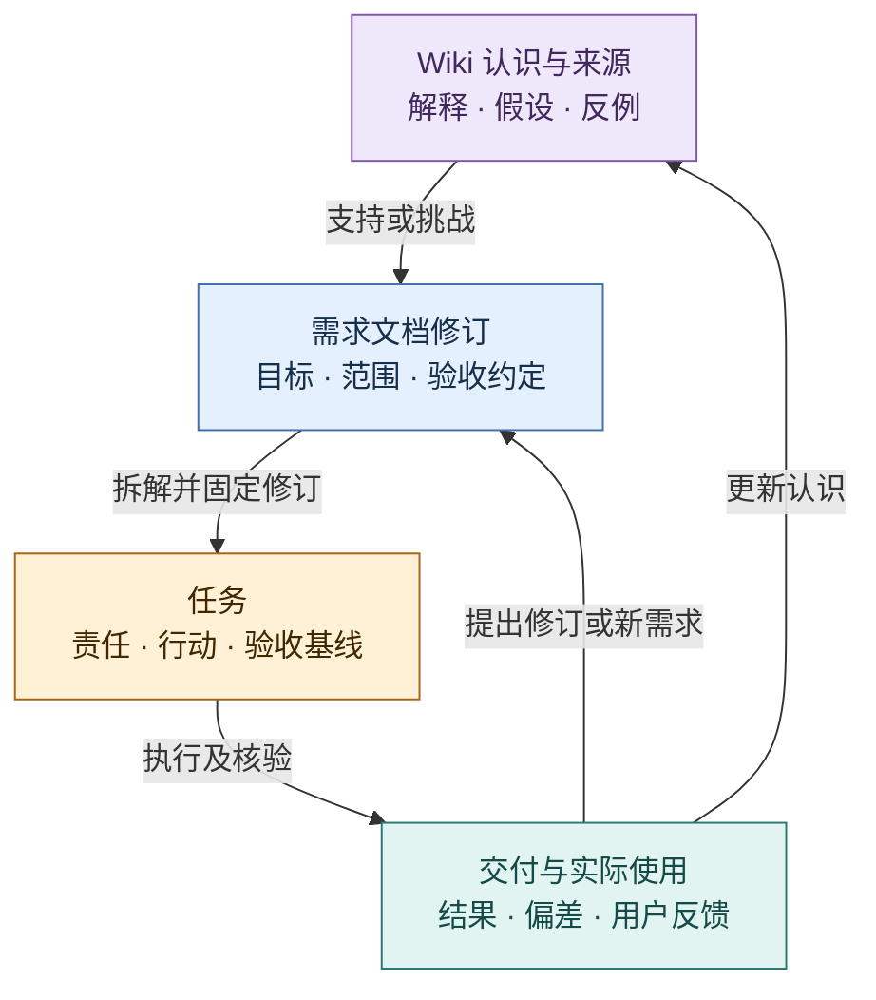
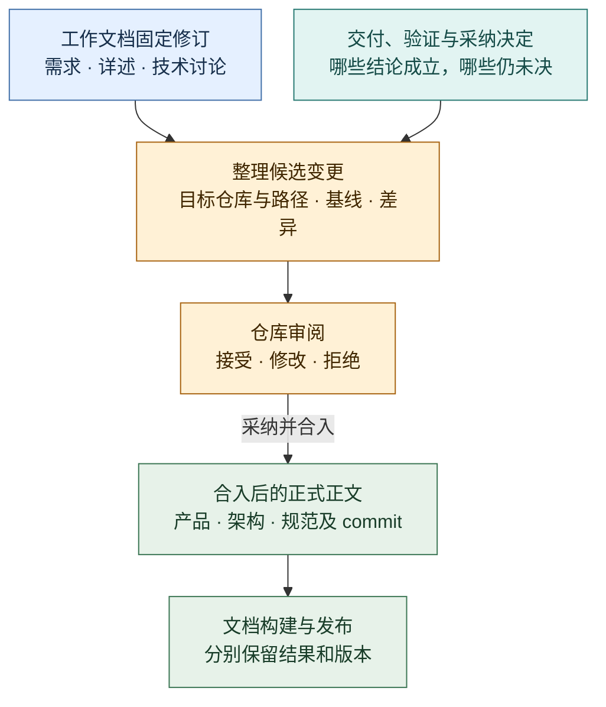
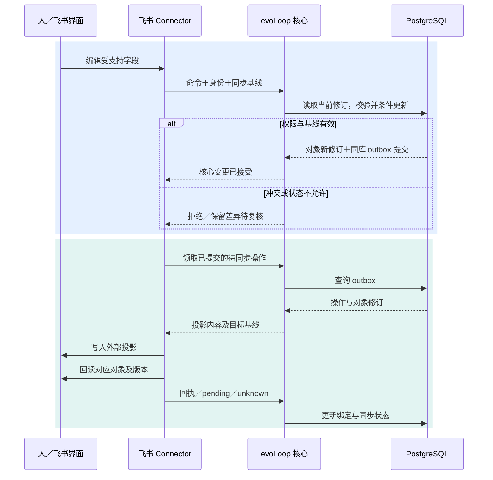

# 项目数据：任务、需求文档、Wiki 与 Connector

状态：**主数据归 evoLoop、飞书作为 connector 和协作入口，已由用户确认；以下结构与流程尚未实现。** PostgreSQL 已选定。本文落实 [DEC-018](../decisions.md)，替代“飞书持有唯一任务主数据”的早期方向；具体端口见[领域合同](contracts.md)，代码责任见[包架构](packages.md)。Wiki 后端仍按[技术选型](technology-selection.md)单独验证。

## 1. 为什么需要一起管理

认知 session 决定下一步时，需要同时知道：我们希望达成什么、依据是什么、已经做了什么、实际效果如何，以及哪里仍有冲突。孤立的任务表只表达行动，文档描述目标与约定，Wiki 保存可修订的解释；缺少关系和版本，Agent 仍需靠聊天历史猜测它们怎样连接。

evoLoop 因而维护稳定的对象身份与关系，让一次查询能得到相关需求修订、任务状态、关键认识、来源及结果。统一的是项目范围、身份、版本、权限和读取入口；各类正文保留明确的维护位置。它是原有四部分的共同数据基础，不新增一个固定 Agent 角色。

| 对象 | 持续回答的问题 | 主数据与正文位置 |
| --- | --- | --- |
| Task | 谁在什么依据下做什么，如何验收，当前到哪一步？ | evoLoop PostgreSQL；飞书记录是协作视图，编辑通过核心规则接收 |
| Document / DocumentRevision | 本次工作的需求、详述、技术讨论与决定是什么；哪些结论已进入长期规范？ | 工作文档正文与修订在 PostgreSQL；仓库正式产品、架构与规范按 Git 固定修订引用 |
| Knowledge | 为什么这样判断，哪些证据支持或挑战，适用条件是什么？ | 外置 Wiki / KnowledgeRepository；evoLoop 保存稳定引用和相关对象关系 |
| Evidence / Delivery | 观察到什么、交付了什么，在哪里核对？ | 受控原件或成果位置；evoLoop 登记定位、修订及关联 |
| Relation | 哪个任务依据哪份文档和认识，什么结果触发了修订？ | evoLoop PostgreSQL 保存跨对象关系；Wiki 内部来源—主张依赖仍由知识系统维护 |
| ExternalBinding | 哪个外部记录对应哪个内部对象，现在同步到哪个版本？ | evoLoop PostgreSQL；平台 ID 不代替内部业务 ID |

## 2. 三类对象怎样形成闭环

紫＝认识；蓝＝目标约定；黄＝行动；青＝现实证据。已有 Git 正式规范按固定 commit 引用，正文仍由对应仓库维护。箭头表示有来源和版本的关系；画出“支持”并不证明结论正确，仍须读取依据、相反解释和适用条件。

例如“执行结束后认知 session 必须回看”是一份需求。最初版本可能只要求发通知，真实使用发现接收者没有读成果，新版本增加“读取指定成果与修订、形成回看结论”的验收。两个实现任务都应知道自己依据哪版需求；已按旧版完成的记录保留原验收，新增差距进入复核或新任务。Wiki 则修订“通知成功是否足以证明交接”的认识。此例用于说明模型，不表示这些正式对象已经创建。

## 3. 文档表怎样设计

`Document` 是有稳定身份的文档目录，`DocumentRevision` 记录不可变修订。按用途明确区分两类：**工作文档**服务某次任务或阶段，包括需求、任务详细说明、技术讨论、方案比较、阶段计划和评审结论；**正式文档**服务项目持续开发，包括仓库里的产品定义、架构、接口与开发规范。工作文档可以已经采纳、完成或归档，仍不等于正式文档；“中间过程”指它的用途，不意味着只能是未完成草稿。

`native/reference` 描述正文在哪里维护，是另一条维度。当前工作文档主要用 PG 原生正文，Git 正式文档用引用模式；不能仅凭存储模式推断用途。一个 Task 可关联多份工作文档，同一份需求也可服务多个 Task。Task 中保留简短目标与验收入口，详细说明和讨论作为独立修订引用。逻辑对象对应一组表，不把正文、历史、关系和同步状态塞进同一行。

| 项目 | 拟议语义 |
| --- | --- |
| 身份与范围 | 稳定 documentId、projectId、用途 `working/formal`、文档类型、负责人、可见范围；用途与存储模式分开 |
| 维护位置 | `native`：evoLoop 管理正文与修订；`reference`：登记 Git 等外部正文位置、固定修订与可核对哈希 |
| 原生修订 | revisionId、正文格式、Markdown/结构化正文、作者、时间、所读基线和变更理由；首次创建后不可覆写历史修订 |
| 当前指针与采纳 | 草稿、待审、已采纳、已取代/归档分别表达；候选的新修订不自动替换现行已采纳修订，发布采用条件更新 |
| 关联 | 任务、知识、证据、替代文档和成果使用带类型的关系；任务引用实际使用的固定修订 |

**工作文档**可以在 evoLoop 中创建、修订、审核，再经 connector 供人在飞书阅读和受控编辑。**Git 正式文档**继续经过原仓库的修改与审阅流程；evoLoop 登记 repo/path/commit 和关系，查看时按权限读取。工作完成后，采纳的结论可整理成正式文档的新增或修改，原工作文档保留任务当时的历史。默认并非把整个原生文档改成 Git 引用；只有明确迁移**同一份现行文档的维护权**时才使用模式切换，保留两端固定修订与决定。

Wiki 页保持知识对象身份，文档可引用它的修订。搜索或展示可组合这三类对象，但不能把需求已采纳、任务已完成、知识已验证合成一个“完成”字段。正文存在不代表同意实施，关系存在不代表接收者已采用。

## 3a. 工作文档怎样沉淀为仓库正式文档

这里的“build 到仓库文档”包含两步：先把已经采纳且有依据的结论**整理成 Git 正式正文的变更**，再由仓库构建工具把该正文渲染成报告。第一步需要选择、合并和解释内容；第二步才是确定性的文档构建。模型可提出变更，不能用“文件已生成”替代内容审阅。任务完成可触发检查，也允许在里程碑提前整理；不要求每份技术讨论都发布。

蓝＝工作过程；青＝成立依据；黄＝整理与审阅；绿＝正式正文及其构建视图。合入后登记来源与纳入位置的回链；原件保留，正式文档描述现在应该怎样工作。多个需求或技术讨论可以共同修改一份架构文档，一份需求也可以同时修改产品、接口和规范，关系是多对多。

例如，需求文档说明“接续时要核对实际成果”，技术讨论比较两种交接办法，任务交付给出采用情况。责任 session 从这些固定修订提取成立的要求，修改仓库现有产品验收和交接架构，而不是把整份讨论逐字搬进去。废弃方案留在工作文档，长期有价值且可公开的研究过程可另整理到 `docs/research/`，未决项保持未决。

拟议 `DocumentIncorporation` 记录一次整理工作：来源文档及片段/固定修订、关联 Task 与交付/决定、目标 repo/path/章节与预期 base commit、纳入或不纳入的理由、责任者、候选变更/PR，以及核实后的 merge commit。源和目标分别保持独立身份；固定来源到合入目标用 `incorporated_into` 关系追溯。该关系说明内容被整理纳入，不证明来源中的所有主张都成立。

- **先检查目标现状。** 基于当时 Git 正文生成差异；目标分支变化须重新核对，不覆盖后来编辑。来源修订改变时保留旧候选依据，明确是否重新整理；不悄悄换成最新版。
- **经过原仓库流程。** 领域责任者可完成整理、改文、验证与审阅交接；不强制另设固定“出版 session”。读取 Git 的适配器仍只读，写入由获授权的仓库任务完成。自动化整理尚未实现。
- **分别记录结果。** 工作文档完成、任务验收、仓库审阅/合入、HTML 构建、公网部署各自有状态。PR 已建不等于已合入；合入后构建失败只表示报告尚未更新，不回写为“Git 未修改”。无发布目标时部署为不适用。
- **不丢历史、不形成双向正文同步。** 原工作文档保留或归档，旧 Task 仍读当时修订；正式文档后续演进由 Git 维护。原件是历史依据，正式正文是现行约定，两者不会自动互相覆盖。新正式规范若影响尚未完成的工作，走正常影响复核。
- **进入知识体系。** 工作文档作为工作证据、合入 commit 作为现行正式约定分别进入 SourceBridge，并携带采纳/历史状态。Wiki 保存为何作此决定与适用条件，不能凭整理动作把讨论假设升级为事实。公开正式文档只纳入可发布内容，不要求公开私有工作原件。

## 4. 关系与认知读取

关系至少带项目、两端稳定 ID/类型、相关修订、关系类型、建立者、依据、时间与当前有效性。`specifies`、`implements`、`justified_by`、`validates`、`contradicts`、`supersedes` 等类型需有定义；“implements”表达实现目标，实际符合要求还需验收证据。跨项目关联必须显式授权，不能借关系遍历绕过源对象权限。

认知读取可按任务生成一份有限上下文：当前任务与实际基线 → 相关文档修订 → 当前知识及与旧基线的差异/重要反例 → 真实结果和来源入口 → 待确认冲突。每项返回其权威位置、读取版本与时间；关系索引和同步缓存不可伪装成当前知识。关系记录不要求第一版引入图数据库，PostgreSQL 足以先表达这些带类型的连接。

Wiki 维护可以把需求修订、阶段评审和交付证据作为来源，通过固定 Document/Task 修订读取。需要摄入的材料副本只作带原始 ID、版本与权限的只读来源，正文回查原权威；草稿和提议保留未采纳状态。任务进度的每次小变化不必触发全库编译，当前行动状态仍实时从 TaskStore 读取。这样，需求和经验能参与综合认识，又不会把过去的任务快照误读为现在的状态。

知识、需求或来源发生变化时，关系帮助找到受影响对象，先生成待复核事项。**模型不能因为发现相关关系就自动改写已采纳需求或关闭任务。** 复核决定记录继续、换基线、补证、拆新任务或暂缓，再按权限推进。Wiki 维护和业务状态更新仍由各自合同负责。

## 5. 飞书 Connector 的职责

第一种 connector 面向飞书多维表格任务视图；需求文档可先显示标题、状态、链接和版本。后续飞书云文档正文读写需单独探索 API、权限、块结构和修订能力，不能用任务表接通推断文档编辑已经可用。Notion 等平台也遵守同一接口，但按实测能力声明支持范围。

蓝＝入站受控变更；青＝出站及回读。图中的飞书读写表示拟议 connector 能力；第一切片可先做单向投影，再启用已验证字段的回写。Connector 通过核心服务处理业务读写，不能直接跳过授权和状态规则写入主表。

- **同步身份。** 绑定内部对象和外部 ID，保存最后确认的本地/远端基线、字段方向、操作和事件关联，识别自身回写引起的事件，避免循环写入。外部行为者必须映射到允许操作的身份，缺少身份或权限证据时进入待审核。
- **冲突。** 人和 Agent 从同一旧基线改了同一字段时，保留两份意图并复核；不按最后到达时间覆盖。外部接口不能保护并发写时，限制可编辑字段/同步方向，或先停止写回；不能声称完全双向无损同步。
- **断线与重试。** PostgreSQL 适配器通过中立 `UnitOfWork` 端口在同一连接/事务内提交对象、关系、操作记录和 outbox；core 不接触 SQL/client，网络写入在提交后执行并另行回读。超时保留 unknown，重试前核查；事件丢失靠周期对账补漏。核心写失败不标已同步，飞书成功写入也不等于任务已验收。
- **删除与权限。** 删除外部投影默认产生绑定异常，保留内部对象；依配置重建或解除绑定须可追溯。归档/删除主对象是独立授权行为。向外发布前核目标可见范围，权限收紧时先停止后续发布并追踪既有投影的撤销；不能承诺已被复制的内容可以自动收回。

Task 状态、文档采纳状态、Run 状态、Sync 状态与实际效果分别显示。飞书暂时不可用时，核心可以保留任务并通过其他已授权入口工作；若任务的验收目标本来就是“飞书可读/可编辑”，相应验收仍未完成。

## 6. 首个切片与实际验收

本页定义所有权；具体表/键/修订约束见[存储逻辑](storage.md)，从 PG 与 Git 固定来源到 Wiki、再返回任务复核的流程见[知识关联](knowledge-flow.md)。用户阅读和修改这些对象的入口见[工作台产品](../product/workbench.md)与[前端架构](frontend.md)。

先建立最小项目、Task/Document/Relation 合同、PostgreSQL 版本化存储和 CLI 入口，再接工作台的读取、提议与复核切片；完整富文本协作编辑后置。连接飞书任务投影，再验证受控字段回写；Git 引用模式可从显式文档登记开始。之后接入已通过门槛的 Wiki，并保留首期单活动协调者。

1. 验证对象、关系与 outbox 最后一步失败时全部回滚；创建一份原生需求的两个修订，确认待审草稿不覆盖已采纳版本；两个任务都能找到各自依据。
2. 将任务映射到飞书；模拟人和 Agent 并发编辑，冲突可见、旧值可查，修订与同步状态分别正确。
3. 注入核心提交后、外部回执前的中断，恢复后不盲目重复创建；暂停飞书时任务仍可读，恢复后核对投影。
4. 让新 session 从普通入口找到任务、需求、Wiki 反例和原始证据；用户纠正后，相关任务进入复核，旧任务历史未被改写。
5. 撤销权限或删除外部投影，核对敏感内容可见范围与绑定处理；不通过索引、摘要或关系边泄露已无权读取的内容。

评价同时看任务完成质量、找依据的时间、遗漏/返工、纠错传播和同步维护成本。表数量、链接数量、模型自评与“同步成功”均不能单独证明认知工作更有效。
