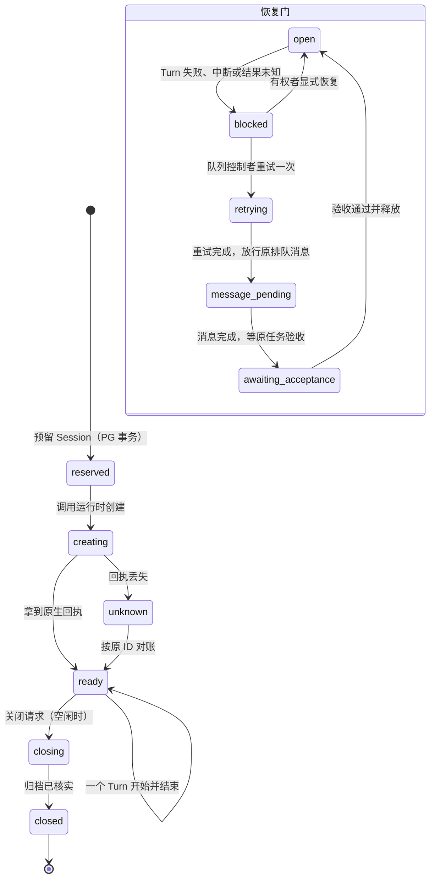
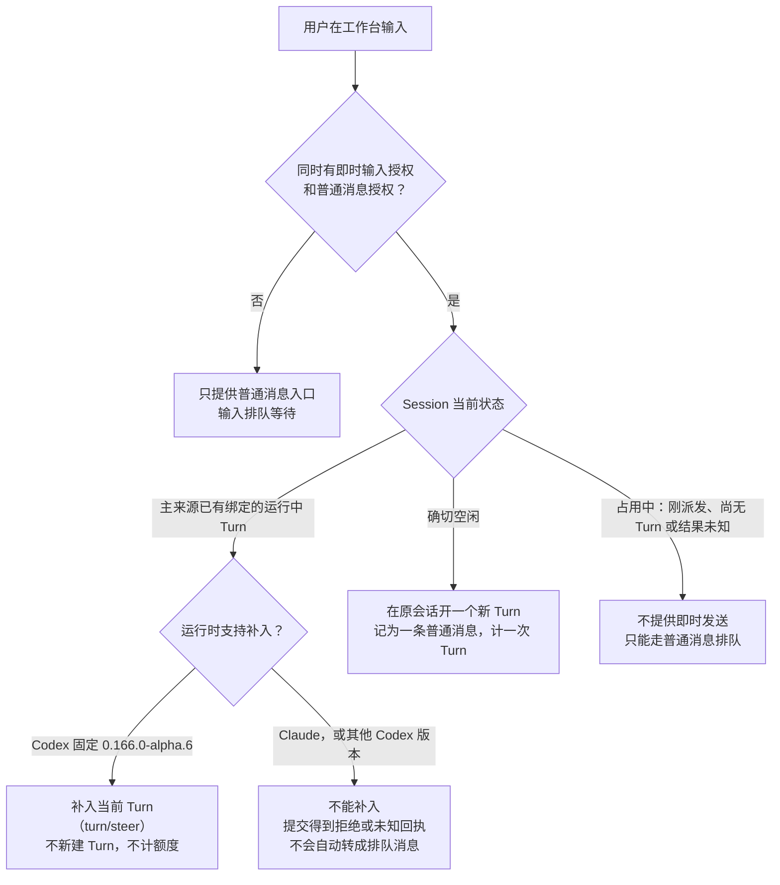

# Session 运行时

2026-11-09 · 本页回答：一个 Session 从创建到续接、被打断、恢复、压缩、结束，系统在每一步做什么；Codex 与 Claude 两种运行时有什么不同；evoLoop 启动的 Session 和用户在桌面客户端里直接打开的会话有什么不同。

本页只写设计和已合入的实现。“已实现（合入）”、“新实例上实际配置并用过”、“已验收”是三件不同的事：本页每一项都写明合入它的 PR 与 schema；新实例上打开了哪些配置、用过什么、验收到哪一步，以[阶段路线的当前基线](../roadmap.md#当前基线)为准。Codex 协议握手、版本指纹和桌面宿主的细节见[Codex 接入](codex-integration.md)。

## 1. 四个对象

| 对象 | 是什么 | 记录在哪里 |
| --- | --- | --- |
| Role | 持续的逻辑职责。第一次预留 Session 时绑定一种运行时，之后不能换（DEC-035）。 | evoLoop 的 PostgreSQL |
| Session | Role 的一次受管承载。创建时固定运行时、工作目录、执行者和执行配置。 | PostgreSQL 保存 Session 与原生绑定 |
| 原生会话 | Codex 的 Thread，或 Claude Code 的 session。对话历史在这里。 | 运行时自己；Claude 另有适配器账本 |
| Turn | 原生会话里的一次执行。每个 Turn 只有一个**主来源**：一个业务 Run，或一条普通消息的处理记录。 | 运行时执行；PostgreSQL 保存 Run 或消息处理，以及对应的 Turn ID |

协调服务不直接调用某个运行时的协议，而是经过中立端口 `RuntimePort`（`packages/contracts/src/runtime.ts`）。每个适配器用 `capabilities()` 声明自己能做什么，协调服务按声明决定是否提供某项操作；没有声明的能力就是不支持，不用别的办法模拟。有一处例外要先说明：Codex 的执行中补入不看这份声明，而由适配器按协议版本单独检查（见[第 3 节](#3-即时输入执行中收到的消息怎样处理)）。

本页常用的几个词：

- **主来源**：让一个 Turn 开始的那件事，只能是一个业务 Run 或一条普通消息的处理记录。
- **槽位**：每个 Session 同一时刻只允许一个主来源占用；占用记录在 PostgreSQL 里，原生会话看起来空闲也不能越过它。
- **恢复门**：每个 Session 一份的持久闸门。Turn 失败或结果未知时关上，有权者显式决定后才重新打开。
- **队列控制者**：登记为某个常驻队列负责人的身份，只有它能对队列里失败的 Run 发起重试。
- **工作轨迹**：一次 Run 在原生会话里的工具调用和输出记录；**连续工作区**：按时间顺序阅读一个 Session 全部历史的视图。

一个协调服务可以同时驱动两种运行时。私有运行配置的 `runtime.providers` 列出要驱动的运行时，`runtime.provider` 是尚未绑定的 Role 首次预留 Session 时采用的默认值。每个 Session 一直由创建它的运行时驱动，路由按原生绑定的归属决定（`apps/coordinator/src/runtime/routed.ts`）。没有列入 `providers` 的运行时，它的 Session 仍可读取，但不会被驱动。

## 2. 一个 Session 的一生

下图回答“系统在哪些点上记录状态、在哪些点上停下来等人”。左侧是 Session 自身的状态（`runtime_session.state`），右侧是每个 Session 都有的恢复门（`session_recovery_gate.phase`）。

### 创建与续接

1. **预留。** 协调服务先在 PostgreSQL 预留 Session，固定 Role、项目、工作目录、执行者和执行配置。新 Session 的执行配置一律是完全访问加不需要审批（`danger-full-access`、`approvalPolicy: never`，DEC-033）。
2. **创建原生会话。** Codex 调用 `thread/start`，以返回的 Thread 回执为准。Claude 不需要先起进程：适配器自己生成原生 session ID 并写入账本，第一个 Turn 用这个 ID 启动，之后的 Turn 用 `resume` 接续。
3. **续接。** 服务重启或配置修订后，Codex 用当前完整的执行配置调用 `thread/resume`，只有原生回执明确确认完全访问才算生效；Claude 每个 Turn 都带着绑定里的完整配置启动新进程，续接只核对本地绑定。
4. **启动 Turn。** 启动前在同一个 PostgreSQL 事务里检查 Session 槽位：已有 `requested`、`dispatching`、`running` 或 `unknown` 的主来源时，不启动第二个。原生“看起来空闲”不能越过数据库里的占用。

### 停止

停止请求和实际停止是两件事。Codex 调用 `turn/interrupt` 后继续等最终的 `turn/completed`；Claude 向本 Turn 的进程发中断，10 秒内没有回应就终止它。停止请求已收到，不等于工作已经停下，也不等于副作用没有发生。PR #184 增加了消息的中断、人工停止与启动前预检（schema 048–050）。

**请求停止一个 Run（DEC-043，迁移 078）。** 业务 Run 的范围变了、不再需要时，有 review 权限且持有该 Session 精确执行授权的身份提交 `runtime.run.stop`（带 Run 的当前版本和理由）。它只在 Run 上记一个**停止标记**（时间、理由、请求人，写入后不能改也不能撤），**不新增 Run 状态**。按 Run 当时的状态处理：还是“已请求”的直接判失败、不再派发；已有 Turn 的沿用现有中断路径，由 runner 调适配器中断，终态仍以运行时观察为准；正处于“派发中”、还没有 Turn 的不判失败（原生启动可能已经发出），标记保留，等 Turn 绑定时立刻中断。同一事务里：已签但未封存（`submitted`、`blocked`）的提交意图作废为 `rejected: RUN_STOPPED`；该 Session 里与这个 Task 相关、还在排队的消息的阻塞原因标成“被取代”（消息本身仍由发送人决定取消或重发）。此后，数据库触发器拒绝任何引用该 Run 的新提交和交付，也拒绝在这个 Task 上还有未结束的已停止 Run 时不带 Run 的交付；已作废的意图对原操作 ID 重放和新操作 ID 都返回同一个 `RUN_STOPPED`；封存者遇到已停止的 Run 一律不封存。已停止 Run 的失败或中断**不会关闭恢复门**（门原本开着就保持开着），也不产生“结束未提交”“提交受阻”这两类 Leader 通知，只留一条 `run.stopRequested` 运行事件；Run 终态之后，同一个 Session 立刻能接新的 Run，Task 也可以重开、修订、重新派发。结果未知（未核实）的终态仍按原规则关门。

### 失败、恢复门与恢复

任何 Run 或消息的 Turn 失败、中断或结果未知，都会在同一事务里把恢复门改成 `blocked`，并保存原因、原来的 Task 占用和最早一条排队消息。门不会因为后来能读到历史就自动打开：

- 结果未知时，只按原 Run 或原消息的 ID 回读原生历史。查不到不等于没发生，保持 `unknown`，不换 ID 重发。
- 已确认失败的 Run，只能由登记的队列控制者用 `queue.retryFailed` 重试一次，并消耗同一队列预算。重试完成后先放行故障时排在最前的那条消息（`message_pending`）；之后 Session 仍要等原 Task 验收通过、原占用被释放（`awaiting_acceptance`），才启动下一个 Turn，普通消息和队列下一项都在等，避免在没验收的结果上继续堆新工作。
- 其他情况由有权者显式执行 `runtime.session.recovery.resume`。

### 宿主失联的三种情况

服务的 HTTP 能访问，不代表受管运行时在线。下表区分三种常见情况。它们来自 PR #184、#185、#199、#200，相关字段在 schema 055、056；操作步骤见[Agent CLI 的宿主恢复](../development/agent-cli.md#受管宿主失联与原会话恢复)与项目技能 `.agents/skills/evoloop-workflow/references/owned-runtime-recovery.md`。

| 情况 | 怎样判断 | 系统怎样继续 |
| --- | --- | --- |
| 运行时连接丢失 | 原生子进程退出或连接断开；协调服务保留首次丢失与确认退出两条诊断 | 有权者请求 `runtime.recover` 重建连接，再按原 Run 的 Turn 历史和完成时间用 `runtime.reconcile` 对账。离线时不能把数据库里的 `running` 直接结算。 |
| 原 Thread 被其他宿主占用 | `thread/resume` 明确返回同一 Thread 的 `-32600 active writer`，且还没有调用 `turn/start` | 在原 Run 或消息处理上保存 `preTurnProof`（证明这次确实还没发出 Turn 的凭证），恢复门保持 `blocked`。确认原 Thread 的写入权已交还后，复核者调用 `pre-turn-continue`，在**原 Thread** 上继续，不新建 Session。 |
| 原生结果未知 | 发送后回包丢失、超时或历史暂时读不到 | 保留原操作 ID 与占用，只读对账；不重放提示或消息。 |

两种运行时的影响范围不同：Codex 的所有 Session 共用一个 App Server 子进程，连接断开会影响所有在途 Turn；Claude 每个 Turn 一个进程，一个 Turn 出问题不影响别的 Turn。同时驱动两种运行时时，恢复只替换失去就绪的那一种；但合成后的运行时只有在两者都就绪时才算就绪，所以 Codex 断开期间，Claude Session 的消息泵也会暂停，直到协调服务恢复，正在运行的 Claude Turn 不会被打断（PR #224）。

### 关闭与退役

关闭只接受已绑定、空闲且没有在途或未知 Run 的 Session。`runtime.session.close` 先把状态改为 `closing`，立即阻止新 Run：

- Codex 调用一次 `thread/archive`，再在归档列表里核到同一 Thread 才记为 `closed`。
- Claude 由适配器在账本里登记归档，此后拒绝新 Turn；原生对话记录保留。

标记为“临时”的 Session 关闭前还要有一条退役决定（schema 062 的 `session_retirement_decision`），并且它名下没有未释放的 Task 分派和未结束的验收安排。Leader 负责核对业务责任，数据库触发器负责核对运行状态。退役与验收接力的合同见[接口合同](contracts.md#验收接力与临时-session-退役)。

## 3. 即时输入：执行中收到的消息怎样处理

用户从工作台发给 Session 的消息立即进入执行，不进入等待队列（DEC-039 采纳的“方案1”：运行中补入，空闲直接开新 Turn）。实现合入于 PR #216，证据表是 schema 059 的 `session_direct_input`。

即时发送是否可用，由能力查询（`direct-input-capability`）按同一组授权和槽位检查实时回答；只有回答 `steer` 或 `start` 时工作台才显示即时发送，否则保留普通消息入口，用户的输入作为普通消息排队。“占用中”指 Session 已有主来源但还没有可以附着的运行中 Turn，例如刚派发还没拿到 Turn ID，或上一次结果未知。

当前实现有一处已知缺口：能力查询只核对授权和槽位，不核对运行时是否支持补入，所以对 Claude 或非 alpha.6 的 Codex 也可能回答 `steer`。这时提交才发现不能补入：Codex 适配器明确拒绝，记为拒绝；Claude 一侧由运行时路由层报“不支持”，没有被归为原生的明确拒绝，目前记为未知。两种情况都不会自动转成排队消息。

规则如下：

- **一个 Turn 只有一个主来源。** 补入的输入不另立主来源，也不改写原 Run 的固定 TaskRevision 和输入哈希。每条补入有自己的 `inputId`、`operationId`、署名、期望 Turn、实际 Turn 和状态。
- **补入只证明入队。** 原生回执说明输入已排进当前 Turn，不说明 Agent 已读、采用或已回复。
- **空闲直启沿用普通消息授权。** 它保存一条普通消息和唯一一条处理记录，再在原会话启动 Turn，计一次 Turn。补入不另外计数。
- **结果未知不重发。** 先持久化原意图再调用运行时；回执丢失就记 `unknown` 并保留槽位，只能按原 `inputId` 只读核对。
- **授权。** 默认关闭（`directInputs`）。启用时要有一条指向同一 Session 的即时输入授权，同时要有对应的普通消息授权；客户端自报的身份不能替代授权。

不同来源的消息分开处理：

| 消息来源 | Session 正在执行时 |
| --- | --- |
| 用户从工作台即时输入 | Codex（固定 0.166.0-alpha.6）补入当前 Turn；Claude 和其他 Codex 版本不能补入，用户改走普通消息 |
| 普通消息：Agent 或人经 `session.message.post` 发出的消息、Leader 通知、消息 Connector 写入的外部平台消息 | 排队，等当前 Turn 结束、恢复门开放后，在原会话开新 Turn |
| 业务 Task 队列的下一项 | 不进消息队列；队列控制者在 Session 空闲、上一项按释放规则放行后，才领取并启动新 Run |

普通消息和业务 Run 共用同一个 Session 槽位，轮流启动；即时输入不借用这两条排队路径，它们也不借用即时输入。

**两种运行时的差别。** 能力声明里的 `delivery.midTurnInput` 两者目前都是 `false`。对 Codex 来说，这项声明还没有跟上实现：补入由适配器的 `steerTurn` 按协议特性表单独检查，只有固定 `0.166.0-alpha.6` 同时具备 `turn/steer` 与 `thread/settings/update`（`packages/adapter-codex-app-server/src/protocol-surface.ts`）；默认的 `0.166.0-alpha.5.1` 不能补入。Claude 适配器没有补入方法。两种运行时都实现了空闲直启所用的普通消息启动。

工作台入口与核对按钮的设计见[Sessions 页面](../frontend/pages/sessions.md)，配置、入口、对账与检查清单见[运行接线手册](../development/runtime-operations.md#2-即时输入)。

## 4. 托管压缩

两种运行时都会在上下文快满时自己压缩（能力声明 `compaction.autoCompacts: true`）。托管压缩是另一件事：Session 因失败被恢复门挡住时，由维护者显式请求一次原生压缩，再决定是否恢复。实现合入于 PR #210、#215、#218、#222，记录表是 schema 058 的 `session_compaction`。

1. **只在恢复门 `blocked` 时可用。** 请求方要有项目 review 与 write 权限和该 Session 的精确运行授权。请求写明原 Session、原 Thread、当前 Session 版本和恢复门版本。
2. **先存意图，再发一次。** 服务核对原失败 Turn 的已知终态后，把意图写入 `session_compaction`，然后在当前连接上发**一次** `thread/compact/start`。同一操作 ID 只读回原结果；回包丢失时保持 `unknown`，不再发第二次。
3. **完成要有原生证据。** `{}` 应答只记为 `accepted`。只有同一个压缩 Turn 出现持久的压缩 Item 和完成时间、Turn 结束且 Thread 空闲，才记 `completed`。
4. **压缩不开门。** 完成后仍由有权者单独执行 `runtime.session.recovery.resume`。
5. **沿用 Thread 默认思考强度。** `thread/compact/start` 没有强度参数，压缩用 Thread 当前的默认值；之后的业务 Turn 仍逐 Turn 传执行配置里的强度（PR #222）。

托管压缩只在 Codex 固定 `0.166.0-alpha.6` 时可用（协议特性表里只有该版本具备 `thread/compact/start`），Claude 的声明是 `compaction.mode: "unavailable"`。私有配置 `runtime.compaction.owned` 默认 `true`；设为 `false` 时关闭这组维护入口，压缩完全交给运行时自己。命令与核对步骤见[运行接线手册](../development/runtime-operations.md#3-托管压缩)。

## 5. 普通消息默认不限轮数

普通 Session 消息默认不限累计轮数（DEC-039，修订 DEC-033 的预算部分；PR #195、#207）：

- 普通消息授权里的 `maxTurns` 省略即不限；只有明确写成正整数时才是有限额度。
- 精确的发送者／接收者授权照常生效，没有授权就不能发。
- 历史上已用的轮数、Session、Thread、失败记录，以及 Task 和队列的尝试上限，全部保留，不因这条规则重置。
- 空闲直启计一次 Turn；补入不计。

这里的“轮数”是 evoLoop 按授权累计的 Turn 数。Claude 运行配置里还有 `runtime.claude.maxTurns` 和 `maxBudgetUsd`，它们限制的是**一个 Turn 内** Claude Code 的步数和花费，与消息授权无关；消息 Connector 的接收授权另有必填的有限 `maxTurns`。

## 6. 一个 Role 只绑定一种运行时

Codex 的 Thread 和 Claude 的 session 是两种不同的原生对象，一个 Role 的历史不应该横跨两者（DEC-035，PR #224，schema 067、068）。

- **绑定一次，不能更换。** `role_runtime_revision` 的第 1 个修订固定运行时；之后的修订只改 skill 选择。未绑定的 Role 在首个 Session 预留时按服务默认运行时绑定。
- **Session 固定运行时。** `runtime_session.runtime_provider` 在预留时写定，之后不能修改（schema 067）。迁移 067 把已有 Session 记为 `codex`；068 按已有 Session 为已有 Role 写入首个绑定，未关闭 Session 横跨两种运行时的 Role 暂不绑定。
- **在运行时内可以调整。** Role 的 skill 选择随时可改，下一个 Turn 生效；Session 的模型修订目前只在 Codex 实现，Claude Session 沿用创建时的模型。
- **skill 选择不是安全边界。** 它只决定每个 Turn 放进模型上下文的 skill：业务 skill 必带，项目、个人、内置 skill 按开关，另可按名称增减。每次读取都向运行时实时取值。

## 7. Codex 与 Claude 能力对照

以代码为准：Codex 见 `packages/adapter-codex-app-server/src/index.ts` 的 `capabilities()`（约第 376–390 行）与 `src/protocol-surface.ts` 的协议特性表；Claude 见 `packages/adapter-claude-agent-sdk/src/index.ts` 的 `capabilities()`（约第 186–198 行）。

Codex 一列有几项取决于运行配置选的协议版本。“现代协议”指除 `0.154.0` 以外的 4 个已核版本：`0.164.0-alpha.11.1`、`0.166.0-alpha.5.1`、`0.166.0-alpha.6`、`0.167.0-alpha.3.2`；标“仅 alpha.6”的两项只在固定 `0.166.0-alpha.6` 时可用，默认的 `0.166.0-alpha.5.1` 下都不可用。各版本的完整特性见[Codex 接入](codex-integration.md#协议版本与可选能力)；当前实例选的是哪个版本，见[阶段路线](../roadmap.md#当前基线)。

| 能力 | Codex（默认协议 `0.166.0-alpha.5.1`） | Claude |
| --- | --- | --- |
| 进程模型 | 所有 Session 共用一个 App Server 子进程（`process: "shared"`） | 每个 Turn 一个 Claude Code 进程（`process: "per_turn"`） |
| 原生会话 ID | 由运行时分配 Thread ID | 由适配器预先生成（`callerAssignedSessionId: true`） |
| 执行配置 | 完全访问＋不需审批，创建和续接都要原生回执确认 | 完全访问＋不需审批，每个 Turn 以 `bypassPermissions` 启动；没有原生回执可核，续接只核本地绑定 |
| 普通消息与空闲直启 | 支持 | 支持（PR #224） |
| 执行中补入 | 仅 alpha.6；默认版本不支持 | 不支持 |
| 自动压缩 | 运行时自己压缩 | 运行时自己压缩 |
| 托管压缩 | 仅 alpha.6；默认版本不支持 | 不支持 |
| Turn 历史 | 原生 `thread/turns/list`、`thread/items/list` | 适配器账本，在进程启动前先记账 |
| 工作轨迹与连续工作区 | 支持轨迹；工作区历史需另开实验开关 | 都不支持 |
| 会话命名 | 现代协议支持 | 不支持 |
| 归档 | 原生 `thread/archive` | 适配器账本登记，拒绝后续 Turn |
| 模型与思考强度修订 | 现代协议支持；只改强度且运行时没有 `thread/settings/update`（Codex 0.167）时立即生效、随每轮 `turn/start` 传入 | 不支持，沿用创建时的模型 |
| 原生提问桥（`request_user_input`） | 默认关闭，可按配置打开 | 不支持；提问工具被禁用 |
| 明确拒绝的启动结果 | 能区分“未发送”“被拒绝” | 只能区分“未发送”，其余为未知 |
| 逐 Turn 用量与费用 | 不写入 Run；Token 读数只在原生观察里 | 写入 Run 的 `usage` 与 `cost_usd`（schema 067） |
| 浏览器只读桥 | 实验性，需单独配置 `browserRead` | 不支持 |
| 进程故障的影响范围 | 共用子进程断开会影响所有在途 Turn | 只影响出问题的那个 Turn |

## 8. 与原生桌面客户端的差别

用户在 Claude 或 Codex 的桌面应用里直接打开的会话，和 evoLoop 启动的 Session 不是一回事。evoLoop 只驱动运行时本身，并按项目授权收紧了一部分能力。

### Claude 一侧

以 `packages/adapter-claude-agent-sdk/src/index.ts` 与 `apps/coordinator/src/configuration.ts` 为准：

| 差别 | 代码依据 |
| --- | --- |
| 关闭了没有 evoLoop 对应入口、或效果会超出单个 Turn 进程的工具：`AskUserQuestion`、`CronCreate`／`CronDelete`／`CronList`、`ScheduleWakeup`、`RemoteTrigger`、`PushNotification`、`SendMessage`、`ListAgents` | `DEFAULT_DISALLOWED_TOOLS` |
| 关闭账号连接器，拒绝跨 Session 的原生消息；Session 之间只能经 evoLoop 的授权消息通信 | `CHILD_SETTINGS`（`crossSessionInbound: "refuse"`、`disableClaudeAiConnectors: true`），子进程环境另设 `ENABLE_CLAUDEAI_MCP_SERVERS=false` |
| 自动记忆关闭 | 子进程环境 `CLAUDE_CODE_DISABLE_AUTO_MEMORY=1` |
| 使用协调服务专用的配置目录，不读用户个人的设置、MCP、插件和记忆；需要在该目录单独登录，或由服务环境提供凭据 | `runtime.claude.configRoot` 作为 `CLAUDE_CONFIG_DIR`；子进程只接收白名单内的环境变量 |
| Role 选中的 skill 以本地插件加载，并关闭插件的 MCP 发现，插件不能借此加入 MCP 服务 | `turnOptions()` 中 `skipMcpDiscovery: true` |
| 权限模式固定为跳过确认（DEC-033） | `permissionMode: "bypassPermissions"` |
| `contextMode` 为 `project`（默认）时，读取工作目录的 `CLAUDE.md`（没有时读 `AGENTS.md`）以及 `.claude/` 下的 skills、agents、commands 和 hooks，hooks 会被执行；为 `explicit` 时都不读，由适配器传入工作目录的 `AGENTS.md`（没有时 `CLAUDE.md`） | `settingSources: ["project"]` 或 `[]`；`runtime.claude.contextMode` |

### Codex 一侧

以 `packages/adapter-codex-app-server/src/index.ts` 与 `apps/coordinator/src/configuration.ts` 为准：

| 差别 | 代码依据 |
| --- | --- |
| App Server 协议版本由运行配置固定，启动前核对二进制版本和 schema 指纹，不匹配就拒绝 | `runtime.protocolVersion`，默认 `0.166.0-alpha.5.1`；详见[Codex 接入](codex-integration.md#协议版本与可选能力) |
| 沙箱和审批来自项目授权配置，而不是用户本机设置：普通 Session 为完全访问＋不需审批；连接器接收方的受限配置为只读、无网络，仅在固定 `0.166.0-alpha.6` 下可建，且首版不启用 | `nativeProfile()`、`connectorReceiver()` |
| MCP 服务发起的表单请求（elicitation）一律拒绝 | `mcpServer/elicitation/request` 固定回 `decline` |
| 原生提问 `request_user_input` 默认关闭；打开后只对本服务的子进程生效，不改用户全局配置 | `runtime.nativeUserInput`，默认 `false` |
| 未配置 `codexHome` 时，与用户共用 Codex 状态目录（登录、模型设置、历史），evoLoop 创建的 Thread 会出现在用户自己的历史里；配置后独立 | `runtime.codexHome` |
| 浏览器只有实验性的只读桥，限定精确的项目、Run 和路由 | `runtime.browserRead` |
| 受管 Thread 由 evoLoop 排他派发，不能同时从桌面客户端向同一 Thread 输入；桌面里的既有聊天只能人工转交 | 见[Codex 接入](codex-integration.md#普通消息与业务执行共用原会话) |

### 宿主应用的功能不在运行时里

桌面应用自带的浏览器面板、电脑操作、Artifacts、会话管理与跨会话协作等，是宿主应用提供的功能，不属于 Claude Code 或 Codex 运行时本身。evoLoop 启动的 Session 里没有这些工具。需要类似能力时，要么经 evoLoop 的对应入口（例如授权消息、Task、只读浏览器桥），要么作为新的 evoLoop 功能单独设计。

## 9. 实现、配置与使用

| 机制 | 合入 | 默认配置 |
| --- | --- | --- |
| 停止、预检与原 Thread 接续 | PR #184、#185；schema 048–050 | 随运行时启用 |
| 宿主失联与写者冲突恢复 | PR #199、#200；schema 055、056 | 随运行时启用 |
| 托管压缩 | PR #210、#215、#218、#222；schema 058 | `runtime.compaction.owned: true`；需 Codex `0.166.0-alpha.6` |
| 即时输入 | PR #216；schema 059 | `directInputs` 关闭 |
| 普通消息不限轮数 | PR #195、#207 | `maxTurns` 省略即不限 |
| Claude 运行时、双运行时与 Role 绑定 | PR #224、#226、#230；schema 067、068 | `runtime.provider: "codex"`；Claude 需显式列入 `providers` 并配置 `runtime.claude` |

上表只说明代码已合入以及代码里的默认值。新实例上实际打开了哪些配置、用过哪些机制、哪些已经验收，见[阶段路线的当前基线](../roadmap.md#当前基线)。

## 下一步读什么

- Codex 协议、版本与历史读取的细节：[Codex 接入](codex-integration.md)
- Session、Run、消息、验收接力和 Leader 通知的合同：[接口合同](contracts.md)
- 这些表的约束：[存储](storage.md#迁移-054-到-070-新增的表和列)
- 服务实际部署在哪里、迁移时 Session 为什么不搬：[部署与迁移](deployment.md)
