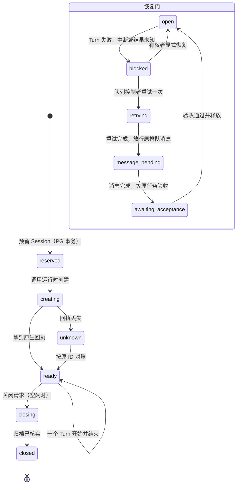
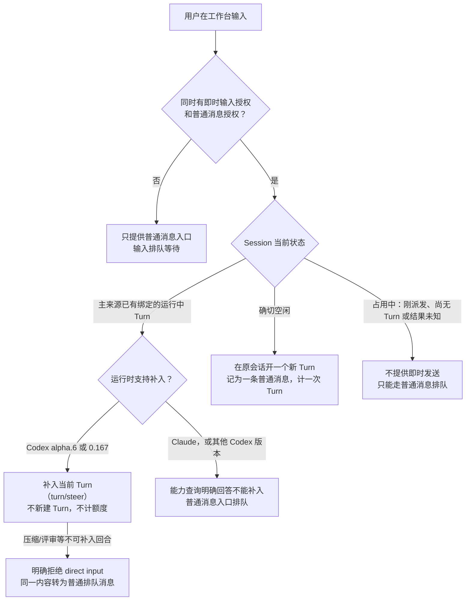

# Session 运行时

2026-11-09 · 本页回答：一个 Session 从创建到续接、被打断、恢复、压缩、结束，系统在每一步做什么；Codex 与 Claude 两种运行时有什么不同；evoLoop 启动的 Session 和用户在桌面客户端里直接打开的会话有什么不同。

本页只写设计和已合入的实现。“已实现（合入）”、“新实例上实际配置并用过”、“已验收”是三件不同的事：本页每一项都写明合入它的 PR 与 schema；新实例上打开了哪些配置、用过什么、验收到哪一步，以[阶段路线的当前基线](../roadmap.md#当前基线)为准。Codex 协议握手、版本指纹和桌面宿主的细节见[Codex 接入](codex-integration.md)。

## 1. 四个对象

| 对象 | 是什么 | 记录在哪里 |
| --- | --- | --- |
| Role | 持续的逻辑职责。第一次预留 Session 时绑定一种运行时，之后不能换（DEC-035）。 | evoLoop 的 PostgreSQL |
| Session | Role 的一次受管承载。创建时固定运行时、工作目录、执行者和执行配置。 | PostgreSQL 保存 Session 与原生绑定 |
| 原生会话 | Codex 的 Thread，或 Claude Code 的 session。对话历史在这里。 | 运行时自己；Claude 另有适配器账本 |
| Turn | 原生会话里的一次执行。每个 Turn 只有一个**主来源**：一个业务 Run，或一条普通消息的处理记录。 | 运行时执行；PostgreSQL 保存 Run 或消息处理，以及对应的 Turn ID |

协调服务不直接调用某个运行时的协议，而是经过中立端口 `RuntimePort`（`packages/contracts/src/runtime.ts`）。每个适配器用 `capabilities()` 声明自己能做什么，协调服务按声明决定是否提供某项操作；没有声明的能力就是不支持，不用别的办法模拟。路由运行时按 Session 实际绑定的 provider 返回 `capabilitiesFor(binding)`，即时输入能力查询因此会核对当前运行时的版本，而不是只看服务默认运行时。

本页常用的几个词：

- **主来源**：让一个 Turn 开始的那件事，只能是一个业务 Run 或一条普通消息的处理记录。
- **槽位**：每个 Session 同一时刻只允许一个主来源占用；占用记录在 PostgreSQL 里，原生会话看起来空闲也不能越过它。
- **恢复门**：每个 Session 一份的持久闸门。Turn 失败或结果未知时关上，有权者显式决定后才重新打开。
- **原生失败类别**：Turn 失败时，适配器把原生错误归为 `quota_exhausted`（额度/余额，HTTP 402）、`authentication_failed`、`context_window_exceeded`、`connection_lost`、`provider_unavailable`、`rate_limited` 等，保存在消息处理记录（`failure_category`，迁移 084）并随恢复门读出；工作台把它们归为四类显示：额度/鉴权（运行受阻，需账户使用者充值或重新授权）、上下文超长、连接中断、其他。类别只说明原因，不改变单个恢复门的决定规则。
- **提供方暂停（迁移 085）**：消息 Turn 以 `quota_exhausted` 或 `authentication_failed` 失败时，同一提供方（Codex / Claude）开一条 `runtime_provider_hold`（每个提供方至多一条生效），因为该提供方的每个 Session 都会以同样原因失败。暂停期间该提供方的新 Run 预留与新消息启动一律在启动检查处被拒（`PROVIDER_HELD`）：消息保持排队、写明阻塞原因，不失败、不逐个关恢复门；其他提供方与其他错误类别（上下文超长、连接断开、其他）不受影响。额度恢复后，复核者提交一次 `runtime.providerHold.release`：解除暂停，并把被该类失败关闭的各 Session 的恢复门逐个经审计过的恢复路径放行（每个 Session 各留一条恢复决定），做不到的 Session 记入 `release_summary.skipped` 并保持关闭，不拖累其他。读取：`GET /api/projects/:id/runtime/provider-holds`。只由消息路径的失败触发；Run 路径的失败暂不触发暂停。
- **队列控制者**：登记为某个常驻队列负责人的身份，只有它能对队列里失败的 Run 发起重试。
- **工作轨迹**：一次 Run 在原生会话里的工具调用和输出记录；**连续工作区**：按时间顺序阅读一个 Session 全部历史的视图。

一个协调服务可以同时驱动两种运行时。私有运行配置的 `runtime.providers` 列出要驱动的运行时，`runtime.provider` 是尚未绑定的 Role 首次预留 Session 时采用的默认值。每个 Session 一直由创建它的运行时驱动，路由按原生绑定的归属决定（`apps/coordinator/src/runtime/routed.ts`）。没有列入 `providers` 的运行时，它的 Session 仍可读取，但不会被驱动。

## 2. 一个 Session 的一生

下图回答“系统在哪些点上记录状态、在哪些点上停下来等人”。左侧是 Session 自身的状态（`runtime_session.state`），右侧是每个 Session 都有的恢复门（`session_recovery_gate.phase`）。

### 创建与续接

1. **预留。** 协调服务先在 PostgreSQL 预留 Session，固定 Role、项目、工作目录、执行者和执行配置。新 Session 的执行配置一律是完全访问加不需要审批（`danger-full-access`、`approvalPolicy: never`，DEC-033）。
2. **创建原生会话。** Codex 调用 `thread/start`，以返回的 Thread 回执为准。Claude 不需要先起进程：适配器自己生成原生 session ID 并写入账本，第一个 Turn 用这个 ID 启动，之后的 Turn 用 `resume` 接续。
3. **续接。** 服务重启或配置修订后，Codex 用当前完整的执行配置调用 `thread/resume`，只有原生回执明确确认完全访问才算生效；Claude 每个 Turn 都带着绑定里的完整配置启动新进程，续接只核对本地绑定。
4. **启动 Turn。** 启动前在同一个 PostgreSQL 事务里检查 Session 槽位：已有 `requested`、`dispatching`、`running` 或 `unknown` 的主来源时，不启动第二个。原生“看起来空闲”不能越过数据库里的占用。

### Session 队伍（DEC-045 Q1）

每个常驻业务 Session 可有一条**队伍**（`session_line`、`session_line_entry`，迁移 087），按 Leader 派发的先后顺序，做完一个再接下一个。它是新的小机制，现有的批量常驻队列（027）原样不动。

- **项的状态**：排队中、挂起、启动中、已开始、已撤下。进行中的三种状态在 `(project_id, task_id)` 上有部分唯一索引，同一个 Task 不能同时排在两处；已开始的项不占索引，返工可以再排。
- **命令**（都要 review 权限）：`line.append` 追加到队尾；`line.move` 只前移或后移一步，不提交整列顺序；`line.remove` 撤下；`line.resume` 把挂起的项放回排队。`line.begin`、`line.advance`、`line.started`、`line.suspend`、`line.withdrawReturned` 记录队伍调度程序的每一步。
- **防止绕过**：排队、挂起或启动中的 Task，在 `task.start`、`runtime.run.reserve`、`task.assignment.set` 与 `task.assignment.release` 上被拒（`QUEUED_IN_SESSION_LINE`）。例外只有这一项自己登记的操作 ID：开始前的分派、开始 Task、开始后的分派、预留 Run，且仅在“启动中”时有效。要另行安排，先撤下。
- **轮到时**：Session 没有未结束的 Run、没有处理中的消息、也没有比这一项更早排队的未处理消息（谁先到谁先）时，队伍调度程序对排头一项依次做：①`task.assignment.set` 把 Task 分派给这个 Session 的业务身份，并发一条带固定 Task 修订的执行确认请求消息；②等 Session 用扩展后的 `task.assignment.acknowledge` 确认（`verdict=confirm`、`plan`、`expectedRevisionId`）或退回（`verdict=return`、`missing`）；③确认后 `task.start`、在开始后的修订上再次 `task.assignment.set`、普通的 `runtime.run.reserve`，记下 Run。每一步的操作 ID 由“队伍项 + 第几次尝试 + 重试次数”决定，重放安全。消息一侧同样让位：比某个排队或启动中的队伍项更晚到的消息，消息泵暂不处理（该项自己的确认请求除外），两边都不饿死。容量视图（`work acceptance`）把 `lineQueued`（排队中、挂起的项）与 `lineStarting`（正在启动，占用 Session）分开：排队项不会让 Session 判为没空，队伍在开始前写的分派也不算未完成分派。
- **受阻与退回**：任何一步被拒且不是“还在忙”（如依据待复核、授权缺失、没有业务身份），这一项挂起并写明原因，写一条 `entry.suspended` 事件（`level: immediate`），后面的项照常往前走。被退回的项撤出队伍，Task 保持未开始、回到作者那里，写 `entry.returned` 事件（`level: summary`）。事件进入有序的 `session_line_event`，供调度板（Q2）读取；通知分级（W5）上线前，这些事件还没有被送成通知。
- **重试与重放**：被拒的结果会记进操作记录，同一操作 ID 重放只会拿回同一个拒绝。所以只表示“还在忙”的拒绝（`SESSION_BUSY`、`SESSION_MESSAGE_BUSY`、`VERSION_CONFLICT`、`RECOVERY_BLOCKED`）由 `line.retry` 登记一组新的操作 ID（由项、尝试次数和重试次数决定）后再试；其他拒绝挂起。动手前先查已发生的事实：分派已是当前修订就不再分派，确认请求消息已在就不再发，确定的 Run ID 已存在就只补记 `line.started`，所以崩溃或丢回复后不会开第二个 Run。
- **确认的等待**：等待确认时，不带结论的普通 `task.assignment.acknowledge` 被拒（`CONFIRMATION_VERDICT_REQUIRED`）；确认请求消息失败、被取消或受阻，挂起为 `MESSAGE_UNDELIVERED`；超过确认期限（默认 1 小时）挂起为 `CONFIRMATION_TIMEOUT`。`task.start` 前要求确认记录的 `expectedRevisionId` 等于 Task 当前修订，否则不开始、挂起为 `CONFIRMATION_STALE`（数据库守卫同样拒绝，`LINE_CONFIRMATION_STALE`）。各项登记的操作 ID 只在自己的步骤里豁免。
- **撤下**：没有为该项预留 Run 时，停在 start 步骤的项也可以撤下。
- **事件**：一项的 Run 结束时写一次 `entry.runEnded`（`runState`）；重试写 `entry.retried`。`session_line.version` 随每次变更递增。
- **放行**：Session 的 Run 结束，下一项才会开始。需要等验收的前后依赖用 `task_dependency` 表达，不是队伍规则。
- **读取**：`GET /api/projects/:projectId/session-lines`（队伍与排队项）、`/session-lines/events?after=&limit=&sessionId=`（有序事件）。

### 停止

停止请求和实际停止是两件事。Codex 调用 `turn/interrupt` 后继续等最终的 `turn/completed`；Claude 向本 Turn 的进程发中断，10 秒内没有回应就终止它。停止请求已收到，不等于工作已经停下，也不等于副作用没有发生。PR #184 增加了消息的中断、人工停止与启动前预检（schema 048–050）。

**请求停止一个 Run（DEC-043，迁移 078）。** 业务 Run 的范围变了、不再需要时，有 review 权限且持有该 Session 精确执行授权的身份提交 `runtime.run.stop`（带 Run 的当前版本和理由）。它只在 Run 上记一个**停止标记**（时间、理由、请求人，写入后不能改也不能撤），**不新增 Run 状态**。按 Run 当时的状态处理：还是“已请求”的直接判失败、不再派发；已有 Turn 的沿用现有中断路径，由 runner 调适配器中断，终态仍以运行时观察为准；正处于“派发中”、还没有 Turn 的不判失败（原生启动可能已经发出），标记保留，等 Turn 绑定时立刻中断。同一事务里：已签但未封存（`submitted`、`blocked`）的提交意图作废为 `rejected: RUN_STOPPED`；该 Session 里与这个 Task 相关、还在排队的消息的阻塞原因标成“被取代”（消息本身仍由发送人决定取消或重发）。此后，数据库触发器拒绝任何引用该 Run 的新提交和交付，也拒绝在这个 Task 上还有未结束的已停止 Run 时不带 Run 的交付；已作废的意图对原操作 ID 重放和新操作 ID 都返回同一个 `RUN_STOPPED`；封存者遇到已停止的 Run 一律不封存。已停止 Run 的失败或中断**不会关闭恢复门**（门原本开着就保持开着），也不产生“结束未提交”“提交受阻”这两类 Leader 通知，只留一条 `run.stopRequested` 运行事件；Run 终态之后，同一个 Session 立刻能接新的 Run，Task 也可以重开、修订、重新派发。**已停止的 Run 先成为 `unknown`、之后读回为 `interrupted`、`failed` 或 `completed` 时**，被它关闭的恢复门自动打开（参照 059 对已核实直接输入的做法，只开这一个 gate，队列认领持有的门不动）。已停止的 Run 若持有队列认领，失败/中断照常关门，由队列的重试决定处理。被取代的消息有持久标记（`superseded_at`，迁移 079），选取与准入都排除，发送人取消或确认后才重新可投递；`runtime.run.stop` 之后撤回的派发直接判为失败，不再回到 `requested`，`beginDispatch` 与预检续接也拒绝已停止的 Run。工作索引不再把已按请求停止的 Run 显示成待返工（阶段回到等待下一个 Run，Run 带 `stopped`）。

**停止后的恢复门（迁移 079 的补充）。** 恢复门等待的下一条消息不会是被取代而未确认的消息：Run 变 unknown 时选下一条会跳过它；叫停核实后若门仍指向这样的消息，直接完全打开而不是进入 `message_pending`；门（`message_pending`）所等的消息被发送者取消时，门释放为 `open`（持有队列认领的门回到 `awaiting_acceptance`）；仍为 `blocked` 的门保留指向，由恢复决定点名并清掉已取消的那条。已停止、处于 unknown、从未发出 turn/start 的 Run：预检证明未审时保持 unknown（证据没审过，不能断定回合没有开始），门保持关闭。审阅者用现有的 `approvePreTurnContinuation` 给出结论时，对已停止的 Run 它的含义是“证据属实、回合从未开始、Run 结束”而不是“继续”：同一事务先记审阅（证明变 approved，事件 `run.reviewed`），再把 Run 判为 failed，由核实后重开门的规则打开门，Session 可以接新的 Run；原生启动不会再发出。校验的是原操作、版本、证明与关闭中的门，不再要求 Session 配置仍可继续。证明已被批准但启动未发出的已停止 Run，`claimPreTurnContinuation` 同样把它判为 failed，不再每轮重试。未停止 Run 的批准与续接不变。

### 失败、恢复门与恢复

任何 Run 或消息的 Turn 失败、中断或结果未知，都会在同一事务里把恢复门改成 `blocked`，并保存原因、原来的 Task 占用和最早一条排队消息。门不会因为后来能读到历史就自动打开：

- 结果未知时，只按原 Run 或原消息的 ID 回读原生历史。查不到不等于没发生，保持 `unknown`，不换 ID 重发。
- 已确认失败的 Run，只能由登记的队列控制者用 `queue.retryFailed` 重试一次，并消耗同一队列预算。重试完成后先放行故障时排在最前的那条消息（`message_pending`）；之后 Session 仍要等原 Task 验收通过、原占用被释放（`awaiting_acceptance`），才启动下一个 Turn，普通消息和队列下一项都在等，避免在没验收的结果上继续堆新工作。
- 其他情况由有权者显式执行 `runtime.session.recovery.resume`。

### 宿主失联的三种情况

服务的 HTTP 能访问，不代表受管运行时在线。下表区分三种常见情况。它们来自 PR #184、#185、#199、#200，相关字段在 schema 055、056；操作步骤见[Agent CLI 的宿主恢复](../development/agent-cli.md#受管宿主失联与原会话恢复)与项目技能 `.agents/skills/evoloop-workflow/references/owned-runtime-recovery.md`。

| 情况 | 怎样判断 | 系统怎样继续 |
| --- | --- | --- |
| 运行时连接丢失 | 原生子进程退出或连接断开；协调服务保留首次丢失与确认退出两条诊断 | 有权者请求 `runtime.recover` 重建连接，再按原 Run 的 Turn 历史和完成时间用 `runtime.reconcile` 对账。离线时不能把数据库里的 `running` 直接结算。 |
| 原 Thread 被其他宿主占用 | `thread/resume` 明确返回同一 Thread 的 `-32600 active writer`，且还没有调用 `turn/start` | 在原 Run 或消息处理上保存 `preTurnProof`（证明这次确实还没发出 Turn 的凭证），恢复门保持 `blocked`。确认原 Thread 的写入权已交还后，复核者调用 `pre-turn-continue`，在**原 Thread** 上继续，不新建 Session。 |
| 原生结果未知 | 发送后回包丢失、超时或历史暂时读不到 | 保留原操作 ID 与占用，只读对账；不重放提示或消息。 |

两种运行时的影响范围不同：Codex 的所有 Session 共用一个 App Server 子进程，连接断开会影响所有在途 Turn；Claude 每个 Turn 一个进程，一个 Turn 出问题不影响别的 Turn。同时驱动两种运行时时，恢复只替换失去就绪的那一种；但合成后的运行时只有在两者都就绪时才算就绪，所以 Codex 断开期间，Claude Session 的消息泵也会暂停，直到协调服务恢复，正在运行的 Claude Turn 不会被打断（PR #224）。

### 关闭与退役

关闭只接受已绑定、空闲且没有在途或未知 Run 的 Session。`runtime.session.close` 先把状态改为 `closing`，立即阻止新 Run：

- Codex 调用一次 `thread/archive`，再在归档列表里核到同一 Thread 才记为 `closed`。
- Claude 由适配器在账本里登记归档，此后拒绝新 Turn；原生对话记录保留。

标记为“临时”的 Session 关闭前还要有一条退役决定（schema 062 的 `session_retirement_decision`），并且它名下没有未释放的 Task 分派和未结束的验收安排。Leader 负责核对业务责任，数据库触发器负责核对运行状态。退役与验收接力的合同见[接口合同](contracts.md#验收接力与临时-session-退役)。

## 3. 即时输入：执行中收到的消息怎样处理

用户从工作台发给 Session 的消息立即进入执行，不进入等待队列（DEC-039 采纳的“方案1”：运行中补入，空闲直接开新 Turn）。实现合入于 PR #216，证据表是 schema 059 的 `session_direct_input`。

即时发送是否可用，由能力查询（`direct-input-capability`）按同一组授权、槽位和 Session 当前运行时能力实时回答；只有回答 `steer` 或 `start` 时工作台才显示即时发送，否则保留普通消息入口，用户的输入作为普通消息排队。“占用中”指 Session 已有主来源但还没有可以附着的运行中 Turn，例如刚派发还没拿到 Turn ID，或上一次结果未知。运行时分别声明 `delivery.midTurnInput`（能否补入）与 `delivery.idleTurnStart`（能否空闲直启）；Codex 的声明来自实际绑定的协议版本，Claude 两项均为否。

**两条明确的路（W2b）。** 发给 Leader 等 owned Session 的消息有两种去处，结果都能按同一个输入 ID 读回：**插入当前这一轮**（即时输入，`steer`；Session 空闲时则开一轮，`start`）和**排队**（普通消息，消息 ID 就是输入 ID，这一轮结束后按顺序处理）。工作台在 Leader 页面、Leader 正在执行且两条路都开放时显示两个按钮“插入当前这一轮”和“排队”，快捷键不变；Leader 空闲时只有一个“发送”。发送后写明结果：已插入、已开始新的一轮、已排队、已转排队（写明原因）。CLI 给智能体同样的两个选择（`session input send --mode insert|queue`，见[CLI 指南](../development/agent-cli.md)）。缺授权时在发出前被拒绝，并说出缺哪一项（即时输入授权、普通消息授权、写入身份、执行授权、工作目录）。

**可证明没有送入原生的拒绝，统一转排队。** 在预占时，人的输入遇到下面三种情况：人看到的那一轮已经结束或换成别的一轮（`TURN_CHANGED`），主回合已派发但还没绑定 Turn（`NOT_BOUND`），或人以为空闲、提交时 Session 已有运行中的 Turn（`TURN_CHANGED`）。存储层在**同一个事务**里把这条输入存成一条排队的普通消息（沿用原输入 ID 和操作 ID，只有一条），并把输入记为 `rejected`、原因以 `TURN_CHANGED:` 或 `NOT_BOUND:` 开头，回执的 `queuedMessageId` 等于输入 ID；没有向运行时发送任何东西。这三种转排队在 `PgDirectInputs.reserve` 内由 `queueRefused` 完成，不经过 `rejectSteerAndQueue`；原生返回“不可补入回合”（评审、压缩）时才由 `rejectSteerAndQueue` 在发送之后转排队，回执同样带 `queuedMessageId`。**结果未知的输入不转**：它们在预占之后，从不走这两条路径。空闲直启被转排队时，回执行的形状是“`mode=start`、`rejected`、没有处理槽位”（迁移 088 放宽了该表的约束）。

**同一个输入 ID 只表示一个意图。** 重复提交（包括补回执丢失后的重试）先读该 ID 已保存的结果并照它回答：已转排队的返回同一份“已排队”回执，不会再发成第二条消息；已被运行时接收、结果未知的输入保持原结果。普通消息入口（`session.message.post`）拒绝“消息 ID 已是一条未被拒绝的即时输入”的提交（`INPUT_ID_IS_DIRECT_INPUT`），所以同一段文字不会既插入又排队。工作台把预占之前的明确拒绝（授权缺失、`TURN_CHANGED`、`SESSION_BUSY` 等）当作没有保存任何输入：文字保留，按钮解锁，可以重新选择插入或排队；5xx 和丢失的回答才算结果未知。

**人的插入先于等待中的通知包。** Session 空闲时，人的插入在预占时同步占用唯一的处理槽位；已排队等待的通知（包括今后的通知包）不会与它并排启动，等这一轮结束后按顺序再处理。顺序由存储层的单槽位保证，并有测试覆盖（`direct-input.test.ts`）；通知包本身（W2）尚未上线。

规则如下：

- **一个 Turn 只有一个主来源。** 补入的输入不另立主来源，也不改写原 Run 的固定 TaskRevision 和输入哈希。每条补入有自己的 `inputId`、`operationId`、署名、期望 Turn、实际 Turn 和状态。
- **补入只证明入队。** 原生回执说明输入已排进当前 Turn，不说明 Agent 已读、采用或已回复。
- **空闲直启沿用普通消息授权。** 它保存一条普通消息和唯一一条处理记录，再在原会话启动 Turn，计一次 Turn。补入不另外计数。
- **结果未知不重发。** 先持久化原意图再调用运行时；回执丢失就记 `unknown` 并保留槽位，只能按原 `inputId` 只读核对。
- **授权。** 默认关闭（`directInputs`）。启用时要有一条指向同一 Session 的即时输入授权，同时要有对应的普通消息授权；普通消息授权的 `receiverActorId` 是 Session 的业务身份（`runtime.materialCli` 的 `cliActorId` 或 `residentQueue.roleActors` 的绑定），不是预约该 Session 的 `runtime_session.actor_id`，准入按与普通消息相同的业务身份绑定核对；客户端自报的身份不能替代授权。
- **每 Session 一把短锁。** 业务 Run 或普通消息开新一轮、用户即时输入和后续通知包送入共用同一把进程内锁，只覆盖准入与原生发送，不覆盖整个 Turn。锁前撞车返回可重试的 `SESSION_INPUT_BUSY`，没有持久化本次意图；若已持久化的意图在适配器自身的在途检查处被拒，则证明没有写入原生传输，保留原输入编号与操作编号供同一意图重试。两种情况都不把恢复门写成拒绝或未知；业务 Run 遇到本地撞车保持 `requested`，下一轮再试，普通消息保持待处理原因而不判失败。
- **不可补入的回合转排队。** 只有原生结构化字段 `codexErrorInfo.activeTurnNotSteerable`（例如 `turnKind: "review"` 或 `"compact"`），或 0.167 的精确文字 `cannot steer a review/compact turn`，才表示这一回合不能补入；direct input 记为 `rejected`，同一内容同时写成一条普通排队消息。`TurnError.misalignment.steer` 是失败回合附带的继续指令，不是 `turn/steer` 的拒绝。送入已被接受、这一轮随后失败且没有物化对应输入 Item 时，该输入保持未读（没有 `nativeItemId`），不会因为送达回执而被当成已读。

不同来源的消息分开处理：

| 消息来源 | Session 正在执行时 |
| --- | --- |
| 用户从工作台即时输入 | Codex `0.166.0-alpha.6` 或 `0.167.0-alpha.3.2` 补入当前 Turn；Claude 和其他 Codex 版本不能补入，用户改走普通消息 |
| 普通消息：Agent 或人经 `session.message.post` 发出的消息、Leader 通知、消息 Connector 写入的外部平台消息 | 排队，等当前 Turn 结束、恢复门开放后，在原会话开新 Turn |
| 业务 Task 队列的下一项 | 不进消息队列；队列控制者在 Session 空闲、上一项按释放规则放行后，才领取并启动新 Run |

普通消息和业务 Run 共用同一个 Session 槽位，轮流启动；即时输入不借用这两条排队路径，它们也不借用即时输入。协调服务另用一把短锁串行化“开新一轮”和“送入当前轮”的原生发送，避免同一 Session 同时出现两个准入。

**两种运行时的差别。** Codex 的 `delivery.midTurnInput` 按协议特性表开启：`0.166.0-alpha.6` 与 `0.167.0-alpha.3.2` 为是，早期版本和默认的 `0.166.0-alpha.5.1` 为否；`delivery.idleTurnStart` 在所有现代协议为是。`thread/settings/update` 只控制执行配置切换，不再与补入共用开关，因此只有 alpha.6 声明执行配置切换。Claude 适配器没有补入方法，两项即时能力均为否。两种运行时都实现了空闲直启所用的普通消息启动。

工作台入口与核对按钮的设计见[Sessions 页面](../frontend/pages/sessions.md)，配置、入口、对账与检查清单见[运行接线手册](../development/runtime-operations.md#2-即时输入)。

### 调度架构的目标变化（DEC-045，已决定、未实施）

DEC-045 在现有即时输入之外增加三类输入，并把“接下来做什么”从 Leader 的上下文搬到每个 Session 的队伍：

- **Leader 通知包作为单独输入。** 通知包不继承人的即时输入授权，使用独立的服务身份与准入，计入 Leader 的通知预算；Leader 空闲时开一轮，忙时在下一个工具间隙送入当前这一轮，任何一轮都可送入，包括使用者或需求 Session 发起的一轮。每次送入都要有原生“读到”证据（送入回执与条目 ID 对齐），逐项状态为待发、已送入、已看到、已处理、已撤回、未知；只有 Leader 明确处置或延后才算已处理。每包最多 20 项、8 KB，超出只送摘要与 ID；每轮最多 5 包；一轮超过 30 分钟或上下文达到阈值时停止送入，攒下的通知开下一轮；系统通知永远不送进业务 Run。对应 W1、W2、W3、W5；W3 还要在 0.167 上审定送入能力并补夹具，W2 还要加送入锁、账本和“至少送达一次”的对账。
- **人发的消息可选插入或排队。** 使用者从工作台、需求 Session 从 CLI 选择“插入当前一轮”或“排队”；插入时如果这一轮刚好换了（`TURN_CHANGED`），自动转为排队。空闲时人的插入先于等待中的通知包。对应 W2。
- **每个常驻业务 Session 一条队伍。** 新工作追加到队尾，Leader 可相对前移、后移或撤下；轮到一项时，先由执行者做轻量执行确认，高风险 Task 先过方案审阅，再依次开始、分派、预留 Run，三步用由队伍项和第几次尝试决定的固定操作 ID，可安全重放。依据待复核、阶段无效、定时未到、依赖未满足或授权缺失时挂起并给 Leader 立即级通知，后面的项照常往前走；Run 结束就放行下一项。验收安排仍走消息队列，一项一轮；Session 空闲时，队伍项与排队消息按到达先后轮流处理。对应 Q1；调度板 `work board` 的快照与事件流对应 Q2。
- **日程到点分发。** 生成 Task 后默认交 Leader 安排，也可按 Leader 的直派名单直接追加到队伍：先选空闲 Session，没有空闲就选队伍最短的，再按名单顺序；只分发，不立即开始；忙就排队，引擎不新建 Session。对应 S1；测量工具与基线对应 M0。

当前实现（W1，迁移 089）已让 Leader 通知可以走通知包（私有配置 `leaderResultNotices.packets`，默认关闭）：逐项状态、人的消息先于通知包（真取消后才撤回）、读到后失败的至少送达一次与按包恢复；包的步骤只由通知发送身份运行；W2 的执行中送入、W5 的分级仍未做。其余仍是旧路径：任务详情里的“驻留 Session 队列”是旧的批量常驻队列，不充当新的 Session 队伍；`session_direct_input` 只记录人的即时输入，还没有通知包送入（通知包现在只开新一轮）；Codex 0.167 的送入能力与 Claude 一侧的补入都还要按 W3/W4 审定。上述能力上线前，页面和正文都不能把它们写成已具备；工作台调度板页面要等第一阶段检验通过后，由另行安排的原生 Session 设计并实现。

## 4. 托管压缩

两种运行时都会在上下文快满时自己压缩（能力声明 `compaction.autoCompacts: true`）。托管压缩是另一件事：Session 因失败被恢复门挡住时，由维护者显式请求一次原生压缩，再决定是否恢复。实现合入于 PR #210、#215、#218、#222，记录表是 schema 058 的 `session_compaction`。

1. **只在恢复门 `blocked` 时可用。** 请求方要有项目 review 与 write 权限和该 Session 的精确运行授权。请求写明原 Session、原 Thread、当前 Session 版本和恢复门版本。
2. **先存意图，再发一次。** 服务核对原失败 Turn 的已知终态后，把意图写入 `session_compaction`，然后在当前连接上发**一次** `thread/compact/start`。同一操作 ID 只读回原结果；回包丢失时保持 `unknown`，不再发第二次。
3. **完成要有原生证据。** `{}` 应答只记为 `accepted`。只有同一个压缩 Turn 出现持久的压缩 Item 和完成时间、Turn 结束且 Thread 空闲，才记 `completed`。
4. **压缩不开门。** 完成后仍由有权者单独执行 `runtime.session.recovery.resume`。
5. **沿用 Thread 默认思考强度。** `thread/compact/start` 没有强度参数，压缩用 Thread 当前的默认值；之后的业务 Turn 仍逐 Turn 传执行配置里的强度（PR #222）。

托管压缩只在 Codex 固定 `0.166.0-alpha.6` 时可用（协议特性表里只有该版本具备 `thread/compact/start`），Claude 的声明是 `compaction.mode: "unavailable"`。私有配置 `runtime.compaction.owned` 默认 `true`；设为 `false` 时关闭这组维护入口，压缩完全交给运行时自己。命令与核对步骤见[运行接线手册](../development/runtime-operations.md#3-托管压缩)。

### 长会话的上下文交接与每日用量上限

原生运行时的自动压缩会在上下文快满时发生，但压缩只缩短保留窗口；之后每轮工具输出与通知正文会继续把窗口填回去。2026-11-11 对一个正式 Leader 线程的只读测量是 148 轮、17 次压缩、按轮最大输入的均值 218,162、中位数 229,557、p90 267,289 个词元，线程累计输入 381,888,271，其中 136 轮达到或超过 150,000。因此把自动压缩当成唯一治理手段不够，服务另加两道可配置的普通 Turn 准入：

- **上下文交接。** `runtime.contextBudget`（默认关闭；打开后 `maxInputTokens` 默认 150,000，`warningRatio` 默认 0.8）比较该 Session 最新原生观察的当前上下文。达到 `warning` 只提示；达到 `handoff_required` 时，普通 Leader 结果通知保留在队列中并写明 `CONTEXT_HANDOFF_REQUIRED`，不再启动新 Turn。业务 Task Run 与使用者自己发的消息不受这道门影响。维护者用同一职责开启新 Session／新线程，把原 Session、原生 Thread、固定 Task 和未处理通知作为第一责任写进交接摘要；`contextHandoffSummary()` 生成一段只引用固定标识、不含原生对话正文的摘要。新线程接手前，旧线程的 Task、交付、验收和通知仍各按原记录判断，不能因为交接而视为已读或已接受。
- **每日总额。** `runtime.dailyBudget`（默认关闭；`maxInputTokens` 与 `maxCostUsd` 至少设一个，`warningRatio` 默认 0.8，`pauseOrdinaryTurns` 默认 `true`）按项目配置的 IANA 时区聚合 `session_usage_daily`。`warning` 只提示，`exhausted` 时同样只暂停普通结果通知；业务 Task Run 不受影响，消息保留可恢复的阻断原因。费用只累加运行时实际报告的成本；有任何一笔记账没有成本时，费用上限判为 `unknown`，不会把未报告当成 0。

按 Session、按天的用量与费用由 `GET /api/projects/:projectId/runtime/usage?from=YYYY-MM-DD&to=YYYY-MM-DD` 读取；工作台智能体页右栏“环境与用量”显示该 Session 今日用量、上下文压力、项目每日上限与最近几天汇总。用量来源按运行时分开：Codex 的累计原生观察是权威来源，Runtime Run 的终态账本只用于没有累计原生观察的运行时（例如 Claude），避免同一 Turn 重复记账。原生观察缺失时显示“未知”，不按 0 计。

基线对比方法：`node scripts/context-baseline.mjs <Codex rollout.jsonl>` 只读原生记录，报告每轮最大输入、均值／中位数／p90、累计用量、压缩次数和各记录类型的字节占比。改动前后各取同一 Leader 线程或同职责新线程的前 N 轮，按同一口径比较；通知正文不是主要来源，工具输出与保留历史才是。

## 5. 普通消息默认不限轮数

普通 Session 消息默认不限累计轮数（DEC-039，修订 DEC-033 的预算部分；PR #195、#207）：

- 普通消息授权里的 `maxTurns` 省略即不限；只有明确写成正整数时才是有限额度。
- 精确的发送者／接收者授权照常生效，没有授权就不能发。
- 历史上已用的轮数、Session、Thread、失败记录，以及 Task 和队列的尝试上限，全部保留，不因这条规则重置。
- 空闲直启计一次 Turn；补入不计。

这里的“轮数”是 evoLoop 按授权累计的 Turn 数。Claude 运行配置里还有 `runtime.claude.maxTurns` 和 `maxBudgetUsd`，它们限制的是**一个 Turn 内** Claude Code 的步数和花费，与消息授权无关；`runtime.claude.maxConcurrentTurns` 限制的是所有 Claude Session 同时进行的 Turn 数，达到上限时新的 Turn 按“本地忙”等待重试（消息保持排队、Run 退回 `requested`），不判失败、不关闭恢复门；消息 Connector 的接收授权另有必填的有限 `maxTurns`。

## 6. 一个 Role 只绑定一种运行时

Codex 的 Thread 和 Claude 的 session 是两种不同的原生对象，一个 Role 的历史不应该横跨两者（DEC-035，PR #224，schema 067、068）。

- **绑定一次，不能更换。** `role_runtime_revision` 的第 1 个修订固定运行时；之后的修订只改 skill 选择。未绑定的 Role 在首个 Session 预留时按服务默认运行时绑定。
- **Session 固定运行时。** `runtime_session.runtime_provider` 在预留时写定，之后不能修改（schema 067）。迁移 067 把已有 Session 记为 `codex`；068 按已有 Session 为已有 Role 写入首个绑定，未关闭 Session 横跨两种运行时的 Role 暂不绑定。
- **在运行时内可以调整。** Role 的 skill 选择随时可改，下一个 Turn 生效；Session 的模型修订目前只在 Codex 实现，Claude Session 沿用创建时的模型。
- **skill 选择不是安全边界。** 它只决定每个 Turn 放进模型上下文的 skill：业务 skill 必带，项目、个人、内置 skill 按开关，另可按名称增减。每次读取都向运行时实时取值。

## 7. Codex 与 Claude 能力对照

以代码为准：Codex 见 `packages/adapter-codex-app-server/src/index.ts` 的 `capabilities()`（约第 376–390 行）与 `src/protocol-surface.ts` 的协议特性表；Claude 见 `packages/adapter-claude-agent-sdk/src/index.ts` 的 `capabilities()`（约第 186–198 行）。

Codex 一列有几项取决于运行配置选的协议版本。“现代协议”指除 `0.154.0` 以外的 4 个已核版本：`0.164.0-alpha.11.1`、`0.166.0-alpha.5.1`、`0.166.0-alpha.6`、`0.167.0-alpha.3.2`；托管压缩与执行配置切换标“仅 alpha.6”，运行中补入标“alpha.6 或 0.167”，默认的 `0.166.0-alpha.5.1` 下都不可用但空闲直启可用。各版本的完整特性见[Codex 接入](codex-integration.md#协议版本与可选能力)；当前实例选的是哪个版本，见[阶段路线](../roadmap.md#当前基线)。

| 能力 | Codex（默认协议 `0.166.0-alpha.5.1`） | Claude |
| --- | --- | --- |
| 进程模型 | 所有 Session 共用一个 App Server 子进程（`process: "shared"`） | 每个 Turn 一个 Claude Code 进程（`process: "per_turn"`） |
| 原生会话 ID | 由运行时分配 Thread ID | 由适配器预先生成（`callerAssignedSessionId: true`） |
| 执行配置 | 完全访问＋不需审批，创建和续接都要原生回执确认 | 完全访问＋不需审批，每个 Turn 以 `bypassPermissions` 启动；没有原生回执可核，续接只核本地绑定 |
| 普通消息与空闲直启 | 支持 | 支持（PR #224） |
| 执行中补入 | alpha.6 或 0.167；默认版本不支持 | 不支持 |
| 自动压缩 | 运行时自己压缩 | 运行时自己压缩 |
| 托管压缩 | 仅 alpha.6；默认版本不支持 | 不支持 |
| Turn 历史 | 原生 `thread/turns/list`、`thread/items/list` | 适配器账本，在进程启动前先记账 |
| 工作轨迹与连续工作区 | 支持轨迹；工作区历史需另开实验开关 | 都不支持 |
| 会话命名 | 现代协议支持 | 不支持 |
| 归档 | 原生 `thread/archive` | 适配器账本登记，拒绝后续 Turn |
| 模型与思考强度修订 | 仅 alpha.6；需精确读回 | 不支持，沿用创建时的模型 |
| 原生提问桥（`request_user_input`） | 默认关闭，可按配置打开 | 不支持；提问工具被禁用 |
| 明确拒绝的启动结果 | 能区分“未发送”“被拒绝” | 只能区分“未发送”，其余为未知 |
| 逐 Turn 用量与费用 | 不写入 Run；Token 读数只在原生观察里 | 写入 Run 的 `usage` 与 `cost_usd`（schema 067） |
| 浏览器只读桥 | 实验性，需单独配置 `browserRead` | 不支持 |
| 进程故障的影响范围 | 共用子进程断开会影响所有在途 Turn | 只影响出问题的那个 Turn |

## 8. 与原生桌面客户端的差别

用户在 Claude 或 Codex 的桌面应用里直接打开的会话，和 evoLoop 启动的 Session 不是一回事。evoLoop 只驱动运行时本身，并按项目授权收紧了一部分能力。

### Claude 一侧

以 `packages/adapter-claude-agent-sdk/src/index.ts` 与 `apps/coordinator/src/configuration.ts` 为准：

| 差别 | 代码依据 |
| --- | --- |
| 关闭了没有 evoLoop 对应入口、或效果会超出单个 Turn 进程的工具：`AskUserQuestion`、`CronCreate`／`CronDelete`／`CronList`、`ScheduleWakeup`、`RemoteTrigger`、`PushNotification`、`SendMessage`、`ListAgents` | `DEFAULT_DISALLOWED_TOOLS` |
| 关闭账号连接器，拒绝跨 Session 的原生消息；Session 之间只能经 evoLoop 的授权消息通信 | `CHILD_SETTINGS`（`crossSessionInbound: "refuse"`、`disableClaudeAiConnectors: true`），子进程环境另设 `ENABLE_CLAUDEAI_MCP_SERVERS=false` |
| 自动记忆关闭 | 子进程环境 `CLAUDE_CODE_DISABLE_AUTO_MEMORY=1` |
| 使用协调服务专用的配置目录，不读用户个人的设置、MCP、插件和记忆；需要在该目录单独登录，或由服务环境提供凭据 | `runtime.claude.configRoot` 作为 `CLAUDE_CONFIG_DIR`；子进程只接收白名单内的环境变量 |
| Role 选中的 skill 以本地插件加载，并关闭插件的 MCP 发现，插件不能借此加入 MCP 服务 | `turnOptions()` 中 `skipMcpDiscovery: true` |
| 权限模式固定为跳过确认（DEC-033） | `permissionMode: "bypassPermissions"` |
| `contextMode` 为 `project`（默认）时，读取工作目录的 `CLAUDE.md`（没有时读 `AGENTS.md`）以及 `.claude/` 下的 skills、agents、commands 和 hooks，hooks 会被执行；为 `explicit` 时都不读，由适配器传入工作目录的 `AGENTS.md`（没有时 `CLAUDE.md`） | `settingSources: ["project"]` 或 `[]`；`runtime.claude.contextMode` |

### Codex 一侧

以 `packages/adapter-codex-app-server/src/index.ts` 与 `apps/coordinator/src/configuration.ts` 为准：

| 差别 | 代码依据 |
| --- | --- |
| App Server 协议版本由运行配置固定，启动前核对二进制版本和 schema 指纹，不匹配就拒绝 | `runtime.protocolVersion`，默认 `0.166.0-alpha.5.1`；详见[Codex 接入](codex-integration.md#协议版本与可选能力) |
| 沙箱和审批来自项目授权配置，而不是用户本机设置：普通 Session 为完全访问＋不需审批；连接器接收方的受限配置为只读、无网络，仅在固定 `0.166.0-alpha.6` 下可建，且首版不启用 | `nativeProfile()`、`connectorReceiver()` |
| MCP 服务发起的表单请求（elicitation）一律拒绝 | `mcpServer/elicitation/request` 固定回 `decline` |
| 原生提问 `request_user_input` 默认关闭；打开后只对本服务的子进程生效，不改用户全局配置 | `runtime.nativeUserInput`，默认 `false` |
| 未配置 `codexHome` 时，与用户共用 Codex 状态目录（登录、模型设置、历史），evoLoop 创建的 Thread 会出现在用户自己的历史里；配置后独立 | `runtime.codexHome` |
| 浏览器只有实验性的只读桥，限定精确的项目、Run 和路由 | `runtime.browserRead` |
| 受管 Thread 由 evoLoop 排他派发，不能同时从桌面客户端向同一 Thread 输入；桌面里的既有聊天只能人工转交 | 见[Codex 接入](codex-integration.md#普通消息与业务执行共用原会话) |

### 宿主应用的功能不在运行时里

桌面应用自带的浏览器面板、电脑操作、Artifacts、会话管理与跨会话协作等，是宿主应用提供的功能，不属于 Claude Code 或 Codex 运行时本身。evoLoop 启动的 Session 里没有这些工具。需要类似能力时，要么经 evoLoop 的对应入口（例如授权消息、Task、只读浏览器桥），要么作为新的 evoLoop 功能单独设计。

## 9. 实现、配置与使用

| 机制 | 合入 | 默认配置 |
| --- | --- | --- |
| 停止、预检与原 Thread 接续 | PR #184、#185；schema 048–050 | 随运行时启用 |
| 宿主失联与写者冲突恢复 | PR #199、#200；schema 055、056 | 随运行时启用 |
| 托管压缩 | PR #210、#215、#218、#222；schema 058 | `runtime.compaction.owned: true`；需 Codex `0.166.0-alpha.6` |
| 上下文交接与每日用量上限 | 本次；schema 081 | `runtime.contextBudget`／`runtime.dailyBudget` 均默认关闭 |
| 即时输入 | PR #216；schema 059 | `directInputs` 关闭 |
| 普通消息不限轮数 | PR #195、#207 | `maxTurns` 省略即不限 |
| Claude 运行时、双运行时与 Role 绑定 | PR #224、#226、#230；schema 067、068 | `runtime.provider: "codex"`；Claude 需显式列入 `providers` 并配置 `runtime.claude` |

上表只说明代码已合入以及代码里的默认值。新实例上实际打开了哪些配置、用过哪些机制、哪些已经验收，见[阶段路线的当前基线](../roadmap.md#当前基线)。

## 下一步读什么

- Codex 协议、版本与历史读取的细节：[Codex 接入](codex-integration.md)
- Session、Run、消息、验收接力和 Leader 通知的合同：[接口合同](contracts.md)
- 这些表的约束：[存储](storage.md#迁移-054-到-081-新增的表和列)
- 服务实际部署在哪里、迁移时 Session 为什么不搬：[部署与迁移](deployment.md)
