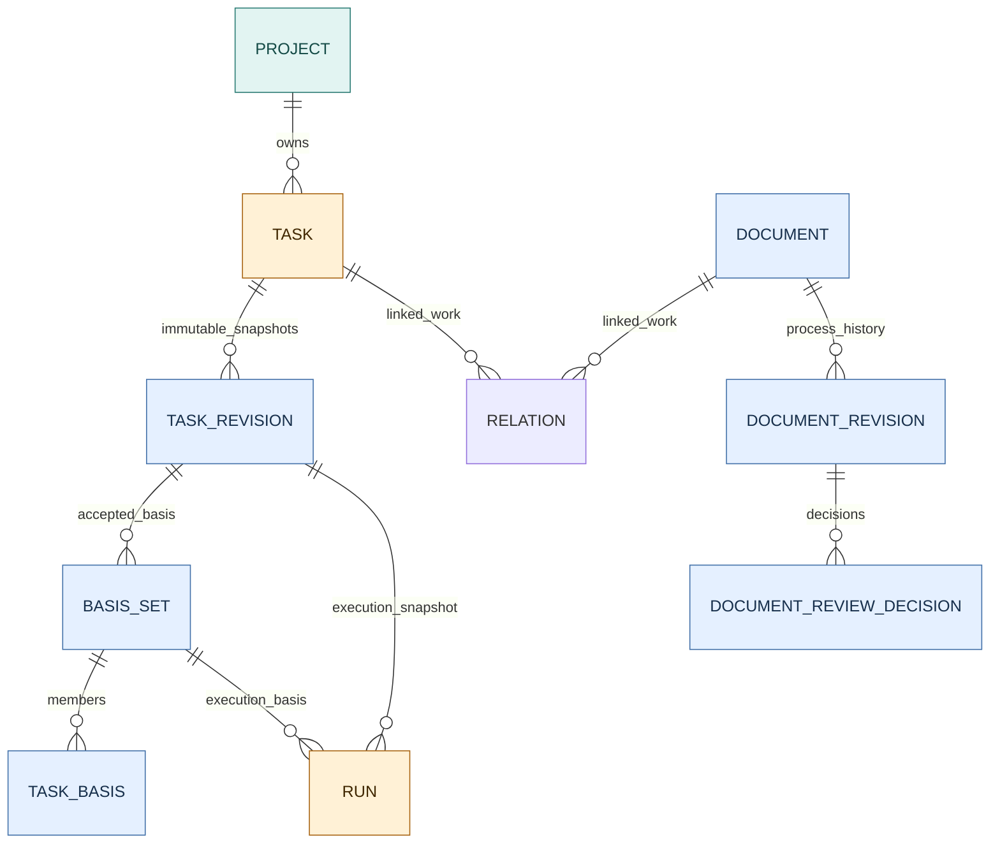
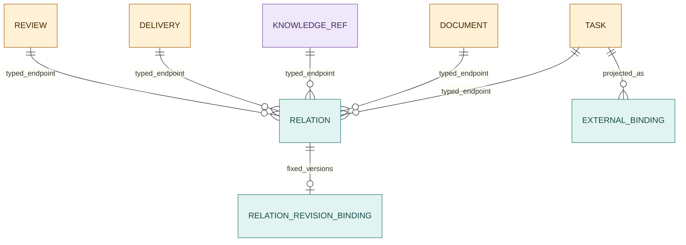
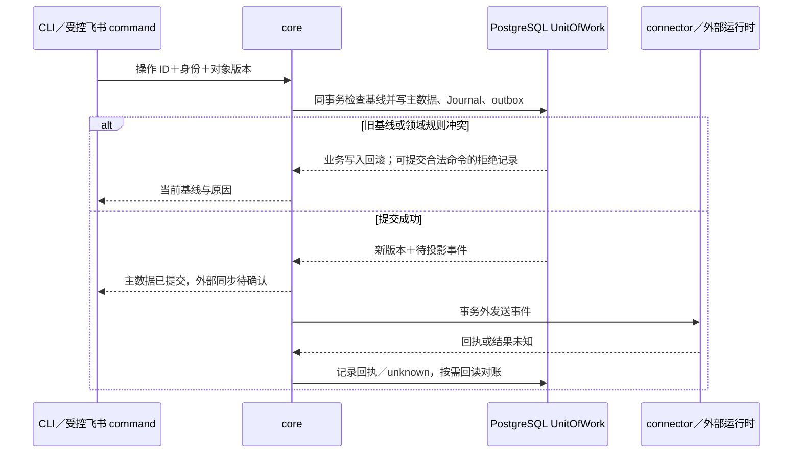

# 存储逻辑：主数据、固定依据与外部引用

状态：2026-10-20 **目标逻辑设计，S1a 的任务/过程 Markdown/依据/影响/操作日志/outbox 已建表、迁移并通过真实 PG 检查，其余表按切片实施。** 用户已选定 PostgreSQL 保存 evoLoop 主数据、飞书作为 connector；本页细化逻辑约束，不宣称字段名或 SQL 已成为合同。语义以[领域合同](contracts.md)为准，权威位置见[项目数据](project-data.md)，包和运行边界见[包架构](packages.md)与[技术选型](technology-selection.md)。

C5 的 Task 正文不再双存：头表和 TaskRevision 都固定引用主 DocumentRevision，读取联结产生 content。迁移保留旧 TaskRevision ID/状态/验收及 Run/Basis/operation；将原 goal 原字节存为对应的主正文修订，当前状态才映射为四态。不得向既有 sealed BasisSet 补写成员或改旧操作摘要。Document 追加用途 kind（可空）与 draft/published/archived；Schedule 历史 task_template JSON 保留原样，只读兼容旧 goal，新模板写 content。具体 DDL 以新增迁移 012 及非空迁移测试为准。

## 对象与固定依据模型

PostgreSQL 中的当前对象用于工作入口：Task 说明当前目标和状态，过程 Document 提供要求与讨论，Schedule 说明何时触发，Relation 帮人导航。飞书任务记录是协作投影，Git 正式 `docs/` 是独立来源，Wiki 正文及其内部知识依赖留在外置知识系统；它们不会因为被 PG 登记而变成 Document 行或第二份可编辑正文。

接受任务时，系统保存不可变 TaskRevision 和一整套 BasisSet。TaskBasis 的成员指向当时实际采用的过程 DocumentRevision、固定 repo/path/commit/hash 的 GitSourceRef，或外置知识的固定修订。普通 Task↔Document 链接只指对象身份，供查找；固定依据才回答“这次决定和 Run 到底按哪一版执行”。旧 Run 同时绑定 TaskRevision 与 BasisSet，所以当前任务、文档或知识后来改版，不会改变旧运行的目标与依据。来源撤回或不可达产生待复核，派发前还须重新核查有效性。

保存时形成的修订载荷、hash 和资源清单是历史事实；当前权限、可达性、完整性复核、采纳和同步进度是随时间变化的观察或决定。新内容形成新修订，原件重新可访问则追加核验记录。原始 HTML、图片和 Markdown 与供检索的提取文本分开；HTML 构建视图、飞书投影和 Wiki 索引不能冒充权威原件。下面先列逻辑键与约束，再说明事务、恢复和建议技术。

## 权威与共同键

PostgreSQL 保存 Task、Schedule、任务关联过程 Document/Revision、跨对象 Relation、ExternalBinding/同步状态、OperationJournal/outbox、运行/触发关联、水位及必要的知识/Git 固定引用。已有正式产品、架构、开发规范的**正文仍在 Git**；可用独立 GitSourceRef 元数据固定来源，不创建 Document 行。Wiki 正文、来源、知识历史和内部依赖仍在外置 KnowledgeRepository。OpenViking 已选作首个接入实现，固定版生产能力尚未验收；可替换范围见[知识合同](contracts.md#知识后端可替换合同)。数据库只保存 Wiki 的可核对引用、跨对象关系和传递回执。

项目权限在服务端由已验证身份和项目成员/受委派操作范围判断；首片单用户也不信任模型自报 Role。复合外键防误关联，不等于访问授权；查询、命令及关系遍历都须检查当前权限。未来多用户或数据库 RLS 的隔离加固需独立验证，不能仅凭 project_id 字段宣称安全多租户。

租户对象以不可重用的稳定 ID 标识，主键采用 `(project_id, object_id)`；外键也带 `project_id`。即使 ID 采用全局唯一 UUID/ULID，也用复合键防止错项目关系成立。

对象 ID 不等于飞书 record ID、Git 路径、Wiki URI 或标题。固定修订有独立 revision ID 与内容/来源校验；当前指针可变，历史修订不可原位覆盖。跨项目关系需另有明确授权对象；首版 Relation 限定同一项目。PostgreSQL 支持多列唯一约束和引用唯一列组的外键，实际 DDL 与删除行为仍须在选定版本测试。[PostgreSQL 约束文档](https://www.postgresql.org/docs/current/ddl-constraints.html)

| 表或表组 | 主键、核心字段和唯一约束 | 外键与职责 |
| --- | --- | --- |
| `project` | `project_id` PK、状态、可见范围；外部 slug 可变 | 项目归档不级联清空证据 |
| `task` / `task_revision` | 头表 `(project_id, task_id)` PK，含当前版本和当前修订/依据集合指针；快照表 `(project_id, task_id, task_revision_id)` PK，含目标、责任、验收判据、接受决定、时间及内容 hash | 头表按旧版本条件更新；每次接受或影响执行的变更插入不可变快照。当前指针须成对指向同一 TaskRevision 的已封存 BasisSet；旧 Run 只读其固定快照 |
| `schedule` / `schedule_revision` / `occurrence` | 定义头键 `(project_id, schedule_id)`；不可变定义快照键 `(project_id, schedule_id, schedule_revision_id)`；触发键 `(project_id, schedule_id, planned_at_utc)` 唯一 | 快照固定时区、规则、启停及错过/重叠策略；Occurrence 复合 FK 指向实际计算所用 ScheduleRevision，并关联创建/复用的 Task。定义改版不改写旧触发 |
| `document` | Document 仅用于过程文档；头键 `(project_id, document_id)`、版本/类型/权限及已采纳修订指针 | 仓库 `docs/` 正式文档不建此行；Task 与 Document 通过稳定 ID 多对多导航 |
| `document_revision` | `(project_id, document_id, revision_id)` PK；`format`、`media_type`、`original_name`、源 `content_hash`、`body` 或 `payload_ref`、`entrypoint`、`assets_manifest`、保存时资源完整性、作者/时间/基线/变更理由 | FK 到过程 Document；不可变；`body` 与 `payload_ref` 必须 XOR；每个 payload_ref 唯一归属一个 revision。内联正文限小型 Markdown/自包含 HTML；较大报告和 bundle 以 canonical BlobStore 引用读取 |
| `document_review_decision` | `(project_id, decision_id)` PK；document/revision、决定者、决定、依据、时间 | 复合 FK 到被审修订；批准/拒绝另追加决定，不原位改 revision；批准后才在同事务条件移动已采纳指针 |
| `document_text_derivative` | 过程 DocumentRevision、`source_hash`、extractor/version、提取状态、派生纯文本、缺失资源/内容清单、生成时间 | 复合 FK 到源 revision；每个 extractor 版本单独留痕。仅供索引/Wiki；源 hash 改变时不得复用为新源正文 |
| `git_source_ref` | `(project_id, git_source_ref_id)` PK；repo 身份、path、commit、原始字节 hash、验证/权限/可达状态 | 独立来源记录，不依附 Document 行；Git 文件移动或版本变化新增引用，旧引用保留 |
| `document_incorporation` / `incorporation_source` / `incorporation_target` | 整理 ID、理由、责任与关联任务；来源 DocumentRevision/片段；目标 repo/path/章节、base commit、差异/PR、merge commit；构建/部署状态分列 | 多来源到多 Git 目标；来源 FK 指向固定过程 DocumentRevision 和 Task/Review，目标位置不 FK 到 Document。核实合入后可关联实际 GitSourceRef；不复制正式正文，不覆盖源文档 |
| `knowledge_ref` / `knowledge_ref_revision` | `(project_id, knowledge_ref_id)` 及加 `revision_id` 的复合 PK；外部空间/ID/revision、可选 hash；有效/待复核/撤回/不可达另记带时间的观察 | 固定身份/版本不随状态观察改写；只登记外部引用和本地处置，正文和内部依赖不入库 |
| `external_binding` | `(project_id, binding_id)` PK；connector、外部 scope/ID、双方最后确认版本、方向、同步状态 | `(connector, external_scope, external_id)` 唯一；内部对象用类型化 FK，不能把投影版本当主版本 |

Document 可在同一事务里先建目录、再建首个过程文档修订、再记录审核决定并设已采纳指针；复合 FK 保证修订及指针属于该 Document。

现行已采纳指针必须对应已批准的审核决定；此规则跨行，须由受控写入路径及必要的约束触发器保证，不能声称单行 CHECK 已验证。每个 revision 的 `format`/`media_type` 描述内容，`original_name` 保留上传名，`content_hash` 校验精确源载荷；`body` 与 `payload_ref` 以 CHECK 保证恰有一者非空。

BlobStore payload_ref 是唯一 canonical 载荷位置，`entrypoint` 指向 bundle 内 HTML 入口，`assets_manifest` 逐项记录相对路径、媒体类型和字节 hash；资源未齐或核验不通过时标记 incomplete/unavailable，不得报告完整可读。Markdown 和小型自包含 HTML 可内联；较大报告/资源包走 BlobStore。GitSourceRef 仍是独立来源，不进入 Document 表。

GitSourceRef 激活前须读取指定 commit 的指定路径、计算原始内容 hash 并记录验证结果；仓库 HEAD、同名路径或相同 hash 都不替代固定 commit。路径移动建立新的 GitSourceRef，旧 TaskBasis 仍保留旧 repo/path/commit；原仓库删除或权限丢失标不可达并复核。

修订载荷、源 hash 和保存时的资源清单不可变；当前权限、blob 可达性、资源核验和知识有效性是带观察时间/依据的状态记录，不能在不可变 revision 行内覆盖过去事实。已采纳指针及审核决定单独维护。缺失资源后补或原件修改须形成新 DocumentRevision；相同原件重新可达只追加观察，不能借此变更正文/hash。历史下载也受当前权限约束。具体语义以[修订合同](contracts.md#2a-documentstore-与-relationstore)为准。

Schedule 头表只提供当前可编辑入口；每次规则、时区、错过或重叠策略改变都插入不可变 `schedule_revision`。到期计算读取某一修订，`occurrence` 保存 `schedule_revision_id` 并以 `(project_id, schedule_id, schedule_revision_id)` 复合 FK 约束，同时保存原计划 UTC 时点。触发去重仍按稳定 `(project_id, schedule_id, planned_at_utc)`，修订号是被观察基线，不作为同一时点重复创建任务的理由；若改版改变该时点是否应触发，先对账旧实例并记录重算决定。

第一幅 ER 图只核**执行快照能否从旧 Run 回到当时的 TaskRevision 与 BasisSet**；它不是全库表图。Document 的独立修订和审核决定也画在此处，以防把候选正文或导航链接误当执行依据。

图例：青＝项目范围；黄＝当前行动/运行；蓝＝固定快照与审核记录。图只画执行快照域；`TASK_BASIS` 可固定过程 DocumentRevision、独立 GitSourceRef 或 KnowledgeRefRevision；普通 Task↔Document 链接仅用于导航。Schedule 是定义，Task 是实际工作，两者状态和 ID 不合并。Mermaid ER 的 `classDef`/`class` 语法见[官方文档](https://mermaid.js.org/syntax/entityRelationshipDiagram.html#classes)。

## 关系与执行基线

`relation(from_type, from_id, to_type, to_id)` 若没有 FK，会让已删除、跨项目或拼错的 ID 悄悄进入关系图。首版把**导航关系**与**固定修订绑定**分开。

### 导航关系与版本绑定

`relation` 的 source/target 各有 `task_id`、`document_id`、`git_source_ref_id`、`knowledge_ref_id`、`delivery_id`、`review_id`、`evidence_ref_id` 等受支持的类型化 nullable 列，每端 `num_nonnulls(...)=1`，每列用 `(project_id, typed_id)` 复合 FK 指向具体实体。Task↔Document 普通多对多链接作为仅指稳定 documentId 的导航关系保存，不要求固定修订，也不隐含采用；需要作为任务依据时，再在 TaskBasis 固定 DocumentRevision。

`relation_revision_binding` 以 `(project_id, relation_id)` 复合 FK 接导航关系，再以各端类型化 revision/source 列引用 TaskRevision、DocumentRevision、GitSourceRef、KnowledgeRefRevision，或固定的 Delivery/Review/EvidenceRef 版本；本行 `CHECK` 约束每端恰好一种目标；对应目标的复合 FK 保证版本/引用属于同一对象和项目；绑定与导航行的对象类型/ID 一致性由同事务写入及约束触发器核验，不能靠跨表 CHECK。关系两端身份、方向和类型建立后不可原位改变；改向或改类型要失效旧关系并创建新 relation ID，保留旧绑定的原义。

固定修订关系没有可解析版本/来源就不得创建。新对象类型须经迁移、合同和查询变更；JSON 泛型 ID 不能充当外键。Relation 自身有 `(project_id, relation_id)` PK、类型、建立者、依据、创建/失效时间与版本。允许的类型组合由约束或受控类型表限制；关系存在不证明任务符合依据。

### 执行依据集合与旧运行

固定执行版本也不能靠“当前 Task/文档”动态解析。`task_revision` 在接受或改变目标/判据/责任等执行语义时插入完整不可变快照；`task` 头仅供当前查询与乐观竞争。`basis_set` 以 `(project_id, task_id, task_revision_id, basis_set_id)` 标识一次已接受的完整依据集合，`task_basis` 的每行 FK 到该集合，并三选一 FK 到过程 DocumentRevision、GitSourceRef 或 KnowledgeRefRevision，针对每种非空目标建立部分唯一索引。接受时在同一事务写齐成员、封存集合并条件推进 Task 当前修订/集合指针；Run 只能引用已封存集合。封存后成员不得增删改，改依据要创建新的 TaskRevision 与 BasisSet；仅 FK 和成员去重不足以保护旧 Run 的依据。

Run 同时持 `(project_id, task_id, task_revision_id, basis_set_id)` 复合 FK 到 `basis_set`，因此旧 Run 的目标、判据和依据均可重放；仅 FK 到可变 Task 头不够。Task 头更新或接受新依据要产生新快照/集合并复核，旧 Run 不跟随当前指针变化。

知识撤回、GitSourceRef 不可达或过程文档被取代时，影响任务标待复核；**派发前还须实时向来源端核固定引用的有效性**，不能只依赖后台影响扫描已完成。无法确认时暂停派发。Wiki 内部“来源支持哪条主张”的依赖仍由外置知识系统维护。

`basis_set/task_basis` 是接受和派发依据的唯一写入入口。用于导航的相同“任务依据”关系由该集合派生；若物化关系，必须同事务生成并只读，禁止另从 Relation 编辑出第二份不同基线。其他解释性关系仍可独立提出，但不能据此隐式改变执行依据。

### 外部绑定的约束

ExternalBinding 也使用类型化对象列、恰好一项非空 CHECK 和复合 FK。首期只开放 Task→飞书 Bitable 记录；Document→飞书云文档须按另一套 API 单独验证。唯一约束覆盖 connector、外部租户/空间、外部 ID；另约束同一内部对象在同一目标视图至多一个有效绑定。首次创建投影前须验证远端可保存并按稳定内部对象/操作标记查询；回包丢失而尚无 binding 时用该标记对账，不能仅凭空 binding 判定未创建。无法可靠定位就保留 unknown，暂停自动重建。远端删除记绑定异常，不默认删除内部对象。入站变化缺行为者、读入基线或字段归属时留待处理差异，不按最后写入时间覆盖。

| 关系与运行表 | 最小键和字段 | 约束与边界 |
| --- | --- | --- |
| `relation` / `relation_revision_binding` | 导航键 `(project_id, relation_id)`；两端类型化对象列、关系类型；绑定键含 relation ID 与两端固定 revision | 导航和版本目标均以同 project 复合 FK 校验；Review/Delivery/EvidenceRef 须有具体表与固定版本，跨表一致性用受控事务/约束触发器；不级联抹历史 |
| `basis_set` / `task_basis` | 集合键 `(project_id, task_id, task_revision_id, basis_set_id)`；成员含固定 DocumentRevision、GitSourceRef 或 KnowledgeRefRevision、判据校验、记录时间 | 集合 FK 到不可变 TaskRevision；成员 FK 到集合及唯一一种固定来源；同一集合内依据去重；封存后拒绝成员变更，Task 当前指针与 Run 只引用封存集合 |
| `run` / `occurrence` | `(project_id, run_id)`、`(project_id, schedule_id, planned_at_utc)`；承载 Session、操作、观察状态、相关 Task | Run 复合 FK 到 TaskRevision+BasisSet；Occurrence 复合 FK 到固定 ScheduleRevision 及 Task；运行完成不能改写 Task 验收或实际效果 |
| `delivery` / `review` / `evidence_ref` | 各自 `(project_id, id)` 与固定 revision 或不可变决定 ID；成果地址/内容 hash、亲用证据、判断者/时间 | 明确对象和版本，供 `validates` 等 Relation 的类型化端点 FK；正文或原件仍按授权定位 |
| `task_effect_review` | `(project_id, review_id)`；task ID/版本、目标消费者、亲用证据、结论/时间 | 复合 FK 到固定 TaskRevision；结果未知可保留，不用空值伪装成功 |
| `blob_ref` / `source_fingerprint` / `ingestion_receipt` | 各自 `(project_id, id)` PK；外置 URI/hash/可见范围，或源对象/修订/片段/hash/策略/转换器/目标/sourceRef/回执 | `source_fingerprint` 对 `(project_id, source_kind, source_id, source_revision, fragment)` 唯一并固定 contentHash；回执再按该身份+hash+policyVersion+transformerVersion+target 去重；不存 Wiki 来源正文与内部依赖 |

第二幅 ER 图只核**导航关系端点、固定版本绑定和外部投影绑定**，避免把 Relation、TaskBasis 或飞书记录混为一类关系。完整列约束仍以上表和正文为准。

图例：黄＝PG 业务对象；紫＝外部知识引用；青＝跨对象关系及平台绑定。关系图省略两端同样受约束的复合 FK；每条关系两端均须存在且同 project。固定版本绑定不修改导航对象身份。ExternalBinding 首期只接 Task，其他类型启用前加对应有外键的列及测试。

014 评价切片新增 `evaluation_head`、`evaluation_revision`、`evaluation_attempt`、`evaluation_assessment`、`evaluation_conclusion`：head 只指向当前定义，四种事实按项目及评价修订保存并追加。`runtime_run` 另存评价绑定与输入包引用；attempt 以同项目 FK 约束真实 Run、Session、来源 TaskRevision 与执行 TaskRevision，assessment 约束 Delivery/Observation 属于该次执行，conclusion 约束所选判定属于固定修订。015 新增可空 `delivery.run_id`，同项目、同 Task FK 固定显式 Run 归因；旧行保留 null。assessment 的来源约束按该 Run 关联，而不要求交付登记修订等于执行修订；两者各保留原义。业务层还须核对全部尝试、当前更正链、同项目后续 Task/TaskRevision 引用和未知成本；首片结论不能记完全可比。协议、来源与 Wiki 只存固定引用和 hash；输入包及较大产物在仓库外受控 Blob，活 Wiki 正文不进 PG 评价表或正式 Git 文档。014 的定向真实 PG 回归已覆盖派生 Run/Attempt 及外部来源变化拒绝；完整入口集成与真实两组业务运行尚未完成，不能据表定义声称已完成实际评价。

分工与认知讨论页的其他结果也需要稳定定位，但可在后续切片落地，不先做通用聊天数据库：

| 后续表组 | 记录什么 | 固定引用与权威边界 |
| --- | --- | --- |
| `role` / `role_revision` / `session_instance` / `session_binding` | 逻辑职责头及不可变职责说明；稳定 Session ID 与宿主 ID 映射；绑定起止时间、所承担的 RoleRevision、交接 Task/Run | `role_revision` 复合 FK 到 Role；binding 复合 FK 到 RoleRevision 和本项目 SessionInstance，关联 Run 时再用复合 FK；聊天换窗不新建 Role，职责正式配置若在 Git 仍只登记 ref+commit |
| `stage_review` / `review_decision` | 阶段目标、读入 Task/过程 Document/GitSourceRef/KnowledgeRef 固定版本、消费者实际使用观察、下一步选择、决定者、时间、被取代决定 | 每次决定是不可变记录，复合 FK 到本项目固定 TaskRevision/DocumentRevision/GitSourceRef；知识端只存固定外部 revision 引用；新判断追加而非改旧结论 |
| `impact_review` | 来源撤回、过程文档改版、GitSourceRef 不可达或知识失效触发的影响对象/基线、责任者、待复核/已处理及决定 | 复合 FK 到本地 Task、过程 Document、GitSourceRef、Relation 的固定来源及可用的 KnowledgeRefRevision；外部知识内部依赖仍由 KnowledgeRepository 查询 |
| `knowledge_contribution` | 贡献者、输入来源固定版本、提交操作、外部 candidate ID/revision、回读状态和审核结果引用 | 只存外置候选的身份与回执，绝不复制候选或 Wiki 正文；同一来源/操作可查重复与撤回影响 |

这些记录为讨论页提供查询与交接锚点，不把聊天文本或通知送达当作判断已被消费的证据。关联到外部 Git/Wiki 的字段只能保存经权限检查的固定引用；没有外部修订可核验时显示缺项，而不是伪造本库 FK。

## 事务、幂等和读取

`operation_journal` 用 `(project_id, operation_id)` 唯一记录请求身份、目标、读入基线、规范化命令摘要、预期副作用及 `pending/applied/rejected/unknown`。同一 ID 与摘要一致时，经当前授权核验后返回原结果或待对账状态；摘要不同则拒绝，不能把旧结果当作新命令成功。`outbox` 用 `(project_id, event_id)` PK，`(project_id, operation_id, effect_key, target_connector, event_kind)` 去重。`effect_key` 是命令内稳定的对象/项目项键：一次操作变更多个 Task、关系或投影时各项不同，同一项重试时不变。载荷只保存目标对象 ID/版本、最少投影内容、可见范围、尝试与回读回执，不把 outbox 当长期第二正文。唯一键字段均应非空；不能假设普通 UNIQUE 将多个 NULL 视为冲突。[PostgreSQL 约束文档](https://www.postgresql.org/docs/current/ddl-constraints.html)

一次主数据变更在 `UnitOfWork` 里用同一数据库事务/连接：校验身份/项目及命令结构 → 查询或占用 operation ID 并核摘要 → 重验当前授权/读入版本 → 条件更新 Task/Document/Relation → 写 Journal/outbox → 提交。旧版本或领域规则冲突不产生投影。若要持久记录合法命令的领域拒绝，可在同一外层事务用 savepoint 包住业务写入，回滚该 savepoint 后只提交 `rejected` 与摘要，不留下对象变更或 outbox；身份或结构校验失败可直接拒绝而不建 Journal。PG 提交结果不明时不得伪造 `rejected`，先按 operation ID 回读。提交后才向飞书、Codex 或 Wiki 发网络请求。PG 能原子提交本库对象和 outbox，不能跨服务保证恰好一次；外部回执丢失时记 `unknown` 并按 operation/binding/远端回读对账。首期只有一个活动协调者，失去独占资格停止新写入与 outbox 重试。

下面的时序图放大**本库事务与外部副作用之间的断点**。它解释操作记录为何需要 `pending/unknown` 和回读，通用恢复选择见[总览](overview.md#派发结果未知先对账再决定)。

普通读取从 PG 当前主数据和固定修订装配视图；飞书是可滞后的协作投影。认知上下文再按授权解析 Git 固定 commit/path、Wiki 固定 revision 和原件，附读取时间、外部可达性与差异/缺项。检索索引只加速定位，不能把缓存摘要当正文。Task、文档审核、Run、Sync、实际使用效果各自独立；跨项目查询逐项授权，关系遍历、搜索和导出沿用源对象可见范围。

## 原件、权限、删除和恢复

### 原件登记与发布

附件、原始会话、Evidence 原件、大型成果和较大过程报告/资源 bundle 在仓库外受控 blob/原权威位置；PG 的 `blob_ref` 仅登记 project、稳定 ID、存储 URI、字节 hash、大小、媒体类型、权限范围、生命周期状态及唯一所属 revision/payload。路径不能作为永久身份，读取前再授权并核 hash。

过程报告载荷先 prepare、核验主文件和 manifest 中全部资源的字节 hash、形成不可覆盖的完整载荷；随后在 PG 单一事务登记 BlobRef、DocumentRevision、canonical payloadRef 与当前指针。**对使用者的发布点是 PG 登记成功，不能把多文件上传描述成存储层原子事务。** PG 事务失败时载荷尚未成为可读文档，由对账清理未引用 blob；缺资源只可记录 incomplete，不得登记成完整可读报告。PG 内联正文直接在 revision 事务提交，且与 payloadRef 互斥。

### 来源传递的校验与回执

拟议 SourceBridge 按白名单读取 PG 固定 revision、Git commit 或成果；`ingestion_receipt` 记录源 kind+ID+revision、片段定位、`contentHash`、`policyVersion`、`transformerVersion`、目标知识空间、外部 `sourceRef` 及提交/回读/撤回状态。**同一原来源固定 revision 与片段若重新读出不同 contentHash，先报来源漂移并暂停摄入，不将它当合法新事实。** 合法变化须有新的来源 revision 或明确不同片段；策略/转换器升版可在原 hash 不变时形成可追溯重处理。`source_fingerprint` 的独立唯一键防止带新 hash 的回执去重键掩盖漂移。它是**传递回执**，不存 Wiki 来源正文或内部依赖；语义见[知识流](knowledge-flow.md)。

### 文件与数据库的恢复边界

BlobStore 的**本机适配器**发布顺序为临时写入 → 核字节 hash → 同文件系统原子移入受控位置 → PG 登记可读引用。未来对象存储适配器则使用不可覆盖的对象键、完整 manifest 与独立内容校验，全部准备好后再登记；不能假设具有文件系统式原子改名，也不能把任意 ETag 当作本合同的内容 hash。两者都不暴露未登记载荷，失败孤儿、未完成上传和多余对象按保留策略对账清理。PG 与 blob 后端没有共同事务；备份清单固定已登记 blob 的 ID/hash 与 PG 恢复点，恢复时核缺失和多余项。对象存储的搬移语义须按具体后端核验，例如 [S3 的复制、移动与改名](https://docs.aws.amazon.com/AmazonS3/latest/userguide/copy-object.html)不能据本机 rename 行为推定。

### 权限、删除与跨系统恢复

业务删除默认归档/标失效，保留已执行任务和旧修订引用；真正删除遵守另定保留政策，先查关系、投影、索引、blob、备份及外部副本。权限收紧先阻断新读取/投影；outbox worker 发出前须重验当前源对象授权、目标可见范围与绑定状态，过期意图暂停并记录原因，再按 connector 能力撤销既有可见副本。不能承诺收回已下载内容。索引、outbox、日志、备份和导出不得扩大源对象权限；备份加密、恢复权限及保留周期需在部署前确定。

恢复分别检验 PG 主数据+outbox、受控 blob、Git 固定 commit、外置 Wiki 固定 revision 和飞书投影。PG 恢复点若早于已发生的外部副作用，不能只恢复数据库就重新派发；先冻结写入，按 operation/binding 与外部实际状态对账。Git 或 Wiki 修订不可达时标依据缺失并安排复核，不能从旧摘要补造正文。跨系统一致恢复是验收用例，不由单一 PG 备份保证。

## 技术选择是否合理

**当前推荐是“一套业务数据库 + 各自权威的文档/知识存储 + 可重建索引”。** PostgreSQL 与首个知识后端 OpenViking 已由用户选定，具体版本、部署方式及其余实现选择仍待首片确认。表多不等于每片都要建立所有表；下面先确定边界，按实际功能建立必需结构。

| 层 | 首期具体建议 | 选择理由与避免的重复 |
| --- | --- | --- |
| 业务持久化 | PostgreSQL 18.x；`pg` 驱动、参数化 SQL、同连接 UnitOfWork | Task、Doc、关系、基线和 outbox 可同库事务；不另建 SQLite 过渡库或单独业务图数据库 |
| 字段与正文 | 身份/状态/版本/权限/关系用有类型的列；小型过程文档正文可内联 PG，Markdown/HTML 均保存源字节；较大报告/资源 bundle 走 BlobStore | JSONB 只放经 schema 校验的资源 manifest 等元数据；不把 Wiki 正文复制入 JSONB，也不把外置载荷当第二份可改正文 |
| 数据迁移 | 推荐 `node-pg-migrate` 执行版本化、可审阅的 SQL；单一部署步骤，固定稳定版本 | 用已有 runner 管迁移记录与互斥，避免另写迁移框架；不启用启动时自动改生产 schema。当前未安装，不能用文档工具的最新预发布版代替已锁定依赖 |
| Git 正式文档 | 保留仓库正文和固定 commit；PG 可登记独立 GitSourceRef 来源元数据，由白名单适配器读取 | 工作台显示同一正式版本；不建立“从网页再抓一次”的第二份规范，也不创建 Document 行 |
| Wiki 来源/正文/内部关联 | 首期 OpenViking 服务持外置内容与修订（版本待验）；若补发布格式，与 Wiki 同一知识空间 | nashsu 的页面和图谱体验可通过知识查询模型实现，无需同时保留它的另一套可编辑 vault |
| 附件与不可重建原件 | 首个本机切片使用仓库外受控目录，通过 BlobStore 端口访问；PG 保存 blob 元数据 | 大型原件不塞业务表，不装第二套文件管理产品；迁到常在线主机时再选择受控持久卷或对象存储，并演练搬迁和恢复 |
| 检索与关系展示 | PG 先按 ID、标题和结构化过滤检索；Wiki 语义检索沿用知识后端；前端图谱是有权限的有界关系视图 | 首期不新增 Elasticsearch、Neo4j、Redis 或第二向量库；关系可视化不要求图数据库。中文全文效果和跨源排序单独验证 |

依据：[PostgreSQL JSON 类型](https://www.postgresql.org/docs/18/datatype-json.html)说明 JSONB 的存储与查询能力；[pg 事务](https://node-postgres.com/features/transactions)要求同一 client；[node-pg-migrate](https://salsita.github.io/node-pg-migrate/migrations/)提供迁移记录、锁和事务执行机制。项目选择不等于这些库已经通过本项目验证。迁移只用已锁版本支持的 SQL 路径；已经执行的迁移不可编辑，变更追加新文件。需要非事务 DDL 的迁移单独设计恢复，数据不可逆时采用向前修复/备份恢复，不假定自动 down 无损。

### 两个参考 Wiki 的存储是什么

以下为固定版本的官方文档/源码核查，不是 evoLoop 已部署的组件清单。OpenViking 此处核查 0.5.1；此前隔离运行实验使用 0.5.0，不能据此宣称 0.5.1 已通过运行验证。

| 参考实现 | 正文、来源与附件 | 配置、历史与检索 | 对 evoLoop 的含义 |
| --- | --- | --- | --- |
| nashsu/llm_wiki v0.6.12 | 用户选定的本地 vault：`wiki/**/*.md`、`raw/sources`、`raw/assets` | 应用配置用 Tauri JSON store；项目标识在 `.llm-wiki/project.json`；向量索引可用本地 `.llm-wiki/lancedb`。Timeline 默认关闭，开启后的 `.llm-wiki/history` 有限量保留；摄入另有条件性 page-history | 核心存储可只用本地文件；引用其前端体验不要求引入这套 vault 或 LanceDB，更不能把其可选备份当作完整不可变修订历史 |
| OpenViking 0.5.1 | VikingFS 提供统一 URI；AGFS/RAGFS 内容层可选本地文件系统、S3 兼容后端，或测试用内存后端 | 向量索引独立配置为 local、HTTP 服务或 Volcengine/VikingDB；索引除向量外还可能含摘要和其他文本。摘要/索引异步更新可落后于内容写入 | 可先接本地内容存储，部署时再选对象存储；S3 只解决内容存放，不替代索引、页修订或发布并发语义 |

依据：[nashsu 项目目录](https://github.com/nashsu/llm_wiki/blob/48fd970e206a02a6d2028d1dbfc41b7a0345bf0b/src-tauri/src/commands/project.rs)、[应用配置](https://github.com/nashsu/llm_wiki/blob/48fd970e206a02a6d2028d1dbfc41b7a0345bf0b/src/lib/project-store.ts)、[向量索引](https://github.com/nashsu/llm_wiki/blob/48fd970e206a02a6d2028d1dbfc41b7a0345bf0b/src-tauri/src/commands/vectorstore.rs)、[历史实现](https://github.com/nashsu/llm_wiki/blob/48fd970e206a02a6d2028d1dbfc41b7a0345bf0b/src-tauri/src/commands/file_history.rs)；[OpenViking 固定版存储说明](https://github.com/volcengine/OpenViking/blob/e855796c83f9eb575d9b0f3082926660730f6a63/docs/en/concepts/05-storage.md)。本项目要求的“索引可重建”以完整保留其来源为前提，不能在未核对来源覆盖时直接删除上游索引中的文本。

### evoLoop 何时接入对象存储

**建议把 BlobStore 作为必需边界；对象存储作为正式托管时优先评估的实现，当前尚未选定供应商或部署。** 本机验证可以使用仓库外受控目录；正式托管并保存真实 HTML 资源包、图片、PDF 或其他成果时，应在接收第一份不可重建原件前确定持久存储、备份和恢复方案。多端访问通过统一 API 即可实现，本身不强制要求对象存储；单机持久卷也可行，但需承担该主机的容量、备份和搬迁。

数据归属保持清楚：PG 保存任务、过程文档元数据/小型正文及 blob 引用；BlobStore 保存较大过程文档的唯一载荷与原件；Git 保存正式文档；外置 Wiki 保存知识正文、受控来源副本及自身索引。送入 Wiki 的提取文本记录源修订/hash，不替代 BlobStore 原始报告。HTML 的隔离展示与资源授权仍由[前端读取边界](../frontend/architecture.md)处理，不能把公开 bucket 当作报告阅读器。

evoLoop 的 BlobStore 与 OpenViking 内容层可以复用同一家存储服务，但使用分离的 bucket 或受隔离的前缀及访问策略，各自负责版本、生命周期和恢复；evoLoop 不直接改 OpenViking 私有对象，OpenViking 也不管理过程文档的 canonical payload。对象存储不自动提供应用的历史语义、跨 PG 事务或备份恢复证明。

从本机目录迁到对象存储时保留 blob 稳定 ID、字节 hash、资源 manifest 和旧 DocumentRevision，只在适配绑定里调整物理位置。先复制、核验并试读，再切换绑定、按保留策略处理旧副本；Task/Wiki 的来源引用无需跟着本机路径变化。端口归[领域合同](contracts.md)，供应商 SDK 和迁移实现归[包架构](packages.md)，不为当前未部署的服务预建空包。

**仍需明确的部署项**是数据库实例位置、容量/保留、备份频率与恢复目标、Wiki 固定版的底层后端及真实写入能力。这些在保存第一份真实且不可重建材料前落实。开发和 CI 用同主版本真实 PG 验约束，部署步骤先验空库建立、旧版升级和中断恢复。没有测量依据时不增加新的存储引擎；若 OpenViking 复用收益不足，重新比较薄知识后端，而不是在其旁边补一整套重复系统。

## 切片与验收

存储随[包架构 S1—S4](packages.md#切片与验证)接入，下面只列各片的持久化检查，不另定义一套实施顺序。

**S1 主数据与出站投影**落 project、Task/不可变 TaskRevision、过程 Document/Revision、Task↔Document 多对多链接、独立 DocumentReviewDecision、GitSourceRef 登记、固定 BasisSet、OperationJournal/outbox、飞书 Task 出站 Binding 和最小 CLI。当前可先交付受限 **S1a**：PG 18 上的内联 Markdown 过程文档及已批准修订、ready Task、封存 BasisSet、导航 Relation、ImpactReview 与 Journal/outbox；不接飞书、Git、Wiki 或 Blob，也不把这一子片称作完整 S1。用真实 PostgreSQL 验证复合 FK、跨项目/权限拒绝、旧版本拒绝、已封存成员不可改、旧 TaskRevision/BasisSet 回读、并发批准与接受、文档批准不修改正文、同操作两个对象产生两条 outbox、事务最后一步回滚、同 ID 同/异摘要、合法领域拒绝不留对象或 outbox，以及提交结果未知按 ID 回读。完成 S1 时再验证 TaskBasis 固定 GitSourceRef、飞书首次创建成功却丢回执后用稳定标记定位、重复发送与远端回读、权限收紧使排队投影停发；GitSourceRef 验证固定 commit/path/hash。未接 Wiki 时不要求不存在的 KnowledgeRefRevision，也不能把缺项当作验证通过。飞书入站编辑等字段、身份和基线能力验证后开放。

**后续持久化**：S2 加真实 Run/Session 映射，验证旧 Run 仍读旧 TaskRevision/BasisSet 及未知派发恢复；S3 加 Schedule/ScheduleRevision/Occurrence；S4 加 KnowledgeRef、知识依据绑定、source fingerprint/ingestion receipt、知识变更的反向影响复核与评价。blob 在首次较大 Markdown/HTML 报告或资源包切片接入，同时验证发布中断、资源缺失、核 hash 和恢复；它不是收真实原件后的补救项。DocumentIncorporation、职责试行记录、更多关系类型和云文档 connector 随相应用例接入；权限与跨系统恢复逐片验证。不要为未接入的 Wiki 或 connector 预造可编辑副本。自动检查通过后仍由真实消费者核对依据能否找到、冲突能否处理、旧版本能否复现；这些效果尚无运行证据。
