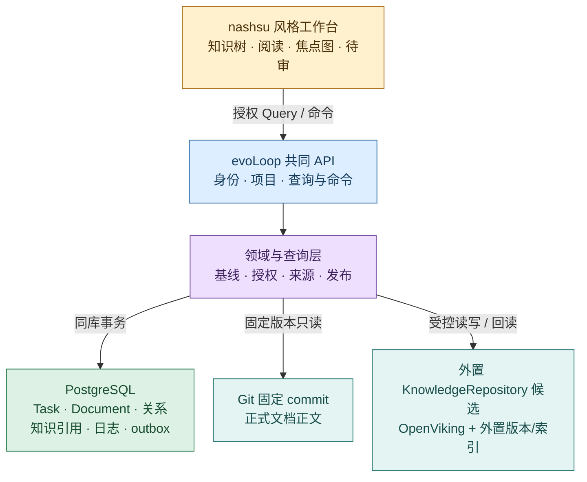
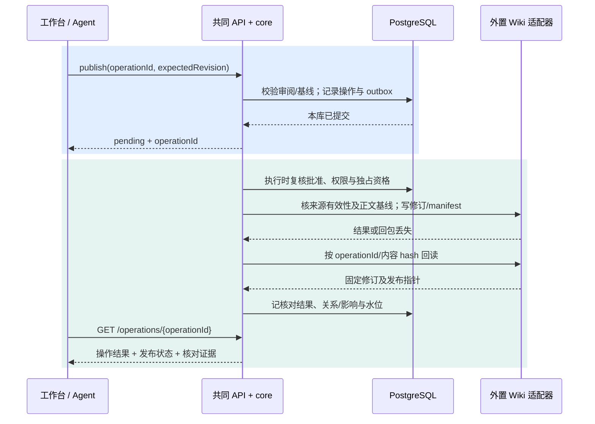

# Wiki 前端与知识服务集成

状态：2026-10-20 **可实施设计提议，尚未编码或部署**。用户已确定 PostgreSQL 持有 evoLoop 任务、日程、原生文档与跨对象关系；OpenViking **v0.5.1 是待验证的外置 Wiki 候选**，nashsu/llm_wiki **v0.6.12（`48fd970e`）是前端参考**。本页给两者之间的最小接缝，不改变[领域合同](contracts.md)、[存储权威](storage.md)、[知识流](knowledge-flow.md)、[Wiki 维护](wiki-maintenance.md)和[工作台架构](frontend.md)。本地 OpenViking checkout 为 v0.5.0；v0.5.1 能力判断来自固定上游源码，旧版实测不能当作新版验收。[候选核查](../research/wiki-base-selection-20261019.md) · [技术取舍](technology-selection.md)

## 1. 一个入口，三个正文权威

`apps/workbench/knowledge` 展示知识点、专题、来源、双链、关系图和待审；所有浏览器读写经过 evoLoop 的 `/api/v1`。API 负责身份、项目范围、能力、固定版本、命令基线与分源状态。PG 是 Task、仅含过程文档的 Document Table、Relation 及运行维护记录的权威；Git 仓库 `docs/` 独立维护产品、架构与规范，文件不进入 Document Table；外置 KnowledgeRepository 是 Wiki 正文、来源、内部依赖与历史的权威。PG 的 KnowledgeRef 只登记外部知识身份与固定修订，不能成为第二份可编辑 Wiki。公开文档站只读 Git 派生视图，飞书仅是协作投影入口。

`KnowledgeRepository` 合同先于 OpenViking 实现。若最终不采用该候选，工作台、Query/Command 及 PG 关系不用改；要替换的是适配器和外置空间内的索引/版本实现。[Wiki 前端模型](wiki-workspace.md)规定页面类型、认识性质、有效状态分开。



箭头表示调用或提交方向，不表示 PG、Git、Wiki 存在全局事务。黄色是浏览器；蓝色是共同协议；紫色是领域判断；绿色是 evoLoop 主数据；青色是外部正文权威。浏览器不能持有数据库、Git 或 OpenViking 凭据。

## 2. nashsu 前端接缝

以固定 [nashsu v0.6.12 源码](https://github.com/nashsu/llm_wiki/tree/48fd970e206a02a6d2028d1dbfc41b7a0345bf0b/src)和[前端复用核查](../research/nashsu-llm-wiki/frontend-reuse.md)为边界；保留交互语言，不直接搬其文件系统状态。`KnowledgeTree` 的类型/来源筛选、`WikiReader` 的 Markdown/来源阅读、`PageLinksPanel` 的出链/反链/缺链、`GraphView` 的聚焦与邻域、`ReviewView` 的待审比较分别映射成 API 数据视图。`wiki-page-types`、`wikilink-transform` 等纯解析代码可单独评估复用；阅读组件直接依赖 `useWikiStore`，图构建直接遍历 Tauri 文件，必须拆出数据适配和事件接口。任何源码复制先核许可和依赖；目前未复制。

| 组件边界（拟议） | 输入 | 只向上发出的事件 |
| --- | --- | --- |
| `KnowledgeNavigator` | 已授权的专题/类型/来源游标页、选中 ID | `onOpenKnowledge(id, revision?)`、`onFilter(query)`、`onLoadMore(cursor)` |
| `KnowledgeReader` | 固定 `KnowledgePage`、来源可达性、当前版差异 | `onOpenSource(sourceKey)`、`onOpenRelation(id)`、`onProposeCorrection(basisRevision)` |
| `KnowledgeLinks` / `GraphNeighborhood` | 服务端有界边、解析状态、下一页 | `onFocus(id)`、`onExpand(depth, cursor)`、`onOpenEvidence(edgeId)` |
| `CandidateReview` | 候选与固定基线、权限能力、影响预览 | `onSubmitReview(decision, basis)`、`onPublish(operationId)` |

组件不调用 Tauri 文件命令、不扫描全库、不直接写 OpenViking，也不从前端缓存决定有效性。路由沿用 `/app/p/:projectId/knowledge/:knowledgeId?revision=...`；固定修订深链保留旧页，另给当前版链接。图的相关性排序只用于发现，不赋予边“支持”或“已验证”语义。

## 3. 共同 API 的读取协议

以下均为 **evoLoop 拟议 API**，不是 OpenViking 原生路径。列表和关联页按项目、身份、ACL 与服务端最大页长过滤，返回游标；详情可指定不可变修订。初期用最小可验证闭环，不要求一次做完所有 UI。

| Query | 用途与返回核心字段 |
| --- | --- |
| `GET /api/v1/projects/{p}/knowledge?pageType=topic&status=published&cursor=...` | `items[{knowledgeId,revision,title,pageType,epistemicStatus,validity,sourceCount}]`、`nextCursor`、`watermark` |
| `GET /api/v1/projects/{p}/knowledge/{id}?revision={rev}` | 固定 `body`、`contentHash`、`sources[{sourceKey,originRevision,fragment,state}]`、`currentRevision`、`capabilities` |
| `GET /api/v1/projects/{p}/knowledge/{id}/members?revision={rev}&cursor=...` | 专题成员 ID、固定修订、成员理由与游标 |
| `GET /api/v1/projects/{p}/knowledge/{id}/links?revision={rev}&direction=both&cursor=...` | 出链/反链、端点修订、关系类型、来源与断链原因 |
| `GET /api/v1/projects/{p}/knowledge/graph?focus={id}&depth=1&limit=80` | 有界节点/边、截断标志、下一次展开游标；服务端强制上限 |
| `GET /api/v1/projects/{p}/tasks/{id}/context` | `ContextQuery`：TaskRevision/BasisSet、原生 DocumentRevision、Git commit、知识固定修订及缺项 |
| `GET /api/v1/projects/{p}/knowledge/reviews?state=pending&cursor=...` | PG 中的维护决定/影响复核状态与外置候选引用 |

响应示意（字段名待 `contracts` 的浏览器 schema 定稿）：

```json
{
  "knowledgeId": "k_7f2", "revision": "kr_19", "currentRevision": "kr_20",
  "pageType": "concept", "epistemicStatus": "inference", "validity": "needs_review",
  "body": "...", "contentHash": "sha256:...", "observedAt": "2026-10-20T08:00:00Z",
  "sources": [{"sourceKey": "doc:d_4@dr_8#scope", "originRevision": "dr_8",
    "fragment": "scope", "state": "reachable"}],
  "sourceStatus": {"wiki": "verified", "postgres": "verified", "git": "not_used"},
  "missing": [], "capabilities": ["read", "propose_correction"],
  "watermark": {"wikiManifest": "wm_81", "postgres": "pg_440"}
}
```

`observedAt` 和各源水位只说明分别核对的时间；PG、Git、Wiki 没有共同瞬间快照。索引滞后或上游不可达时返回可解释的 `stale/unknown` 与 `missing`，历史缓存不能被标成“当前有效”。原件与关系端点逐项复核 ACL；列表/搜索、图、来源卡、附件均不因有索引命中而越权。客户端缓存键至少含 actor、project、对象 ID、固定 revision、过滤/游标、授权版本和 Wiki 水位；切身份、权限收紧或发布/撤回后清除相关缓存。Markdown 禁不可信 HTML、危险 URL，附件经共同 API 授权读取。

## 4. 固定来源怎样进入外置知识空间

`SourceBridge` 仅按白名单读取 PG 的 TaskRevision/BasisSet、原生 DocumentRevision、Delivery/Review 固定证据，以及 Git 的 repo/path/commit/blob hash；`adapter-git-documents` 负责固定 commit 读取。正式 Git 文档路径移动时用 commit 与 blob 校验定位，不能把现行路径的不同正文当旧来源。草稿、未授权文件和会话原始文本不能因“有链接”自动摄入。[来源协议](knowledge-flow.md#来源桥接的最小协议)

交付给外置空间的 envelope 拟为 `{projectId, sourceKey, originKind, originObjectId, originRevision, fragment, contentHash, policyVersion, transformerVersion, aclScope, status, textOrBlobRef}`。`IngestionReceipt` 在 PG 只存来源身份、目标空间、外部 `sourceRef` 和状态；知识来源正文及知识内部依赖由外置空间持有。去重键含项目、来源 ID/修订/片段、hash、策略、转换器与目标；**同一固定来源修订和片段回读得到不同 hash** 先报来源漂移，不能以“新 hash”悄悄当新事实。撤回和权限变动发受控失效事件，知识页及其依赖标待复核。

`ContextQuery` 把 PG 的 Task/Document 关系、Git 固定正文校验、Wiki 固定页和当前有效性组合成限量上下文包，标出任务当时基线与当前差异。任务派发前实时核知识状态、来源可达和权限；已撤回或待复核的关键依据阻止最新派发。后台影响扫描补全处理清单，不能替代派发门槛。通知已投递也不证明下一 session 实际采用，须在交付/解释中核对。

## 5. OpenViking v0.5.1 的原生面与适配面

固定 [内容路由](https://github.com/volcengine/OpenViking/blob/e855796c83f9eb575d9b0f3082926660730f6a63/openviking/server/routers/content.py)、[检索路由](https://github.com/volcengine/OpenViking/blob/e855796c83f9eb575d9b0f3082926660730f6a63/openviking/server/routers/search.py)、[资源路由](https://github.com/volcengine/OpenViking/blob/e855796c83f9eb575d9b0f3082926660730f6a63/openviking/server/routers/resources.py)和 [compile 路由](https://github.com/volcengine/OpenViking/blob/e855796c83f9eb575d9b0f3082926660730f6a63/openviking/server/routers/compile.py)可核到下列 HTTP 面；是否满足合同仍需候选版集成实测。

| 已见的上游接口 | evoLoop 用法与未满足的合同 |
| --- | --- |
| `GET /api/v1/content/read?uri=...`、`/abstract`、`/overview` | 读指定 URI 内容/派生摘要；不把 URI 当稳定知识 ID，不把摘要当固定历史修订 |
| `POST /api/v1/search/find`、`/search`、`/glob` | 候选发现/检索；服务端仍要按项目/权限过滤、限制分页并核到固定身份 |
| `POST /api/v1/resources` | 摄入经 SourceBridge 放行的材料；回执是摄入状态，不是知识已编纂或已采纳 |
| `POST /api/v1/content/write`、`/batch-write` | 内容写入；v0.5.1 `batch-write` 的每项可带 `expected_sha256`，普通 `write` 不提供同样条件字段。不能据此声称整组发布事务或多写者安全 |
| `POST /api/v1/compile` | 可选生成/编纂入口；普通内容写入不会自动完成知识综合、审阅、撤回传播或效果验收 |

适配器必须在**开发仓库与 PG 正文表之外**的受控 Wiki 命名空间实现稳定 `knowledgeId`、不可变修订文件/manifest、候选/已发布指针、来源依赖、专题成员、双链和反链、失效标记及可重建只读索引。若后端没有原生事件水位，以受控发布日志 + manifest diff/周期核对生成查询水位；页面内容仍由外置空间持有。不能假定 OpenViking 提供原子 manifest 交换、全局游标或跨页事务。只有一个活动发布者，关闭其他 OpenViking/工具直写路径；条件写与读后核对未验前，多写者发布不在支持范围。

## 6. 命令、发布和纠正

工作台、CLI、Agent 工具统一走共同 Command API。比如纠正命令：`POST /api/v1/projects/{p}/knowledge/{id}/candidates`，body `{operationId, expectedRevision:"kr_19", proposedPatch, sourceKeys:["doc:d_4@dr_8#scope"], reason, actorSessionId}`。服务端检查身份、项目、来源权限、固定基线和候选格式；候选正文存外置空间，PG 记候选引用/维护任务/操作结果。`POST /reviews/{reviewId}/decisions` 记录 `{operationId, expectedReviewVersion, decision, rationale}`；`POST /candidates/{candidateId}/publish` 仅在采纳决定有效时执行。冲突返回当前 revision、差异定位和 `operationId`；客户端保留输入，不盲重试新 ID。端点、字段与错误码需在 `contracts` 中定稿。



蓝色是 PG 内可原子记录的意图；青色是外部副作用与回读。Wiki 发布、PG 记录、Git 正文三者不能一事务提交；`unknown` 不应展示成失败并鼓励重发。先按相同操作 ID/候选 hash 对账，再补回执或显式冲突。单维护者仍需拒绝已变基线，阻止旁路写；若无法获得安全条件写，要把 publish 资格限定为独占运维流程。纠正/撤回由知识内部依赖查页，再由 PG Relation 查 Task/Document/Review 影响，建立 `impact_review`，旧修订可回读且新派发按最新有效性门槛停住。[维护发布门槛](wiki-maintenance.md) · [恢复合同](contracts.md)

操作结果沿共同合同使用 `applied/rejected/pending/unknown`；发布状态另列，例如 `applied + published`、`rejected + conflict` 或 `unknown + unconfirmed`。审阅决定、操作结果和内容发布不共用一个状态字段。

审阅决定必须绑定不可变的 `candidateId + candidateRevision + contentHash + expectedKnowledgeRevision`。队列执行、恢复或真正重试写入前，再查批准是否仍有效、当前身份/来源权限、来源有效性、独占资格与正文基线；排队期间批准撤销或来源失效就停止新的写入。已经发出却结果未知的请求仍先对账，不能把“现在不再批准”当成“之前没有发生”。外置发布清单保留 operationId、候选身份/hash、目标 revision 与前版，供恢复核对；仅正文 hash 相同不能证明就是本次发布。

发布先准备不可变正文/元数据，再核完整性和依赖，最后受控推进发布清单/当前指针。读端只暴露已核清单引用的完整修订；中断留下的未引用文件属于待恢复或孤儿，不自动成为当前版。指针切换的原子性/条件写须在候选后端验证，未通过则保持受限独占发布，不能宣称跨页事务；旧版读取与重建索引也须单独验证。

## 7. 包落点、切片和验证

只在实际切片出现时加代码包，不预建空目录。`apps/workbench/knowledge` 持组件和数据 hooks；`packages/contracts` 定浏览器 DTO、Command/Query、`KnowledgeRepository` 与来源端口；`packages/core/knowledge` 持 SourceBridge 组合用例、候选、审阅和发布，`core/queries` 装配读取与上下文；`packages/adapter-wiki-openviking` 适配服务 HTTP/外置 manifest；`packages/adapter-git-documents` 读 Git 固定 commit；`packages/adapter-postgres` 只持业务主数据、跨对象关系、回执、Journal/outbox。`apps/coordinator` 装配身份、路由和单活发布工作；没有新增 Wiki 前端 daemon 或独立认知执行栈。[包架构](packages.md)

| 切片 | 可验收的交付 | 必测失效 |
| --- | --- | --- |
| 1. 固定来源和读取 | 一个 TaskRevision、一份 PG 原生需求、一份 Git commit 被 SourceBridge 白名单读取；知识不可用时 API 明示缺项 | 路径移动、固定修订 hash 漂移、越权/删除、分页与身份隔离 |
| 2. Wiki 阅读 | v0.5.1 候选接通后，专题→知识点→来源→出/反链→局部图，旧 revision 深链可回读 | 同名不同 ID、断链、索引滞后、图节点/深度上限、断线后缓存可见性 |
| 3. 贡献与发布 | 候选比较、审阅决定、单发布者固定基线发布、回读结果与索引水位 | 两人同基线、回包丢失、外部成功而 PG 未更新、旁路写侦测 |
| 4. 纠正到使用 | 来源撤回触发内部及跨对象影响，Task 派发门槛阻止旧依据，后续 session 显示并用新修订 | 执行中纠正、旧 Run 保持旧基线、新修订未被实际采用 |

自动检查关注 DTO/端口、权限、幂等、版本竞争、固定来源与分页；在**真实候选版本**跑发布/回读/故障注入和浏览器任务。人类验收关注能否解释“为何采用这一判断、哪版来源、谁审阅、旧任务受何影响”；搜索命中、通知成功或自动 compile 结果均不能替代这个判断。nashsu 固定版研究和 OpenViking v0.5.0 实测只是设计证据；v0.5.1 的历史修订、并发、权限和恢复仍是实施前待验条件。
