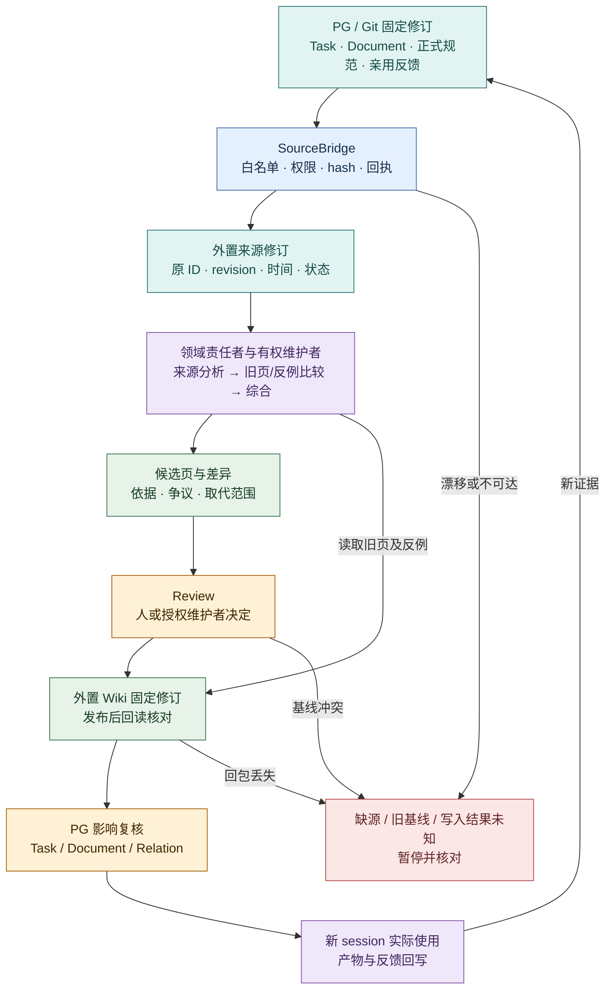

# Wiki 维护机制：借鉴 nashsu/llm_wiki

状态：2026-10-20 **设计提议，尚未实现、复制源码或 fork**。OpenViking 仍是待验证的外置内容服务候选；本页借鉴 nashsu/llm_wiki **v0.6.12（`48fd970e`）**的编纂和阅读机制，不把两个产品并列设为 Wiki 权威。输入和跨对象影响见[知识流](knowledge-flow.md)，PG 记录见[存储设计](storage.md)，人的阅读与命令入口见[工作台架构](frontend.md)。上游能力依据固定版[功能核查](../research/nashsu-llm-wiki/feature-workflows.md)、[架构](../research/nashsu-llm-wiki/architecture.md)与[实测](../research/nashsu-llm-wiki/results.md)；这些研究不等于本设计已经运行。

本页先跟随一条固定来源进入候选、审阅、发布、影响复核与后续使用；实现者再查固定上游机制与复制许可。

## 责任和数据边界

提出或采用认识的领域责任者比较新旧依据、列出反例和适用条件，并提交候选差异；人或授权维护者作审阅决定。Leader 组织受影响 Task 的复核，Evocation 只在跨任务方法或组织问题上结合 User Session 体验提出改进。外置 KnowledgeRepository 保存来源正文、知识正文与固定修订、知识内部的来源依赖和被取代关系。若选择 OpenViking，它承载内容读写、检索和可选 Wiki compile；普通 API 写页不自动完成综合、冲突裁决或撤回传播。[OpenViking 固定版接入研究](../research/wiki-base-selection-20261019.md)

evoLoop 的 PostgreSQL 保存 Task、Document/Revision、跨对象 Relation、知识固定引用、维护任务、贡献/投递回执、影响复核和发布操作结果；不复制可编辑 Wiki 正文或内部依赖。飞书只是 Task connector。工作台显示来源、候选、差异、待审阅与实际使用证据，通过共同 API 发命令，不在浏览器另设一套发布状态。外置知识端不可达或固定修订失效时，需该依据的派发暂停；PG 中的回执不能伪装成内容已被采纳。[知识流](knowledge-flow.md#3-任务执行时怎样读取) · [存储设计](storage.md#权威与共同键)

下图专看**维护者从固定来源形成候选、经审阅发布，再核下一位使用者是否采用**。它补足[知识流的传递流程](knowledge-flow.md#4-从材料变化到-wiki-发布)里的责任和消费门槛；同一路径上的异常要逐项对账。

青＝固定材料；蓝＝传递；紫＝认知工作；绿＝外置 Wiki；黄＝审阅/项目影响；红＝必须核对的异常。箭头是拟议流程，不表示跨 PG、Git、Wiki 的原子事务。审阅决定、发布成功、索引完成、新 session 实际采用是四件不同的事。

## 首片与发布门槛

维护时先区分四种结果：候选已形成、审阅已作决定、正文已发布并回读、后续 Session 已实际采用。若来源撤回、权限收紧或旧判断与新证据冲突，领域责任者与有权维护者应保留相反解释和旧修订，提出受影响页面与 Task/Document 的复核；未核实的关键依据挡住新派发。发布操作结果未知时按相同操作 ID 对账，不能重新发一条新操作。详细命令时序见[Wiki 集成接缝](wiki-integration.md#4-命令发布和纠正)。

用一份已采纳原生需求、一份 Git 固定规范、一条 Task、两个互有分歧的来源和一个 Wiki 主题完成纵向试验：贡献固定来源 → 编出候选 → 审阅差异 → 单发布者按旧 revision 发布并回读 → 新 session 使用该 revision 完成可检查产物 → 用户纠正/撤回一来源 → 影响旧页和 Task/Document → 复核后再由新 session 使用。保留所有候选、被取代判断、未决解释和实际采用证据；与直接读取原始材料对照，不能以页数、通知送达或一次答对断言收益。[共同验证协议](../research/wiki-validation-protocol-20261019.md)

故障用例至少覆盖：同基线双写、回包丢失后重试、撤回但旧正文残留、来源 fixed revision 内容漂移、权限收紧、Wiki 不可达时派发、恢复后固定 revision 读取。若候选服务没有所有写入口共用的条件更新，试点限唯一发布者并封住旁路写；客户端先读后比较只是流程保护。OpenViking v0.5.1 的批量 `expected_sha256` 已有固定源码，但尚未在本项目实测，也未覆盖普通写和 compile 发布路径；正式采用与 fork 范围须待上述试验和迁移/备份验证后决定。[OpenViking 0.5.0 实测](../research/openviking/results.md) · [v0.5.1 批量写请求源码](https://github.com/volcengine/OpenViking/blob/e855796c83f9eb575d9b0f3082926660730f6a63/openviking/server/routers/content.py#L56-L85)
## 从 nashsu 借什么，在哪一层改造

| 固定版机制与证据 | evoLoop 落点 | 必须增加的差异 | 首次验证 |
| --- | --- | --- | --- |
| `purpose.md` 定目标、`schema.md` 定类型/路由；[模板](https://github.com/nashsu/llm_wiki/blob/48fd970e206a02a6d2028d1dbfc41b7a0345bf0b/src/lib/templates.ts)、[生成规则](../research/nashsu-llm-wiki/feature-workflows.md#23-模型整理与知识更新) | 外置 Wiki 空间的项目约束与维护规则 | 类型注明事实/解释/假设/决定/争议，规则引用固定版本；schema 不替代来源核对 | 未接受提议不得被写成已决定 |
| 先分析材料，再生成来源摘要与实体/概念页；[摄入](https://github.com/nashsu/llm_wiki/blob/48fd970e206a02a6d2028d1dbfc41b7a0345bf0b/src/lib/ingest.ts) | SourceBridge 固定输入，有权维护者与领域责任者比较旧 Wiki 后产候选 | 跨旧页寻找影响；新来源不能只增加新页。S02 修正后旧中心页未传播已实测 | 新规则替代旧建议，旧导航页与受影响页都更新 |
| 同页正文合并、来源数组合并；[独立合并函数](https://github.com/nashsu/llm_wiki/blob/48fd970e206a02a6d2028d1dbfc41b7a0345bf0b/src/lib/page-merge.ts) | 候选差异生成可参考其算法或单独评估抽取 | 合并前固定旧页 revision、来源 revision；冲突保留两解，发布以服务端基线校验 | 同基线两候选只允许一版发布；失败可重审 |
| 页级 `sources`、Related/反例及 Review 阅读；[来源生命周期](https://github.com/nashsu/llm_wiki/blob/48fd970e206a02a6d2028d1dbfc41b7a0345bf0b/src/lib/source-lifecycle.ts)、[Review store](https://github.com/nashsu/llm_wiki/blob/48fd970e206a02a6d2028d1dbfc41b7a0345bf0b/src/stores/review-store.ts) | 外置 Wiki 存内部依赖；工作台装配可核来源、差异及审阅入口；PG 记决定与影响事项 | 固定 source/knowledge revision、受影响页/主张待复核；撤回不能只删 `sources` 或把另一解释判真 | 撤回 S05 后正文标待复核，E17 两解仍可追溯 |

表中“反例”是 evoLoop 希望明确展示的阅读项，不声称 nashsu 已有逐主张反证账本。固定版实测中，nashsu 的旧中心页未随新来源修订，来源撤回后仍留未标失效正文，显式覆盖可丢更新；页级来源和 Review 不能直接提供这些强保证。[原生案例 V1/V3/V4](../research/nashsu-llm-wiki/results.md#原生能力与共同案例)

## 可复用代码与不应直接搬的宿主

`page-merge.ts` 将模型合并函数作为参数注入，依赖面较窄，可先以测试评估输入/输出、来源字段保留和许可证，再决定是否复制或用等价实现。[固定版合并代码](https://github.com/nashsu/llm_wiki/blob/48fd970e206a02a6d2028d1dbfc41b7a0345bf0b/src/lib/page-merge.ts) `purpose/schema` 与 Review 的交互方式可借鉴机制；若复制模板、提示词、组件或算法，先逐模块检查 GPL-3.0 许可证、直接/传递依赖、evoLoop 待定许可证及分发方式，不把公开源码当可任意移入的素材。[上游许可证](https://github.com/nashsu/llm_wiki/blob/48fd970e206a02a6d2028d1dbfc41b7a0345bf0b/LICENSE)

整条 `ingest.ts` 连接 Zustand stores、桌面队列、Tauri 文件命令及模型客户端；`App.tsx` 和 `project-file-sync.ts` 负责装载与事件，Rust HTTP 仍依赖桌面 `AppHandle`。其 MCP `write_page` 代理桌面 API，写文件但不自动调用摄入/合并或补齐 `sources`；内置 Rust Agent runtime 也不等于 evoLoop 的认知 session。直接搬这些代码会引入第二套队列、运行时和 Wiki 权威。若未来确要抽 headless 版，先提出独立宿主/依赖注入方案和许可证审查，再做无 WebView 的启动、恢复、取消、部分写入与并发验证。[组件边界](../research/nashsu-llm-wiki/architecture.md#1-组件依赖与进程边界) · [写入边界](../research/nashsu-llm-wiki/architecture.md#3-一轮来源摄入审阅与新-session-消费)
