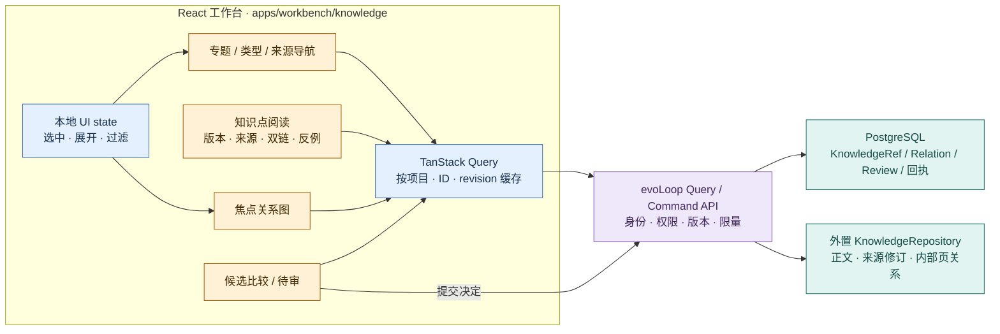

# Wiki 工作台：知识点、专题与关系浏览

状态：**知识全文、来源、历史与候选审阅已有受限本机前端路径；专题和完整图谱仍是目标设计**。参考 nashsu/llm_wiki 固定版 **v0.6.12 / `48fd970e`** 的阅读交互与图谱实现；没有因此声称直接复制了上游组件。evoLoop 的共同 API、身份、权限、固定版本与命令规则以[前端架构](frontend.md)及[Wiki 集成方案](wiki-integration.md)为准；[Wiki 维护机制](wiki-maintenance.md)负责贡献、综合、审阅与发布，[知识流](knowledge-flow.md)负责跨 Task/Document 的依据链，[存储设计](storage.md)负责 PG 主数据。按 DEC-027，当前先用 OpenViking 0.5.1 承载受限外置知识空间，后续可能换成自研知识库；浏览器只依赖 evoLoop 的读取模型，Wiki 正文和内部页关系不得在 PG 或浏览器再建可编辑副本。真人使用与生产能力待验，见[本机运行](../development/local-run.md)。

本页先回答读者如何进入专题、读完整知识页并追踪修订，再说明查询与权限如何保证这些阅读路径；固定上游组件仅是后面的实现参考。

## 1. 浏览对象和屏幕

知识点是可引用的判断/概念/实体等单元；专题是围绕问题聚合知识点、反例、来源和未决问题的阅读入口。两者首先都是外置知识页，均有稳定 `knowledgeId`、固定 `revision`、类型、标题、摘要或正文、适用范围、状态、来源修订和页间关系；专题成员关系由知识端维护。本文的“知识点/专题”是 evoLoop **拟议读取模型**，不声称 nashsu 已有这两个独立实体或可直接提供这些 ID。外置后端若只给 URI 和可变文件名，适配器须建立并核对稳定身份与修订；路径或标题不得成为跨系统主键。下表路由均以 `/app/p/:projectId` 为前缀。

| 工作台视图 | 默认回答的问题 | 操作与版本边界 |
| --- | --- | --- |
| 知识首页 `/knowledge` | 有哪些专题、类型、最近变更、待复核和不可达内容？ | 按项目/类型/状态/来源筛选；列表分页，显示最近核对时间 |
| 专题 `/knowledge/topics/:knowledgeId` | 此问题当前有哪些判断、反例、关联专题和未决点？ | 展开成员的固定 revision；候选与已发布分开展示；来源变化提示 |
| 知识点 `/knowledge/:knowledgeId?revision=...` | 判断依据哪版来源，何时适用，旧说法怎样被取代？ | 阅读正文、来源、出链/反链、修订差异；纠正生成候选，不直接覆盖当前页 |
| 关系 `/knowledge/graph?focus=...` | 两个知识点/专题为何相连，还缺哪些链接？ | 默认焦点邻域、按关系类型和来源过滤；连线可打开依据；图是导航，不是因果证明 |
| 待审 `/knowledge/review` | 哪个候选需决定，受影响旧页和任务有哪些？ | 比较候选与固定基线、理由/来源后作决定；resolve 与发布、实际采用分开 |

URL 中的 `knowledgeId` 与 `revision` 均不可静默改成最新版。跨对象 Task/Document 关系从 PG 的 Relation/KnowledgeRef 装配；Wiki 内的 `related`、wikilink、来源支持/反驳由外置知识端返回。[知识关联](knowledge-flow.md#2-一条可回查的依据链)

### 知识点怎样产生，前端到底读什么

知识卡片不是把一条聊天或一份文档直接截断显示。认知维护时先按项目的 purpose/schema，识别本次材料影响的概念、判断、问题和专题；优先修订已有知识 ID，确有独立阅读价值才提出新页。候选保留固定来源及片段、相反解释、适用条件和与旧页的关系；受控发布后，读取层从该修订的结构化元数据与正文生成卡片和详情。类型/标签自动建议仍可被修正，不能因生成了一张卡片就把判断标成事实。

| 前端读取模型 | 关键内容 | 权威与生成方式 |
| --- | --- | --- |
| KnowledgeSummary / KnowledgePage | ID、revision、标题、摘要、正文、页面类型、认识性质、有效性/审阅状态、来源与更新时间 | 外置知识修订；摘要注明由哪版正文产生，不在 PG 另建可编辑知识表 |
| Topic / TopicMember | 专题问题、导读、知识成员、成员 revision、未决点 | 外置专题页及其发布的成员关系；未入专题也可按类型搜索 |
| KnowledgeLink | 起止知识 ID/revision、关系类型、依据/来源、显式或推荐关系 | Wiki 内部链接由外置知识端持有；共来源/相似度推荐只标“可能相关”，不能混成支持或因果边 |
| SourceView / ProjectLink | 固定原件与片段、可达/撤回状态；关联 Task/Document/Review | 原件状态来自来源端，跨业务对象关系来自 PG，QueryService 按权限组合 |
| KnowledgeReview | 候选引用、所读基线、差异、影响对象、决定和发布结果 | 候选正文在外置 Wiki，决定/维护任务/回执在 PG；已审阅与已发布分开 |

**页面类型与判断状态分开。** 例如概念页、专题页、方法页是内容组织类型；观察、推断、假设、已采纳决定、争议是认识性质；已发布、待复核、已取代、已撤回是有效性/生命周期。一页可包含多个有不同性质的主张，第一片以页内明确小节及来源定位呈现，不假定已经实现自动逐主张账本。前端卡片的主要标签不能把这三组信息混成单一“可信”分数。

外置服务没有原生专题/双链 API 时，适配器从已发布 manifest 和结构化页元数据构建**可重建的只读查询索引**，和知识空间一起维护版本水位；发布正文仍是唯一权威。索引更新失败时显示旧水位/缺项，并支持按固定 ID 直接回查正文。不能为显示知识卡片而在 PG 复制一套可编辑知识模型，也不能让浏览器扫描整个外置目录。

## 2. evoLoop 前端、查询层和知识端

下图用于检查**目标状态下知识导航、阅读、焦点图和待审视图如何共用授权查询**，以及本地 UI 状态与可重建缓存的范围。当前工作台仍用直接 API 请求，图中的 TanStack Query 是后续候选；它不重复总览的系统结构，也不把浏览器缓存当知识权威。

黄＝视图；蓝＝浏览器读取/临时交互；紫＝共同 API；青＝权威边界。浏览器只接收授权后的数据，不引入数据库驱动、Tauri 文件命令、上游服务凭据或模型客户端。TanStack Query 缓存只能加速读取；发布成功回读固定修订并使相应列表、页、图和待审查询失效。[前端架构](frontend.md#2-组件路由与查询模型)

建议的只读 query 形状是 `listKnowledge(project, type/topic/status/source, cursor)`、`getKnowledge(id, revision)`、`getTopicMembers(id, revision, cursor)`、`getLinks(id, revision, direction, cursor)`、`getGraphNeighborhood(focus, depth≤1, limit)`、`listReview(project, state, cursor)`。每个响应返回稳定 ID、固定 revision、内容/来源校验、状态、权限能力、`observedAt` 与缺项；图边另给类型、方向、两端 revision 和来源。搜索结果标记命中的是正文、来源摘要还是原件。服务端对列表、关系遍历、搜索和原件逐项鉴权并限量；不可达时显示最后核对时间和缺项，不把缓存旧页显示为当前有效。

### 焦点图的组件接缝与阅读联动

图谱留在 `/knowledge/graph`，作为知识入口内的关系导航；总览／工作／知识仍是三个主入口，首个交付切片仍按[前端架构](frontend.md#6-实现切片与验收)先完成 Task、过程文档及固定依据的可导航读取。图在知识阅读切片中加入，不要求首次进入就加载全库或完成全局布局。

建议 `GraphScene` 接收共同 API 返回的有界 `GraphNeighborhood`、焦点/选中稳定 ID、过滤条件、加载/截断/缺项状态与可用能力，只上抛 `onFocus`、`onSelectNode`、`onSelectEdge`、`onExpand(cursor)`、`onOpenKnowledge(id, revision)`、`onOpenEvidence(edgeId)` 等意图事件；页面容器负责路由、授权查询、版本比较和缓存失效。`RendererGraphologySigma` 是可替换的渲染实现建议，只接收 `GraphScene` 的可视节点/边并回报命中与视口事件，不导入 OpenViking SDK、Tauri/store，也不自行推断关系或读取全库。关系列表与图使用同一查询结果和事件；以后换 SVG、Canvas 或别的渲染器，阅读与查询合同不变。具体字段以[Wiki 集成方案的拟议 DTO](wiki-integration.md#5-查询-dto-与错误语义)和后续浏览器 schema 为准，这里的组件名/事件是实施建议。

节点以 `knowledgeId` 标识知识页，以固定 `revision` 标识所读内容；边有独立 ID、起止 ID/修订、方向、关系类型、来源定位和解析状态。关系类型与确认状态分开：显式链接或有来源的支持/反驳/取代关系须显示是否已确认；仅由共来源、相似度或共同邻居推得的边只能标“可能相关”。推断边以不同线型和文字标签显示，不能混入已确认关系；“已确认”只指关系的登记/审阅状态，不保证相关认识为真。点节点使阅读面板打开该固定修订，并同步高亮出链/反链；点边显示关系说明、依据和来源可达性，能从来源回到对应知识页及 Task 的固定依据。断链和无权查看的端点保留可解释缺项，但不能泄露其标题、摘要或存在细节；键盘可到达的关系列表提供同样的选择、展开与来源入口。

邻域查询由共同 API 限深度、节点/边数和游标，响应标记 `truncated`、`nextCursor`、分源缺项和水位；界面明确显示“仅部分关系”，展开只请求下一页。搜索、筛选和邻域均逐项执行项目权限；缓存键至少隔离身份、项目、授权版本、焦点/过滤/游标、固定修订与知识投影代次。权限收紧、切项目/身份、发布或撤回后丢弃相应图/列表/页缓存并重新核对，旧图不得继续以当前可见关系呈现。切换知识修订时取消旧请求和布局计算；若后续使用 ForceAtlas2 worker，由 `GraphScene` 创建/中止并在卸载时释放，渲染器释放图实例、监听器和画布资源。布局只影响坐标，不改变边语义；小邻域可先用确定性简单布局。

图页可固定焦点修订，也可请求“当前”投影；两种视图都显示各自的知识 manifest/索引水位与 `observedAt`。固定页修订并不保证整个邻域来自同一历史瞬间：邻居、反链索引、PG Task 关系和来源端可能各有核对时间。版本切换保留焦点 ID，但重查邻域、双链和来源，明确标记缺项/滞后；不得把局部版本比较呈现为全库历史原子快照。[跨源一致性](frontend.md#2-组件路由与查询模型)

命令仅走共同 API：`submitKnowledgeCorrection` 创建候选，`reviewKnowledgeCandidate` 记录决定，`publishKnowledgeCandidate` 在受控写入口核旧 revision 并回读，`requestImpactReview` 连接 PG 跨对象影响。写入成功后回包丢失用同一 operation ID 查询和核对；Review 状态、Wiki 发布、派生索引完成及新 session 实际采用分别显示。[维护机制](wiki-maintenance.md#首片与发布门槛) · [前端命令流程](frontend.md#3-修改刷新与失败如何呈现)

## 3. 从 nashsu 固定版抽取的前端机制

下面概括交互来源；精确到导出符号、直接依赖、锁定版本和复用等级的证据见[前端源码复用核查](../research/nashsu-llm-wiki/frontend-reuse.md)。组件 props/事件、共同 API 示例、OpenViking 原生路由与需要补齐的能力见[集成方案](wiki-integration.md)，避免将“可参考的界面”误作“已可直接导入的组件”。

| 固定源码里的实现 | 可借的交互或算法 | evoLoop 落点与适配差异 |
| --- | --- | --- |
| [KnowledgeTree](https://github.com/nashsu/llm_wiki/blob/48fd970e206a02a6d2028d1dbfc41b7a0345bf0b/src/components/layout/knowledge-tree.tsx) 读 Markdown 的 title/type/tags/origin/sources，按类型列页；[来源筛选](https://github.com/nashsu/llm_wiki/blob/48fd970e206a02a6d2028d1dbfc41b7a0345bf0b/src/lib/knowledge-source-filter.ts) | 类型树、来源筛选、知识点列表和原始材料入口 | `knowledge` 模块的专题/类型导航；服务端分页和权限过滤，来源按稳定 source ID/revision，不让浏览器遍历 vault |
| [WikiEditor](https://github.com/nashsu/llm_wiki/blob/48fd970e206a02a6d2028d1dbfc41b7a0345bf0b/src/components/editor/wiki-editor.tsx)、[WikiReader](https://github.com/nashsu/llm_wiki/blob/48fd970e206a02a6d2028d1dbfc41b7a0345bf0b/src/components/editor/wiki-reader.tsx)、[FrontmatterPanel](https://github.com/nashsu/llm_wiki/blob/48fd970e206a02a6d2028d1dbfc41b7a0345bf0b/src/components/editor/frontmatter-panel.tsx) | Markdown 正文、来源卡、Related 芯片、缺失链接提示与阅读/编辑切换 | 默认只读固定修订；编辑器只产候选差异，服务端校验基线、权限和来源。外部 URL 受 allowlist/安全策略约束 |
| [PageLinksPanel](https://github.com/nashsu/llm_wiki/blob/48fd970e206a02a6d2028d1dbfc41b7a0345bf0b/src/components/editor/page-links-panel.tsx) 展示 outgoing/backlinks/missing；[路径解析器](https://github.com/nashsu/llm_wiki/blob/48fd970e206a02a6d2028d1dbfc41b7a0345bf0b/src/lib/wiki-page-resolver.ts) | 双链、断链和来源定位面板 | API 按 page ID/revision 返回类型化边及解析状态；不能仅靠同名 slug 找目标，缺链留待复核 |
| [wiki-graph](https://github.com/nashsu/llm_wiki/blob/48fd970e206a02a6d2028d1dbfc41b7a0345bf0b/src/lib/wiki-graph.ts) 从 `related`/wikilink 建页图；[GraphView](https://github.com/nashsu/llm_wiki/blob/48fd970e206a02a6d2028d1dbfc41b7a0345bf0b/src/components/graph/graph-view.tsx) 用 Graphology、Sigma、布局 worker；[相关性](https://github.com/nashsu/llm_wiki/blob/48fd970e206a02a6d2028d1dbfc41b7a0345bf0b/src/lib/graph-relevance.ts) 用直接链接、共来源、共同邻居和类型亲和 | 局部关系图、焦点/邻居高亮、筛选和群组发现 | 首片取服务端有界子图，边带类型/来源/修订；相关性只作发现排序，不充当证据强度或知识正确率 |
| [ReviewView](https://github.com/nashsu/llm_wiki/blob/48fd970e206a02a6d2028d1dbfc41b7a0345bf0b/src/components/review/review-view.tsx)、[review-store](https://github.com/nashsu/llm_wiki/blob/48fd970e206a02a6d2028d1dbfc41b7a0345bf0b/src/stores/review-store.ts) | 待审卡、建议动作、批量筛选与处理痕迹 | PG 记录维护任务/决定/回执，候选与差异在外置 Wiki；Review resolve 不等于修订、发布或用户已采用 |
| [SourcesView](https://github.com/nashsu/llm_wiki/blob/48fd970e206a02a6d2028d1dbfc41b7a0345bf0b/src/components/sources/sources-view.tsx)、[SearchView](https://github.com/nashsu/llm_wiki/blob/48fd970e206a02a6d2028d1dbfc41b7a0345bf0b/src/components/search/search-view.tsx) | 来源浏览、检索结果下钻到原件或知识页 | SourceBridge/KnowledgeQuery 分别核授权、固定修订、原件可达；生成的来源摘要标派生，不替代原文 |

nashsu 的组件并非可直接导入的无状态 UI：多处调用大型 [wiki-store](https://github.com/nashsu/llm_wiki/blob/48fd970e206a02a6d2028d1dbfc41b7a0345bf0b/src/stores/wiki-store.ts)；树、预览、图和双链依赖 [`commands/fs.ts`](https://github.com/nashsu/llm_wiki/blob/48fd970e206a02a6d2028d1dbfc41b7a0345bf0b/src/commands/fs.ts) 的 Tauri `invoke`，来源导入还依赖 Tauri dialog、前端摄入队列，图谱构建会遍历读取 vault。UI 层仅参考布局、反馈和纯解析/筛选函数；需复用代码时单独核 GPL-3.0、依赖与替换成本。本阶段未复制。[固定版组件边界](../research/nashsu-llm-wiki/architecture.md#1-组件依赖与进程边界)

## 4. 阅读与图谱验收

先做一条专题、一条知识点、两条相互争议的来源、两条页关系和一条 Task/Document 固定关系。用户能从专题进入知识点，沿来源读原文，沿出链/反链看解释和缺链；随后提交纠正，比较候选与旧修订、审阅发布，旧 URL 仍读旧版，新 URL 读新版，图与来源筛选随核实的发布结果刷新。撤回来源后，相关页与跨对象 Task 显示待复核，派发被阻止，不能只消失一个来源标签。让新 session 据新修订完成任务，并用交付内容而非“通知已发送”判定采用。

检查还应覆盖权限收紧后列表/搜索/图/原件不可见、同名知识点不串链、长列表分页和焦点图限量、Wiki 不可达、两人同基线发布冲突、成功后回包丢失及恢复后旧 revision 可读。尤其在查询索引滞后时，服务端仍须按当前权限和有效性逐项过滤，不能仅依赖缓存失效；客户端重新进入页面或恢复连接时也应先核对可见性。桌面上游的图和阅读体验是设计参考；性能、可用性与知识效果须在 evoLoop 的真实 API 和用户操作中另验。[nashsu 有限实测](../research/nashsu-llm-wiki/results.md) · [Wiki 有效性](../product/wiki-evaluation.md)

| 验收情形 | 可观察结果 |
| --- | --- |
| 焦点、边与来源联动 | 从专题/知识页进入焦点图，选择节点打开固定修订；选择显式/推断边能看清类型、方向和来源，并经出链/反链及来源返回原页。键盘关系列表完成同一路径。 |
| 有界与不完整结果 | 分页或截断时明确显示已载范围和继续展开入口；取消、断线、索引滞后及来源不可达时保留缺项/水位，不把部分结果画成全库图。 |
| 身份、项目与版本隔离 | 切身份/项目、收紧权限、发布/撤回和切修订后，旧画布/列表不泄露已无权内容；历史焦点仍可按授权深链回读，邻域分别标明各源核对状态。 |
| 知识后端替换 | 用同一组浏览器 DTO、路由与图组件接入另一个 `KnowledgeRepository` 适配器；同一个 `knowledgeId` 固定修订深链仍能定位正文/来源，同一 Task 的固定 KnowledgeRef/BasisSet 仍能解释当时依据。若原来源不可达，要返回缺项而非悄悄改绑新页。 |
