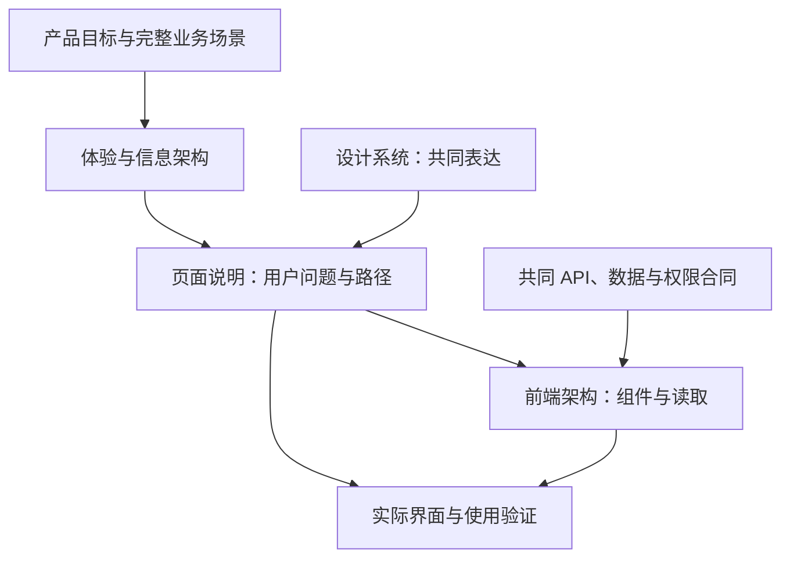

# 前端文档：从产品目标到可用界面

2026-10-30 · 按用户确认的独立目录组织工作台设计与前端实现。先解释用户要看懂和完成什么，再查页面、交互和技术。产品业务规则、数据合同及阶段状态仍由各自正文维护。

## 前端要承接的产品结果

evoLoop 帮助一个人与多个 Agent 持续推进项目，让交付经过实际使用，并据结果修正理解、下一步和分工。工作台主要服务人的观察、阅读、取舍和反馈；Agent 通常在既有会话中经业务 skill＋CLI 执行，两个入口共享事实和权限。

经营交付与组织方法改进使用同一组 Task、Document、Run、Delivery 和使用观察。前端要连起“为什么做 → 谁具体接住 → 做到哪 → 谁用过哪版 → 下一步或停止”，并让未知、失败、历史和下一责任可见。完整产品理由与场景见[产品定义](../product/definition.md)和[功能场景](../product/functional-scenarios.md)。

## 按当前问题阅读

| 我需要回答什么 | 正文 | 阅读后应能做到什么 |
| --- | --- | --- |
| 页面之间怎样组成一条用户路径 | [体验与信息架构](experience.md) | 从目标到工作、固定成果和实际使用走完并返回，知道何时该找现有 Agent |
| 双左栏、文字、组件和异常怎样保持一致 | [设计系统与共同交互](design-system.md) | 分清各类状态，用同一套渐进阅读方式处理正常、空、失败和未知 |
| 眼前这一页该先显示什么 | [页面说明](#页面说明) | 解释首屏、主动作、下钻、返回及可观察验收 |
| 组件、路由、读取、写入和部署怎样实现 | [前端架构](architecture.md) | 在共同 API 和真实授权内实现界面，不在浏览器复制业务状态机 |
| 当前能依靠哪些能力 | [阶段路线](../roadmap.md#当前基线) | 区分源码、运行版本、技术检查、独立使用与真人反馈 |

下面是文档阅读地图，箭头表示解释与下钻关系，不是软件调用或新增审批。

## 页面说明

| 页面 | 用户带来的问题 |
| --- | --- |
| [项目总览](pages/overview.md) | 当前目标还差什么，最近使用说明了什么，谁接下一步？ |
| [任务列表与详情](pages/tasks.md) | 哪项与我有关，谁真正接住，当前成果与使用怎样？ |
| [过程文档](pages/documents.md) | 从哪读完整原件，任务用了哪版，新版影响谁？ |
| [知识空间](pages/knowledge.md) | 当前认识、适用条件、支持和反例在哪里？ |
| [日程](pages/schedules.md) | 为什么检查，下次何时，上次产生的工作怎样？ |
| [团队与 Session](pages/team-and-sessions.md) | 哪个职责由哪个实例承载，它实际接了什么、怎样恢复？ |

评价、异常恢复、讨论、仓库与设置是这些路径的上下文入口；共同要求在[体验架构](experience.md#上下文页面与返回)中说明，跨系统合同仍从相应架构正文下钻。只有内容与独立更新需要足够时再拆独立篇，不为每个路由预建空文档。

## 一项事实只维护一处

产品目录保留价值理由、完整业务场景与业务验收；本目录负责页面与交互及前端实现。服务端对象、状态迁移、权限和固定修订规则仍见[项目数据](../architecture/project-data.md)与[接口合同](../architecture/contracts.md)，业务执行方式见[Agent CLI](../development/agent-cli.md)。

原工作台页的界面细则已归入本目录；[产品工作台](../product/workbench.md)保留产品职责、端到端判据与旧章节入口。[旧前端架构入口](../architecture/frontend.md)保留历史深链。设计过程、未采纳方案和实际使用报告继续保留各自固定来源；不整份搬入正文，也不将作者自检当作独立验收。

维护页面时同时核用户问题、完整路径、正常/异常状态、固定来源、返回及宽窄屏。按[文档维护](../development/documentation.md)更新唯一正文和依赖引用。局部布局可演进，目标、事实权威或权限变化须同步其所属产品/架构合同。
