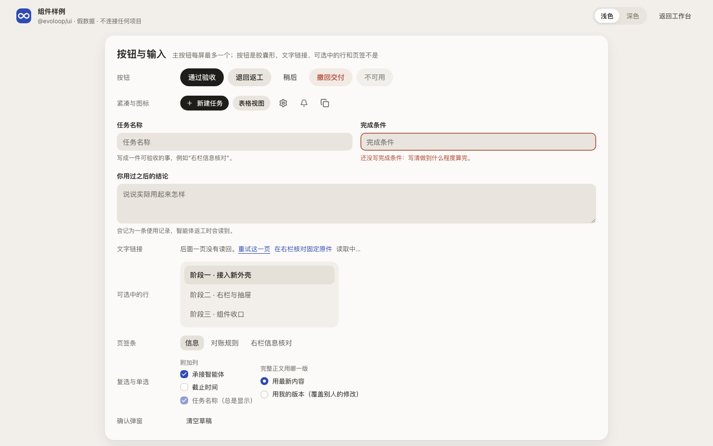

# 前端架构：项目工作台与共同 API

本页只写工作台怎样实现。页面内容见[页面说明](README.md#页面说明)，共同原则见[设计原则](principles.md)，外壳见[布局](layout.md)，产品理由见[产品工作台](../product/workbench.md)；字段、状态与权限以[接口合同](../architecture/contracts.md)为准。

“现状”指当前 main 的代码；“目标”是已选定、由[前端改版 issue #229](https://github.com/cyl19970726/evoLoop/issues/229) 实施的方向，落地前不能当作现状引用。

## 1. 工作台的职责与部署位置

工作台是登录后使用的单页应用，只经共同 Query／Command API 读写，不在浏览器维护第二套状态机。Agent 经业务 skill＋CLI 调用同一 API，授权、固定修订与操作回执规则相同（[DEC-030](../decisions.md#用户已确定的方向)）。浏览器不引入 core、数据库驱动、平台 SDK 或凭据，共用类型只从 `@evoloop/contracts` 的浏览器出口导入。

- **现状**：本机 coordinator 同源提供 `apps/workbench/dist` 与 `/api/`；开发时 Vite 把 `/api` 代理到 coordinator。
- **目标**：多机器方案（[#219](https://github.com/cyl19970726/evoLoop/issues/219)）后由 Hub 托管静态文件，经 Hub 网关访问各机器上的项目；单机模式不变。

公开文档站与工作台的认证空间分开。

## 2. 组件、路由与查询模型

**代码分层。** `apps/workbench/src` 分三层，依赖只向下：`app/ → features/ → shared/ → @evoloop/ui`。规则由 `apps/workbench/test/layers.test.ts` 检查，随 `npm test` 运行。

| 层 | 内容 | 现状 |
| --- | --- | --- |
| `app/` | 外壳、路由表、身份与查询客户端装配 | `router.tsx`（路由表）与 `routePaths.ts`、`queryClient.ts`（查询缓存）、`PageBoundary.tsx`（单页出错不影响外壳）、`shell/`（外壳：`AppShell.tsx`、空间与分区模型 `spaces.ts`，登录后按需加载；页面经 `shared/ui/` 的两个入口填外壳：`ContextRailContent` 把对象列表放进内层栏，`ContextPanelContent` 把当前对象的信息放进右栏（`ContextPanel.tsx`）；只有屏上的那一页能填，`pageActive.ts` 由 `App.tsx` 按页提供）、`App.tsx`（按区域选页面并逐页懒加载）、`entry/`（登录门、项目列表、操作核对；登录门在首屏里，只从组件库按名引用不依赖 `cn` 的 `Logo`，不用其他组件，免得把 tailwind-merge 和图标带进首屏；项目列表登录后按需加载，可用组件库）、操作回执与恢复、组件样例页 `ui-samples/`。`src/` 根目录只留入口 `main.tsx`、唯一的样式入口 `main.css`（只引入 Tailwind 与 `@evoloop/ui` 的样式，不写规则）和全局类型声明，按 app 层对待 |
| `features/<领域>/` | 页面、领域组件、该领域的查询与命令 | 16 个领域，目录名沿用旧名（任务仍叫 `workflow`，团队页是 `team`；项目设置、结果未知的操作、仓库规范在 `settings`） |
| `shared/` | API 客户端、对象引用、修订标签等跨领域部件 | 地址与历史（`navigation.ts`、`appPath.ts`、`routes.ts`）、身份（`identity.ts`）、读取层（`query.ts`）、`api.ts` 与被多个领域读取的 `*Client.ts`、唯一的提交表单 `command/`（`useCommand`、`CommandForm`；`ActionForm` 是它的字段列表接口，规则见[组件](components.md#提交表单)）、业务状态映射（`workStatusPresentation`、`leaderWorkLoad`、`taskTiming`、下一动作与下一责任 `workPresentation`、职责状态 `rolePresentation`）、对象链接与名称解析（`taskNavigation`、`deliveryPresentation`、`externalHostEntry`、`ownerRole`、按名称显示职责、智能体与任务的 `ui/RecordName`）、来源与完整标识层（`ui/FullIdentifiers`）、Markdown 与 HTML 原件阅读（`ui/`）、假数据 `fixtures/` |
| `@evoloop/ui`（`packages/ui`） | tokens、基于 shadcn 的基础组件、布局骨架、通用状态与对话流条目 | 见[组件](components.md) |

检查的规则：

- `shared/` 不引用 `features/` 和 `app/`（含 `import type`）；`features/` 不引用 `app/`。
- 领域之间只经对方的 `index.ts`，不许成环。`index.ts` 只导出别的领域实际用到的组件、函数和类型。
- `app/` 是组装根，直接引用各页面模块，不经 `index.ts`。PR4a 按路由拆包要逐页懒加载；若页面也放进 `index.ts`，别的领域引用其中一个小函数就会把整页提前带进来。
- 别的包按包名引用，不用相对路径跨包。检查读不懂的 import 写法直接报错，不会放过。
- `@evoloop/ui` 不引用工作台和 `@evoloop/contracts`（含 `package.json` 依赖），不发请求，文案与数据由调用方传入。

领域之间现有的依赖（检查运行时会打印）：overview → workflow；roles → discussions；runtime → orchestration、sessions、workflow；sessions → discussions；team → discussions、roles、runtime；workflow → discussions、orchestration、references、sessions。任务的分派、执行队列和运行在任务自己的“运行与关联”（`workflow/TaskRuntimeTab.tsx`）；团队页“分工与运行”是 `ExecutionView`，嵌入编排与执行队列。执行队列 `ResidentQueuePanel` 由 workflow 提供给这两处。

**路由。** URL 承载项目、对象稳定 ID、修订和筛选，刷新或分享后回到同一位置；改标题或移动 Git 路径不改链接。历史修订 URL 不跳到最新版。导航入口由[布局](layout.md)决定，不按路由生成。

- **现状**（PR4a）：TanStack Router 管地址与历史，路径 URL `/p/{项目}/{区域}/{ID}?revision=…`，`/` 是项目列表，`/ui` 是组件样例页。路由表在 `app/router.tsx`，地址清单在 `app/routePaths.ts`；页面仍由 `App.tsx` 按解析出的区域选择（`shared/routes.ts` 的 `parseRoute`），访问过的页面保持挂载；PR5 的新外壳没有改成布局路由。
  - **旧链接**：文档正文、交付登记、消息里保存的 `#/p/…` 链接继续可用。打开带 `#/…` 的地址（书签、粘贴、Agent 只读浏览器）时先换成对应路径；渲染保存的链接时用 `appPath()` 改写为路径。合同和数据库里的保存格式不变。团队页的旧地址 `/runtime?view=roles|discussions` 与 `/runtime?session={含冒号的键}` 由 `shared/routes.ts` 的 `legacyTeamAddress` 改写到 `/roles`、`/discussions`、`/sessions`；`/runtime?session={UUID}` 就是“分工与运行”里选中该受管智能体的地址。
  - **站内跳转**：`shared/navigation.ts` 是唯一入口：`navigate()`、`currentPath()`、`onNavigate()`；只改地址栏、不通知页面的视图状态（筛选、展开项）用 `replaceQuietly()`。站内 `<a href="/p/…">` 的点击统一转成历史导航，不整页刷新，所以内存里的登录不丢；带修饰键、新标签页、下载和外站链接不拦。
  - **离开项目**：有未提交草稿时先确认，前进后退同样拦截。
  - **拆包**：每个页面是单独的 chunk，首屏只带登录门与共用代码，外壳（`app/shell/`）登录后再加载。首屏 JS 预算以 `apps/workbench/bundle-budget.json` 为准（现为 gzip 170 KB；拆包前单包 392 KB，历次调整写在该文件的 `note` 里），由 `bundle-budget.test.ts` 对构建产物检查。
  - **服务**：coordinator 对 `/p/*` 和 `/ui` 返回 `index.html`，`/api` 与静态资源不受影响；Vite 开发服务默认同样回退。
- **目标**：页面改为路由组件（布局路由承载外壳），筛选与排序用路由的 search 校验写进地址栏。以后要服务端渲染，可在同一套路由上换 TanStack Start。

**读取。** 列表返回有界游标页，不首次加载全项目 Wiki 或全部 trace。搜索按任务、文档、知识分组，各给来源与修订，不把不同后端的分数合并排名。

- **现状**（PR4b）：读取层是 TanStack Query，在 `shared/query.ts`，缓存实例在 `app/queryClient.ts`。
  - **键**：`queryKeys.project(项目, …)` 与 `queryKeys.identity(身份, …)`，键以所属范围开头。
  - **隔离**：离开一个项目时取消它在途的请求并清掉它的缓存（`leaveProject`）；登录和退出清空全部。
  - **写后重读**：写操作成功后，该项目的查询标为过期，可见的重读（`projectChanged`，由 `MutationContext.onChanged` 触发）。页面不必再按 `refresh` 自己重读一次，否则请求会被取消后重发。
  - **固定内容**：固定修订和原件的键以 `fixedContent` 开头，只读一次：写入不使它们过期，也不自动重读；离开项目时照常清掉。
  - **重读**：保留旧内容，`useProjectQuery` 返回 `checking` 供页面标“正在核对”。
  - **重试**：4xx 是结论不重试，连接中断与 5xx 最多重试两次。
  - **迁移情况**：多数页面的读取已改用 `useProjectQuery`。还有少数读取自己管理状态并显式传令牌，例如日程、微信连接、分工讨论的关联读取、智能体对话的时间线；项目列表在项目之外，按身份隔离（`queryKeys.identity`）。
- **目标**：所有服务端读取经 Query；缓存只加速读取，不裁定当前版本或批准状态。

QueryService 返回 `observedAt`、对象与 revision、权限能力、分源状态和缺项。PG 部分在一个只读事务内取得；Wiki/Git 分别读固定版本，不声称跨系统原子快照。知识服务不可用时任务仍可读，依据标为暂不可核对。服务端只装配已授权对象，前端隐藏按钮不是授权；空项目返回空态，前端不注入示例。

现状 `App.tsx` 的 `WorkspacePages` 按项目保留已挂载页面以保住内存草稿，这不是持久恢复；外壳在 760px 两侧只换样式、不换结构，跨断点也不会卸载页面。

### 过程文档表格与完整阅读

`DocumentTable` 只请求列表元数据；用 `<table>` 和可聚焦的标题入口，行内 Task 链接不触发打开行，返回时恢复筛选、分页、选中行和焦点。`DocumentReader` 按项目、文档、修订读完整内容，按 `format` 字段而非文件后缀选择阅读器。

| 阅读器 | 实现边界 |
| --- | --- |
| Markdown | 现状用 markdown-it，关闭原始 HTML 与图片，链接按白名单校验；Mermaid 懒加载，SVG 放进带 CSP 的 sandbox iframe |
| HTML 报告 | 从固定原件构造静态副本：清除脚本、表单、内嵌页面、自动跳转和外部资源，重写已登记资源路径；副本带限制来源的 CSP，放进禁脚本的 sandbox iframe，不写入父页面 `innerHTML`；原件不改 |
| 原文 | 按纯文本显示；大包另给授权下载，不以同源可执行 HTML 响应 |

`srcdoc` 只用于小型自包含预览，大包由隔离来源提供。缺资源或省略动态内容时列出缺项。需要脚本的交互报告须用与工作台不同的来源、限定网络、不带工作台凭据；不对上传报告同时开放 `allow-scripts` 与 `allow-same-origin`。

### Session 的单一时间线

`SessionTimeline` 只消费共同服务的 typed entry/page，不自行拼接历史。历史游标与 live 位置分别推进，同一 Item 原位替换，迟到的 running 不覆盖终态；切换身份、项目或 Session 时取消旧请求；401/403 后清空内容，普通刷新不恢复。见[原生读取合同](../architecture/codex-integration.md#session-工作区的历史与实时读取)。

## 3. 修改、刷新与失败如何呈现

每条命令带 `operationId` 和所读 revision。服务端同事务校验权限与基线、写入并登记 outbox；冲突时返回当前 revision，前端保留输入并给差异入口。

- 接受、发布、采纳和派发只显示服务端确认后的状态，不做乐观完成。
- 回包丢失按同一 `operationId` 查询，不换新 ID 重发；`unknown` 显示为“正在核对”。
- 成功读取不清除未知回执。

**实时更新。**

- **现状**：没有 SSE 或 WebSocket。Session 输出是长轮询：服务端每次最多挂起 15 秒（上限 20 秒），只有运行时提供实时更新时才会挂起，前端在上一次返回后立即发下一次。项目级变化靠定时轮询带游标的 `/session-work/changes`；另有若干页面级定时器和只读的“回读当前状态”。实时位置只在单个服务进程内有效，coordinator 重启后要重读。
- **目标**：分两步。第一步只加**项目级失效事件流**：只推对象类型、ID 和修订号，不推标题或正文；前端让对应查询失效重读；Session 输出暂留长轮询。第二步再评估 Session 输出是否改推送。
- **鉴权**：原生 `EventSource` 不能带 `Authorization` 头，所以用 fetch 流式读取：单机模式带现有令牌，Hub 模式用同源 cookie。服务端按项目授权过滤事件；收到 401/403 时断开流并清空内容。
- **续传**：事件 ID 复用现有游标；重连时从上次游标续传，出现缺口或服务端要求重置（合同里的 `resetRequired`）时整体重读。coordinator 重启或部署后，客户端重置并重读。
- **经 Hub 访问**：网关按项目路由到所在机器，不缓冲流式响应，心跳间隔短于各层空闲超时；机器离线时把页面标为“已过期”。这些要求需要写进 #219 的网关设计。
- **多个标签页**：每个标签页各开一条流会占用同源连接数（HTTP/1.1 下同源最多 6 条）。多个标签页共享一条流（BroadcastChannel 或 SharedWorker），或在文档中注明这个限制。

事件到达不代替业务状态。轮询只覆盖当前页面与未结束操作，后台降频，失败退避并显示最后核对时间。

**本地状态。** 服务端数据不长期存入 localStorage；现状操作回执和返回位置存 sessionStorage。草稿留在页面内，离开前提示；登出或换身份清除查询缓存；新修订出现时不替换正在编辑的草稿。

### 状态复核与命令边界

接受、交付、使用观察、阶段选择与交接的状态只来自共同 API，按钮、表单或缓存不能自行裁定。同一对象在各入口使用同一 revision；业务、运行、同步、知识和效果状态分列。命令成功后让相关查询一起失效；日程暂停只失效日程查询，不改在途 Run。业务规则见[日常闭环](../product/daily-loop.md)。

## 4. 会话与权限边界

讨论入口准备带固定版本的交接包，再打开或在授权内创建会话。工作台不嵌入、不伪造 Codex Desktop 聊天，不自动发送消息；无法跳转时给可复制引用。

- **现状**（PR4c）：`shared/identity.ts` 是唯一的身份来源，所有请求经 `shared/api.ts` 的同一处读取它。
  - **本机令牌**：用户在登录门输入令牌，只存在页面内存，请求带 `Authorization` 头。
  - **Hub 登录**：Hub 托管的页面带 `<meta name="evoloop-auth" content="hub">`，登录门不要令牌，直接用同源 cookie 核对 `/api/session`；Origin/CSRF 校验在 Hub 一侧（#219）。
  - **新代码**：调用 `api()` 不传令牌即用当前身份；上面说的少数读取和登录门、项目列表、操作核对仍从 `MutationContext.token` 或页面参数传令牌。
  - **401**：任何请求收到 401 视为登录失效：清空查询缓存、草稿、恢复意图和页面缓存，回登录门并说明原因。地址保留，未确认的操作回执保留给同一身份。
  - **403**：403 只说明某个对象无权读取，由页面自己说明。只有读取项目本身得到 403 时，外壳重读身份；项目已不在授权内就清掉它的缓存，回到项目列表并提示。
  - **页面出错**：某一页渲染出错只替换这一页（`app/PageBoundary.tsx`），外壳、登录和其他已访问页面保留；路由层兜底的错误页同样是中文。
- **目标**：组件间不再传令牌；剩下的读取迁到 `useProjectQuery` 时一并去掉。

公网访问须先有 HTTPS 与登录。Git、Wiki、飞书和模型凭据只在服务端；附件下载经授权并限定内容类型。

## 5. 推荐前端技术与取舍

工作台保持 React + TypeScript + Vite 单页应用。暂不用 Next.js：工作台是登录后的工具；数据在各台机器上，Hub 网关要承载机器长连接；单机模式要简单；Server Actions 会形成 API／CLI 之外的第二条写入路径，与 DEC-030 冲突。以后做公开产品时新增独立的 `apps/site`（Next.js：官网、定价、用户文档、注册、公开分享页），共用设计体系，工作台不重写。

| 责任 | 现状 | 目标 |
| --- | --- | --- |
| 样式 | 已达成（#229 PR10）：旧的全局 CSS、领域 CSS、旧变量名和 `data-legacy` 区域都已删除。工作台只有样式入口 `main.css`，依次引入 token、Tailwind 主题与工具类、tw-animate-css 和 `@evoloop/ui/base.css`，不写规则；页面全部用工具类引用 token。`base.css` 在 `base` 层给整页做基础重置并设元素默认值（字体与行高、文字颜色、背景、等宽数字、焦点框、选中底色、减少动效），任何工具类都能覆盖它。`data-ui` 已不影响样式，现有标记留作“用组件库绘制”的标识，少数测试和选择器靠它定位，新页面不必再加。`style-budget.test.ts` 检查颜色字面量只在 `tokens.css`、工作台不写 CSS 规则、源码没有 `data-legacy` | Tailwind v4 + shadcn/ui（DEC-036），token 只在 `@evoloop/ui` 定义，见[设计基础](foundations.md) |
| 动效 | 无统一做法 | Radix `data-state` + tw-animate-css；列表与布局用 Motion（`motion` 包）；尊重 `prefers-reduced-motion` |
| 构建 | 已达成（#229 PR4a、PR5）：按路由拆包，每页一个 chunk；首屏只有登录门，外壳登录后加载；Markdown、Mermaid 与组件样例页按需加载。首屏 JS 预算以 `bundle-budget.json` 为准（gzip 170 KB），见上文“拆包” | 保持在预算内；提高预算要在同一改动里写明理由 |

第三方组件来源与许可证记在 `apps/workbench/THIRD_PARTY.md`。知识空间的组件接缝见[知识工作区架构](../architecture/wiki-workspace.md#焦点图的组件接缝与阅读联动)；图渲染器只消费 API 给的授权子图。

### nashsu 的技术组合如何取舍

知识阅读参考 nashsu/llm_wiki，[逐文件核查](../research/nashsu-llm-wiki/frontend-reuse.md)记录其锁定版本；上游锁文件不是本项目已验证的依赖，复用按[移植验证约定](../development/standards.md#上游前端复用与工作台验证)。

| 能力 | evoLoop 的做法 |
| --- | --- |
| 应用壳 | 去掉 Tauri 入口与文件命令，构建普通 Web 应用 |
| Markdown | 若改用 `react-markdown` + `remark-gfm`，保持现有安全边界，链接与图片走授权 API |
| 图关系 | 子图较大时用 Graphology + Sigma + ForceAtlas2 worker；输入由 API 限量提供 |
| 状态 | 不移植 `useWikiStore`，服务数据交给 TanStack Query |
| 知识编辑 | 只产生候选；富文本确有需要再评估 Milkdown |

## 6. 实现切片与验收

按以下顺序拆成小 PR，具体以前端改版 issue 为准：

1. **地基**：token 收进 `@evoloop/ui` 并接入 Tailwind 主题；基础、状态与对话流组件和组件样例页；`app/ → features/ → shared/` 分层，拆除循环，依赖检查进 `npm test`。
2. **路由与读取**：分三个 PR：TanStack Router、路径 URL、旧链接跳转与按路由拆包；TanStack Query 替换直接请求；身份抽象。
3. **外壳与页面**：双左栏、中间与右栏的新骨架，再依次迁移 Session、任务、文档和其余页面，每迁一页删掉该页旧 CSS。
4. **收口**：删除旧全局 CSS，颜色字面量只允许在 `packages/ui/src/tokens.css`，由 `style-budget.test.ts` 检查（PR10 已完成）；页面截图由脚本生成（PR11 已完成）。
5. **实时与 Hub**：coordinator 提供项目级失效事件流后，前端接入并让查询失效重读，Session 输出暂留长轮询；随 #219 接入 Hub cookie 与网关流式转发。

每片验收：`npm test`、typecheck、build 通过；旧 `#/p/` 深链、历史修订链接和返回位置可用；切换项目不串入旧内容；断线后能恢复；首屏 JS 不超过 `bundle-budget.json`。

### 页面截图

[页面说明](README.md#页面说明)里的截图由 `npm run docs:screenshots`（`scripts/frontend/screenshots.mjs`）生成，不手工放图：

- **数据**：`scripts/frontend/fixture/` 是一个合成项目（智能体、任务、文档、目标与阶段、知识、日程、评价、微信连接等），名称、标识和时间都是编的。夹具只应答读取，写入一律拒绝。个别失败状态（如 HTML 原件读不回）由场景自己拦截那一次读取；结果未知的操作的回执由场景在打开页面前写进浏览器会话。截图展示的是夹具数据下的界面，不是使用证据；真实路径的证据按[前端旅程与截图](../development/documentation.md#前端旅程与截图怎样进入仓库)进实景旅程。
- **画面**：先构建工作台，再逐页打开 `scripts/frontend/pages.mjs` 里列的地址。每页截 1440（右栏内嵌）和 390；有右栏的页面再截 1024，点“展开右栏”打开抽屉；登录、项目列表和账号菜单里的项目设置、结果未知的操作、仓库规范没有右栏，1024 照原样截。任务页另外五个页签等补充状态只截一个宽度。输出为 `docs/assets/frontend-pages/<页面>-<宽度>.png`，文件名固定。
- **稳定**：浏览器时钟固定在 2026-11-10 11:00（Asia/Shanghai）、`zh-CN`、DPR 1，减少动态效果并关掉过渡、动画和光标；用软件光栅、单线程栅格化（GPU 栅格化每次抗锯齿边缘略有不同）；等读取停下、字体就绪后才截。PNG 压成 256 色索引图（`scripts/frontend/png.mjs`）。同一构建和夹具得到同样的字节，没变的图不重写。字体用本机系统字体，换操作系统重跑会整批变化。
- **报告**：结束时列出几张变化、几张新增、目录总大小，以及页面读到而夹具没应答的接口（按空页应答）。页面报错、横向溢出或等不到内容时退出码非 0，失败画面存为 `failed-*.png`，不要提交。

Playwright 不进依赖，和浏览器回归一样从环境变量载入：

```sh
export EVOLOOP_BROWSER_TEST_PLAYWRIGHT_MODULE=/path/to/playwright/index.js
export EVOLOOP_BROWSER_TEST_CHROMIUM_EXECUTABLE=/path/to/chromium   # 不设则用 Playwright 自带的浏览器
npm run docs:screenshots                                    # 全部页面
npm run docs:screenshots -- --only task,tasks --skip-build  # 只截几页，复用已有构建
```

**什么时候重跑**：改了页面源码、布局或共用组件的 PR，重跑受影响的页面，提交变化的图，并在 PR 里写明变化了几张。新页面在 `pages.mjs` 加一项、在夹具里补数据，再在页面说明的“截图”一节引用。组件样例页 `/ui` 没有页面说明（组件外观以它为准，见[组件样例页](components.md#组件样例页)），它的截图也在这里：



窄屏：[组件样例](../assets/frontend-pages/ui-samples-390.png)。
