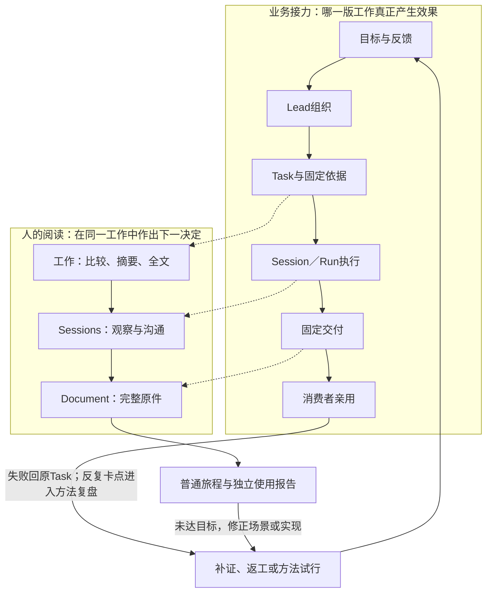
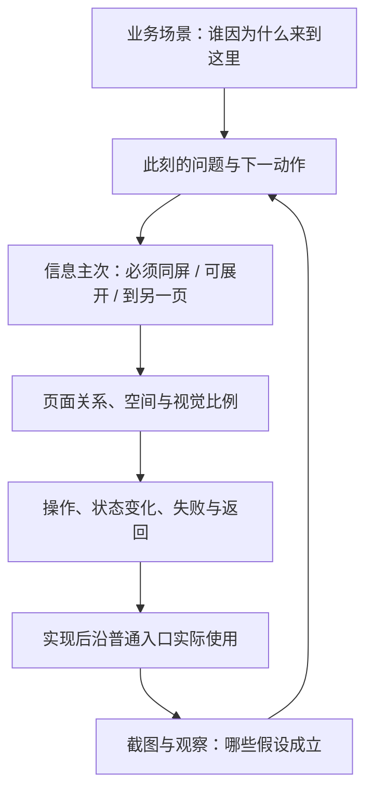

# 从完整业务推导前端：人要理解什么、决定什么

2026-11-01 · 本页解释设计的推导过程。产品事实以产品与架构正文为准；页面目标、真实截图和已发布能力分别标明。

evoLoop 要让一个人与多个 Agent 持续完成项目工作。对人来说，难点是把分散的目标、执行、交付和使用反馈连起来：**这件事为什么做，谁真正接住，做到哪里，结果能不能用，接下来该等、介入还是返工。** 对 Agent 来说，难点是取得足够的上下文，保有职责内的判断，执行后把成果和未解决的问题交回同一项工作。

因此，前端先帮助人理解和参与这段协作。页面名称、字段和组件都从这段业务中推导。产品的[经营与交付、组织与方法改进两张卫星图](../product/definition.md#两张产品卫星图经营交付与组织改进)继续作为总蓝图；本页把它们投影成人能够阅读和操作的界面。

## 一张总图：业务、人的判断、页面和验收怎样相接

先看上层的业务接力，再看下层的人怎样从工作台读回同一件事。虚线是页面对业务事实的呈现关系，实线是工作或阅读的接续；图不表示点击页面会自动派工，也不代替授权与状态转换。[经营图](../assets/company-delivery-loop.html)与[改进图](../assets/company-evocation-loop.html)保留各自完整的责任和反馈结构，这里只选出决定前端空间的关系。

图的关键取舍是：Task 承载工作承诺，Session 承载持续协作，Document 承载可核的正文。三者在业务上相连，却分别需要**比较、观察、完整阅读**三种空间。图底部的旅程与验收让页面设计接受反证：读者即使能打开每个对象，若仍不能解释当前责任或读完报告，就应回到原场景和原 Task 修正。

## 先理解业务，再决定页面

经营与交付循环中，用户和领域 Agent 提出目标或问题，Leader 安排工作组合、顺序和承接，业务 Session 判断并执行，消费者亲用交付，结果决定继续、返工或停止。组织与方法改进循环则观察重复返工、交接与体验问题，试行改进，再看下一次真实工作是否变好。两条循环使用同一组业务记录，每个领域 Session 都保有自己的理解与判断。

以本轮发现的 HTML 阅读问题走一遍完整业务：用户实际要从固定成果的首段读到末段；先前实现和检查只覆盖加宽、图片加载，报告仍被约 420px 的预览限制。产品责任者据此重写阅读目标与失败样本，Lead 决定修复范围、承接者和独立验收者；开发者须在原阅读 Task 内改实现、用同一长报告复测，指定消费者再沿普通入口读到末尾。若下一轮又只验容器尺寸而漏掉真实阅读，Evocation 才比较任务表达、截图条件与交接方法，试行改进并看下一次工作是否少返工。**本轮文档改稿只记录这一反例和验法；HTML 界面修复仍由原 Task 承接。**

例如，“HTML 报告读起来只剩一个小窗口”首先是一项阅读体验失败。产品责任者要明确读者能从首段读到末段；实现者再决定布局与隔离方式；Lead 和消费者沿原报告复测。如果任务只写“加宽容器、图片加载正常”，完成这些操作仍可能没有解决用户的问题。若这类遗漏反复发生，方法改进才进一步追查任务写法、截图条件和验收方式。

| 业务中的问题 | 需要理解的事实 | 前端承担的责任 |
| --- | --- | --- |
| 我现在该关注哪件事？ | 工作目标、进展、最近变化、下一责任 | 在工作列表比较和定位，选中后先读摘要 |
| 谁在接手，是否真的在做？ | 职责、具体 Session、接受记录、当前 Run | 从 Task 进入确切实例，区分承接与实际执行 |
| 我该等还是介入？ | Agent 回复、别人发来的信息、当前工具进展、待答与失败 | 在 Session 活动区连续阅读，能展开细节并回应 |
| 交出来的东西能用吗？ | 固定成果、约定的完成条件、实际使用 | 在完整 Task / Document 中读懂内容，再回原 Task 留结论 |
| 为什么总要反复纠正？ | 多轮失败、采用的规则、真实反馈和改进效果 | 从工作与团队分工进入有依据的复盘，形成下一项改进 |

Role 是持续职责，Session 是具体工作实例，Run 是一次执行；Task 是工作承诺，Document 是正文与依据，Delivery 固定一次交付，使用观察说明谁实际用到了什么。理解这些关系，是为了让页面上的“承接”“运行”“交付”“已用”各有含义。详细业务合同沿[任务与文档](../product/tasks-and-documents.md)和[功能场景](../product/functional-scenarios.md)下钻。

页面关系由三种使用情境决定：

| 情境 | 主空间怎样分配 | 重要的返回关系 |
| --- | --- | --- |
| **比较与选择工作** | 工作模块；左表用于横向比较，右摘要用于确认所选项；只有表格自身横滚 | 查看全文后回到相同筛选、选中项和位置 |
| **持续与 Agent 协作** | Sessions 模块；第二左栏只放 Session 目录，主区以消息、活动和底部输入为中心 | 从当前任务进入全文，再返回该 Session 的原页签和阅读位置 |
| **深入阅读一份内容** | 完整 Task / Document 使用左栏外的主阅读空间；正文优先，来源和诊断按需展开 | 固定成果回原 Task，任务回原列表或来源 Session |

这些是同一个产品的连续空间。工作模块保留项目总览、任务、文档与知识、日程、团队分工和项目工具；Sessions 模块专门处理具体 Agent 实例。工作不复制 Session 目录，Sessions 不复制工作菜单。导航细则统一在[体验与信息架构](experience.md#项目范围导航与事实状态)维护。

## 怎样由场景推导一张页面

一张设计图需要能解释：人为何来到这里，读完要作什么决定，什么信息必须同屏，操作之后会发生什么。先用真实或明确标示的样本走这条链，再选择组件和尺寸。

**例一：Agent 已开始工作，还没有回复。** 人想判断是否需要介入。主区应有可归属本次工作的进展摘要，例如当前工具、阶段或待答问题；工具过程可展开，Agent 回复和人与 Agent 的消息仍是连续阅读主体。顶部简洁说明身份、模型、当前任务。没有回复不等于没工作，但只有旧工具记录、未绑定的 Turn 或过期观察时，也不能写“当前正在执行”。从这个判断才推导出活动主区、可展开工具和底部输入，具体要求见[Session 页面](pages/team-and-sessions.md)。

这条推导怎样落地：

| 环节 | 对运行中、无回复的 Session 的约束 |
| --- | --- |
| 默认动作与信息 | 先判断“是否真在做、是否需要我”；同屏显示确切 Task/Run、最近有界进度、消息状态与待答数。项目活动和完整工具日志按来源展开。 |
| 空间与视觉 | 双左栏保持方向和唯一目录；主区给活动与对话，顶部上下文压成可展开摘要，输入区始终可达。可读的消息空间决定宽度，不能先定右栏比例再挤入内容。 |
| 状态与实现 | 消息、原生工具和项目事件各有来源与观察时间；长回复在主活动容器内读，待答问题露出有效性和允许答复者，失败露出步骤与下一责任，旧进度标过期。Task/Session/Run 归属必须从正式关系读取，不能从 Role 名称猜。 |
| 对照验收 | 从真实 Task 进入该实例，分别用无回复、长回复、待答与失败样本；说得出“在做什么、需不需要我、怎样返回”，再核短窗、键盘焦点和来源。当前实景只覆盖无消息与在途 Run，其他分支仍待测。 |

**例二：任务交付了，消费者还没有用。** 人要读结果并判断下一步。列表突出待使用或待验收及责任，摘要提供固定成果，完整 Task 展示约定的完成条件；技术检查通过单独呈现。读者打开本次 Document 后，应能连续阅读全文，回到同一 Task 记录实际观察。不能用“模型已结束”或“报告已提交”把这段工作涂成完成。

同一目标对各层的要求也不同：列表仍用六列和表内横滚比较多项工作；右摘要用一句可核的话说明“固定交付已登记、技术检查已通过、消费者使用待观察、谁接下一步”；完整 Task 用宽正文核目标与完成条件，再开固定 Document 读全文。长报告的滚动和图资源不应占去 Task 的比较空间，也不能让元数据挤掉 Document 正文。实现中 Delivery、技术检查、当前交付的使用观察分别绑定来源修订；若原件缺失，保留 ID、失败原因和恢复入口；若消费者实际使用失败，回**原 Task**注明所用版本、失败步骤与返工责任。验收时从普通列表走摘要→全文→本次固定成果→返回，核首段、中段、末尾与图片，并让声明消费者独立记录结果。实景旅程的研究 Task 已有独立 Agent 使用，不能冒充这里“交付待使用”的现场样本；这一推导的待使用证据来自前轮固定研究 Document `7049a242@9b2801d7` 中的另一实施 Task，正式页面变更仍须在当前任务复测。

**例三：读者从成果进入 HTML 报告。** 此刻的主任务是阅读全文。紧凑页头保留标题、版本和返回；正文占据剩余主阅读区，原始标识、资源清单和源代码在明确的次级入口。页面只保留一条清楚的主要阅读滚动路径。隔离 HTML 的执行环境是架构约束，不要求把正文锁在小卡片里。Markdown 与 HTML 都按完整阅读检验；已可用的 Markdown 阅读不用为了统一而退回小预览。

## 文档怎样配合这条思考过程

| 文档 | 它负责的答案 | 与下一层的关系 |
| --- | --- | --- |
| 产品定义、功能场景、产品工作台 | 为什么做、各方如何完成工作、什么才算有效 | 提供业务目标、对象关系和场景，保留两张卫星图 |
| 本页与体验架构 | 如何从业务推导人的判断、空间和跨页路径 | 解释设计理由与导航，不复制业务状态机 |
| 设计系统 | 同一产品怎样保持视觉、状态和交互一致 | 为各页提供稳定共同表达 |
| 页面说明 | 这页首屏、主动作、长内容、失败和返回怎样工作 | 指导具体实现与场景验收 |
| 带截图的用户旅程 | 某一版本中，人实际怎样一步步使用 | 将目标与真实页面对齐，指出仍有的差距 |
| 前端架构与开发规范 | 数据、组件和接口如何承载这些行为；谁验证和发布 | 将约定实现为可复测的工程交付 |

过程 Document 记录某次设计取舍、候选、失败和验收；仓库正文维护当前可继承的解释与规则。PR154 中“从用户问题决定信息主次、逐层查看证据”的方法融入现有目录，历史导航和色彩候选留在其历史版本，不再新增一份并行 `DESIGN.md`。

## 从设计到下一次实际使用

页面设计完成时，就写清测试样本、正常入口、操作、预期结果和复核者。开发者按这条路径完成真实使用报告并附 PR；Lead 独立使用当前候选，失败回原 Task 修复，达到条件后按既有授权审阅合并、发布并从正式入口复测。发布后的截图及成立的路径进入仓库，失败过程与原始运行材料留在对应过程 Document。执行规则集中在[开发规范](../development/standards.md#证据与交付)。

先看[实景旅程：从当前工作到固定成果](journeys/current-work.md)，再读对应页面。截图用于解释和发现问题：画面有内容、无溢出、接口成功，都不能代替读者完成了原本要做的事。
