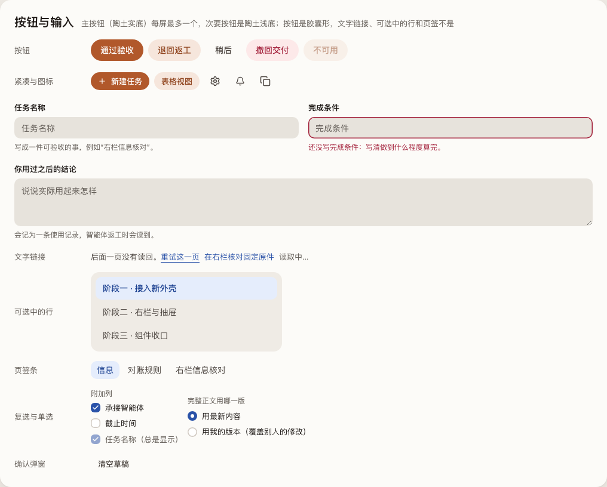
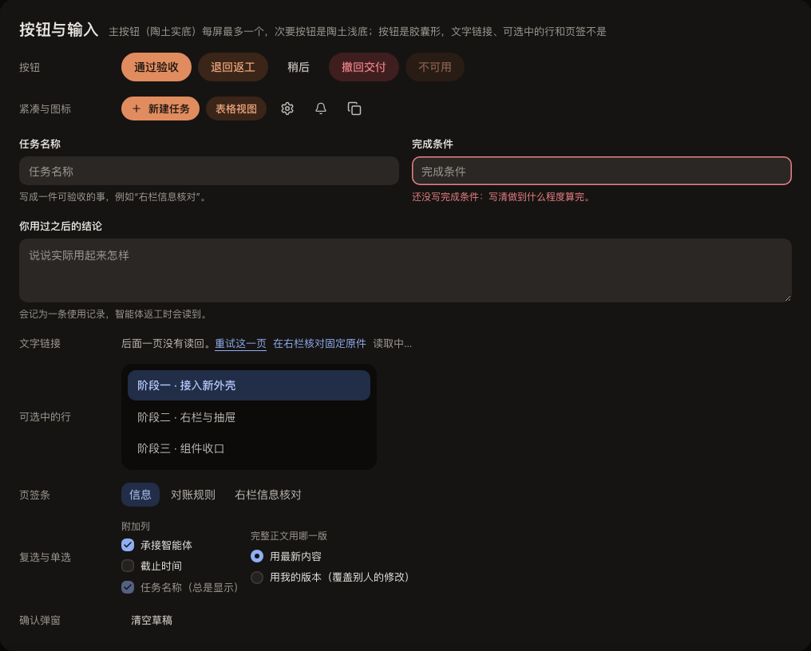
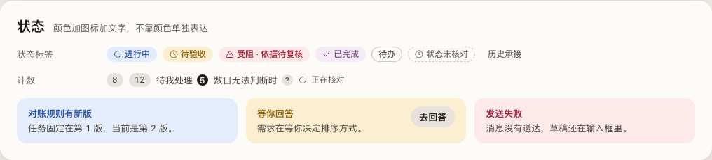
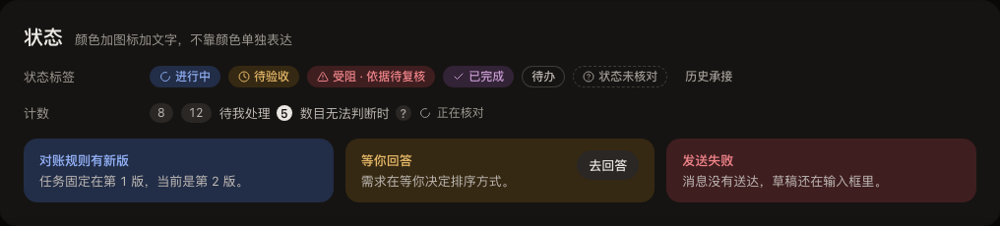
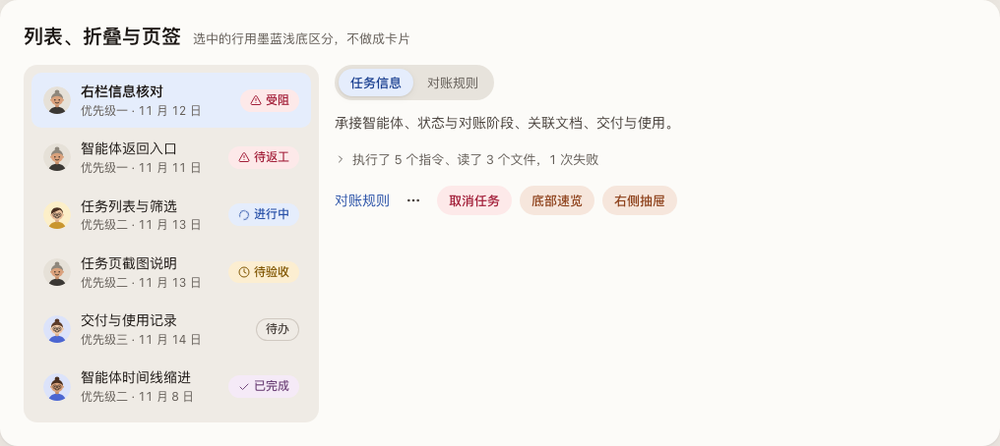
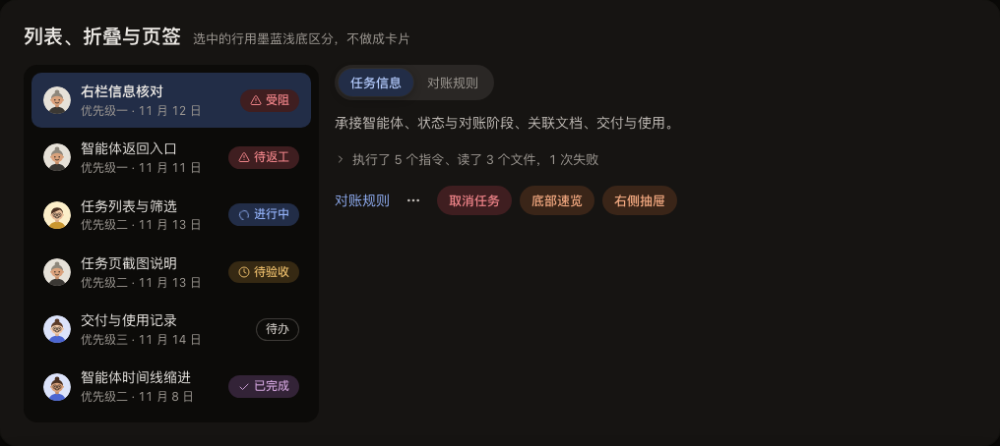

# 设计基础：颜色、文字、间距与状态

本页定义工作台共用的设计 token、Logo 和状态的视觉表达。数值只在 `packages/ui/src/tokens.css` 维护一份，文档只说明用途和规则。

**目标与现状。** 视觉已定稿（[DEC-037](../decisions.md#用户已确定的方向)，具体色值由 [DEC-049](../decisions.md#用户已确定的方向) 改为浅色“宣纸”、深色“松烟”）：暖纸底、墨蓝强调、陶土品牌色（Logo、账号头像和按钮，DEC-051），浅色为默认，另有一套深色。token 在 `packages/ui/src/tokens.css`，Tailwind 主题在 `packages/ui/src/theme.css`，元素的默认样式（正文字体与行高、文字颜色、等宽数字、键盘焦点框、选中底色、减少动效）在 `packages/ui/src/base.css`，也只引用 token。旧的全局 CSS 和旧变量名已在 #229 PR10 删除，工作台只有一个样式入口 `apps/workbench/src/main.css`，不写规则，页面用 Tailwind 工具类引用 token。`apps/workbench/test/style-budget.test.ts` 固定这几条：颜色字面量只出现在 `tokens.css`（头像插画的配色在 `avatar.tsx`，见下文），工作台不写 CSS 规则，源码里不再有 `data-legacy`。迁移由[前端改版 issue #229](https://github.com/cyl19970726/evoLoop/issues/229) 跟踪。
> **2026-11-22 起，色值、圆角、阴影、按钮与选中的写法以[设计语言](principles.md#设计语言)和 `packages/ui/src/tokens.css` 为准**（Task 870a2e38-953d-467c-ad9f-4269be69bd93）：中性灰加墨绿，不用陶土做按钮，选中是中性底加粗字，没有胶囊和左侧竖条。下面凡与之冲突的色值和 DEC-051 的叙述，是被取代的历史记录。

## 颜色

颜色分两层：基础值只在 token 文件里出现；页面和组件只用下面的用途 token。

### 表面：从后往前

界面分三层：两条左栏直接放在最底层；中间内容和右栏合在一块浮起的“工作面板”里，四周留 8px，圆角 18px，带一层很淡的阴影；面板里的事实卡片、工具步骤、待办清单用柔底色块，不加边框。

| 用途 token | 用途 | 浅色 | 深色 |
| --- | --- | --- | --- |
| `surface-sunken` | 最底层，两条左栏的底色 | `#e4ded4` | `#090807` |
| `background` | 工作面板：中间内容与右栏 | `#faf8f3` | `#171513` |
| `surface-raised` | 浮在面板上的卡片、弹层、输入框、选中的列表项 | `#ffffff` | `#2f2c28` |
| `surface-muted` | 面板里的柔底色块：事实卡片、工具步骤、待办 | `#eee9e0` | `#232019` |
| `surface-field` | 输入底、筛选标签（按钮不用灰色，DEC-051） | `#e1dbd0` | `#363330` |
| `surface-selected` | 左栏和列表里悬停的行（选中的行用 `accent-soft`，DEC-051） | `#dcd4c8` | `#3c3833` |
| `tab-track` | 页签条的轨道（选中页签落在它上面）：浅色同悬停灰，深色同最底层 | `=surface-selected` | `=surface-sunken` |

配色方案 B（Task a523f45e，由需求 Session 在 Task 294a4d38 的对照报告上选定）把上面的表面层次和线条拉开：浅色“卡片 / 面板”1.03→1.06、动态图连线 / 画布 1.38→1.58、深色 1.77→2.54，文字对比度最低 4.62:1。选中的位置除了 `accent-soft` 底，再加 3px 的 `accent` 边（`selected-edge` 工具类，选中的行、卡片、导航项）；蓝色提示条是柔底加 3px 蓝边；页签条的轨道比选中页签更深，选中页签有一圈细线。按钮颜色、状态色含义、布局、字体、间距和焦点框不变，没有新增绿色。

### 文字、线条与角色

| 用途 token | 用途 | 浅色 | 深色 |
| --- | --- | --- | --- |
| `text` | 正文、标题 | `#1c1714` | `#eae7e3` |
| `text-secondary` | 辅助文字 | `#49423d` | `#c0bbb6` |
| `text-muted` | 说明、时间、占位 | `#5b554f` | `#b0aba5` |
| `border` / `border-strong` | 细线 / 强调分隔（动态图连线用 `border-strong`，1.5px） | `#d2cbc0` / `#bbb1a4` | `#3d3a35` / `#55514b` |
| `accent` / `accent-soft` / `accent-strong` | 链接、进行中 / 选中的行、标签与菜单项的底色 / 选中项上的字 | `#2a52a8` / `#e5edfc` | `#90aef3` / `#222d47` |
| `warning` / `warning-soft` | 等你处理、待验收 | `#775000` / `#fceed1` | `#e3b667` / `#362913` |
| `danger` / `danger-soft` | 受阻、失败、返工、危险操作 | `#a3203a` / `#fde9e9` | `#f08e92` / `#3f1e20` |
| `done` / `done-soft` | 完成、通过（淡紫，不是绿色） | `#72487c` / `#f5eaf7` | `#c99dd3` / `#332337` |
| `count-bg` / `count-fg` | “待我处理”等计数点（墨色，不像报错） | `#1c1714` / `#fcfbf8` | `#eae7e3` / `#161412` |
| `brand` / `on-brand` | **主按钮底**、Logo 的对外版本、账号头像（不用于状态、计数和链接）/ 其上的文字 | `#b1582b` / `#ffffff` | `#e18c5f` / `#15110d` |
| `brand-hover` / `brand-pressed` | 主按钮悬停 / 按下的实色（不用透明度叠加） | `#9c4a22` / `#8a3f1b` | `#ea9a70` / `#f0a984` |
| `brand-soft` / `on-brand-soft` | **次要按钮**的陶土浅底 / 其上的字 | `#f6e6dc` / `#8f431d` | `#3a2518` / `#f0a77f` |
| `brand-soft-hover` / `brand-soft-pressed` | 次要按钮悬停 / 按下的实色 | `#f0d9ca` / `#e9ccb9` | `#46301f` / `#523a27` |
| `user-bubble` | 人发的消息气泡（深色底、浅色字） | `#1c1714` | `#393633` |

- **按钮不用灰色（DEC-051）**：主按钮用陶土实底（`brand` 底、`on-brand` 字），每屏最多一个；次要按钮用陶土浅底（`brand-soft` 底、`on-brand-soft` 字）；悬停与按下换成上表的实色，不用 `opacity` 叠加（浅色主按钮叠 90% 不透明度后白字只有约 4.1:1），默认、悬停、按下三态都 ≥ 4.5:1，禁用态照旧半透明。透明按钮、危险按钮、链接和焦点框不变。灰色（`surface-field`）只留给页面底、各层面板和输入框。
- **选中的行、标签和菜单项（DEC-051）**：墨蓝浅底 `accent-soft`、字 `accent-strong`（`bg-accent text-accent-strong`）；悬停的行仍是 `surface-selected`，选中的行悬停时保持 `accent-soft`。墨蓝仍不用来做按钮底色，陶土仍不用于状态、计数和链接。
- **不使用绿色**，包括青绿、薄荷绿和绿色状态（DEC-029）。“完成、通过”用淡紫 `done` 加勾和文字（DEC-049），“在线”用图标和文字；不引入色相约 90°–160° 的状态色。
- 颜色之外总有文字或图标；不靠色点表达唯一含义。
- 以上组合都满足 4.5:1 对比度（小字）；`packages/ui/test/palette.test.ts` 在 CI 里读 `tokens.css` 逐项算两种模式下所有文字与底色的组合，并核对每个 token 与 DEC-049 色值表一致，改任何一个值都会让它失败。
- **状态标签与计数（DEC-049）**：下图是组件样例页的“状态”和“列表”两节，浅色与深色各一张（`/ui`，假数据）。运行中、等待、失败、完成（淡紫）、待办（空心）、未知（虚线）在一行里彼此分得开，计数点是墨色。

- **按钮（DEC-051）**：下图是组件样例页“按钮与输入”一节，浅色与深色各一张（`/ui`，假数据）：主按钮陶土实底，次要按钮陶土浅底，可选中的行与页签条里的选中项是墨蓝浅底。

- 深色通过 `<html data-theme="dark">` 切换；入口和规则见下一节“主题与外观”。

## 主题与外观

**入口。** 账号菜单（宽屏在内层栏底部的设置按钮，窄屏在底部标签栏“我的”）里的“外观”：跟随系统、浅色、深色三选一，当前项带对勾，默认“跟随系统”。每个页面都能到。控件是三个 `menuitemradio`，代码在 `apps/workbench/src/app/shell/AppShell.tsx`，规则在 `apps/workbench/src/shared/theme.ts`。

**规则。**
- **偏好只属于这个浏览器**：存在 `localStorage` 的 `evoloop.theme`（`light` / `dark`；“跟随系统”就是没有这个键）。不进项目数据，不进服务端。读不到或写不进存储时按“跟随系统”，页面照常可用，选择只在当前页面内生效。
- **首次绘制前就生效**：`apps/workbench/public/theme-init.js` 在 `<head>` 里同步读取偏好并设置 `<html data-theme>` 与 `color-scheme`，所以不会先闪一下浅色。它是单独的文件而不是内联脚本，因为页面的内容安全策略只允许同源脚本。它和 `theme.ts` 的规则一致，改一处要改另一处。
- **跟随系统时不用刷新**：监听 `prefers-color-scheme` 的变化；其他标签页改了偏好也会同步。
- **样例页自管**：`/ui` 和 `/ui/flow` 的临时开关只在样例页打开期间管 `data-theme`（页面上带 `data-theme-sample` 标记，正式偏好的应用暂停），离开后恢复正式偏好；样例页的开关不写偏好。
- 不改色值与页面结构；色值仍以 DEC-049 为准。

测试：`apps/workbench/test/theme-switch-browser.test.ts`（真实浏览器，宽屏与窄屏）覆盖入口、三个选项、跟随系统不刷新、刷新后保持、首绘不闪、存储不可读、样例页不改偏好。
## 文字

| token | 大小 | 用途 |
| --- | --- | --- |
| `font-caption` | 12px | 时间、计数、徽标、输入框下方的提示 |
| `font-label` | 13px | 区块小标题、工具摘要、筛选标签 |
| `font-small` | 14px | 界面文字、列表、右栏事实 |
| `font-body` | 16px | 正文阅读（行高 `leading-reading` 1.8） |
| `font-heading` | 20px | 页头标题、区块标题 |
| `font-title` | 28px | 对象标题（任务、文档、交付），每页一个 |

- 字体：系统中文无衬线（`-apple-system, "PingFang SC", "Microsoft YaHei", sans-serif`）；代码、命令、技能名用等宽字体。
- 字重三档：常规 400、中等 500（列表标题、按钮）、强调 600（页面与区块标题）。
- 行高三档：正文阅读 1.8，界面 1.55，标题 1.3。正文行宽不超过 `reading-width`（680px）。
- 页面只用 token 类：字号 `text-caption` 到 `text-title`；行高 `leading-(--leading-reading)`、`leading-(--leading-body)`、`leading-(--leading-tight)`。不写 `text-[11px]`、`leading-[1.6]` 这类方括号值，也不用任意属性（`[font-size:…]`）、字号上的行高修饰（`text-small/6`）、内联样式，或 Tailwind 自带、token 之外的档（`text-sm`、`leading-relaxed`、`leading-5`、`leading-tight` 等）。`packages/ui` 的样式表（`tokens.css` 之外）同样只写 `var(--…)`。
- 数字用等宽数字（`tabular-nums`）。中文与数字、英文之间留一个空格。

## 间距、尺寸与圆角

- 间距只用 4、8、12、16、24、36（`space-1` 到 `space-9`）。工作面板外留 8，内容区左右留 36。
- 外层栏 68px，内层栏 264px；按钮高 36px，紧凑控件 30px。
- 圆角五档：行内代码 6px，列表项与输入 10px，卡片与弹层 14px，工作面板与提问卡 18px，按钮、标签、输入框 999px（胶囊），对应 `rounded-sm`、`rounded-md`、`rounded-lg`、`rounded-xl`、`rounded-full`。不写 `rounded-[9px]` 这类方括号值，也不用 `rounded`、`rounded-2xl` 等 token 之外的档。字号、行高和圆角的字面量由 `style-budget.test.ts` 检查，确实需要的写进它的例外表并写明理由（#229 F6 之后为空）。

## 阴影与层级

只有三种东西有阴影：工作面板（`shadow-panel`）、浮在面板上的卡片和选中项（`shadow-control`）、弹出菜单与提示（`shadow-popover`）；弹窗和抽屉用 `shadow-overlay` 并加遮罩 `scrim`。面板内部的区域不加阴影，用柔底色块或细线分隔。焦点用 `focus-ring`：画在元素内侧——外圈 2px 不透明强调色，里面再留 2px 表面色，在任何表面上都看得清（WCAG 2.4.7），也不会被所在的滚动容器裁掉。自身带阴影的控件（选中的页签）和包着输入框的外框（智能体搜索、消息输入框）用同色 2px 向内描边；不自己画焦点的元素（浏览器自动可聚焦的滚动区、`summary`）由基础样式画同色 2px 向内描边，正文里的文字链接描边在文字外侧。工作台的 `focus-ring-ci-browser` 回归按键盘走过关键页，检查每一处都有焦点环且没被裁掉。

## Logo

圆角方块里一条不断开的回环（“方块回环”）：工作交出去、被使用、再回来。文件在 `packages/ui/src/`：

| 文件 | 用途 |
| --- | --- |
| `logo.svg` | 产品内主标：墨蓝底、白色回环；外层栏左上角 36px |
| `logo-dark.svg` | 深色界面：提亮的墨蓝底、深色回环 |
| `logo-small.svg` | 24px 及以下（浏览器标签页图标），回环加粗到 2.8 |

对外页面与社交头像可用陶土底（`brand`）配浅色回环。不加描边、阴影或渐变，不旋转，不单独使用回环，不放在绿色或高饱和底色上。

## 智能体头像

每个智能体有一个卡通头像：**底色区分职责**，发型和配饰区分同一职责下的不同实例。底色取自暖色和蓝紫系，不用绿色。头像在左栏 30px、标题 32–36px、对话流和表格里 16–24px。头像是插画，配色写在 `packages/ui/src/components/avatar.tsx`，不属于用途 token；职责底色按职责 ID 稳定选取，发型与配饰按智能体 ID 选取，Leader 和复盘用固定形象。头像组件见[组件清单](components.md)。智能体自选的标识（颜色加图标，显示在名字旁）用 `AgentMark`，配色同样写在 `avatar.tsx`；原来的青绿和橄榄绿换成了青蓝和赭黄（PR6d）。

## 断点

| 宽度 | 行为 |
| --- | --- |
| ≥ 1440px | 外层栏、内层栏、中间、右栏全部展开 |
| 1100–1439px | 右栏默认收起，可展开 |
| 760–1099px | 内层栏可收起；右栏以抽屉打开 |
| < 760px | 外层栏变成底部标签栏；内层栏和右栏变成从底部升起的速览 |

只用这几个断点，页面里不另写断点。具体布局见[布局](layout.md)。

## 动效

| token | 时长 | 用途 |
| --- | --- | --- |
| `duration-fast` | 150ms | 悬停、按下、小元素出现 |
| `duration-base` | 200ms | 展开收起、面板进出 |
| `duration-slow` | 250ms | 抽屉、弹窗 |

缓动统一用减速曲线（ease-out）。尊重 `prefers-reduced-motion`。使用原则见[设计原则](principles.md#动效)。

## 状态的视觉表达

| 状态 | 颜色 | 图标 | 文字示例 |
| --- | --- | --- | --- |
| 进行中、运行中 | `accent` | 旋转的加载图标 | 正在运行测试 · 1 分 04 秒 |
| 完成、通过 | `done` 字，`done-soft` 底（淡紫） | 勾 | 已验收 |
| 等你处理、待验收、等你回答 | `warning` | 时钟 | 待验收 |
| 受阻、失败、待返工 | `danger` | 警示三角 | 待返工 |
| 待办、空闲 | `text-secondary`，空心：中性色细边、无底色 | 无 | 待办 |
| 未知、过期、未核对 | `text-muted`，虚线边、无底色 | 问号 | 状态未核对 |
| 历史、已取消 | `text-muted` | 无 | 历史承接 |
| 机器在线 / 离线 | `accent` / `text-muted` | 圆点 | 在线 / 离线 |

状态标签是胶囊形：浅底色加同色系文字（例如 `danger-soft` 底、`danger` 字）。由一个组件统一渲染（见[组件清单](components.md)），业务状态到这张表的映射放在工作台的共享层，各页不各写一套。
