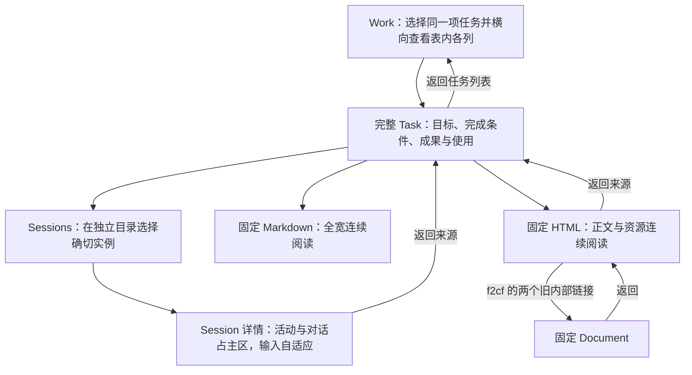
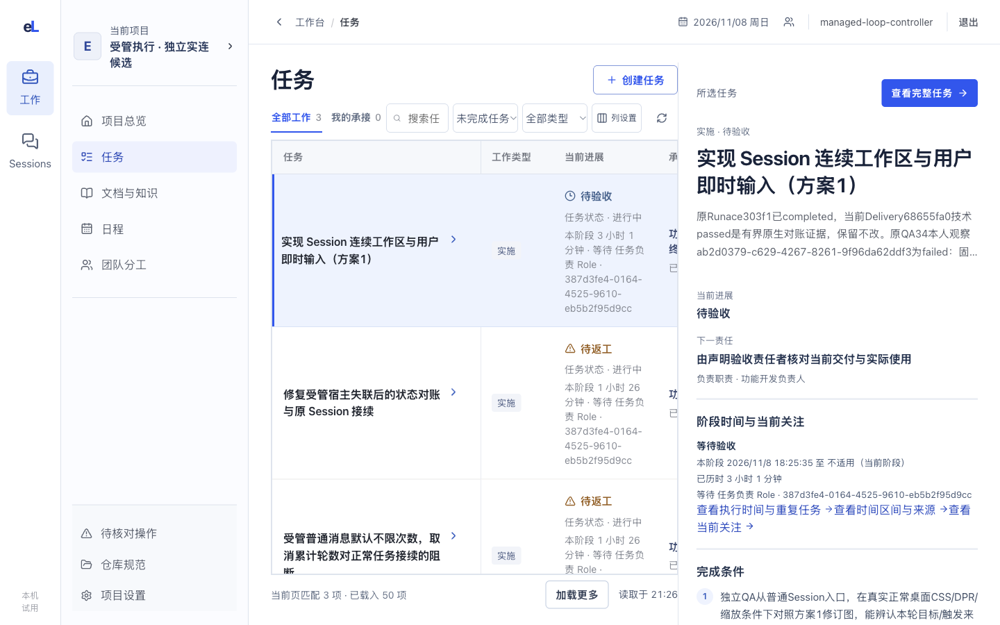
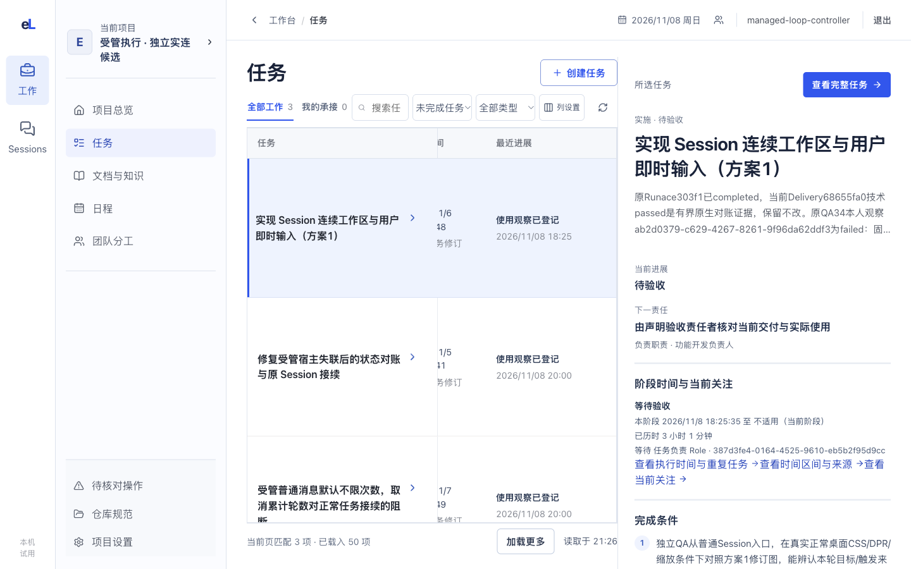
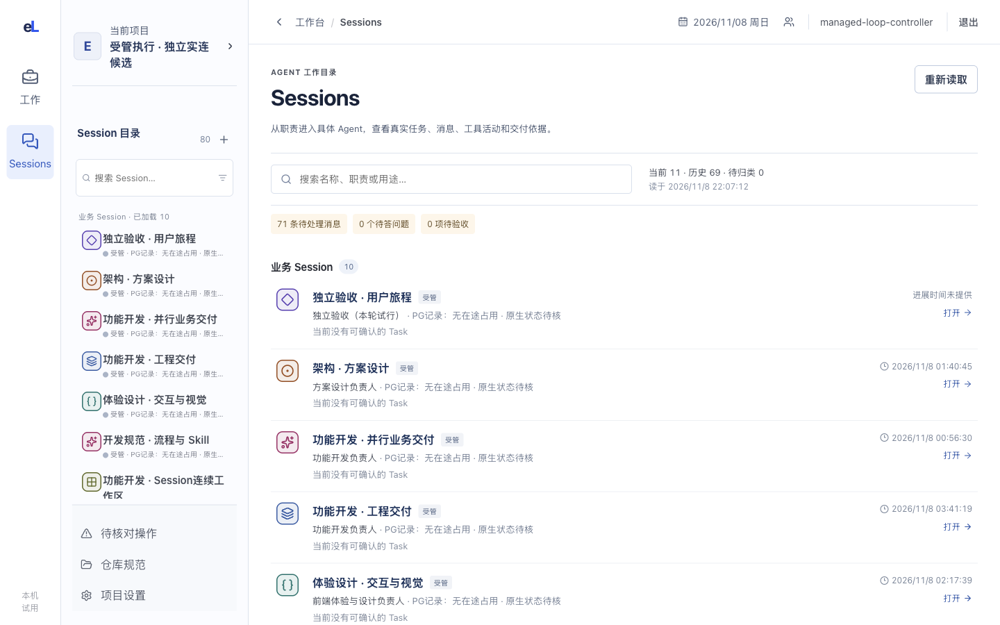
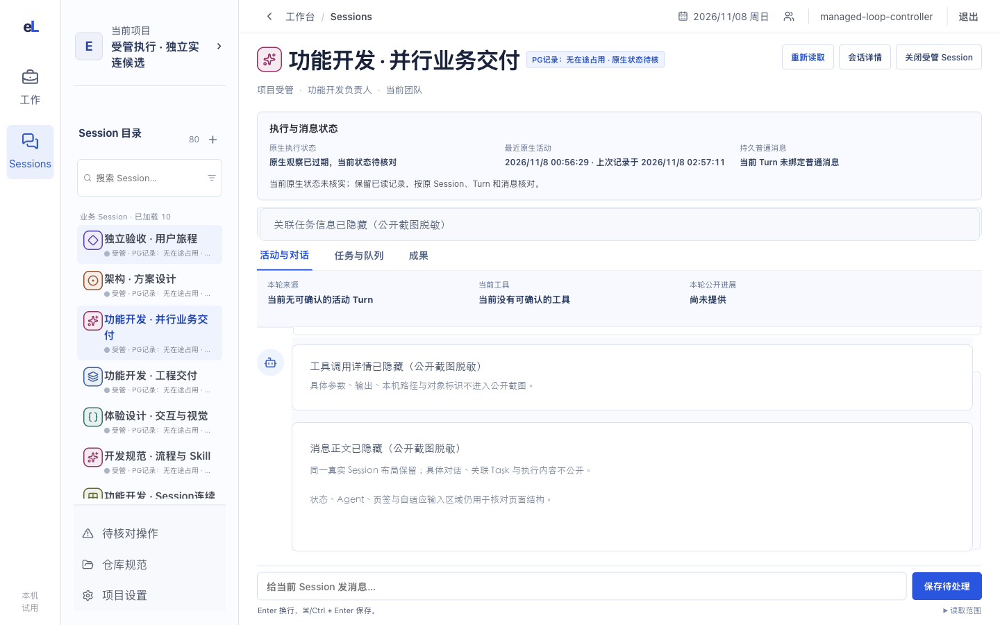
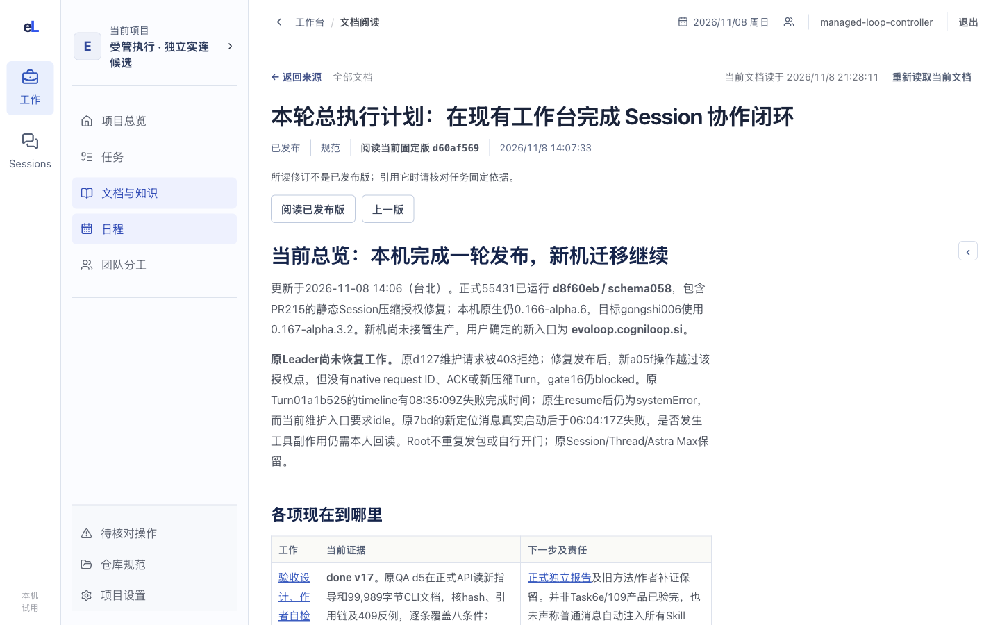
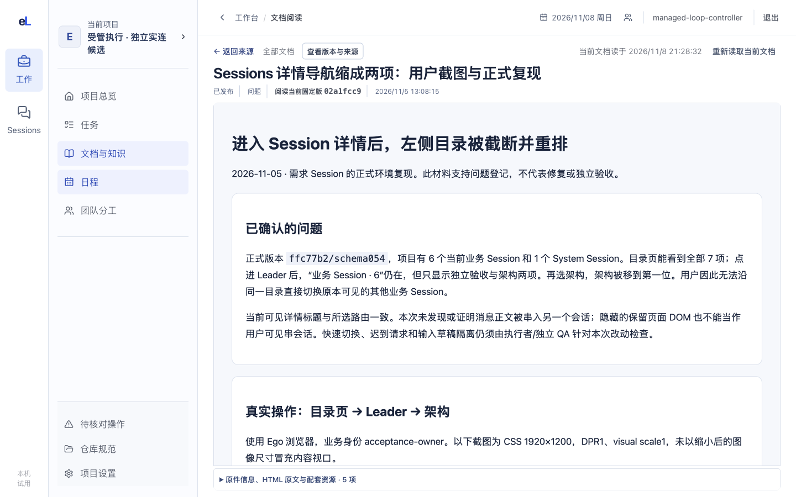
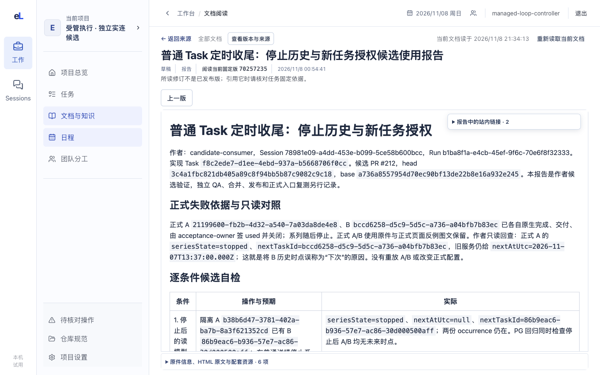
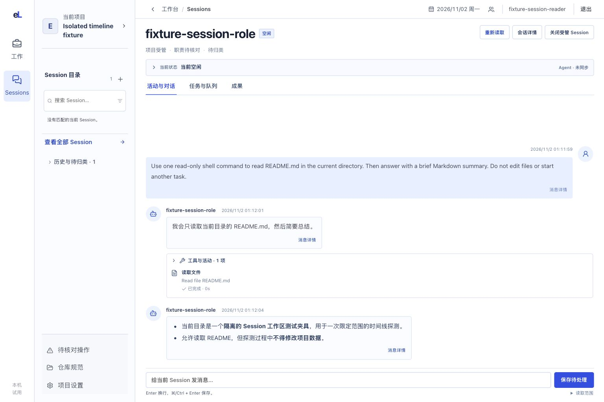

# 实景旅程：从当前工作读到固定成果，再返回

2026-11-08 · **发布后当前路径**：本文先记录正式 `36cb620/schema062` 维护服务中的只读实景复测，再保留 2026-11-01 和 2026-11-02 的失败与候选样本作为历史差距。页面目标仍由各页面正文维护；一次维护模式截图不会把“页面可读”扩大成自动 Agent 运行、模型流或业务迁移完成。

本轮沿同一件当前工作依次核对：任务表在自己的区域横向滚动，右侧摘要保持稳定；从摘要进入完整 Task；由 Task 到达确切 Session，并核对左侧 Session 目录与主工作区；打开固定 Markdown 和 HTML 成果；在带旧内部链接的 HTML 中进入固定 Document 后返回。七张当前图的 CSS 视口均为 **1440×900、DPR 1、visual viewport scale 1**，PNG 输出也全部为 **1440×900**。逐图 URL、动作、哈希、服务修订、schema 和边界见[当前来源记录](../../assets/frontend-journey-20261108/source.json)。

服务健康回执同时记录 `runtime:false`、`automationEnabled:false`。因此本页证明的是维护模式中的普通读取、视觉布局和固定链接导航；它没有发起模型 Turn、消息发送、自动 Session、实时订阅或目标库正式业务迁移。

## 当前路径与每一步的判断

这条路径把“找到工作、核对执行、读固定成果、回到来源”连成一条人的阅读路线。截图所在版本与后续候选、合入和部署仍须分别核对。

## 1. 在列表横向查看任务，同时保留右侧摘要

人的问题是“这项工作解决什么，做到哪，我现在该看哪一列”。当前任务表保留任务、工作类型、当前进展、承接者、创建时间和最近进展六列；表格过宽时只在自己的区域内横向滚动，右侧所选任务摘要不随表格平移。

初始位置先看任务名称、工作类型和当前进展。右侧仍显示同一任务的目标、当前责任和完成条件，因此不必在表格里寻找一段被隐藏的长摘要。

实测任务表自身 `scrollLeft=508` 后，后续列在表格内部进入视野，整页和右摘要没有一起横移。当前交互记录还确认，从右侧“查看完整任务”进入完整 Task；这张图只直接证明入口和滚动范围，完整 Task 的目标阅读区由下一节及独立 QA 继续核对。

**读者应得到的判断：** 表格负责横向比较，摘要负责快速确认；移动列不能带走正在读的任务，也不能把表内滚动误写成整页溢出。

## 2. 打开完整任务，读懂本次约定

从右摘要打开完整 Task 后，双左栏仍保留，目标、完成条件、正文、当前进展、固定成果与实际使用进入双左栏之外的主阅读区。完整 Task 不再缩在列表摘要里，返回任务列表时原搜索、筛选、选择与表格位置应保留。本文没有另放当前完整 Task 截图；这项入口和返回动作须由普通本地入口的独立 QA 重走，不能拿 2026-11-01 的历史截图冒充当前结果。

**设计理由：** 列表帮助选择，摘要在不离开列表时确认，全文负责持续阅读。三层只能共享同一对象事实，不能用摘要内容齐全替代全文入口。

## 3. 从任务核对具体承接者

人的问题从“这项工作由谁承接”转为“这个确切 Session 的当前任务、活动、输入和成果在哪里”。当前 Sessions 把 Session 目录固定在左栏；主区用于目录结果或所选实例，不再在对话后再追加一列目录，也不复制第二份 Session 快捷列表。

主目录按业务、System 和待归类边界展示可信 RoleClass；列表中的“当前没有可确认的 Task”是读取结论，不自动等于该 Session 空闲。搜索、历史展开和加载更多仍属于同一目录。

选择确切 Session 后，左侧目录保持可见并保留选择；活动与对话占据主区，任务与队列及成果作为同一实例的相邻页签，底部输入适应主区宽度。正文截图已脱敏：具体消息内容、工具详情与关联 Task 均替换为显式占位，只用于核对目录、状态、Agent、页签和自适应输入布局，不能据此声称完整对话内容可见。

状态区仍显示“原生连接不可用／PG 状态待核”。因此这张公开脱敏图不能被解释为当前模型正在流式回复或自动 Agent 已成功运行。

**读者应得到的边界：** 同一真实 Session 布局中的目录位置、主区比例、状态、Agent、页签和自适应输入是当前发布后已验证的视觉范围；消息正文、工具详情与关联 Task 在公开图中隐藏。实时连接、实际发送、工具执行和原生 Turn 是否可用仍按当次运行回执判断。

## 4. 读固定成果并回到工作

人的最后一个问题是“本次固定的是哪一版，我能否从头连续读完，再沿来源返回”。当前 Markdown 与普通 HTML 都把正文放进双左栏之外的主阅读区。版本与来源、原件信息和资源清单进入次级入口，不再在正文外堆出比正文更长的页面。

### Markdown：全宽连续阅读

样本从标题、状态、正文首段读到表格，主区宽度和纵向滚动都用于 Document，没有旧的窄预览边界。读者仍可从页头确认固定修订、发布时间和“返回来源”。

### HTML：正文与资源连续阅读

`26b5` 样本的 HTML 本身没有 href。这张图只证明隔离报告、已保存资源和次级原件信息可以连续阅读，不证明任何站内链接存在或被改写。

`f2cf` 是另一种样本：报告中的站内链接面板列出两个合法旧内部链接，实际点击后进入其映射的固定 Document，并可返回原报告。这个结果证明固定修订映射和工作台 origin 的读取路径，不证明任意 HTML 链接、脚本、表单或外部资源都能执行。

读完固定成果后，“返回来源”回到原 Task 的交付与使用位置，再返回任务列表；本轮的实际读取链路与来源边界记录在同一[来源记录](../../assets/frontend-journey-20261108/source.json)中。本页没有把视觉阅读升级为消费者亲用，也没有替换任何 Task、Document 或 Session 状态。

## 本次发布的证据边界

| 已在维护服务读回 | 仍未由这些截图证明 |
| --- | --- |
| Work 六列在表内横滚，`scrollLeft=508` 后右摘要位置不变 | 所有窄窗都能发现横向滚动，也不证明真人认为该交互舒适 |
| Session 目录只在左栏，活动与对话占主区，输入自适应 | 实时原生连接、自动消息处理、模型流和工具执行成功 |
| Markdown 全宽连续阅读，固定修订与返回入口可见 | 任意长文档都能读到末段，以及所有附件、权限和错误状态 |
| HTML 主区连续阅读，26b5 资源可读且无 href | 任意报告脚本、表单、外部资源或交互内容可运行 |
| f2cf 的两个旧内部链接可映射并进入固定 Document | 任意旧绝对链接、同源页面或 token 化 URL 都可安全导航 |
| 正式服务是 `36cb620/schema062`，读取时 `runtime:false` | 目标空库已经完成正式业务迁移，或维护模式具备自动 Agent 能力 |

`target-coldstart-1440x900.png` 只表示目标空库冷启动，未纳入当前产品旅程，也不作为正式迁移完成证据。

## 历史差距与历史版本

以下内容保留旧日期和旧版本的含义，不再代表 2026-11-08 的当前界面。修复后的判断以本文前半段的发布后复测为准。

### 2026-11-01：旧正式入口样本

2026-11-01 在 `2880×1772 CSS px、DPR 1、visual viewport scale 1` 下读取四张图，PNG 均为 2880×1772。该样本记录了任务选择、完整 Task、历史 Session 和约 420px HTML 内预览；当时 Task、Session 和 HTML 的具体差距现已由后续版本改变。原来源和哈希继续保留在[历史来源记录](../../assets/frontend-journey-20261101/source.json)。

这张图保留当时“右侧长摘要偏重、是否容易理解仍待使用验证”的判断。2026-11-08 的新图证明表内横滚和摘要稳定，不能用旧图继续描述当前 Work。

这张图保留完整 Task 已进入左栏外阅读区的当时证据；页头摘要高度与真实长文阅读舒适性属于该历史版本的待判断项。

这张图记录当时 Session 目录已独立、但活动与配置仍接在对话之后的结构。2026-11-08 的新图证明左侧目录、活动与对话主区和自适应输入已经改变；历史截图不能继续称为当前布局。

这张图明确保留 420px 内部预览的失败。2026-11-08 的 Markdown、26b5 与 f2cf 图分别证明当前两种 Document 阅读路径；旧失败仍应作为修复来由可查，但不再是当前结论。

### 2026-11-02：统一 Session 候选回读

该图来自隔离测试项目的真实原生消息 Turn，展示重启后的历史回看，自动执行未启用，既不是实时订阅，也不是正式 Task 使用。它保留候选阶段的输入、进展、工具与回复阅读证据；2026-11-08 的 Session 图则来自正式维护服务的只读页面，但服务 `runtime:false`，仍不能证明当前自动运行。原始视口、DPR、裁切方式与哈希见[历史候选来源记录](../../assets/session-workspace-20261102/source.json)。

## 下一次界面改动怎样沿这条路径验证

| 场景 | 普通操作 | 应能观察到的结果 |
| --- | --- | --- |
| 找到任务并打开全文 | 搜索、选行、横滚表格、看摘要、打开完整 Task | 表内滚动不带动摘要或整页；同一任务进入双左栏外全文并返回原选择 |
| 查谁真正工作 | 从 Task 进入确切 Session，切换目录与活动 | 左栏只保留目录；主区连续读活动与任务，不把历史内容或旧活动算作当前运行 |
| 使用 Markdown 成果 | 打开固定修订，读首段、中段、末尾并返回 | 正文占主区，固定修订不漂移，返回来源仍明确 |
| 使用 HTML 成果 | 分别检查无 href 与带站内链接的报告 | 无 href 样本只验阅读/资源；合法旧链接进入固定 Document 后能返回 |
| 发布改动 | 记录维护模式与 runtime 状态，复测后再独立 QA | 维护读取、自动运行、模型实际调用、合入、部署和业务迁移分别留证 |

影响路径或布局的改动，应在同一个 PR 更新相关步骤和关键截图。截图授权、尺寸和公开检查见[文档维护](../../development/documentation.md#前端旅程与截图怎样进入仓库)；需要核对业务状态时回到固定 Task、Run、Delivery 与使用观察，不从页面截图反推。
