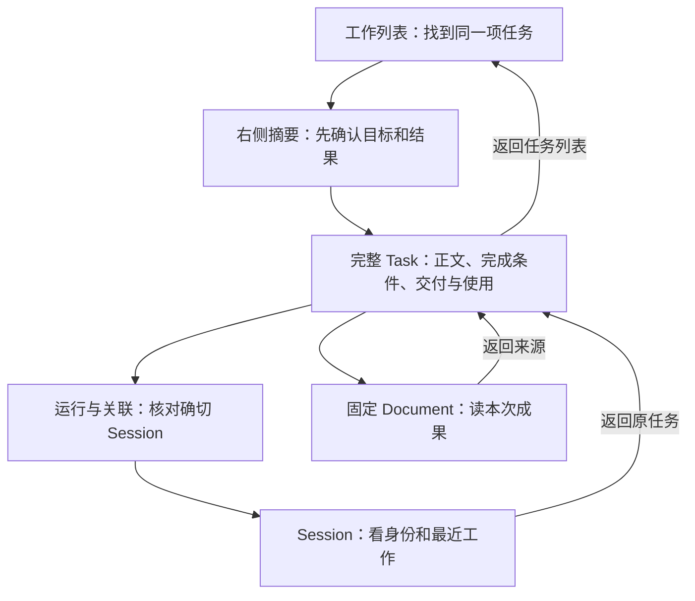
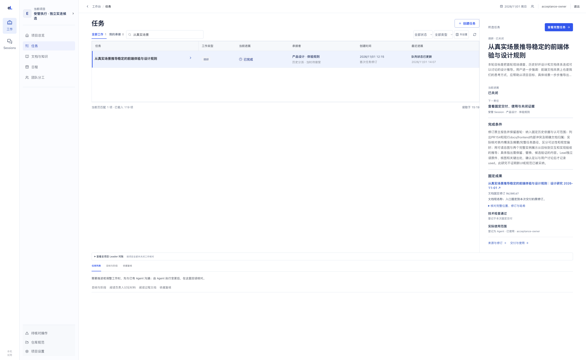
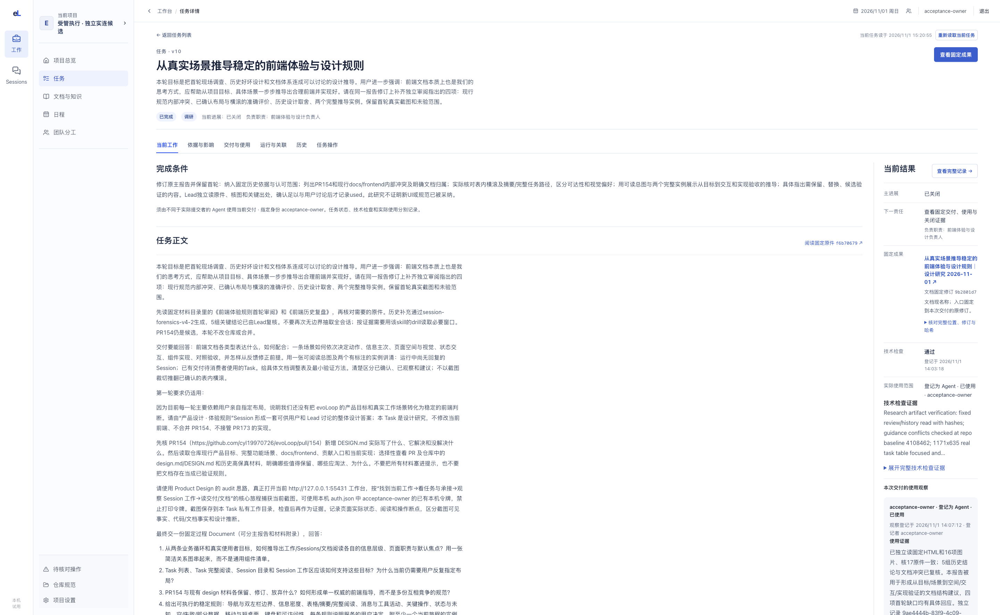
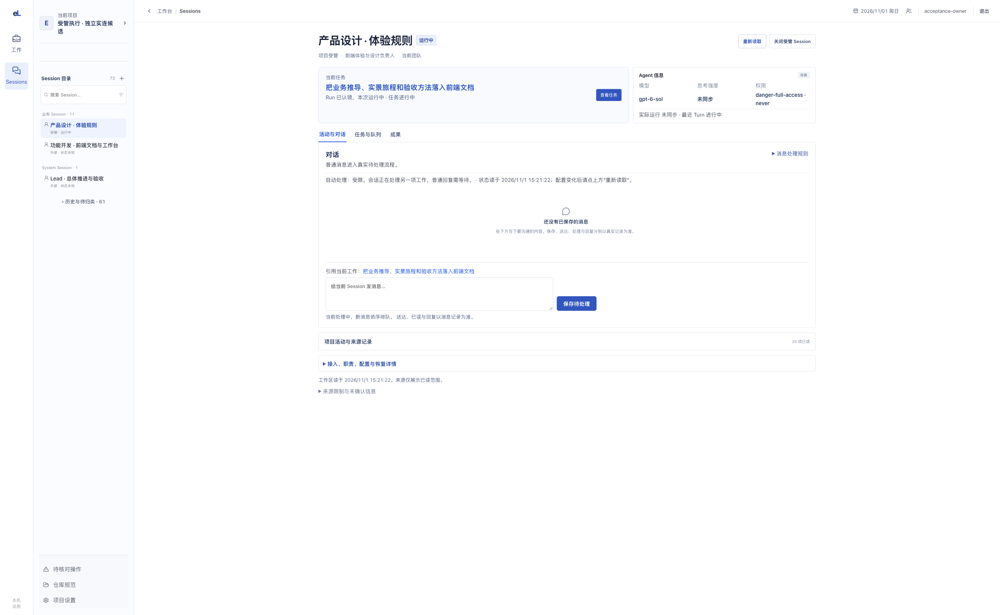
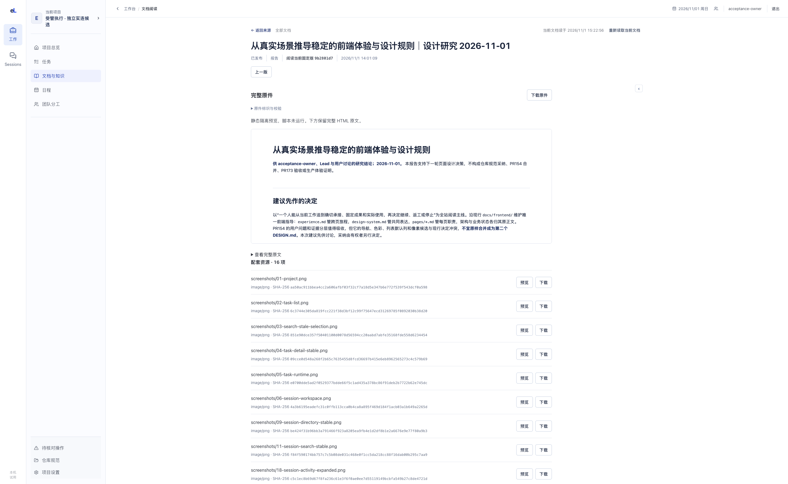

# 实景旅程：从当前工作读到固定成果，再返回

2026-11-01 · 这是一条真实阅读样本，用来对齐产品目标、页面职责与当前差距。截图来自已运行工作台，未展示候选 PR173 的改动，也不代表全站体验已通过。

我们沿同一项“从真实场景推导稳定的前端体验与设计规则”研究 Task，找任务、读正文、核历史承接 Session、打开固定成果，再返回。该研究 Task 已关闭；截图时同一个 Session 正在执行后续的**前端文档 Task**。这两个时间层必须分清，不能把现时运行说成旧研究 Task 仍在执行。本页只读观察，不重新执行研究或发送消息。

四张图由用户指定的 ego-browser 在同一条路径捕获。每步实读 **2880×1772 CSS px、DPR 1、visual viewport scale 1**，保存的 PNG 均为 **2880×1772 像素**。这组宽窗样本的图像比例约 1.625，接近用户给的 **3342×2056 输出像素**参考；参考图拍摄时的 CSS 视口、DPR 和缩放未知，不能据比例声称两者阅读条件相同。浏览器 UI 缩放也未单独读回；本组没有应用 CSS zoom。图在文内可点开原尺寸，来源和哈希见[来源记录](../../assets/frontend-journey-20261101/source.json)，测量口径见[截图与页面尺度](../design-system.md#截图与页面尺度先对齐真实阅读环境)。短窗和手机另作边界检查。

## 路径与每一步的判断

这条路径对应[业务到界面的总图](../business-to-interface.md)。下面每步同时记录“为什么这样设计”和“当前实际怎样”，实现尚有差距的部分留在原工作中处理。

## 1. 在列表选中值得阅读的工作

人的问题是“这项工作解决什么，做到哪，我接下来该看什么”。从工作模块进入任务，选择全部状态，搜索标题并选择一行；右摘要随选择展示目标、完成条件和固定成果。搜索进行中会继续读取后续页，尚未读完不能说项目没有结果。

图为走完全程返回后的选择状态。搜索、全部状态筛选及所选任务仍保留，摘要指向同一份固定报告。列表和摘要里的“已完成／已关闭”“历史分派”和“Agent 已使用”分别描述任务、承接历史和本次使用范围；读者不能只从其中一个标签推断所有事实。较长的完成条件使摘要偏重；右栏存在不等于已经能够轻松理解，任务表达与页面设计要一起改进。

**设计理由：** 表用于比较，右摘要用于快速确认，全文另有阅读空间。本宽窗可直接看到六列；较短窗口中的表内横滚已在前轮研究实测可到末列，是否容易发现仍待独立使用验证。不能用宽窗六列全显或短窗裁切中的任一张图替代另一种视口的体验判断。

## 2. 打开完整任务，读懂本次约定

从摘要点击“查看完整任务”，进入正常阅读页。读者先核目标、完成条件与正文，再查看固定成果、技术检查及谁实际使用；原列表的返回入口仍可见。

**观察：** 全文已进入左栏以外的阅读页，正文与成果有独立层次。长任务的页头摘要和完成条件仍占较多高度，实际正文宽度也需要结合真实内容继续判断；“已经打开全文”只证明入口可用，不能直接证明阅读舒适。

**设计理由：** 完整阅读应让人建立对工作的理解，来源、历史和操作保持可达；右摘要与全文承担不同阅读深度，不能把两者都做成小卡片。具体页面要求见[任务列表与详情](../pages/tasks.md)。

## 3. 从任务核对具体承接者

在同一 Task 的“运行与关联”点击“查看该 Session 的工作区”，进入“产品设计 · 体验规则”。工作模块不保留第二份会话快捷列表；Sessions 的第二左栏显示业务与 System 实例，可搜索并区分历史。

**观察：** 研究 Task 的“运行与关联”保留旧修订分派，并提醒这不能证明新修订已接手。点击其具体 Session 后，目录确实选中“产品设计 · 体验规则”；截图中的顶部**当前任务是后续文档工作**，Run 已认领且运行中，普通消息区仍为空。空消息不代表这项新工作没有运行，更不能把新 Run 算到已关闭研究 Task 上。目录已经独立；活动与配置仍接在对话之后，主工作区空间仍有改进余地。

此次从 Session 使用浏览器历史返回原 Task 的“运行与关联”，再进入成果。页面给出“查看任务”的当前链接，指向新文档 Task；若要回到旧研究 Task，必须保持来源或浏览器返回，本次证实了后者。本样本没有验证键盘长消息、原生待答或发送信息；那些场景有独立验收条件。当前目标及状态边界见[团队与 Session](../pages/team-and-sessions.md)。

## 4. 读固定成果并回到工作

在 Task 点击“查看固定成果”，再打开交付中的当前报告链接。页面应保持本次交付的修订，而不是悄悄换成后来编辑的版本。此样本读到 `9b2801d7` 固定修订。

**已确认的差距：** 即使在2880×1772宽窗，普通 HTML 的 iframe 仍实量 **420px 高、约1100px 宽**；外层还有说明、原文与16项资源清单。报告虽可打开、资源已保存，主要阅读空间仍被压缩。这解释了为什么只验“加宽、图片加载”会遗漏用户真正要的从上到下完整阅读。原阅读任务已重新打开，当前只记录问题，尚未修复。

预期是紧凑页头之后由完整正文占据可用主区，来源、原文与资源按需进入；同时保留HTML隔离及固定修订。Markdown已可连续阅读的体验应保持。详细目标与复测步骤见[完整 Document 阅读](../pages/documents.md#完整阅读要同时给足宽度和高度)。

然后点击“返回来源”回到同一 Task 的交付页，再点“返回任务列表”。本轮实际恢复了原搜索、全部状态和所选任务，第一张图记录这一返回结果。没有为了截图新建交付或替任何消费者签署使用。

## 下一次实现要怎样沿这条路径验证

| 场景 | 普通操作 | 应能观察到的结果 |
| --- | --- | --- |
| 找到任务并打开全文 | 搜索、选行、看摘要、打开完整Task | 目标与结果属于同一任务；全文可读，返回选择仍在 |
| 查谁真正工作 | 由Task进入确切Session，核当前或历史任务、Run与进展 | 不将同Role成员或旧工具活动当作本次执行；当前无回复也能判断是否介入 |
| 使用本次成果 | 打开固定Document，读首段、中段、末尾和图表，再返回 | 修订一致；主要空间用于正文，长报告不困在小预览 |
| 发现未达目标 | 保留实际失败、所用版本、截图和下一责任 | 回原Task修复后沿同一路径复测，历史失败仍可追 |
| 发布改动 | 候选亲用与当前检查通过后合并、发布，再从正式入口复测 | 能区分候选、合入和实际运行版本，正式使用成立后才关闭工作 |

开发者在交付Document提供完整使用报告，Lead独立复核；角色与步骤按[开发规范](../../development/standards.md#证据与交付)。这张表是本旅程的验证例子，每项Task仍应说明它改变了哪一步、具体样本和预期差异。

## 如何继续维护这页

影响路径或布局的改动，应在同一个PR更新相关步骤和关键截图。不要把所有运行记录搬进仓库；保留能说明当前路径、差距及决定理由的材料。某版问题被修复后，换上通过复测的新图并标明版本，旧失败保留于过程Document或历史版本。图片授权、尺寸和公开检查见[文档维护](../../development/documentation.md#前端旅程与截图怎样进入仓库)。
