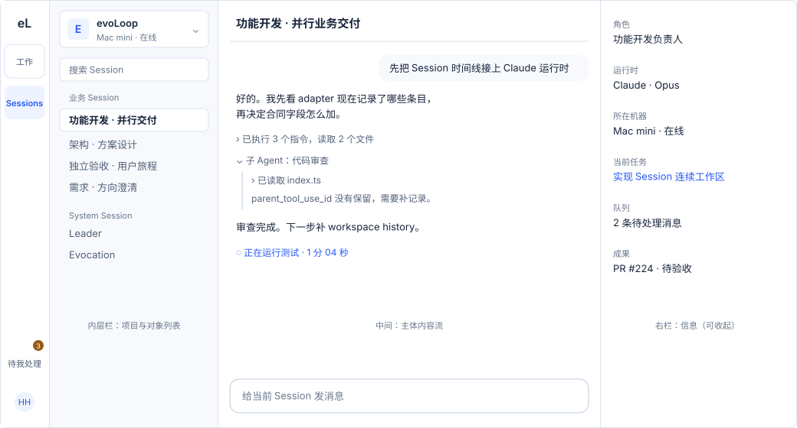

# 布局：双左栏导航，中间内容，右侧信息

所有内容页用同一个骨架：外层模块栏选空间，内层上下文栏选对象，中间读和对话，右边看这个对象的事实。中间不包卡片，次要信息是一行灰字，可以展开。这个布局由[场景与交互](scenarios.md#从场景看布局)推出。

**目标与现状。** 下面是已选定的目标布局（[DEC-036](../decisions.md#用户已确定的方向)）。外壳已按它实现（#229 PR5，`apps/workbench/src/app/shell/`）：68px 模块栏（工作、智能体，底部待我处理）、264px 上下文栏（项目、分区导航、对象列表，底部账号与设置）、浮起的工作面板（中间加可组合的右栏）。窄屏时模块栏变成底部标签栏，上下文栏变成抽屉。各页都已在新外壳里重写（#229 PR6–PR10）：对象列表经 `ContextRailContent` 放进内层栏，当前对象的信息经 `ContextPanelContent` 放进右栏；账号菜单里的设置类页面（项目设置、结果未知的操作、仓库规范、微信连接）和几张列表页只用中间，没有右栏。迁移由[前端改版 issue #229](https://github.com/cyl19970726/evoLoop/issues/229) 跟踪。

## 骨架

| 区域 | 宽度 | 内容 | 滚动 |
| --- | --- | --- | --- |
| 外层模块栏 | 68px，常驻 | 顶部 Logo；工作、智能体；底部是待我处理（带计数） | 不滚动 |
| 内层上下文栏 | 264px，可收起 | 项目切换；本空间的分区导航；当前分区的对象列表；底部是账号名和设置 | 对象列表单独滚动 |
| 中间 | 占满剩余宽度；正文行宽不超过约 760px | 页头（标题、状态、最多一个主操作）和主体内容流；Session 页底部固定输入框 | 单独滚动 |
| 右栏（上下文面板） | 约 320px，可拖宽、可收起 | 默认是当前对象的信息组合；也可以在这里打开别的对象（文档、任务、交付物、Session 摘要），以页签叠放，见下节 | 单独滚动 |

- 两条左栏放在最底层；中间和右栏合在一块浮起的工作面板里，四周留 8px，圆角 18px，右栏与中间之间只用一条细线分开。表面与阴影见[设计基础](foundations.md#表面从后往前)。
- 整页不横向滚动；宽表格只在自己的区域里横向滚动。
- 宽度不够时，先收起右栏，再收起内层栏；断点见[设计基础](foundations.md#断点)。用户手动展开或收起后，跨页保持。

## 右栏：随内容变化的上下文面板

右栏参考 Claude Code 桌面版的侧边面板：能放各种东西，组合随当前内容变化，用起来不用离开中间正在读或正在对话的内容。

默认组合跟着对象走：选中什么，右栏就给出这类对象最常用的几块，顺序固定，块与块之间用细线分隔，可以各自折叠。

| 中间是 | 右栏默认组合 |
| --- | --- |
| Session | 实体卡（身份、职责、所在机器与状态）→ 动态 / 资料库 → 环境与用量 |
| Leader 安排 | 冲突与风险 → 空闲与过载的 Session → 截止临近的任务 |
| 任务 | 状态与对账阶段 → 承接 Session → 关联文档 → 交付与使用 → 版本 |
| 文档 | 版本 → 来源 → 引用它的任务 → 页内目录 |
| 知识 | 来源 → 反例与相关认识 → 版本 → 评价 |
| 日程 | 触发条件与下次时间 → 最近运行 → 产生的任务 |

- **可以在右栏打开别的对象**：在中间点到文档、任务、交付物或 Session 的链接时，默认在右栏打开，中间保持不动；按住 Cmd/Ctrl 点击在新标签页打开。右栏里打开的对象以页签叠放在默认组合旁边，最多保留 5 个，可以关闭、固定，或点“在中间打开”切过去。切过去以后，这个页签关闭，右栏回到“信息”，显示中间这个对象的版本、来源和关联，不再重复正文。
- **任务页签只属于打开它的任务**：在任务页打开文档后切到另一项任务，上一任务的文档页签关闭，右栏回到当前任务的“信息”，不把上一任务的正文当作当前任务的固定依据；表格改选另一行也按换任务处理。
- **记住状态**：右栏打开了哪些页签、宽度和折叠状态按空间分别记住；地址栏只记录当前选中的那一个，分享链接时对方看到同样的内容。
- **宽度**：可拖动，在 280–560px 之间；宽度不够时右栏先收起，窄屏变成从右侧滑出的抽屉，一次只开一个对象。
- **收起与抽屉**：收起后，工作面板右边留一条窄栏，只放“展开右栏”，不压住页首的按钮；手机上这个按钮在顶栏右端。抽屉由页面上的按钮（如“所选任务信息”“任务信息”）或“展开右栏”打开，按 Esc 或点关闭后，焦点回到打开它的按钮。

## 外层模块栏

外层栏只回答“我在哪个空间”，并放全局信号：

- **工作**：总览、任务、文档与知识、日程、团队。原来只能从深链进入的页面挂在所属分区下：任务下有目标与阶段、评价与后果；文档与知识下有知识空间、仓库规范；团队下有职责、分工讨论、组织复盘、协作回执。
- **Sessions**：所有 Session 的对话与活动。
- **待我处理**（底部，带计数）：待我验收、等我使用的交付、待我决定、依据变化、结果未知的操作。计数是各项之和；任一项读不到时不显示数字，改为灰色问号（数目待核对），并在页面顶部说明。
- **账号**在内层栏底部（头像、名字、权限，加一个设置按钮）：项目设置、结果未知的操作、仓库规范、微信连接、切换项目、退出。窄屏放在底部标签栏的“我的”。

切换空间时，各空间的选中对象、筛选、搜索和滚动位置各自保留，回来时原样恢复。列表就地写进地址的条件（任务表格的状态筛选、搜索、选中行）随地址一起记住；不写进地址的（文档表的筛选、智能体目录的搜索）由页面自己保留。

## 内层上下文栏

从上到下三块：

1. **项目切换**：项目名、所在机器和在线状态。点开是项目列表；多机器方案（[issue #219](https://github.com/cyl19970726/evoLoop/issues/219)）落地后按机器分组，并标出离线机器。
2. **分区导航**（工作空间）：总览、任务、文档与知识、日程、团队，紧凑的一行一项。
3. **对象列表**：当前分区的对象，带搜索和筛选，选中项高亮。Sessions 空间没有分区导航，整列都是 Session 目录（分业务、System、待归类，历史可展开）。

## 各页面的分工

| 页面 | 内层栏的对象列表 | 中间 | 右栏 |
| --- | --- | --- | --- |
| [Session](pages/sessions.md) | 顶部固定“Leader 安排”，下面是 Session 目录 | 对话与 Agent 活动流，底部输入框；选中“Leader 安排”时为编排总览文档加安排看板 | 角色、运行时（Session 自己的绑定）、所在机器（#219 前为“未知”）、当前任务、队列、成果；“Leader 安排”时为冲突与风险 |
| [任务](pages/tasks.md) | 紧凑任务列表（标题 + 状态），按状态筛选、可排序 | 选中任务：目标 → 完成条件 → 正文 → 进展与讨论；可切换为六列“表格视图”供批量对账 | 状态与对账阶段、承接 Session（可绑定）、关联文档（主正文、总图、编排总览、依据、交付物）、交付与使用、版本 |
| [文档](pages/documents.md) | 文档列表；可切换“文档 / 知识” | 选中文档的全文；未选文档时显示文档表格 | 版本、来源、引用它的任务 |
| [知识](pages/knowledge.md) | 专题目录 | 正文 | 来源、反例、相关认识、版本、评价；图谱单独展开 |
| [日程](pages/schedules.md) | 日程列表 | 所选日程的说明与最近运行 | 触发条件、下次时间、产生的任务 |
| [评价](pages/evaluations.md) | 评价目录（从任务或知识页进入时只列当前范围） | 冻结定义、两个条件的逐次尝试、结论与下一步 | 共同任务、材料、Wiki 修订、来源、定义版本、完整标识 |
| [团队](pages/team.md) | 职责列表，另有分工讨论、组织复盘两组 | 所选职责：目标、范围、交接、试行状态，承载它的 Session | 运行时与 skill、试行指标与回看时间 |
| [总览](pages/overview.md) | 正在推进的阶段 | 目标、当前阶段、需要判断的事、最近使用、当前工作 | 读取范围、约定执行、队列 |
| [目标与阶段](pages/journey.md) | 目标及其下的阶段 | 所选阶段：目标、学习问题、下一步、阶段下的任务、接受与回看、修订历史 | 读取范围、阶段状态与任务进展、目标的使用者与承接、不属于阶段的任务 |
| 待我处理 | 按类型分组的待办 | 所选事项的对象（任务、文档或操作） | 事项来源、责任与下一步 |
| [项目设置](pages/settings.md)、[结果未知的操作](pages/operations.md)、[仓库规范](pages/repository.md) | 只有所在空间的分区导航 | 单栏：事实、回执或表单，以及去别处的入口 | 没有 |

## 导航与项目范围

- 先选项目，再看项目里的内容。跨项目的内容只在有授权时出现。
- 待处理与异常有固定入口（外层栏的“待我处理”），并能从相关对象回链。
- 仓库里的 `docs/` 通过项目设置里的仓库入口访问，不放进文档列表。
- 搜索和对象固定链接是补充入口，不代替正常导航。
- 项目里不存在的地址（例如单数的 `/task/{ID}`）显示“找不到这个页面”，地址栏保留原地址，给出“回到总览”“回到任务”；这个地址不记作空间的位置。
- 跳转、返回和列表筛选的规则见[场景与交互](scenarios.md#跳转规则)。

## 上下文页面与返回

| 入口 | 首先回答 | 返回到 |
| --- | --- | --- |
| 依据复核 | 哪版来源改变了什么，谁有权判断 | 原文档或任务 |
| [结果未知的操作](pages/operations.md) | 哪个操作结果未知，最后可核的事实是什么 | 原操作所在对象；按原操作 ID 查回 |
| 效果评价 | 每个案例的材料、产物、采用、使用与成本 | 知识或阶段 |
| [仓库与配置](pages/repository.md) | 正式规则在哪里，哪些能力已配置可用 | 项目设置 |

上下文页只做本页范围内、有授权的操作：知识纠正不直接接受关联任务；结果未知的操作只发起对账；暂停日程不停止已在途的工作；收件箱不直接派发任务。

跨页返回保留项目、身份、对象、筛选、所选修订和阅读位置。固定历史链接打开原修订，另给“查看当前版”入口。

## 窄屏与手机

- 宽度小于 760px 时，外层模块栏变成底部标签栏（工作、智能体、待我处理、我的）；内层栏变成抽屉，右栏变成从底部升起的速览（下拉关闭，不离开当前页），中间占满屏幕。任何时候都能找到全部智能体的入口。
- 手机优先：待我处理、任务状态、Session 对话与待答问题、异常处理。
- 列表在窄屏可以变成逐项卡片；过程文档仍保留表格，可横向查看或收起次要列。任务的表格视图在手机上默认是紧凑列表（每行是标题、进展、类型、承接和最近进展）；在“任务视图”里选“表格”后，这个浏览器记住选择。
- 版本差异和来源在窄屏保留完整内容，可以横向查看，不因为窄屏隐藏反例、权限和冲突。
- 高风险操作（采纳、撤回、关闭）在手机上也要显示影响对象并二次确认，不靠滑动触发。
