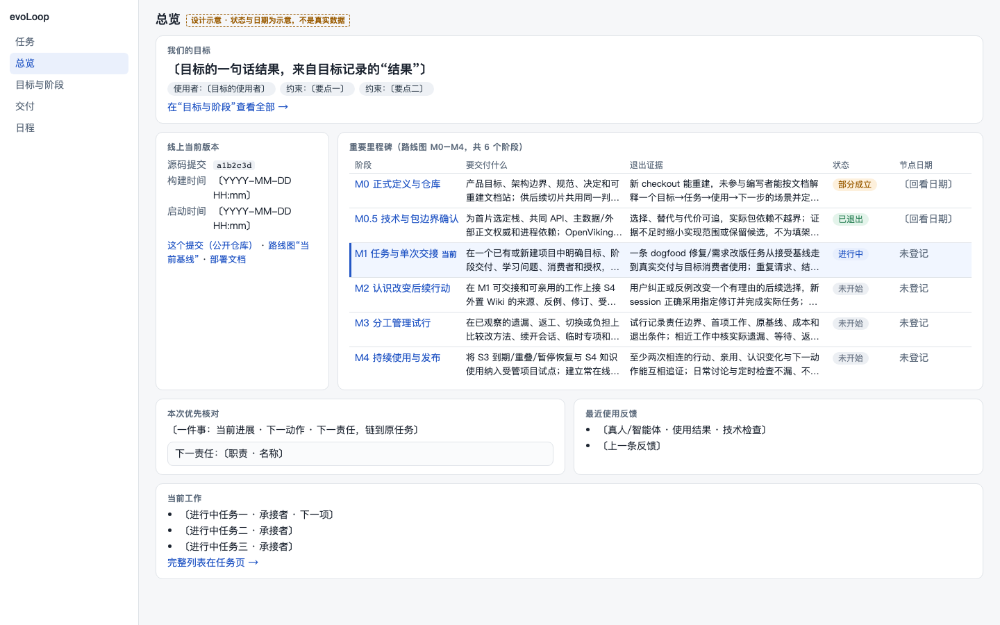
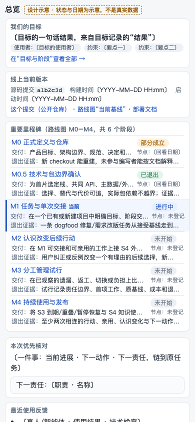

# 总览顶部重做：设计（已确认）

Task `e5af6765`（2026-11-12 返工）。使用者要从总览一眼看清三件事：目标是什么、线上版本是什么、重要里程碑做到哪。本文是实现前的设计，需求 Session 已于 2026-11-12 确认（见 PR #377 评论）；发布脚本写 `build-info.json` 不在本 PR。图中带“〔…〕”的文字是占位，状态与日期只是示意。

## 设计图

1440×900，首屏（示意状态：阶段已与服务端的阶段关联）：

390×844，首屏：

整页（含下方三块）：[1440](../assets/frontend-pages/design/overview-top-1440-full.png)、[390](../assets/frontend-pages/design/overview-top-390-full.png)。第一天的真实状态（阶段还没关联、目标未登记，全部如实写“未登记”）：[1440](../assets/frontend-pages/design/overview-top-1440-day1.png)、[390](../assets/frontend-pages/design/overview-top-390-day1.png)。静态源：[overview-top.html](../assets/frontend-pages/design/overview-top.html)（`?state=linked` 或 `?state=day1`）；实测数据：[overview-top-measure.json](../assets/frontend-pages/design/overview-top-measure.json)。

## 版面（自上而下）

1. **目标**（整行）：一句话结果、使用者、约束要点，链到“目标与阶段”。
2. **线上当前版本**（1440 宽在左，390 宽在目标下面）：源码提交、构建时间、**启动时间**（不叫发布时间），三个公开链接。
3. **里程碑**：路线图实际的 **6 个阶段**：M0、M0.5、M1、M2、M3、M4（Task 原文的“五个”是笔误）。每个阶段一行：阶段名（可点）、要交付什么、退出证据、状态、节点日期。当前阶段整行浅底加左侧色条并写“当前”，**只突出一个**。
4. **下方三块**（原有，完整画出）：本次优先核对、最近使用反馈、当前工作，内容与现有页面一致，只是下移。右栏不变。

窄屏（≤700 px）每个阶段仍是同一行数据，只换排法：第一行阶段名和状态，第二行交付（一行截断）和节点日期，第三行退出证据（一行截断）。**没有阶段被隐藏，退出证据没有收进二级页面**；缺字段写“未登记”。

## 数据从哪来（逐列）

里程碑不是现有目标与阶段页里的东西：路线图的 M0–M4 是 evoLoop 自己的实施阶段（见 `docs/roadmap.md`），目标与阶段页的“阶段”是项目目标下的阶段，只有交付、学习问题、状态和回看记录，没有名称、退出证据和日期字段。设计据此让**路线图提供文字，服务端的阶段提供状态与日期**，两者用一个可选关联连起来；没有关联就写“未登记”，不猜。

| 列 | 服务端只读来源 | 缺字段时 |
| --- | --- | --- |
| 阶段名 | 路线图阶段表第一列（`docs/roadmap.md`，随部署的同一提交读取） | 路线图读不到：整块写“路线图读不到”，不显示旧值 |
| 要交付什么 | 路线图第二列 | 同上 |
| 退出证据 | 路线图第三列（版面按行数截断，完整文字在点开的路线图里） | 同上；某行该列为空写“未登记” |
| 状态 | 关联的阶段（`Stage.state` 与它最近一次 `StageReview`），映射见下 | 没有关联的阶段：“未登记” |
| 节点日期 | 关联阶段最近一次回看的日期（写作“回看于 日期”） | “未登记”；不从路线图的文字里推日期 |
| 当前阶段 | 恰有一个关联阶段是 `active` 时，它对应的那一行 | 没有或有多个：不突出，页眉写“当前阶段未登记”，不猜 |

**状态映射**（与目标与阶段页同一份数据，同一套词；需求 Session 已确认）：`proposed` → 未开始；`active` → 进行中；`reviewed` 且最近回看 `adopted` 非空、`gap` 与 `rejected` 都为空 → 已退出；`adopted` 非空且 `gap` 或 `rejected` 非空 → 部分成立；其余 `reviewed` → 已回看（结论见阶段页）。没有关联的阶段、或有多个进行中的阶段，一律写“未登记”，不猜。命令要求三项都有文字，“空”如何写见文末“‘已退出/已回看’如何经真实命令到达”。

**新增只读投影** `GET /api/projects/:projectId/milestones`（项目读权限）：返回 `{ source: { commit }, phases: [{ id, title, deliver, exit, stage: { id, state, review: { adopted, gap, createdAt } } | null }] }`。路线图由服务启动时读取已部署目录里的 `docs/roadmap.md`（与版本接口同一提交），不放进文档表，也不在前端写死；页面和“目标与阶段”页读同一份阶段，所以两页不会各算一遍。

**需要的数据改动（待确认）**：阶段要能关联到路线图的阶段，建议给阶段加一个可选字段 `phaseKey`（如 `M1`，在“目标与阶段”页的阶段表单里填），需要一个小迁移。不用它就只能靠标题文字匹配，太脆弱，设计不采用。

## 版本块

- 字段：源码提交（短哈希）、构建时间、启动时间，来自新增只读接口 `GET /api/version`：`{ commit, builtAt, startedAt }`。**不含路径、环境变量或任何配置**。`commit`、`builtAt` 由发布流程的构建步骤写入随发布目录放置的 `build-info.json`，`startedAt` 是进程启动时间；没有构建信息（开发运行）时 `commit`、`builtAt` 为 null，页面写“版本未读到”，不显示旧值。
- 链接**都指向公开页面**：这个提交（公开仓库的提交页）、路线图“当前基线”（`docs/roadmap.md#当前基线`）、部署文档（`docs/development/local-run.md`）。仓库地址沿用工作台现有的文档基址常量。不链接私有的 `release-ID.json`。
- 发布负责人已说明启动时间不等于发布时间，所以字段名写“启动时间”；要“发布时间”需要发布流程另写一个字段，不在本轮。

## 视口与实测

两种视口各用静态源页面在 Chromium 里实测（`overview-top-measure.json`）。首屏要求：目标、版本、全部 6 个阶段和当前阶段都在首屏，页面没有水平溢出。

| 视口 | 状态 | 目标底边 | 版本底边 | 里程碑底边（最后一行底边） | `scrollWidth`/`clientWidth` | 超出右边界的元素 | 整页高度 |
| --- | --- | --- | --- | --- | --- | --- | --- |
| 1440×900 | 示意（已关联） | 178 | 562 | 562（549） | 1440/1440 | 0 | 900（下方三块也在 900 内） |
| 1440×900 | 第一天（未登记） | 178 | 562 | 562（549） | 1440/1440 | 0 | 900 |
| 390×844 | 示意（已关联） | 136 | 236 | 663（655） | 390/390 | 0 | 1044 |
| 390×844 | 第一天（未登记） | 136 | 236 | 663（655） | 390/390 | 0 | 1044 |

390 宽里里程碑底边 663 < 844，6 行都在首屏，下方三块在首屏下方、向下滚动可见（它们本来就是“首屏之后”的内容）。1440 宽时整页高度等于视口，三块下方内容也不需要滚动。

## 状态

| 情况 | 页面写什么 |
| --- | --- |
| 读取中 | 各块各自写“正在读取…”，互不阻塞 |
| 目标未登记 | “尚未登记目标”，给“目标与阶段”入口 |
| 版本读不到 | “版本未读到” |
| 路线图读不到 | 里程碑块写“路线图读不到”，版本和目标不受影响 |
| 阶段未关联 | 状态与节点日期写“未登记”，不突出任何阶段，页眉写“当前阶段未登记” |
| 有多个进行中的关联阶段 | 不突出，写“有多个进行中的阶段”，不猜哪个是当前 |

## 需要确认的几点

1. 路线图文字由服务启动时读已部署目录的 `docs/roadmap.md`，状态与日期来自关联的阶段；是否同意加可选字段 `phaseKey`（小迁移），以及“没有关联就写未登记”的第一天表现。
2. 状态映射中“部分成立”“已退出”的判定规则（见上）是否符合目标与阶段页对回看记录的用法。
3. `/api/version` 按与 `/health` 一样不要求登录设计（只含提交与构建/启动时间）；需要登录时页面写法不变。
4. 构建写 `build-info.json` 要改发布脚本（`scripts/release/`），不在本轮。

## 实现范围（确认后另开 Run）

`/api/version` 与 `build-info.json`；`/milestones` 投影与阶段的可选 `phaseKey`；总览顶部三块和测试夹具；两种宽度截图；总览页文档更新。最终验收仍由 `acceptance-claude-agent` 在正式实例上做。

## 真实页面实测（实现后）

真实页面截图与量到的数据：[1440 首屏](../assets/frontend-pages/overview-top-1440.png)、[1440 整页](../assets/frontend-pages/overview-top-1440-full.png)、[390 首屏](../assets/frontend-pages/overview-top-390.png)、[390 整页](../assets/frontend-pages/overview-top-390-full.png)、[390 第一天](../assets/frontend-pages/overview-top-390-day1.png)、[实测数据](../assets/frontend-pages/overview-top-real-measure.json)。

- 1440×900：目标、版本、6 个阶段都在首屏（最后阶段底边 624），无水平溢出。
- 390×844：目标、版本、6 个阶段都在底部标签栏（约 64px）之上（最后阶段底边 752），无水平溢出。为此在手机宽度下：页面副标题收起；目标卡里“阶段交付/要弄清的问题”并排、各最多两行；版本块三行标签对齐；阶段行只留一行（阶段名与状态），只有当前阶段展开“交付/退出证据”，节点日期在放得下时才显示。

## “已退出/已回看”如何经真实命令到达

`stage.review` / `stage.review.correct` 要求采纳、拒绝、缺口三项都有文字，所以“没有拒绝、没有缺口”只能写成一个词。判定时，某项**整段**是“无 / 没有 / 暂无 / 无缺口 / 无拒绝 / 无遗漏 / none / nil / n/a / - / —”（忽略首尾空格和结尾句号）就当作空；含这些词的整句话（如“没有完全解决，剩下一项”）不算空。于是：采纳有内容、拒绝与缺口都写“无” → 已退出；采纳有内容、拒绝或缺口之一有内容 → 部分成立；采纳写“无” → 已回看。回看记录仍只追加；`stage.review.correct` 追加一条即可让阶段从部分成立变为已退出。真实 PG 测试 `tests/integration/stage-phase-key.test.ts` 用这两条真实命令覆盖。**这是对需求 Session 已确认的 3 条规则的补充解释，待需求 Session 确认。**
