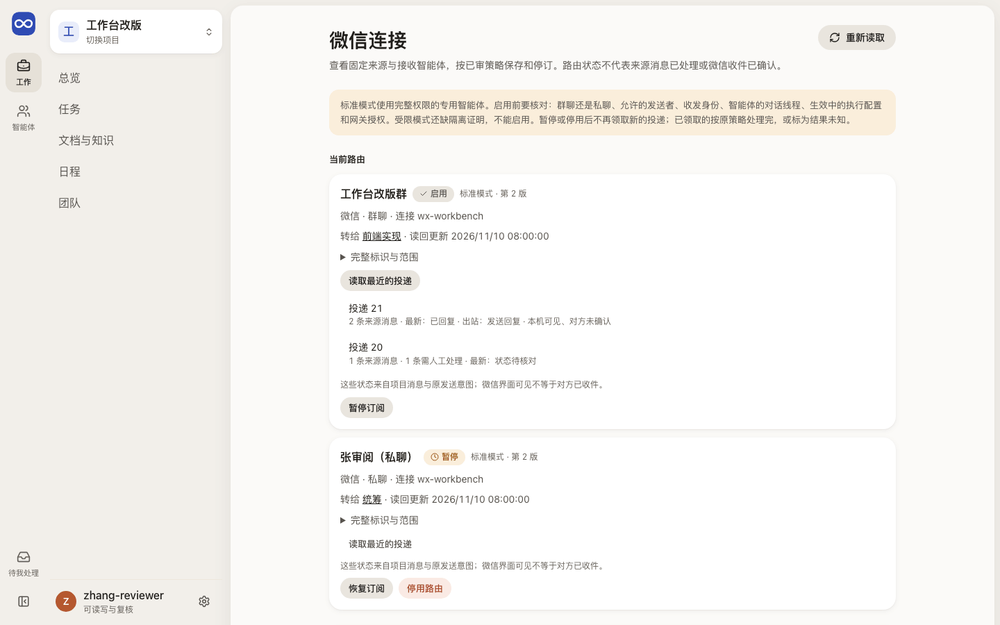
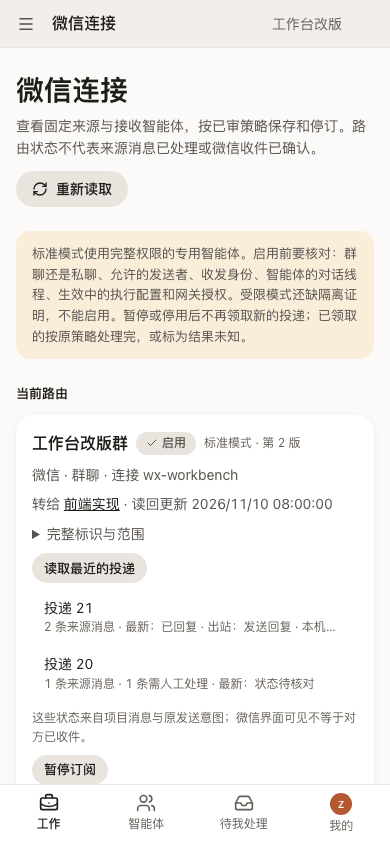

# 微信连接：哪个微信会话转给哪个智能体

微信连接页让人看清每个微信群聊或私聊转给了哪个智能体、现在是启用、暂停还是停用，最近几批投递处理得怎样；有复核权限的人在这里保存新路由、启用、暂停和停用。路由合同与资格检查见[消息 Connector](../../architecture/message-connectors.md)。

## 这一页回答什么

- 项目里有哪些微信路由，各自转给哪个智能体，现在是否在接收？
- 最近几批投递里，消息是否转给了智能体、有没有回复、哪些需要人工处理？
- 一次保存或状态变更的结果不确定时，怎样按原操作查回？

## 布局

| 区域 | 放什么 |
| --- | --- |
| 页首 | 标题、说明、“重新读取” |
| 提醒 | 标准模式的限制；有未确认的原操作时，显示原操作 ID 和“按原 ID 查回” |
| 当前路由 | 每条路由一张卡片：会话名称、状态、模式与版本，平台、会话类型与连接，转给哪个智能体（显示名字，链到智能体页）；“完整标识与范围”里放全部 ID 与名单；最近的投递及明细；暂停、恢复、启用、停用 |
| 创建标准模式路由 | 折叠的表单，只对有写入和复核权限的人显示；新路由保存为停用 |

本页属于设置菜单，用设置页的单栏布局，没有内层栏和右栏（[布局](../layout.md)）。

现状（#229 PR9d）：整页已换成 `@evoloop/ui` 组件，旧的 `connectors.css` 已删除；读取仍用页面自己的状态与令牌，尚未迁到按项目隔离的查询。

## 内容与状态

通用的空、加载、失败、未知规则见[设计原则](../principles.md)。

- 路由状态只说配置：启用不等于来源消息已处理，也不等于对方已收到。每张卡片都写明微信界面可见不等于对方已收件。
- 首次读取失败只显示失败，不显示“还没有路由”；重读失败时保留上次读回的路由，标“上次读回，当前待核对”。
- 卡片正文显示智能体名字；名字读不到时写“智能体（名称待读取）”。完整的智能体 ID、路由 ID、对话线程和网关登记只放在“完整标识与范围”里，长 ID 在窄屏折行。
- 投递是网关送来的一批消息，和任务的“交付”不是一回事。每批写来源消息数、需人工处理数、最新状态和出站决定；明细里分开写每条消息的处理、没有转给智能体的事件及原因、出站请求。服务端的状态值在前端改写成中文（`connectorPresentation.ts`）。
- 保存与状态变更带原操作 ID；结果未知时保存该 ID，先查回再继续，查回前不提交新的修改。
- 表单标签用中文，网关与运行时的技术名放在说明小字里。

## 截图

由 `npm run docs:screenshots` 用合成夹具生成，怎样重新生成见[页面截图](../architecture.md#页面截图)。

## 代码与测试

| 范围 | 路径 |
| --- | --- |
| 源码（`apps/workbench/src/`） | `features/connectors/ConnectorPage.tsx`、`features/connectors/connectorPresentation.ts`、`features/connectors/client.ts`；设置页共用布局在 `shared/ui/SettingsParts.tsx` |
| 测试（`apps/workbench/test/`） | `connector-presentation.test.ts`、`connectors-browser.test.ts` |

## 相关

- 架构：[消息 Connector：微信标准模式](../../architecture/message-connectors.md)
- 接入：[微信 Connector 标准模式接入与核验](../../development/wechat-standard-connector.md)
- 用语：[界面用语](../principles.md#界面用语)
