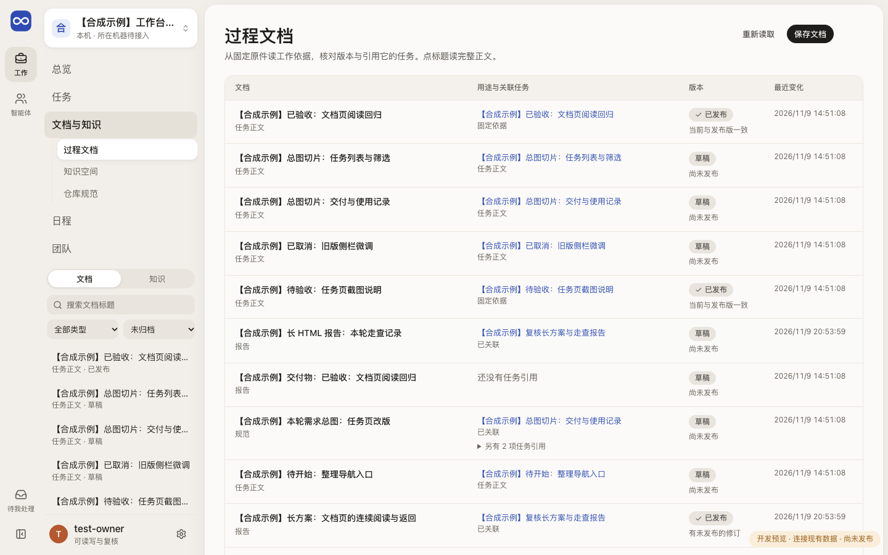
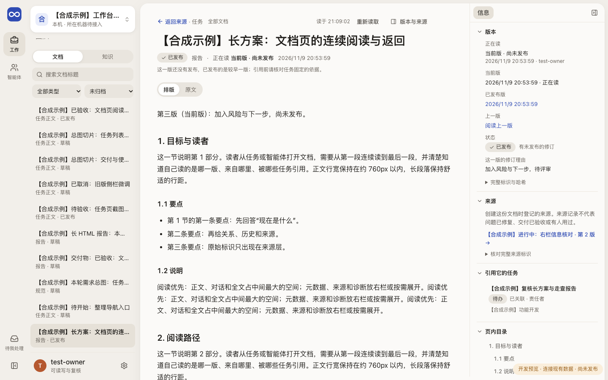
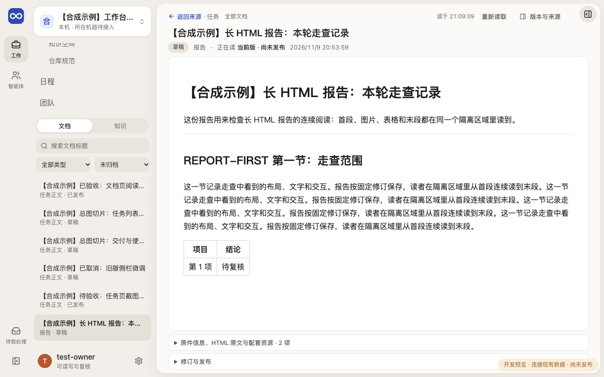
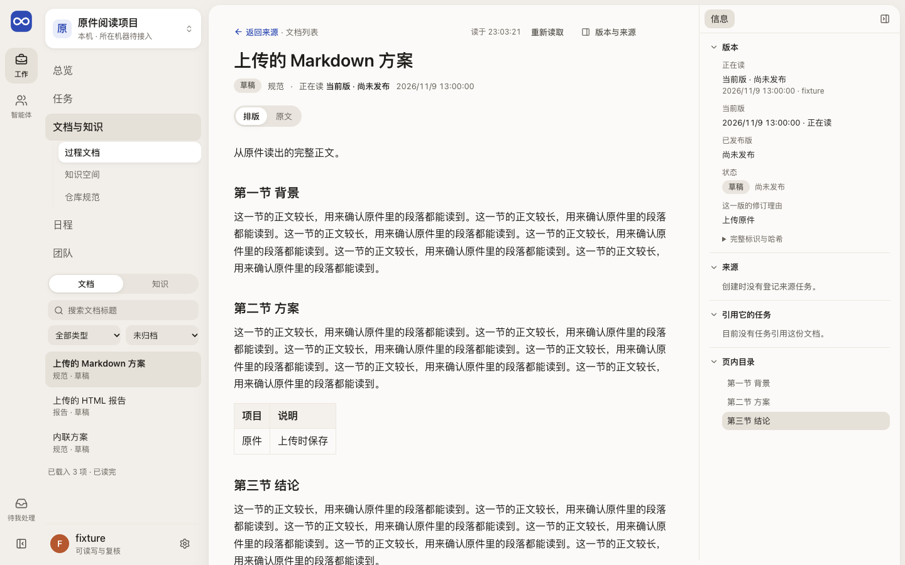
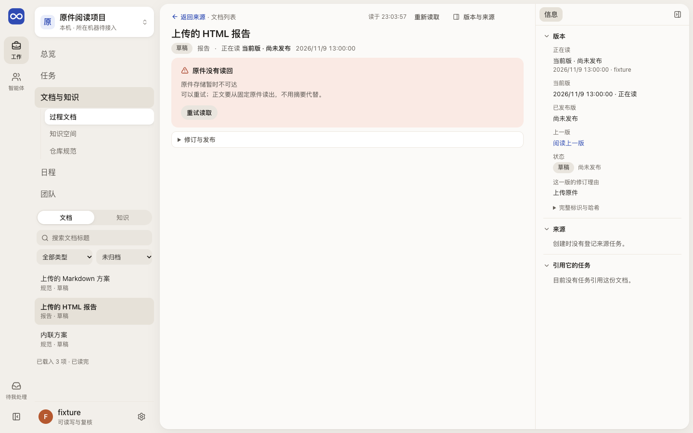

# 过程文档：读完整原件，知道工作用了哪一版

这一页帮人找到一份过程文档，从头读到尾，并知道读的是哪一版、来自哪里、被哪些任务使用。

## 这一页回答什么

- 这项工作的完整说明、方案或报告在哪里？
- 我读的是哪一版，和当前版、已发布版是什么关系？
- 它来自哪项任务，又被哪些任务引用？
- 出了新版，哪些工作要复核？

## 布局

| 位置 | 放什么（目标） |
| --- | --- |
| 左栏 | 文档目录与列表，每行一个标题和状态；可按用途、状态筛选和搜索 |
| 中间 | 所选文档的全文，Markdown 和 HTML 都从首段连续读到末段；未选文档时显示文档表格 |
| 右栏 | 版本（正在读、当前版、已发布版）、来源、关联任务；可收起 |

现状（#229 PR8）：已按上表实现。内层栏可切换“文档 / 知识”，带搜索、类型和状态筛选，打开的文档高亮，并写明载入范围；内层栏不在屏上时，搜索和筛选移到表格上方。没选文档时中间是四列文档表格。选中后是全文：Markdown 可切换排版和原文；HTML 报告在隔离区域里占满页头以下，原件、HTML 原文和资源收在区域下方。右栏依次是版本、来源、引用它的任务（点开在右栏查看，正文不动）和页内目录。固定历史链接停在原修订，提示一直可见并给“查看当前版”。返回时保留来源、筛选、载入范围和刚打开的那一行（从表格或内层栏打开都算）。“修订与发布”仍用旧表单，折叠在正文下方；HTML 原件读取中、读取失败或不可用时，它仍留在区域下方，可以上传修正版或归档。

上传或导入的 Markdown 只存原件，正文从原件读出，页内目录照常可用。固定修订和原件只读一次，写入后不重读。

## 内容与状态

共同规则见[设计原则](../principles.md)。

### 从表格打开完整过程文档

- 过程文档用表格逐行查阅，点标题读完整正文（[DEC-024](../../decisions.md)）；卡片摘要不代替列表和全文。
- 标题支持键盘打开；行内的任务链接单独跳转。
- 搜索、筛选和分页写明覆盖范围；从全文返回时保留原条件和位置。
- 窄屏时表格横向滚动或收起次要列，标题和打开入口始终可读。

| 格式 | 怎样读 | 怎样保存 |
| --- | --- | --- |
| Markdown | 排版后的完整正文，可切回原文；保留标题、列表、表格、代码块和附件引用 | 保存原文和固定修订，渲染结果可重建 |
| HTML 报告 | 在隔离区域保留原排版、样式和已保存的图片、图表；可查看 HTML 原文 | 原件和所需资源一起保存，绑定同一修订；单文件报告也适用 |

HTML 报告直接作为过程文档保存，脚本不执行，默认静态阅读；交互能力单独验证后再开放。未保存的外部资源列为缺项，这时不称“完整报告”。实现边界见[前端架构](../architecture.md#过程文档表格与完整阅读)。

### 版本与状态

- 草稿、已发布、已归档是生命周期；正在读的固定版、当前版、已发布版分开标明，读旧版时提示一直可见。
- 从任务的固定依据进入时保持那一版。
- 任务主正文只从任务修改，文档页只读并链到所属任务。
- 普通文档修订保留读入时的版本和草稿，冲突时先比较。
- 原件缺失、无权限、服务不可达分别说明原因；摘要不代替原件。Markdown 正文只存在原件里时，读取中、读取失败、原件不可用也分别说明。
- “影响哪些工作”尚未实现：从新版逐项看引用旧版的任务及处理理由，规则见[需求纠正](../../product/daily-loop.md#需求纠正怎样处理)。

### 过程文档和仓库正式文档的关系

三类正文各有入口：过程文档记这次工作的讨论和决定，仓库正式文档（“仓库规范”）存已采纳的规则，知识空间读当前认识。来源可以往返，各自的正文和修订保持独立。权威归属见[对象关系](../../product/workbench.md#对象关系与能力职责)。

“整理到仓库文档”尚未实现。目标是：核对来源固定修订、成立与未决部分、目标路径和候选差异；完成后能从来源查到实际 commit，构建、部署、采用分别显示，不改也留理由。流程见[项目数据](../../architecture/project-data.md#6-工作文档怎样沉淀为仓库正式文档)。

## 截图

2026-11-09，#229 PR8 分支，测试实例的合成数据。

1440×900，未选文档：内层栏是文档列表，中间是文档表格。

1440×900，从任务打开的 Markdown：页首有返回来源和正在读的版本，右栏依次是版本、来源、引用它的任务和页内目录。

1280×800，HTML 报告：右栏默认收起，隔离区域占满页头以下，在内部从首段滚到末段。

390×844：内层栏和右栏都收进抽屉，“版本与来源”从底部升起。

下面三张来自 PR8 修复的浏览器用例，合成数据。

1440×900，上传的 Markdown：正文从原件读出，右栏的页内目录列出各节。

390×844，同一份上传的 Markdown。

1440×900，HTML 原件没有读回：说明原因并可重试，“修订与发布”仍在下方。

## 代码与测试

源码在 `apps/workbench/src/features/documents/`，测试在 `apps/workbench/test/`。

| 部分 | 主要源码 | 相关测试 |
| --- | --- | --- |
| 列表与表格 | `DocumentIndex.tsx`、`DocumentRail.tsx`、`DocumentTable.tsx`、`DocumentFilters.tsx`、`useDocumentList.ts`、`documentListState.ts`、`documentListModel.ts`、`apps/workbench/src/shared/leaderWorkLoad.ts`（用途与关联补读） | `document-list-model.test.ts`、`document-presentation.test.ts`、`discovery-browser.test.ts`、`leader-work-load.test.ts`、`document-original-reading-browser.test.ts`（从内层栏打开后返回的焦点、行悬停） |
| 阅读页与右栏 | `DocumentPage.tsx`、`DocumentFacts.tsx`、`DocumentOutline.tsx`、`TaskPeek.tsx`、`documentPresentation.ts`、`apps/workbench/src/shared/ui/MarkdownBody.tsx`、`apps/workbench/src/shared/ui/markdownContent.ts` | `document-presentation.test.ts`、`markdown-content.test.ts`、`document-original-reading-browser.test.ts` |
| HTML 原件与资源 | `HtmlReport.tsx`、`useOriginal.ts`（HTML 与只存原件的 Markdown 共用）、`apps/workbench/src/shared/ui/OriginalDocumentReader.tsx`（静态副本，任务页也用）、`apps/workbench/src/shared/ui/imagePreview.ts` | `document-full-html-reading-browser.test.ts`、`document-image-preview.test.ts`、`document-original-reading-browser.test.ts` |
| 读取与重读 | `useRereadOnReturn.ts`、`apps/workbench/src/shared/query.ts`（固定内容不随写入重读） | `query.test.ts`、`document-original-reading-browser.test.ts` |
| 来源与返回 | `DocumentOrigin.tsx`、`originValidation.ts`、`apps/workbench/src/shared/ui/returnRoute.ts` | `document-origin.test.ts`、`document-origin-refresh-browser.test.ts`、`session-document-return-browser.test.ts` |
| 保存与修订 | `DocumentRevise.tsx`、`UploadDocument.tsx` | 暂无专门测试 |

## 相关

- 产品：[Document 的用途、格式和状态](../../product/tasks-and-documents.md#document-的用途格式和状态)、[链接和改版](../../product/tasks-and-documents.md#链接和改版)
- 合同：[DocumentStore 与 RelationStore](../../architecture/contracts.md#2a-documentstore-与-relationstore)、[项目数据](../../architecture/project-data.md)、[存储设计](../../architecture/storage.md)
- 前端：[布局](../layout.md)、[设计原则](../principles.md)、[实景旅程：读固定成果并回到工作](../journeys/current-work.md#4-读固定成果并回到工作)
