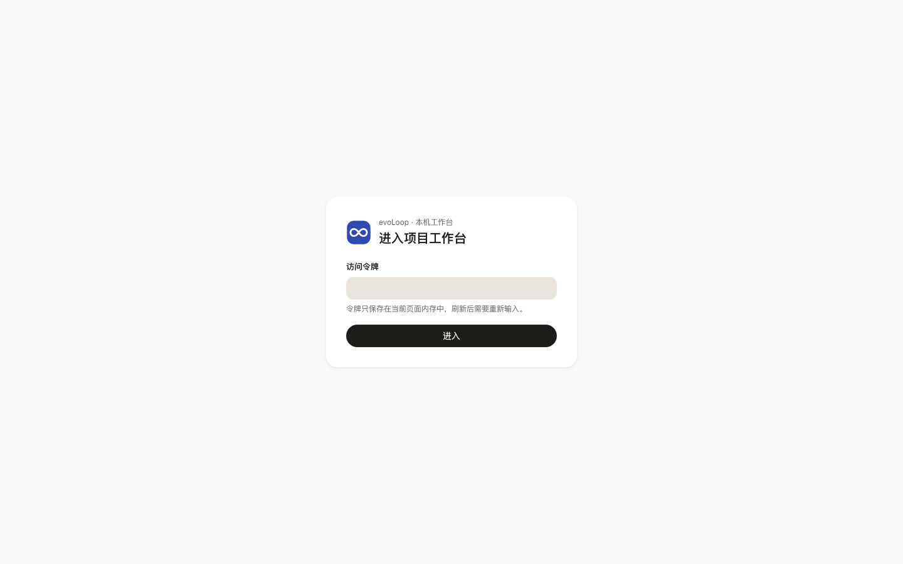
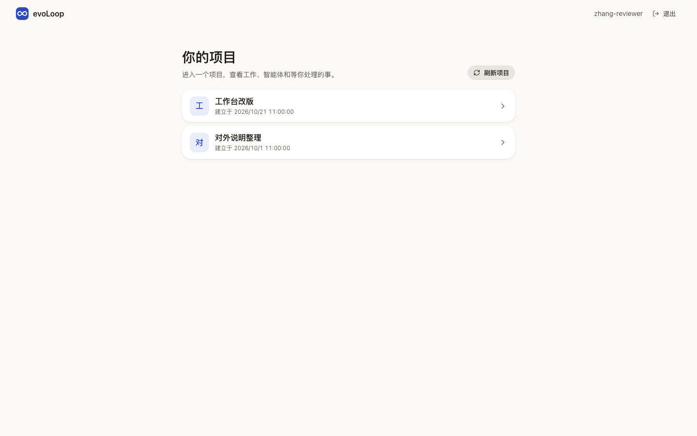
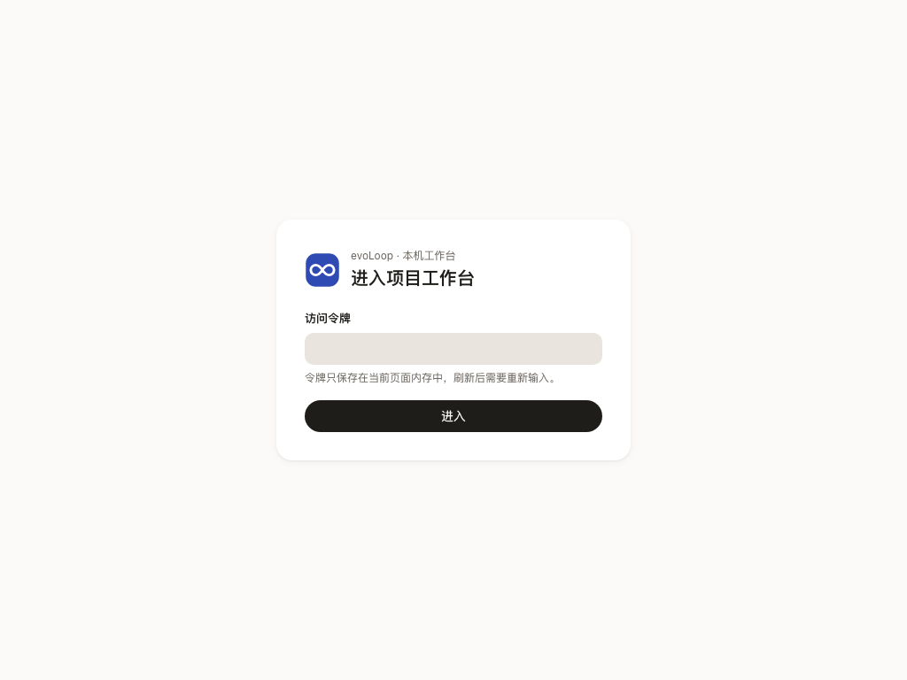
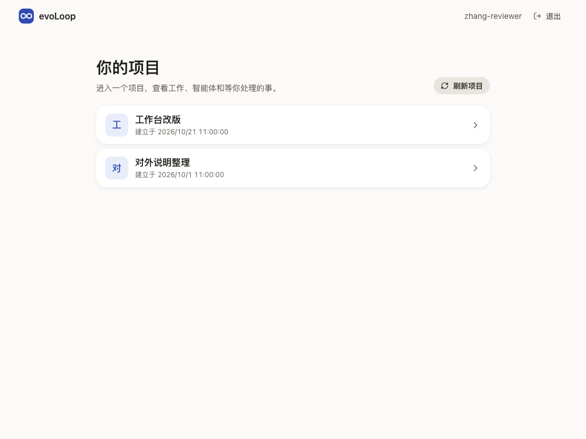
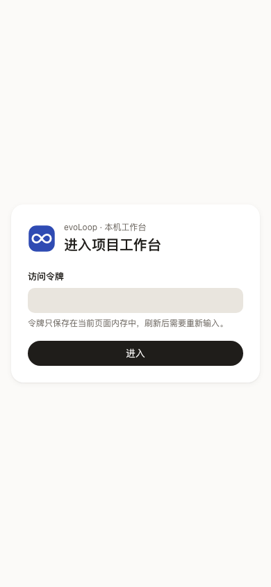
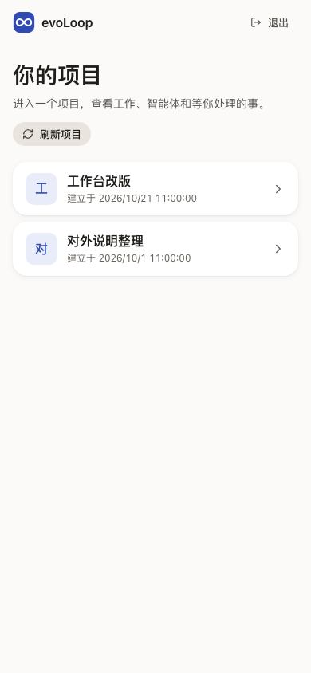

# 登录与项目列表：用哪个身份，进哪个项目

打开工作台先看到这两页，读者是每个要进入项目的人。登录门核对身份；项目列表列出这个身份有权读取的项目，并在进入前先让人核对结果未知的操作。两页都在外壳之外，没有双左栏和右栏。

## 这一页回答什么

- 我用什么方式登录，令牌保存在哪里？
- 我能进入哪些项目？有没有授权了、却读不到的项目？
- 进入项目之前，有没有结果未知的操作要先核对？

## 布局

| 页 | 区域 | 放什么 |
| --- | --- | --- |
| 登录门 | 居中卡片 | Logo 与“进入项目工作台”；本机模式是“访问令牌”和“进入”，Hub 模式是“重新检查登录”；登录失效、保存了回执时的提示 |
| 项目列表 | 顶栏 | Logo（回到项目列表）、身份名（窄屏不显示）、“退出” |
| 项目列表 | 中间单栏 | “你的项目”与“刷新项目”；操作结果提示；保存的回执逐条核对；项目行（名称、建立时间、待核对操作数）；读不到的授权项目各一张卡 |

登录门在首屏代码里，只引用组件库的 `Logo`，按钮和输入框直接写 token 对应的工具类，免得把组件库其余部分带进首屏（见[前端架构](../architecture.md#2-组件路由与查询模型)）。项目列表登录后才加载，用组件库。

## 内容与状态

通用的空、加载、失败、未知规则见[设计原则](../principles.md)。

- **登录**：本机模式的令牌只放在页面内存里，刷新后要重新输入。Hub 模式不要令牌，打开时用浏览器已有的登录核对一次，没登录写“尚未登录 Hub，或登录已过期。”核对中按钮写“正在核对…”，失败原因写成中文。
- **登录失效**：任何请求收到 401，就清空页面内容和草稿，回到登录门并写明“登录已失效，页面内容已清除”。地址保留，重新登录后回到原处。
- **读取项目**：首次读取写“正在读取你有权限的项目…”；重读时保留上次的列表，标“正在核对授权项目”。“刷新项目”先重读身份再重读列表，失败时写“刷新失败”和原因。
- **空与读不到分开**：身份没有任何项目授权时，才写“还没有可读取的项目”。有授权却读不回的项目不当作不存在：写明“可能尚未建立，也可能暂时读不到”，项目标识收在“完整标识（用于 CLI）”里，下面是“创建项目”表单；这个项目有未核对的回执时，表单暂停提交。
- **回执**：保存了结果未知的操作时，登录门提示用原身份登录后核对；项目列表在顶部逐条列出这个身份全部项目的回执，核对方式同[结果未知的操作](operations.md)，项目行写“N 项操作待核对”。
- **退出**：有未提交草稿或未确认回执时先确认。回执留在当前浏览器会话，用同一身份登录后还能核对。
- 按机器分组和在线状态等[多机器方案 #219](https://github.com/cyl19970726/evoLoop/issues/219)。

## 从哪里来，到哪里去

| 从 | 到 |
| --- | --- |
| 打开工作台；401 之后；退出之后 | 登录门 |
| 外层栏 Logo、内层栏顶部“切换项目”、账号菜单“切换项目”；打开无权读取的项目地址 | 项目列表。离开有草稿的项目前先确认；项目授权被收回时写“你已无权访问该项目，已回到项目列表” |
| 项目行 | 这个项目的 工作 › 任务 |

## 截图

由 `npm run docs:screenshots` 用合成夹具生成，怎样重新生成见[页面截图](../architecture.md#页面截图)。

## 代码与测试

| 范围 | 路径 |
| --- | --- |
| 源码（`apps/workbench/src/`） | `app/entry/AuthGate.tsx`（登录门、开发预览条）、`app/entry/ProjectChooser.tsx`（项目列表、创建项目）、`app/entry/OperationCheck.tsx`（一张回执的核对）；登录、401 与 403、退出和回执在 `app/App.tsx`；身份来源在 `shared/identity.ts` |
| 测试（`apps/workbench/test/`） | `entry-pages-browser.test.ts`、`identity-browser.test.ts`、`recovery.test.ts`、`bundle-budget.test.ts`（登录门留在首屏预算内） |

## 相关

- 架构：[会话与权限边界](../architecture.md#4-会话与权限边界)
- 场景：[进入与切换项目](../scenarios.md#十个场景)（场景 10）
- 前端：[项目设置](settings.md)、[结果未知的操作](operations.md)
