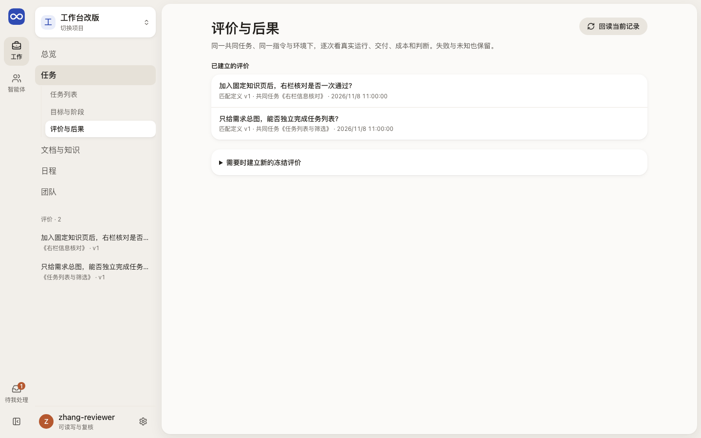
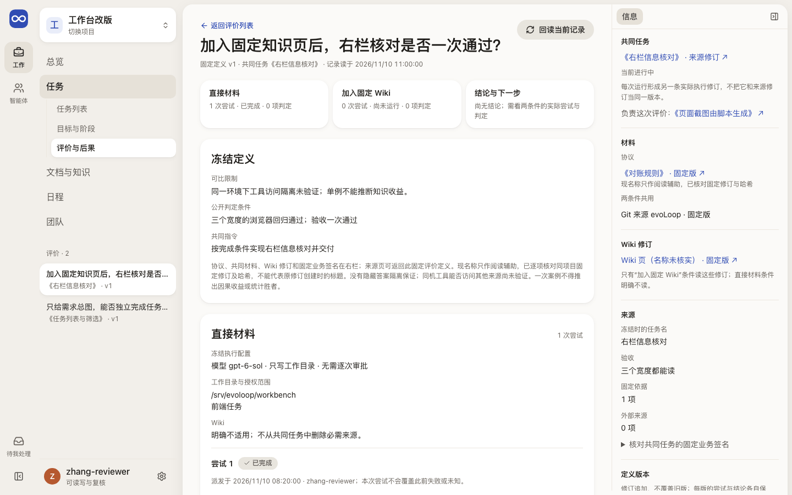
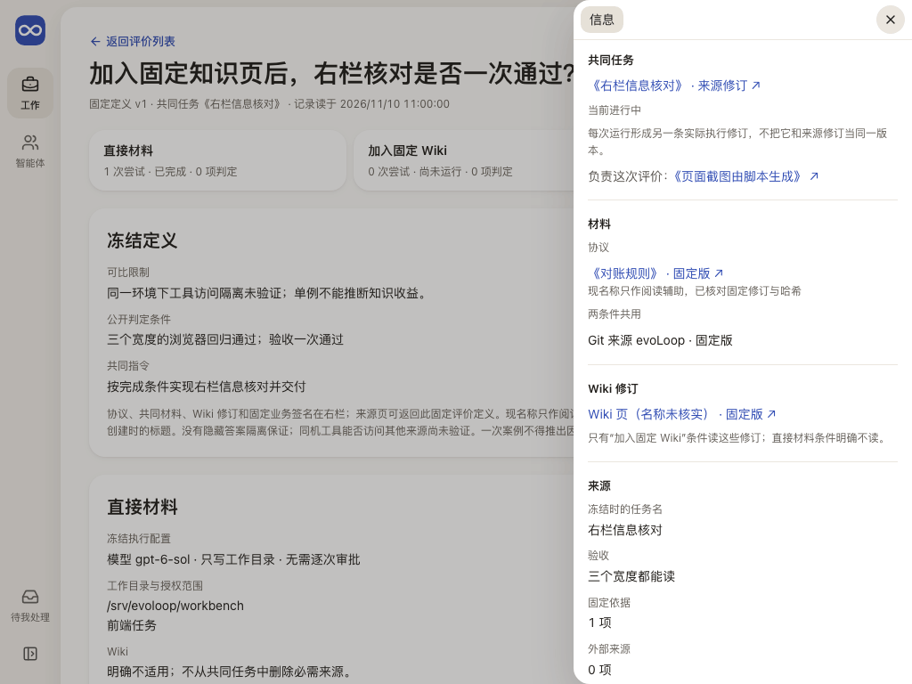
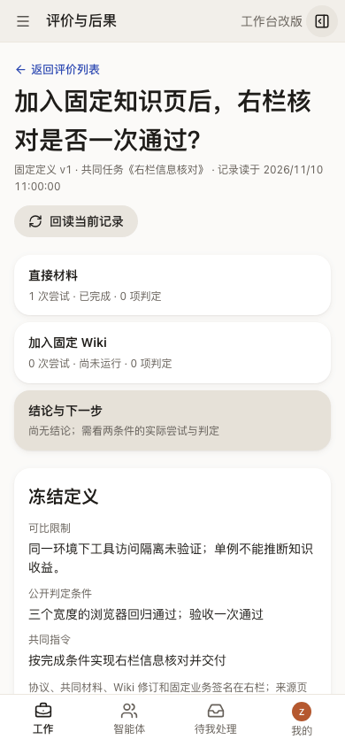

# 评价与后果：同一任务，两种条件，逐次看真实结果

评价页让人看一次冻结的比较：同一共同任务、同一指令与执行环境，只差“是否加入固定 Wiki”，每次真实运行交付了什么、用后怎样、花了多少、谁怎样判断，最后得出什么结论和下一步。

## 这一页回答什么

- 这次比较的问题、可比限制和公开判定条件是什么，冻结在哪一版定义？
- 两个条件各跑了几次，每次的运行结果、交付、使用记录、成本和判定是什么？失败和结果未知的尝试在哪里？
- 当前结论是什么，可比到什么程度，下一步选什么？
- 共同任务、协议、材料和 Wiki 用的是哪一版，能不能回到原件？

## 布局

| 栏 | 放什么 |
| --- | --- |
| 左栏（对象列表） | 评价目录：问题与共同任务名、定义版本；从任务或知识页进入时只列当前范围 |
| 中间 | 未选评价时是列表和“建立新的冻结评价”；选中后是概览（两个条件与结论各一行）、冻结定义、两个条件各自的逐次尝试与“派发下一次”、结论与下一步、另存定义 |
| 右栏（可收起） | 共同任务（来源修订、当前状态、负责任务）、材料、Wiki 修订、来源（固定业务签名）、定义版本、完整标识 |

外壳与左栏见[布局](../layout.md)。窄屏时左栏和右栏都是抽屉，只在用户要时打开。

现状（#229 PR9j）：上表已实现。表单是共同的[提交表单](../components.md#提交表单)：先保存恢复回执，结果未知时保留草稿并暂停本项目的其他写入，核对为已应用后清掉草稿。

## 内容与状态

通用的空、加载、失败、未知规则见[共同原则](../principles.md)。

- 运行终态 ≠ 产物合格 ≠ 真人后果。三者分开写，判定逐次署名；结论只留证，不自动采用知识或关闭任务。
- 失败、中断和结果未知的尝试都保留；结果未知时先沿同一运行核对，派发表单不会出现。
- 成本按判定里逐项登记的阶段和单位显示，另列运行自己报告的费用和用量；没登记的写“未记录，不视为零”。
- 运行、任务或评价没有读回时写“无法判断”，不写“没有尝试”“没有交付”“没有结论”；重读失败保留旧内容，标“上次读回，当前待核对”，写入暂停。
- 文档现名称只在核对了固定修订和哈希后显示；原始 ID 和哈希只在“完整标识”里展开。
- 建立或另存定义时，共同任务（只列进行中的）和负责任务按名称搜索选择；协议、材料选文档再选版本，Wiki 选页面再选版本，修订和哈希由页面读回后填入，界面只写名称和版本。列表里没有的来源（如 Git）可在“按完整标识添加”里写一行。发出的命令与原来手填标识和哈希时一样。
- 新定义统一采用完整本机权限、无需逐次审批；旧定义保留原权限，只供回读。

## 截图

由 `npm run docs:screenshots` 用合成夹具生成，怎样重新生成见[页面截图](../architecture.md#页面截图)。

评价列表的其他宽度：[390](../../assets/frontend-pages/evaluations-390.png)。

## 代码与测试

| 范围 | 路径 |
| --- | --- |
| 源码（`apps/workbench/src/`） | `features/evaluation/EvaluationPage.tsx`（列表、左栏、详情外框）、`features/evaluation/EvaluationDetail.tsx`（冻结定义、条件、结论、右栏）、`features/evaluation/Attempts.tsx`（逐次尝试、判定、派发）、`features/evaluation/DefinitionForm.tsx`、`features/evaluation/DefinitionPickers.tsx`（按名称选任务、文档与 Wiki 版本）、`features/evaluation/fixedRefChoice.ts`、`features/evaluation/formData.ts`、`features/evaluation/EvaluationForm.tsx`、`features/evaluation/evaluationReads.ts`、`features/evaluation/presentation.ts` |
| 测试（`apps/workbench/test/`） | `evaluation-presentation.test.ts`、`evaluation-definition-form.test.ts`（命令与原表单一致）、`evaluations-browser.test.ts` |

## 相关

- 产品：[可比验证如何开始](../../product/wiki-evaluation.md#可比验证如何开始)、[评价怎样改变产品](../../product/wiki-evaluation.md#评价怎样改变产品)
- 合同：[EvaluationRecord：评价证据与条件](../../architecture/contracts.md#6a-evaluationrecord评价证据与条件)
- 场景：[十个场景](../scenarios.md#十个场景)（第 9 个：评价改变下一步）
