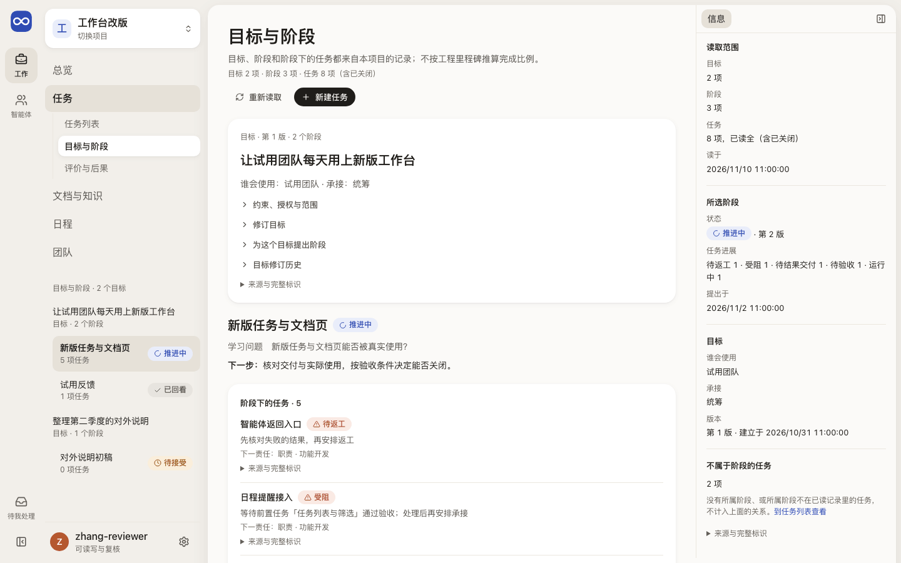
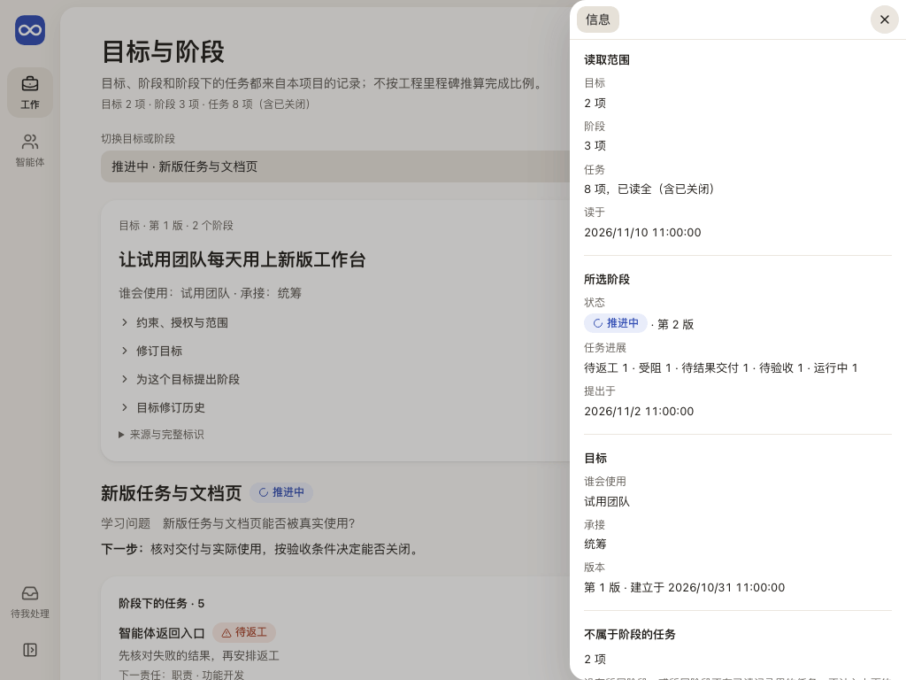
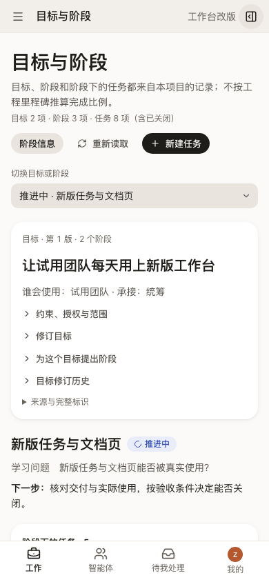

# 目标与阶段：目标分几步走，每一步做到哪里

这一页帮人看清项目目标分成了哪些阶段、每个阶段要交付什么和想弄清什么、阶段下的任务做到哪里，并在这里接受阶段、记录回看和建立所属任务。

## 这一页回答什么

- 项目有哪些目标，每个目标分成了哪些阶段，各阶段现在是待接受、推进中还是已回看？
- 这个阶段要交付什么、想弄清什么，下一步该做什么？
- 阶段下有哪些任务，各自卡在哪里、下一步由谁接？
- 阶段回看采用了什么、推翻了什么，下一选择是什么；有新证据时怎样纠正？

## 布局

| 位置 | 放什么 |
| --- | --- |
| 左栏（对象列表） | 目标，下面缩进列出它的阶段：交付、状态、所属任务数；所属目标没读到的阶段单列 |
| 中间 | 目标卡片（结果、使用者、承接，约束与授权可展开，修订目标、提出阶段、修订历史）→ 所选阶段（交付、学习问题、下一步）→ 阶段下的任务 → 接受或回看 → 回看记录 → 阶段修订历史；底部可建立新目标 |
| 右栏（可收起） | 读取范围（目标、阶段、任务各读了多少、读于何时）、所选阶段的状态与任务进展计数、目标的使用者与承接、不属于阶段的任务数、完整标识 |

页头的“新建任务”打开 `?action=propose`：中间换成[新建任务](tasks.md#新建任务)，所属阶段默认是正在看的推进中阶段，左栏仍是目标与阶段。窄于 1100px 时右栏用“阶段信息”打开，中间另有“切换目标或阶段”的下拉。

## 内容与状态

共同规则见[设计原则](../principles.md)。本页要分清的事实：

- **阶段来自记录**：目标、阶段和任务都读自本项目，不按工程里程碑推算完成比例。默认打开第一个推进中的阶段；地址里的 `stage` 或 `goal` 记住所选对象。
- **阶段下的任务**：按任务最新提议里的阶段归属，已关闭的也列出。每项写进展状态、按阶段写成中文的下一步（受阻时写出卡住它的前置任务、待复核依据或队列暂停）和下一责任（如“职责 · 开发职责”）；服务端写给智能体的下一动作原文和任务标识收在“来源与完整标识”里。
- **阶段的下一步**按阶段状态和所属任务的进展推出：待接受先接受；有结果未知的先核对；有待验收的先核对交付与使用；全部结束后记录回看。
- **读取中与失败**：首次读取用占位；任务读不回时写“阶段下的任务暂不可读取，这不表示阶段没有任务”，下一步写“暂不能判断”。重新读取时旧内容保留并标“正在核对”；失败时标“上次读回，当前待核对”，回看的最新一条写“上次读回的判断”。任务只读了一部分时，不说“没有所属任务”或“都已结束”。阶段读不回时目标照常显示，但不写阶段数和“还没有阶段”，不属于阶段的任务也写“无法判断”。
- **写入**：建立和修订目标、提出阶段要写入权限；接受阶段、记录回看、追加纠正要审阅权限。目标与阶段正在核对或没读回时提交暂停。
- **草稿与版本**：草稿连同写下它时看到的版本留在页面里，切换目标或阶段、离开再回来、重新读取都不丢。版本已变（切回时发现，或保存时服务端答复版本冲突）就先重新读取，再请人选“保留草稿，按最新版本核对”或“用最新内容重填”，选之前不能提交。
- **纠正回看**：只针对读回的最新一条，草稿按所纠正的那条分开保存；那条被新的纠正替代后，旧草稿不会填进新表单，只提示可以带入。旧判断保留在回看记录里，标“已被后续回看替代”。

## 截图

由 `npm run docs:screenshots` 用合成夹具生成，怎样重新生成见[页面截图](../architecture.md#页面截图)。

## 代码与测试

源码在 `apps/workbench/src/features/workflow/`，测试在 `apps/workbench/test/`。

| 部分 | 主要源码 | 相关测试 |
| --- | --- | --- |
| 页面、左栏、右栏 | `features/workflow/JourneyPage.tsx`；任务的下一步与下一责任在 `apps/workbench/src/shared/workPresentation.ts`，名称在 `apps/workbench/src/shared/ui/RecordName.tsx` | `journey-browser.test.ts` |
| 阶段状态、下一步、任务归属、回看先后 | `features/workflow/journeyPresentation.ts` | `journey-presentation.test.ts` |
| 读取 | `features/workflow/journeyRead.ts` | `journey-browser.test.ts` |
| 目标与阶段的写入、草稿与版本 | `features/workflow/JourneyForms.tsx`、`features/workflow/useCommand.ts` | `journey-drafts.test.ts`、`journey-browser.test.ts` |
| 新建任务 | `features/workflow/CreateTaskPage.tsx`、`features/workflow/taskCreate.ts` | `task-create.test.ts`、`journey-browser.test.ts` |

## 相关

- 产品：[从一个目标走到第一次有效交付](../../product/definition.md#从一个目标走到第一次有效交付)、[提议怎样变成任务](../../product/daily-loop.md#一条提议怎样变成可做的任务)
- 合同：[阶段回看](../../architecture/contracts.md#6-stagereview从交付到下一阶段)
- 前端：[布局](../layout.md)、[项目总览](overview.md)、[任务](tasks.md)
