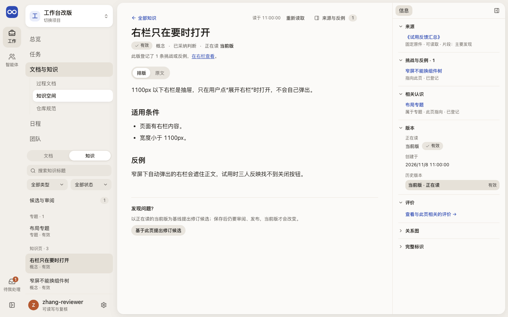
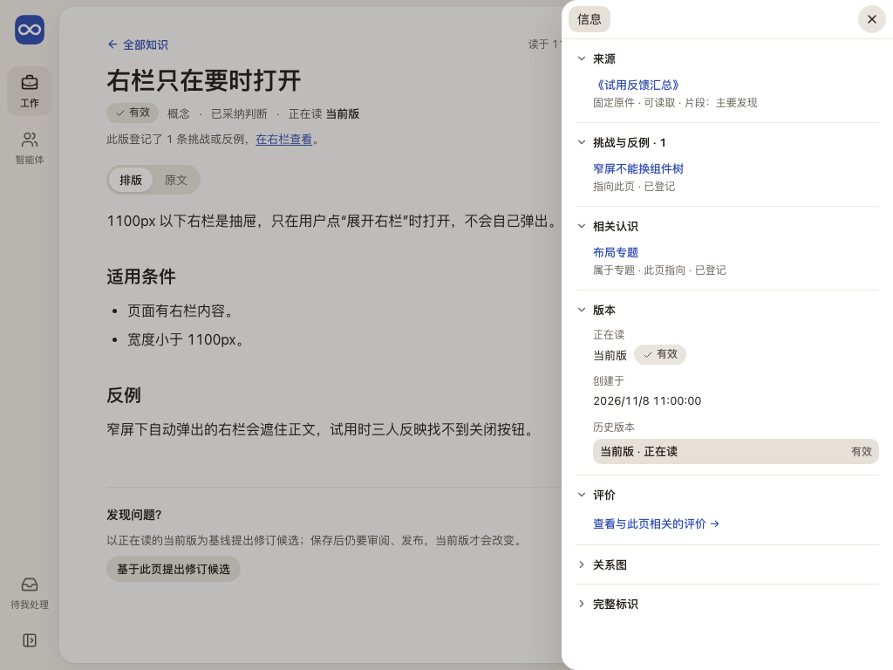

# 知识空间：理解认识、来源和反例

知识空间让人不经任务也能主动浏览当前认识，沿完整正文和来源判断它是否适用，并留下可追的反例。

## 这一页回答什么

- 这个问题当前有哪些认识，在什么条件下适用？
- 这条认识依据哪些来源，有没有挑战或反例？
- 我读的是哪一版，和当前版有什么不同？
- 发现错误后怎样提交纠正，之后正文改了没有、谁用上了？

## 布局

| 栏 | 放什么 |
| --- | --- |
| 内层栏 | “文档 / 知识”切换；搜索、页面类型和有效状态筛选；“候选与审阅”入口（带待审数）；专题目录（专题在前，打开的专题下列出成员），其余知识页；载入范围和“载入更多” |
| 中间 | 未选页：服务状态、降级时“此时仍可做什么”和目录。选中页：标题、三组标签、所读版本与当前版、完整正文（排版 / 原文）、“基于此页提出修订候选”。另有“候选与审阅”（带“重新读取”）“提出候选”两个视图。从别处打开时页首写回到哪里（“返回任务：<名称>”“返回文档列表”等，`shared/ui/ReturnLink.tsx`） |
| 右栏 | 来源 → 挑战与反例 → 相关认识 → 版本（含历史版本）→ 评价 → 关系图（默认收起）→ 完整标识（默认收起）；候选视图是候选的来源、拟议关系和基线 |

外壳见[布局](../layout.md)。页标题和外壳导航都叫“知识空间”。

现状（#229 PR9i）：已按上表实现。1100–1439 宽度右栏默认收起，中间有“来源与反例”按钮（带反例数）；窄屏右栏是抽屉，只在点这个按钮时打开。内层栏不在屏上时，切换和筛选移到中间。切换页面时右栏保留上一页并标“正在读取”，栏宽不变；在右栏点历史版本，焦点留在原链接，点关系后焦点不丢到页面。尚未实现：按适用范围筛选（还没有结构化字段）、最近修订（列表没有时间）、关系图单独展开页。

### 知识空间是完整的阅读入口

- 不经 Task 也能进入：从专题找到认识，读完整页面，核对原始来源，沿相关认识继续，有问题就提交纠正。
- 组织方式借鉴 [nashsu/llm_wiki 固定版](../../research/nashsu-llm-wiki/feature-workflows.md#24-人阅读编辑图谱与洞察)。正文与修订的权威仍是外置 Wiki，见 [Wiki 工作台](../../architecture/wiki-workspace.md)。

## 内容与状态

通用规则见[共同原则](../principles.md)。

- 三组标签分开：页面类型、认识性质、有效状态，不合成一个“可信”分（见 [Wiki 工作台](../../architecture/wiki-workspace.md#1-浏览对象和屏幕)）。
- 固定版本链接停在原版本，提示一直可见并给“阅读当前版”；当前版没读回时写“当前版待核对”，不拿当前版代替。历史版本按位置称呼，不显示版本号。
- 来源逐条写原件、状态和片段。没有登记来源或来源已撤回时标“正文待复核”；来源暂不可读时写“正文是否仍有依据无法判断”。“此版未登记挑战关系” ≠ 没有反例。
- 知识 ID、版本号、哈希、候选和操作标识只在“完整标识”里；服务能力写成中文，放在“服务与读取范围”里。服务报错写成中文，原文在“诊断信息”里。
- 列表写明已载入多少、后续是否未读；筛选只作用于已载入的页。“载入更多”只读下一页。读取中或失败时不说“没有”。
- 读取失败分三种说：从没读到过（不说“上次读回”）、重读失败（标“上次读回，当前待核对”，右栏同样标）、下一页没读到（已载入的照常可看，只重试这一页）。
- 候选、审阅、发布分开：接受只记录决定；发布和撤回来源要二次确认。结果未知时保留操作回执，按原操作核对，核对前不能再发布或撤回。撤回的核对结果不说“发布”。
- 服务不可达或固定正文未接通时，列表改称“可核对的固定引用”，并写明此时仍可做什么。项目没配置知识后端时写“知识后端未配置”，不提示重试；“提出候选”在入口处写“知识后端未配置，暂时不能提出”且不可点。
- 可选来源没读回时，提出候选写“没有读回”，不说“没有来源”。

## 截图

由 `npm run docs:screenshots` 用合成夹具生成，怎样重新生成见[页面截图](../architecture.md#页面截图)。

## 代码与测试

源码在 `apps/workbench/src/features/knowledge/`，页面入口在 `app/App.tsx`。

| 部分 | 主要源码 | 相关测试 |
| --- | --- | --- |
| 页面与写操作 | `KnowledgePanel.tsx`、`knowledgeReceipts.ts`、`availability.ts` | `knowledge-browser.test.ts`、`knowledge-availability.test.ts` |
| 读取 | `knowledgeData.ts`（`useProjectQuery`、逐页读取的 `useProjectList`）、`knowledgeRead.ts`、`apps/workbench/src/shared/knowledgeClient.ts` | `knowledge-read.test.ts`、`query.test.ts` |
| 内层栏 | `KnowledgeRail.tsx` | `knowledge-presentation.test.ts`、`knowledge-browser.test.ts` |
| 阅读与右栏 | `KnowledgeReader.tsx`、`KnowledgeFacts.tsx`、`KnowledgeGraph.tsx`、`apps/workbench/src/shared/ui/MarkdownBody.tsx`（正文，排版取自 `readingProse`）、`apps/workbench/src/shared/ui/readingProse.ts` | `knowledge-browser.test.ts` |
| 候选、审阅、发布、撤回 | `KnowledgeReview.tsx`、`KnowledgeCompose.tsx` | `knowledge-browser.test.ts` |
| 用语与路由 | `knowledgePresentation.ts`、`knowledgeRoute.ts` | `knowledge-presentation.test.ts`、`knowledge-route.test.ts` |

## 相关

- 产品：[对象关系与能力职责](../../product/workbench.md#对象关系与能力职责)、[一页认识最低应表达什么](../../product/wiki-evaluation.md#一页认识最低应表达什么)
- 架构：[Wiki 工作台](../../architecture/wiki-workspace.md)、[命令、发布和纠正](../../architecture/wiki-integration.md#4-命令发布和纠正)、[Wiki 维护机制](../../architecture/wiki-maintenance.md)、[知识关联](../../architecture/knowledge-flow.md)
