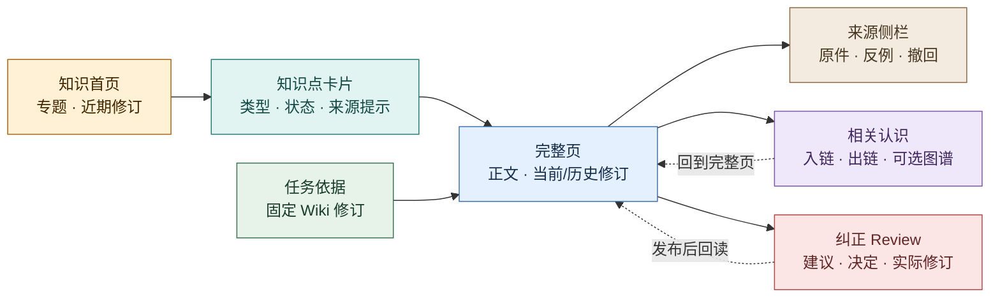

# 知识空间：理解认识、来源和反例

2026-10-30 · 页面目标与阅读合同。允许不经Task主动浏览，沿完整正文和来源判断认识是否适用，并留下可追的反例。

本页承接认识进入行动、使用失败触发纠正，以及组织方法改进中的知识回看，产品理由及整段验收仍见[工作台产品目标](../../product/workbench.md)。实现能力和实际使用范围分别沿[阶段路线](../../roadmap.md#当前基线)核对；方案、源码、候选体验和已部署不互相代替。共用导航、状态、权限缺项及响应方式见[体验架构](../experience.md)与[设计系统](../design-system.md)。

## 首先看到什么

先给知识后端的实际可读状态、最后核对时间和范围，再呈专题、最近修订与需回看的争议。卡片给问题/主张、适用条件、版本、来源可核对性和反例提示；只有已登记引用而无正文时，明确它是引用，不是全文或完整知识库。

详情以完整原文、所读修订及适用条件为主，支持与挑战来源按需展开。Task引用先读其固定版，当前版另有入口；图谱辅助发现，任何边回到文字关系和原件，不能由相关性或图规模推出认识正确。

## 知识空间是完整的阅读入口

借鉴[nashsu/llm_wiki 固定版的阅读、知识树、来源/Related、图谱与 Review 研究](../../research/nashsu-llm-wiki/feature-workflows.md#24-人阅读编辑图谱与洞察)：让人先按主题找到认识，再读完整页面和原始依据，沿关系继续探索，最后有明确的纠错入口。借鉴的是信息组织与交互，不把它的 React/Zustand/Tauri 摄入实现、页级来源字段或图相关性分数直接当作 evoLoop 的知识正确性机制；外置 Wiki 仍是正文与修订权威。[Wiki 工作区架构](../../architecture/wiki-workspace.md)负责可用读取、权限和修订映射。

| 阅读层 | 具体呈现与动作 |
| --- | --- |
| **知识首页与专题目录** | 当前项目的专题树/列表、主题说明、最近修订、待回看争议和关联阶段目标。用户可按专题、知识类型、适用范围、修订状态筛选，并从“继续阅读”回到先前所看修订；专题是导航，不自动表示已有共识。 |
| **知识点卡片** | 标题、一句话主张或问题、类型、适用条件、当前修订与更新时间、来源可核对性、反例/争议提示、关联任务/需求数。卡片点击进入完整页；它是外置 Wiki 某一可追溯修订的阅读视图，不另存可编辑的“社区帖子”，不能靠卡片文字代替原文。 |
| **完整页与来源侧栏** | 正文按原有段落、标题、引用与图表阅读；侧栏逐条列支持和挑战来源的身份、观察版本、权限与撤回状态，点击可核对原件。无来源、来源不可达或被撤回时显式提示正文待复核；不把编号存在当作主张已获支持。 |
| **相关认识与可选图谱** | 页内显示入链与出链、关系类型和所指修订，可从 A 到 B 再返回 A；相关认识包括支持、挑战、限定、取代和同主题。图谱可作为按主题缩放的辅助探索，节点点击回完整页、边可追来源；布局、社区或相似度只是找线索，不是正确性评分。首期先保证文字关系可用。 |
| **版本变化与纠正 Review** | 当前修订与历史版并排比较，标出改变的主张、原因、来源和受影响任务/需求。任何有权限者可提交具体反例、原件位置和预期修正；Review 区分待判断、需补证、已决定、修订已发布、后续消费者已采用。审阅结案须有决定与理由；拒绝、重复归并或确认无需修改可以结案。接受且需改正文的候选，另以发布回执和固定修订证明修改完成，不能用结案冒充正文已改。 |

知识卡片区分三个维度：页面类型（概念、方法、专题等）、认识性质（观察、解释、假设、已采纳决定或争议）与有效状态（当前、待复核、已取代、已撤回）。观察须写时间和来源；解释保留提出者、依据与反例；假设写可证伪条件；决定写权限、范围及取代条件；争议并列解释与下一次复核条件。同页可有多种性质的段落；已发布不代表每条主张已被证实，首期不承诺自动抽取和裁决逐条 claim。

图例：黄＝主动探索，青＝卡片，蓝＝全文，棕＝来源，紫＝关联，红＝纠错，绿＝任务固定引用。项目首页提供有来源的方向与任务讨论入口；浏览知识空间可以独立发生，发现的新观点按来源提交候选认识，形成任务仍须核当前授权与创建、开始条件。

## 纠正、未知与验证

反例说明原件位置、观察、挑战的主张和预期修正，提交后显示候选与下一责任。建议已登记、Review已决定、正文已发布、后续已采用和有效各自留证；确认无需改也可有据结束。评价从知识或阶段回看进入逐case材料/产物/采用/亲用/成本，缺数据保持未知。

后端不可达时显示已有固定引用、失败范围和重读入口，不造正文、来源或成功提交。固定版读取失败也不以当前版代替。验证从首页找专题、核一条支持与一条挑战来源、提交有权反例后回看正文是否变化和下游是否采用；声明服务故障时的未验分支。
