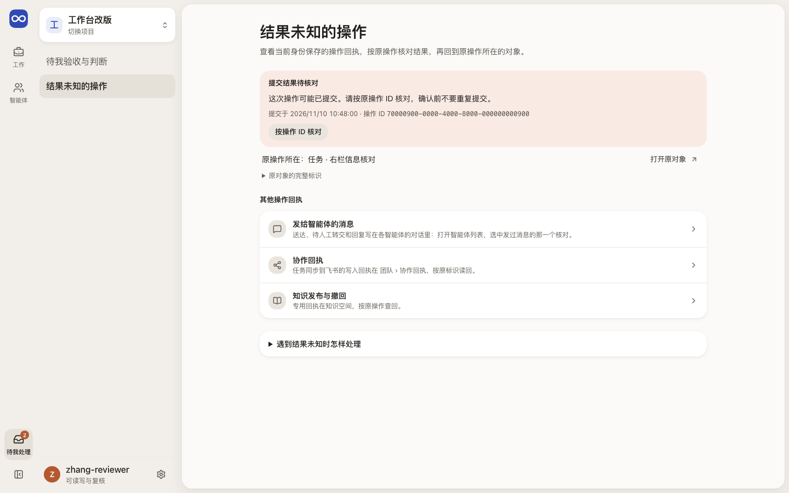
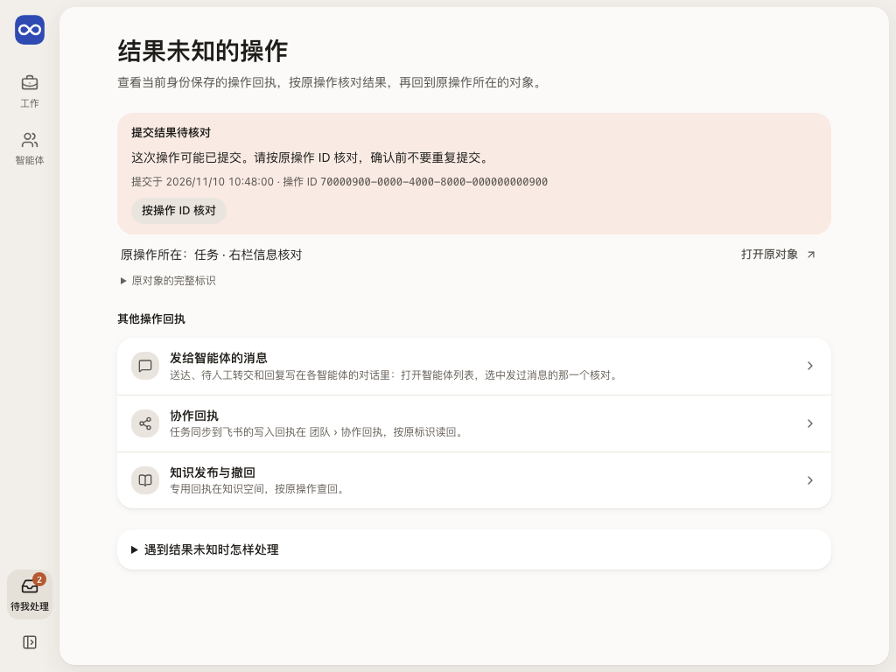
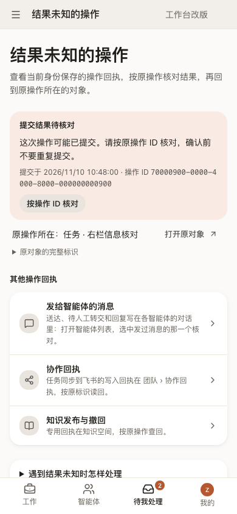

# 结果未知的操作：哪次提交结果未知，怎样按原操作查回

一次写入发出后没收到可靠答复（断网、超时、服务重启）时，工作台不把它当成功，也不当失败，而是在浏览器会话里保存一张回执，等人按原操作 ID 查回。本页列出当前身份在这个项目里保存的回执，读者是做了这次提交的人。

## 这一页回答什么

- 哪次提交的结果还不知道，什么时候提交的，原操作 ID 是什么？
- 查回的结果是什么：已应用、被拒绝，还是仍查不到？
- 查不到时能不能按原 ID 和原内容重试，什么时候只能去 CLI 核对？
- 原操作是在哪个对象上做的，核清后怎样回去看它现在的样子？

## 布局

| 区域 | 放什么 |
| --- | --- |
| 内层栏 | 待我处理的两项：待我验收与判断、结果未知的操作（高亮） |
| 中间（单栏） | 页首；每张回执一张“提交结果待核对”卡：当前结论、提交时间与操作 ID、“按操作 ID 核对”，能重试时再给“按原 ID 和原内容重试”；卡下一行写原操作所在的对象和“打开原对象”；没有回执时是空状态；“其他操作回执”三个入口；折叠的“遇到结果未知时怎样处理” |
| 右栏 | 没有 |

页首标题、导航、窄屏顶栏和账号菜单都写“结果未知的操作”。

## 内容与状态

规则来自[设计原则](../principles.md)第 9 条和[提交表单](../components.md#提交表单)。

- **回执里有什么**：身份、项目、对象、原操作 ID、命令类型、提交时间和命令摘要（SHA-256），存在浏览器会话存储里，不含令牌和提交正文。原命令正文只留在页面内存，刷新或退出后就没有了。
- **有回执时**：这个项目的写入全部暂停；其他页面顶部写“N 项操作结果尚未确认，提交已暂缓。”并链到本页；“待我处理”和账号菜单的计数包含回执；关闭、刷新页面或退出前先确认。浏览器存不下回执时，这次写入不发出，并提示保留原操作 ID。
- **核对**：按原 ID 读回操作记录，身份、项目、类型、ID 和命令摘要都一致才确认。确认后回执消失，顶部写“已应用；正在回读当前数据”，或“被拒绝”和中文原因，各页重读。文档上传、来源登记这类专用接口没有命令摘要，只核到同身份、同项目、同类型、同 ID，提示里写明没有核对正文。
- **没核清**：记录与摘要不一致、页面已没有原命令无法比对、读取失败，都保留回执并写明原因，不据此确认或重发。
- **查不到**：查不到不能证明没提交。页面内存里还有原命令时，才出现“按原 ID 和原内容重试”，用同一个操作 ID 重发；没有原命令时只能继续核对，或用原身份在 CLI 处理。任何时候都不换新 ID 重发。
- **原对象**：回执只存一个对象 ID，按命令类型判断是任务、文档、目标、阶段还是分工讨论，读回它的名称写成“原操作所在：任务 · 名称”。读不到（404）时写“在本项目里读不到”，并提醒新建操作的对象可能还没建立，不给链接；读取失败写“暂时读不到”，仍给最可能的链接。回执只存了项目 ID 时（如发给智能体的消息），写“没有记下是哪个智能体”，链到智能体列表。对象 ID 和命令类型只在“原对象的完整标识”里。
- **打开与返回**：链接带上返回本页的参数（`return`、当前身份 `actor`、`returnTitle`，和任务页、智能体页读的返回参数同名）；文档页把它显示为“返回来源”，任务、目标与阶段、分工讨论页现在还不认这个去处，用浏览器返回。
- **空状态**：写“没有结果未知的操作”，并说明这里只列当前身份保存的回执，不代表项目里没有结果未知的事。消息、飞书协作和知识发布各有回执，放在“其他操作回执”里：消息的送达和待人工转交写在各智能体的对话里，链到智能体列表。
- 回执的核对和[项目列表](entry.md)顶部的是同一个组件；项目列表列出这个身份全部项目的回执，本页只列当前项目的。

## 从哪里来，到哪里去

| 从 | 到 |
| --- | --- |
| 待我处理 › 结果未知的操作；账号菜单“结果未知的操作”（带计数）；其他页顶部提示的“按原操作 ID 核对”；项目设置“结果未知的操作” | 每张回执的“打开原对象”（带返回参数）或所在区域；空状态的“返回当前工作”；“发给智能体的消息”→ 智能体列表；“协作回执”→ 团队 › 协作回执；“知识发布与撤回”→ 知识空间 |

## 截图

由 `npm run docs:screenshots` 用合成夹具生成（夹具预先在浏览器会话里放了一张回执），怎样重新生成见[页面截图](../architecture.md#页面截图)。

## 代码与测试

| 范围 | 路径 |
| --- | --- |
| 源码（`apps/workbench/src/`） | `features/settings/OperationsPage.tsx`（页面、读回原对象名称与空状态）、`features/settings/operationsPresentation.ts`（按命令类型判断原对象、链接与返回参数、说明文字）、`app/entry/OperationCheck.tsx`（核对与同 ID 重试）、`app/recovery.ts`（回执存取）、`app/recoveryIntent.ts`（原命令、摘要比对与能否重试）；保存回执、暂停写入和顶部提示在 `app/App.tsx`，它把本项目的每张回执连同核对卡一起交给本页 |
| 测试（`apps/workbench/test/`） | `operations-presentation.test.ts`、`recovery.test.ts`、`recovery-intent.test.ts`、`use-command.test.ts`、`entry-pages-browser.test.ts`、`settings-pages-browser.test.ts`（打开原对象再返回） |

## 相关

- 架构：[修改、刷新与失败如何呈现](../architecture.md#3-修改刷新与失败如何呈现)
- 布局：[上下文页面与返回](../layout.md#上下文页面与返回)
- 场景：[定时检查与未知结果](../scenarios.md#十个场景)（场景 7）
