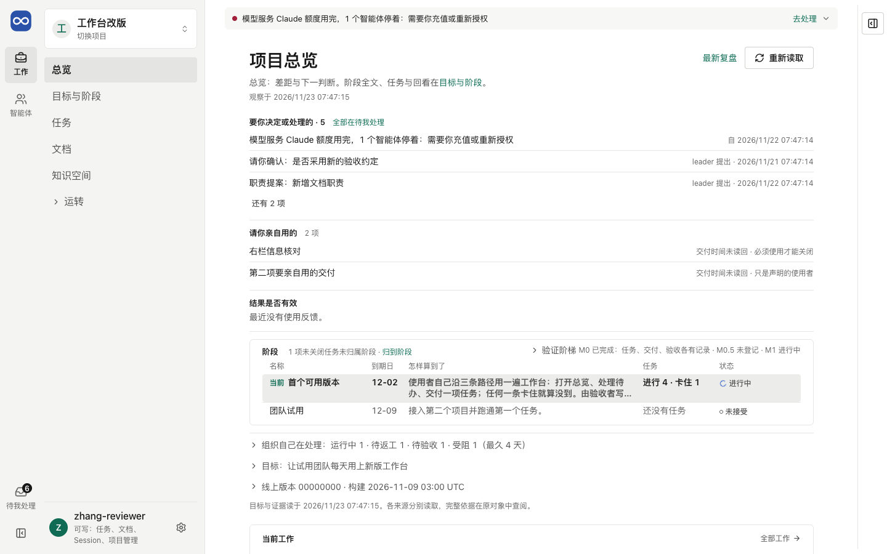
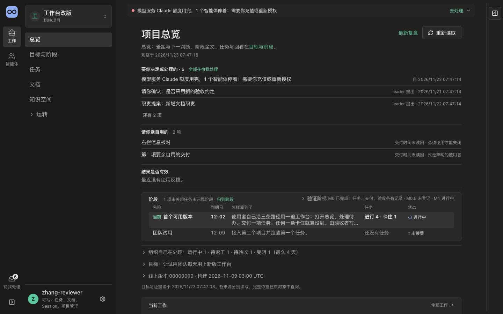
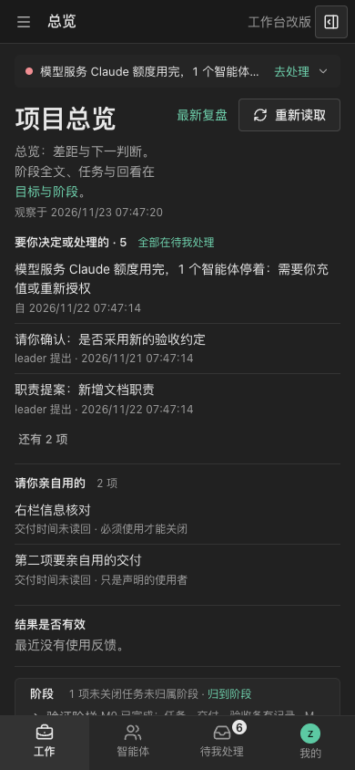
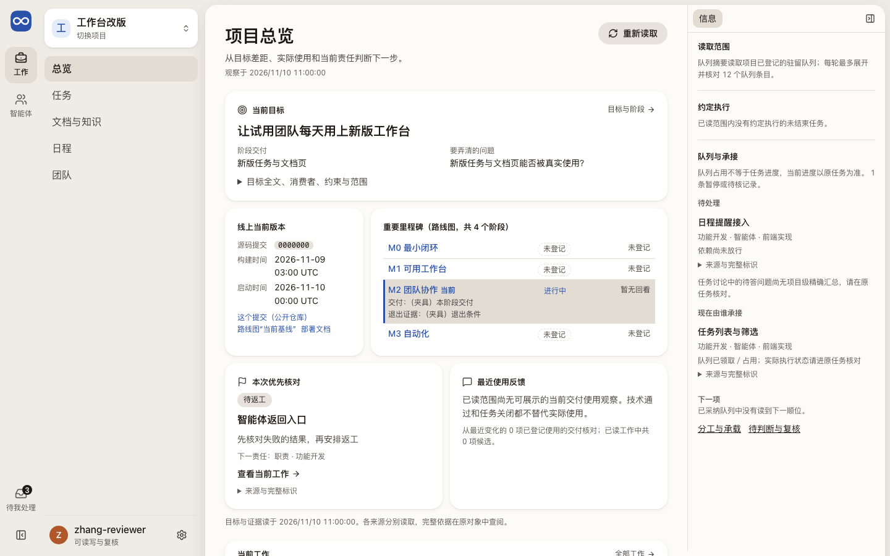
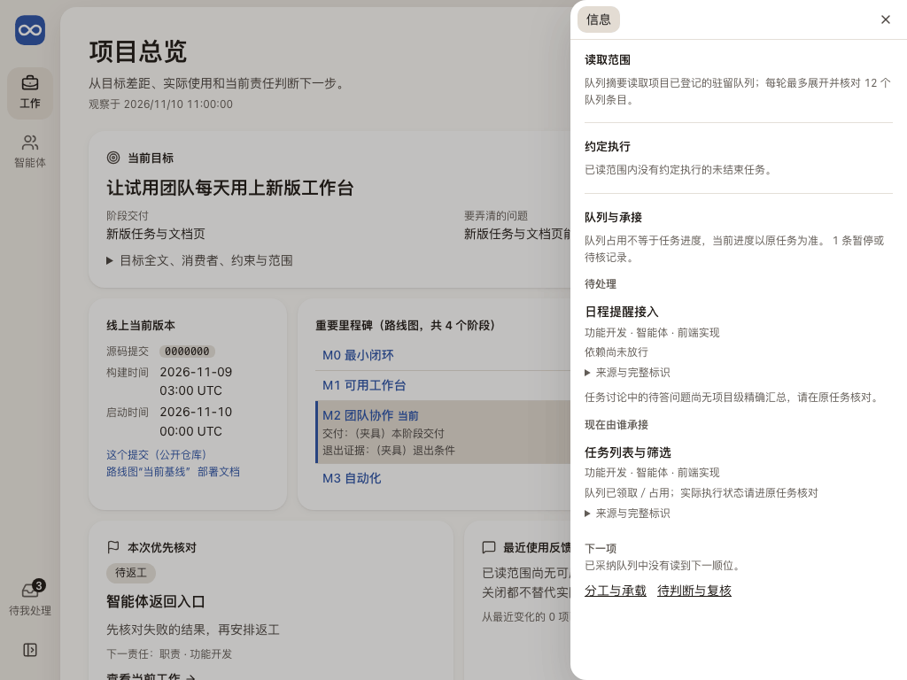

# 项目总览：目标还差什么，谁接下一步

这一页帮人判断项目目标还差什么、最近的使用说明了什么，以及下一步由谁接。

## 这一页回答什么

- 当前目标和阶段是什么，这一阶段要交付什么、想弄清什么？
- 现在有哪些事要我决定或处理，哪些交付要我亲自用？
- 最近谁用过哪次交付，结果是否有效？
- 进行中的工作由谁承接，下一项是什么？

## 页面分工（Task 523a91e9）

总览是“判断主页”：标题下一句写明“总览：差距与下一判断。阶段全文、任务与回看在目标与阶段”，并链接到[目标与阶段](journey.md)。项目列表的项目行进入这一页；任务列表仍一步可达：项目行的“任务列表”链接、左栏“任务”、本页“当前工作”的“全部”。首屏顺序（Task 7a411ad4，页面顺序就是阅读顺序，1440 与 390 相同，不再用 CSS `order` 换位）：标题行 → ① 要你决定或处理的 → ② 请你亲自用的 → ③ 结果是否有效 → ④ 阶段块（内容不变）→ ⑤ 一行折叠的“组织自己在处理” → ⑥ 目标一行与线上版本一行（折叠，原内容在里面）→ 其余。

首屏要求：1440×900 不滚动看到 ①②③ 全部和“阶段”标题行；390×844 看到 ① 全部和 ② 的标题（手机以底部标签栏上沿为准，用 getBoundingClientRect 量）。右侧信息栏在总览任何宽度默认关闭，人手动开合的选择会记住（总览单独记，不与任务页共用）。

标题行右侧入口：“最新复盘”直达最新一份 `organization_review` 文档；“每日简报”入口暂未做：文档列表只从地址读取类型（`?kind=`），读不了搜索词，所以按任务约定省略，待文档列表能从地址带搜索词再补。

阶段块不变：一行五格（名称、到期日、怎样算到了、任务、服务状态词），只有服务指出的阶段标“当前”；标题行“N 项未关闭任务未归属阶段”链到未归属区；无阶段写“这个项目还没有阶段”；验证阶梯在标题右侧折叠一行。

首屏对照（旧顺序，“五个阶段同时进行中”的数据形态，同一夹具）：1440×900 改前 [图](../../assets/frontend-pages/overview-first-screen-before-1440.png)、改后 [图](../../assets/frontend-pages/overview-first-screen-after-1440.png)；390×844 改前 [图](../../assets/frontend-pages/overview-first-screen-before-390.png)、改后 [图](../../assets/frontend-pages/overview-first-screen-after-390.png)。这是上一版的对照，新顺序的截图在 Task 7a411ad4 的交付里。

新顺序首屏：

## 布局

| 位置 | 放什么（目标） |
| --- | --- |
| 左栏 | 主导航；对象列表处列出正在推进的阶段，有多个阶段时在这里切换 |
| 中间 | ① 要你决定或处理的 → ② 请你亲自用的 → ③ 结果是否有效 → 阶段 → 组织自己在处理 → 目标与线上版本 → 当前工作 |
| 右栏 | 读取时间与覆盖范围、定时任务的任务、队列与承接明细；总览默认收起，可展开 |

现状（Task 7a411ad4）：中间依次是 ①②③、阶段块、折叠的组织自己在处理、折叠的目标与线上版本、当前工作；右栏是读取范围、定时任务、队列与承接，默认收起。多个阶段时在内层栏切换（短名加到期日），所选阶段与阶段展开写进地址，详见[布局](../layout.md)。

## 内容与状态

共同规则见[设计原则](../principles.md)。本页特有的要点：

首屏各块（上一块答完才轮到下一块）：

| 块 | 读什么 | 数量、空与读不到 |
| --- | --- | --- |
| ① 要你决定或处理的 · N | 与“待我处理”同源，依次：只有你能办的运行问题、待我决定、待我验收、依据变化、用量与上下文告警；再是卡住的任务（受阻或待返工、3 天以上没有进展，写“〈任务标题〉卡了 N 天：〈原因〉”，状态标签、无行底色，卡 1 天的不进来） | 最多 3 行，“还有 K 项”原地展开，“全部在待我处理”链到该页；每行链到具体对象。空：“现在没有等你决定或处理的事。”读不到：“这一栏读不到”加重试，绝不写“没有” |
| ② 请你亲自用的 | 等你亲自使用的交付，链到任务的“交付与使用”页 | 最多 3 行。空：“现在没有等你亲自用的交付。” |
| ③ 结果是否有效 | 最近的使用反馈：任务、谁用的、结果、时间（“本次优先核对”是旧叫法，已取消） | 最多 3 行。空：“最近没有使用反馈。” |
| ⑤ 组织自己在处理 | 折叠一行“运行中 a · 待返工 b · 待验收 c · 受阻 d（最久 N 天）”，数字来自工作索引 `counts`；展开是调度动态 | 默认折叠 |
| ⑥ 目标与线上版本 | “目标：〈标题〉”“线上版本 〈提交前 8 位〉 · 〈时间〉”各一行，原内容在展开里 | 默认折叠；合同里没有发布时间，这里写构建时间并标“构建” |

数字关系：① 前五类的条数加 ② 的条数，等于“待我处理”入口上的数；卡住的任务只在 ① 多出一行，不计入入口数。

- **目标与阶段**：显示目标、阶段交付和要弄清的问题；消费者、约束和范围按需展开。没有正在推进的阶段时，提示与现有责任 Agent 明确首项工作、消费者和要补的证据。
- **用语与标识**：职责状态、执行状态、暂停原因按代码写成中文；暂停原因原文、等待原因原文和各类完整标识收进每项的“来源与完整标识”。
- **当前工作**：只列少量进行中的业务任务，完整列表回任务页；同一任务不在多处重复铺开。
- **定时任务**：每项写本次时间、重复方式、上一份和后一份任务，以及最近一份已完成任务的结果。有执行时间没读回时，不写“没有定时任务”。
- **队列与承接**：暂停、当前占用、下一项分开列；队列占用不等于任务进度。
- 最近业务活动不算消费者使用，任务关闭不等于目标达成。
- 汇总只来自有权限、有范围的读取。没读全时写明已读范围，计数为零不代表没有问题。
- “讨论当前分工”“讨论下一阶段”两个入口现在在团队分工页；两类讨论带什么材料、留下什么结果见[两种日常讨论](../../product/daily-loop.md#两种日常讨论)。

## 截图

由 `npm run docs:screenshots` 用合成夹具生成，怎样重新生成见[页面截图](../architecture.md#页面截图)。

## 代码与测试

源码在 `apps/workbench/src/features/overview/`，测试在 `apps/workbench/test/`。

| 部分 | 主要源码 | 相关测试 |
| --- | --- | --- |
| ①②③⑤⑥ 与阶段 | `ProjectContext.tsx`、`OverviewTop.tsx`、`overviewFirstScreen.ts`、`MilestonesBlock.tsx`、`contextPresentation.ts`；共用的下一动作与下一责任在 `shared/workPresentation.ts`，名称读取在 `shared/ui/RecordName.tsx` | `overview-first-screen.test.ts`、`overview-first-screen-ci-browser.test.ts`、`stages-ci-browser.test.ts`、`project-context-presentation.test.ts`、`work-presentation.test.ts` |
| 页面、定时任务、当前工作、队列明细 | `ProjectSummary.tsx`、`summary.ts`、`overviewPresentation.ts`；职责状态在 `shared/rolePresentation.ts` | `project-summary.test.ts`、`overview-presentation.test.ts`、`project-summary-browser.test.ts`、`overview-wording-browser.test.ts` |

## 相关

- 产品：[从一个目标走到第一次有效交付](../../product/definition.md#从一个目标走到第一次有效交付)、[六条端到端使用路径](../../product/workbench.md#六条端到端使用路径)、[两种日常讨论](../../product/daily-loop.md#两种日常讨论)
- 合同：[阶段回看](../../architecture/contracts.md#6-stagereview从交付到下一阶段)；当前能力见[阶段路线](../../roadmap.md#当前基线)
- 前端：[布局](../layout.md)、[设计原则](../principles.md)、[任务](tasks.md)
