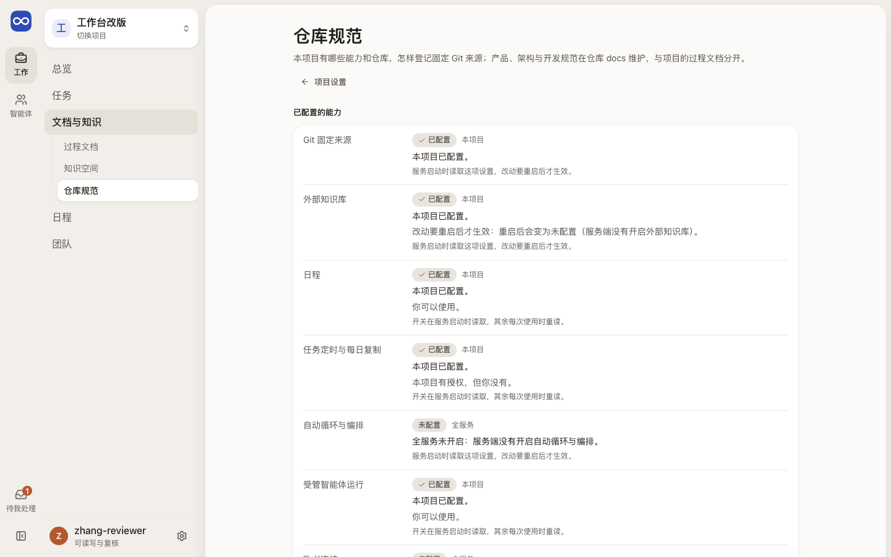
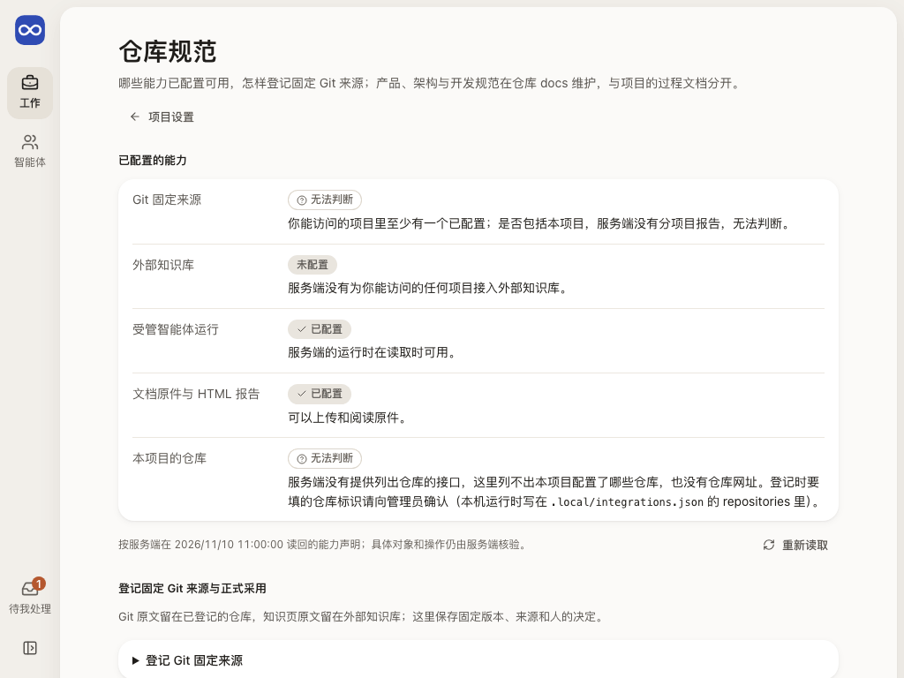
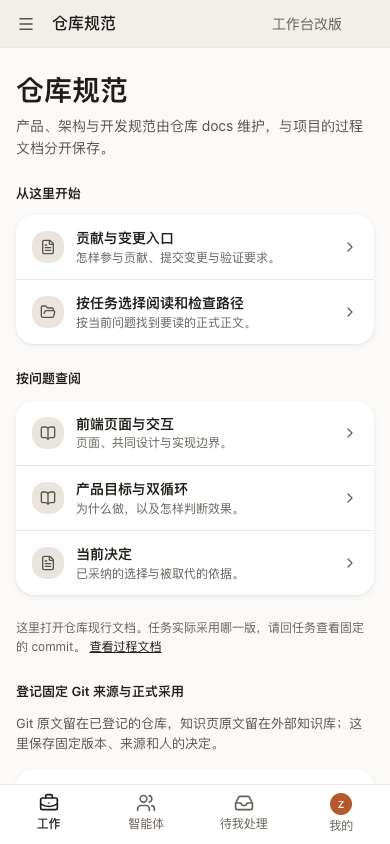

# 仓库规范：哪些能力已配置，怎样登记固定 Git 来源

仓库规范页回答两件事：服务端为这个项目配置了哪些能力和仓库，以及怎样把仓库里某个文件的固定版本登记成来源、记录它和过程文档的关系。它把仓库 `docs/` 里的正式规则和项目的过程文档分开。读者是要核对配置、登记来源和记录正式采用的人。

## 这一页回答什么

- 哪些能力已配置可用，本项目有哪些仓库，哪些判断不了？
- 怎样把仓库里一个文件的固定版本登记为来源？
- 某份过程文档的某一版，有没有被正式文档采用或吸收？
- evoLoop 自身的产品、架构和开发规范从哪里读？

## 布局

| 区域 | 放什么 |
| --- | --- |
| 内层栏 | 文档与知识下的分区导航，高亮“仓库规范”；没有对象列表 |
| 中间（单栏） | 页首和“项目设置”返回；已配置的能力（服务端为本项目判断的九项能力）；本项目的仓库（仓库标识与允许读取的路径）；登记固定 Git 来源与正式采用：两张默认折叠的表单；evoLoop 自身的规范（从这里开始、按问题查阅）；一句说明和“查看过程文档” |
| 右栏 | 没有 |

外壳与内层栏见[布局](../layout.md)；设置类页面的单栏布局同[项目设置](settings.md)。

## 内容与状态

通用的空、加载、失败、未知规则见[设计原则](../principles.md)。

- **已配置的能力**：读服务端为本项目判断的能力，写明读取时间。每项写已配置、未配置或无法判断，标明是“本项目”还是“全服务”，并写出原因（哪个开关没开、本项目没配置、持有授权的身份权限不够等）。按身份授权的能力另写你能不能用：本项目有授权但你没有、令牌缺写入或复核权限等。配置文件改了而要重启才生效时，写“改动要重启后才生效：重启后会……”；运行时暂时没应答不算配置变化。集成文件或身份文件现在读不了时，只在上方说一次重启后会怎样无法判断。仓库登记整份被拒时标“整份登记被拒”，不写“本项目未配置”。持有授权但能力整体没生效时，不写“你可以使用”。不认识的原因代码写通用说法，代码在“原因代码”里。整份结论读不到时写“无法判断”，不写“没有配置”。
- **本项目的仓库**：列出仓库标识和允许读取的路径（以 / 结尾的是目录）。读到本项目没有仓库时说登记会被拒绝；服务端的仓库登记有误、整份被拒时，如实说所有项目都读不了 Git，并列出本项目的条目，不说“没有配置仓库”；服务端没有清单或读取失败时写“无法判断”。没有仓库网址，也不显示服务器上的位置。首次读取失败可重新读取；重读失败保留上次结果，标“上次读回，当前待核对”。
- **evoLoop 自身的规范**：链接固定打开 evoLoop 仓库 main 分支的现行文档，页面写明它们不随项目变化。任务实际采用哪一版，回任务看固定的 commit。仓库文档不进过程文档列表（[对象关系与能力职责](../../product/workbench.md#对象关系与能力职责)）。
- **登记 Git 固定来源**（要写入权限）：仓库从本项目的仓库里选，路径按所选仓库允许读取的范围提示，超出范围在提交前就说明。本项目没有仓库或整份登记被拒（刚读回的结论）时，表单说明原因并暂停提交；读不到清单时退回手填仓库标识；清单读取中或只有上次读回时，也可以展开“按完整标识填写”。路径检查只按允许路径的前缀，路径本身是否合法仍由服务端核对。完整 commit 和原文 SHA-256 仍要手填，工作台不能替人读出；哈希有大写或位数不对、路径以 / 开头或含 ..，当场说明。服务端按 commit 读原文、核对摘要，一致才登记。
- **记录正式文档与过程文档的关系**（要复核权限）：刚登记的来源写成“仓库 · 路径”；也可以改填另一条固定引用，读回后写出它指向哪里，读不到就如实说明。过程文档按标题选，修订从修订列表里按第 N 版、状态、时间、作者和理由选，不读正文，后面的页按需列出。决定分三种，理由里要写出具体段落或差异，因为系统不证明正式文档已包含过程成果。各项标识放在“将要记录的完整标识”里。两张表单发出的字段和以前相同。
- 没有对应权限时，表单换成一句说明。两张表单都是共同的[提交表单](../components.md#提交表单)，结果未知时按原操作 ID 查回（见[结果未知的操作](operations.md)）。能力和表单各有出错边界，一块出错不影响其余部分。任务的“运行与关联”用同一组件（见[任务](tasks.md)）。

## 从哪里来，到哪里去

| 从 | 到 |
| --- | --- |
| 文档与知识 › 仓库规范；账号菜单 › 仓库规范；项目设置 › 各类记录在哪里 | 页首“项目设置”；evoLoop 规范（新标签页）；“查看过程文档”→ 文档与知识 › 过程文档 |

## 截图

由 `npm run docs:screenshots` 用合成夹具生成（夹具的能力里有一项重启后会变，项目有两个仓库），怎样重新生成见[页面截图](../architecture.md#页面截图)。

## 代码与测试

| 范围 | 路径 |
| --- | --- |
| 源码（`apps/workbench/src/`） | `features/settings/RepositoryPage.tsx`（能力、仓库、规范链接与说明）、`features/settings/capabilityPresentation.ts`（能力结论的中文）、`shared/projectConfiguration.ts`（仓库、能力、成员三个读取）、`shared/repositoryPresentation.ts`（仓库清单与允许路径）、`features/references/ReferencePanel.tsx`（登记表单，任务的“运行与关联”也用它）、`features/references/RepositoryChoice.tsx`（从清单选仓库）、`features/references/FormalSourceFields.tsx`（按名称选固定来源、文档与修订；修订列表用 `shared/useDocumentRevisions.ts`）、`features/references/referenceCommands.ts`（各写入的地址与字段）、`features/references/referencePresentation.ts`（字段校验、修订名称、决定与来源的中文）；局部出错边界 `shared/ui/SectionBoundary.tsx` |
| 测试（`apps/workbench/test/`） | `reference-commands.test.ts`、`reference-form.test.ts`（字段校验、仓库与路径、修订名称与请求体）、`capability-presentation.test.ts`、`settings-pages-browser.test.ts`（能力与仓库、选仓库登记、整份登记被拒，`EVOLOOP_SETTINGS_SCREENSHOT_DIR`）、`legacy-bits-browser.test.ts`、`entry-pages-browser.test.ts` |

## 相关

- 合同：[项目配置只读](../../architecture/contracts.md#项目配置只读仓库能力与成员)、[DocumentStore 与 RelationStore](../../architecture/contracts.md#2a-documentstore-与-relationstore)（`GitSourceRef`）
- 本机配置：[本机运行与恢复](../../development/local-run.md#环境与启动)（`.local/integrations.json` 的 `repositories`）
- 前端：[过程文档](documents.md)、[任务](tasks.md)
