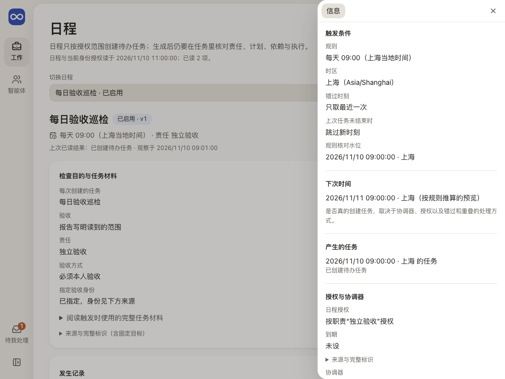
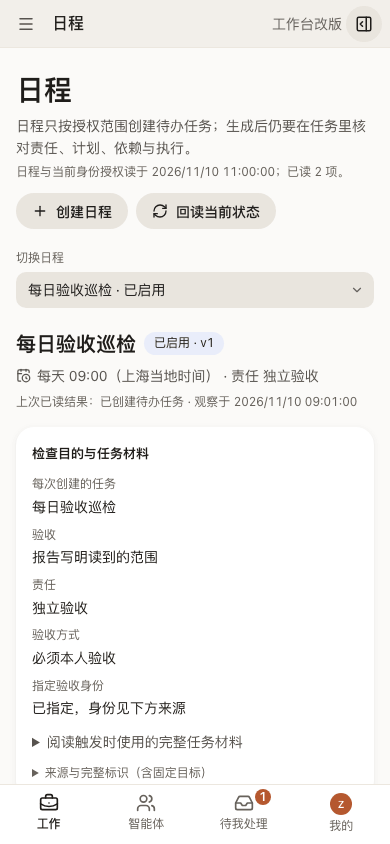

# 日程：何时检查，上次产生的工作怎样

日程页让人看懂一项安排为什么检查、下次何时触发、上次产生了什么工作，再追到生成的任务和实际承接者。

## 这一页回答什么

- 这项安排为什么存在，由谁负责？
- 现在是启用、暂停还是停止，下次什么时候触发？
- 上次触发发生了什么：创建或复用了哪个任务，还是跳过、排队？
- 生成的任务现在由谁承接，做到哪里？

## 布局

| 栏 | 放什么（目标） |
| --- | --- |
| 左栏（对象列表） | 日程列表：名称与目的、一次性或周期、启用 / 暂停 / 停止、最近结果 |
| 中间 | 所选日程：检查目的、责任、任务材料；最近几次运行，每次写输入、创建或复用的任务、跳过 / 排队 / 派发，以及原操作 |
| 右栏（可收起） | 触发条件（规则、时区、错过与重叠策略）、下次时间、产生的任务；授权与协调器状态 |

外壳与左栏见[布局](../layout.md)。

现状（#229 PR9c）：日程列表在内层栏（窄屏另有下拉切换）；中间是所选日程的检查目的与任务材料、发生记录（每次的结果、原因、生成的任务）和修订表单；右栏是触发条件、下次时间（按规则推算的预览）、产生的任务、授权与协调器。创建日程是中间的单独视图，表单仍是旧样式。职责按名称显示；日程、修订、操作、授权范围、授权人、指定验收身份和固定目标（工作链、阶段、所属目标）的完整标识在各处“来源与完整标识”里。

## 内容与状态

通用的空、加载、失败、未知规则见[共同原则](../principles.md)。

- 定义状态、触发结果和任务结果分开写。生成 Task ≠ Run 已执行 ≠ 已验收。
- 已配置规则 ≠ 下次一定执行。协调器未启用或当前身份没有授权时写明原因，规则预览只是预览。
- 暂停和停止只影响未来的触发；已生成的 Task、在途 Run 和 Session 各有自己的状态。历史触发的 Task 链接一直可达。
- 错过、重叠、旧定义排队和结果未知都写理由与下一责任；结果未知按原操作回读，不重复新建。
- 协调器写的触发原因是英文代码，按代码写成中文；最近错误只写“最近一次检查出错”，原文收进来源层。
- 授权正在重读或重读失败时整块标“上次读回，当前待核对”，不写“没有授权”。时区或时间不合法时，下次时间写“无法推算”。
- 长的任务正文放在可展开的材料区，不压住时间和责任。
- 修改普通日程看日程授权；指定受管目标的日程还要核对目标和执行授权。授权撤回后，已有定义仍可暂停或停止。
- Task 自己的执行时间与每日重复在任务详情里设置，不在本页（规则见[一次与每日复制](../../architecture/contracts.md#普通-task-的一次与每日复制)）。

## 截图

由 `npm run docs:screenshots` 用合成夹具生成，怎样重新生成见[页面截图](../architecture.md#页面截图)。

## 代码与测试

| 范围 | 路径 |
| --- | --- |
| 源码（`apps/workbench/src/`） | `features/scheduling/SchedulingPanel.tsx`（内层栏日程列表、所选日程、右栏、创建视图）、`features/scheduling/presentation.ts`（规则、下次时间、触发原因与授权用语）、`features/scheduling/managedTarget.ts`、`features/scheduling/client.ts`；名称与来源层在 `shared/ui/RecordName.tsx`、`shared/ui/FullIdentifiers.tsx`；任务详情里的“执行时间与重复”是另一套机制，在 `features/workflow/TaskScheduleSection.tsx` |
| 测试（`apps/workbench/test/`） | `schedule-presentation.test.ts`、`schedule-next-instant.test.ts`、`schedule-managed-target.test.ts`、`schedule-wording-browser.test.ts`、`schedule-run-session-path-browser.test.ts` |

## 相关

- 产品：[定时工作怎样参与闭环](../../product/daily-loop.md#定时工作怎样参与闭环)
- 合同：[ScheduleStore 与触发实例](../../architecture/contracts.md#7-schedulestore-与触发实例)、[可选的受管目标](../../architecture/contracts.md#可选的受管目标)
- 运行时：[任务、职责与定时触发](../../architecture/codex-integration.md#任务职责与定时触发)
