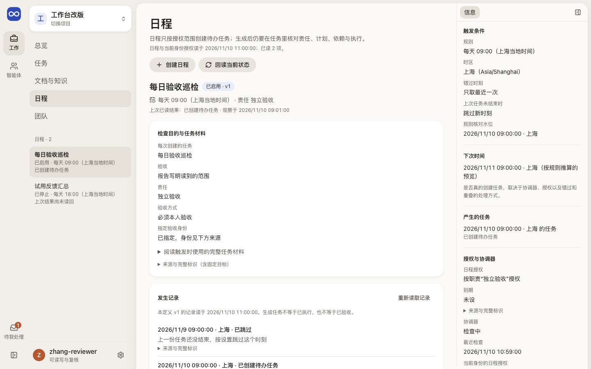

# 日程：何时检查，上次产生的工作怎样

日程页说明安排为何检查、下次何时触发、上次产生什么，追到任务与承接者。**已决定、未实施：** 到点分发、队伍、调度板。

| 变化 | 内容 | 实施 Task / 状态 |
| --- | --- | --- |
| 定时分发（Q1、S1） | 到点生成 Task 后默认交 Leader；直接分发在 Leader 名单中先选空闲、没有空闲再选队伍最短的，追加到队尾；到点只分发、不立即开始；忙就排队，引擎不新建 Session。旧的批量常驻队列原样保留，不充当新队伍。 | Q1 `1ce3444c-a8c1-4484-b073-32c256772467`、S1 `0f624669-f11e-4efa-9881-f12fe46524c7`；未实施 |
| 调度板（Q2） | 第一阶段提供 `work board` 快照与调度事件流；页面等第一阶段检验通过后由原生 Session 设计实现。 | Q2 `5c1760f7-4c94-4b56-81f4-433314972e69`；未实施 |
| 测量（M0） | M0 基线已测出并复算采用；工具已合并，未发布。 | M0 `58d1974c-7e44-4649-8a83-7fa96afe4aea`；工具已合并，未发布 |

## 这一页回答什么

- 这项安排为什么存在，由谁负责？
- 现在是启用、暂停还是停止，下次什么时候触发？
- 上次触发发生了什么：创建或复用了哪个任务，还是跳过、排队？
- 生成的任务现在由谁承接，做到哪里？

## 布局

| 栏 | 放什么（目标） |
| --- | --- |
| 左栏（对象列表） | 日程列表：名称与目的、一次性或周期、启用 / 暂停 / 停止、最近结果 |
| 中间 | 所选日程：检查目的、责任、任务材料；最近几次运行，每次写输入、创建或复用的任务、跳过 / 排队 / 派发，以及原操作 |
| 右栏（可收起） | 触发条件（规则、时区、错过与重叠策略）、下次时间、产生的任务；授权与协调器状态 |

外壳与左栏见[布局](../layout.md)。

现状（#229 PR9c）：日程列表在内层栏（窄屏另有下拉）；中间是所选日程的检查目的与任务材料、发生记录和修订表单，其下是“定时任务”一栏；右栏是触发条件、下次时间（按规则推算的预览）、产生的任务、授权与协调器。创建日程是中间的单独视图。创建、修订和停用表单是共同的[提交表单](../components.md#提交表单)，修订还核对授权是否变化（#229 F3）：职责和日程授权按名称选择，时间按日程时区填写；完整标识在“来源与完整标识”里。

## 内容与状态

通用的空、加载、失败、未知规则见[共同原则](../principles.md)。

- 定义状态、触发结果和任务结果分开写。生成 Task ≠ Run 已执行 ≠ 已验收。
- 已配置规则 ≠ 下次一定执行。协调器未启用或当前身份没有授权时写明原因，规则预览只是预览。
- 暂停和停止只影响未来的触发；已生成的 Task、在途 Run 和 Session 各有自己的状态。历史触发的 Task 链接一直可达；从这里打开的任务页首写“返回日程：<名称>”，回到这项日程。
- 错过、重叠、旧定义排队和结果未知都写理由与下一责任；结果未知按原操作回读，不重复新建。
- 协调器写的触发原因是英文代码，按代码写成中文；最近错误只写“最近一次检查出错”，原文收进来源层。
- 授权正在重读或重读失败时整块标“上次读回，当前待核对”，不写“没有授权”。时区或时间不合法时，下次时间写“无法推算”。
- 日程自己的时刻（规则、计划时刻、核对水位、到期、下次时间）按日程修订里的时区显示并写明时区；读者本地时间不同时，后面再附“你的时间”。每日规则只写“下次是你的时间”，因为夏令时会改变以后各次在读者时区的钟点。记录与读取的时间按读者本地时间。
- 下次时间与协调器用同一条每日规则（`@evoloop/contracts/scheduling`）推算：夏令时跳过的本地时刻当天不触发，预览直接写下一天，不显示别的钟点；回拨时重复的时刻取较早的一次。
- 表单里填的一次时刻、间隔起点和授权到期按同一规则换算，字段下写出日程时区、读者和 UTC 的钟点；夏令时跳过的时刻提交前就说明不存在，重复的时刻列出较早、较晚两次供选，新填默认较早。从定义回填的时间不改就原样发回；浏览器不认识日程时区时按 UTC 显示原值，改动会被拦下。发出的命令与手填标识和 UTC 时一样。
- 长的任务正文放在可展开的材料区，不压住时间和责任。
- 指定验收人按本项目成员名称选：必须本人验收只列能写入的人且必须选一人（标签不写“可选”）；独立智能体验收只列能写入的智能体，可不指定。能否写入无法判断的成员不可选，不写“没有可选的成员”；身份文件改过时写明重启后的变化。列不出成员，或名称相同、成员还在读取时，可展开后按完整标识填写。发出的命令与手填时相同。
- 修改普通日程看日程授权；指定受管目标的日程还要核对目标和执行授权。授权撤回后，已有定义仍可暂停或停止。
- “定时任务”一栏列出 Task 自己的一次执行时间或每日重复（含已停止的系列），不必逐个进任务详情找；修改仍在任务详情里做，本页不复制表单（规则见[一次与每日复制](../../architecture/contracts.md#普通-task-的一次与每日复制)）。每项写下次时间（任务的时区，读者时钟不同时附“你的时间”）、进行中 / 已停止、最近产生的 Task 及状态。点开进入 Task，页首“返回日程：<名称>”回到同一项（`?timing=<首个 Task>`）。没有执行时间的 Task 不出现；读取失败写“本次没有读到”；协调器不可用时写明不会自行复制。

## 截图

由 `npm run docs:screenshots` 用合成夹具生成，怎样重新生成见[页面截图](../architecture.md#页面截图)。

## 代码与测试

| 范围 | 路径 |
| --- | --- |
| 源码（`apps/workbench/src/`） | `features/scheduling/SchedulingPanel.tsx`（内层栏日程列表、所选日程、右栏、创建视图）、`features/scheduling/scheduleForm.ts`（创建与修订表单的字段和命令）、`shared/zonedTime.ts`（当地时间与时区换算，与协调器同一规则）、`shared/ui/LocalTimeInput.ts`（日期时间控件与较早 / 较晚的选择）、`features/scheduling/presentation.ts`（规则、下次时间、触发原因与授权用语，生成任务带“返回日程”的链接；每日规则的本地时刻用 `packages/contracts/src/scheduling.ts` 的 `dailyRuleInstant`，与 `packages/core/src/scheduling/due.ts` 共用）、`features/scheduling/managedTarget.ts`、`features/scheduling/client.ts`；指定验收人用 `shared/ui/MemberChoice.tsx`（`scheduleForm.ts` 的 `withMemberChoice`）；名称与来源层在 `shared/ui/RecordName.tsx`、`shared/ui/FullIdentifiers.tsx`；定时任务一栏在 `features/scheduling/TimedTasksSection.tsx`（列表、状态与失败写法）和 `features/scheduling/timedTasks.ts`（下次时间用语、`?timing=` 地址与返回链接）；任务详情里的“执行时间与重复”是另一套机制，在 `features/workflow/TaskScheduleSection.tsx`，修改仍在那里 |
| 测试（`apps/workbench/test/`） | `schedule-form.test.ts`（命令与原表单一致）、`zoned-time.test.ts`（与 `computeDue` 对照夏令时）、`schedule-form-browser.test.ts`、`command-form-browser.test.ts`、`schedule-presentation.test.ts`、`schedule-next-instant.test.ts`、`schedule-managed-target.test.ts`、`schedule-wording-browser.test.ts`、`schedule-run-session-path-browser.test.ts`（阅读此任务再返回日程）、`legacy-bits-browser.test.ts`（另一时区的日程）、`member-presentation.test.ts`、`member-choice-browser.test.ts`（按成员选指定验收人）、`timed-tasks.test.ts`（定时任务一栏：三类样本与反例、下次时间（含每日首份未到点）与时区、读取失败与协调器不可用的写法、返回日程原位置、列表读取合同）；后端 `packages/adapter-postgres/test/task-timing.test.ts`（项目级列表与分页） |

## 相关

- 产品：[定时工作怎样参与闭环](../../product/daily-loop.md#定时工作怎样参与闭环)
- 合同：[ScheduleStore 与触发实例](../../architecture/contracts.md#7-schedulestore-与触发实例)、[可选的受管目标](../../architecture/contracts.md#可选的受管目标)
- 运行时：[任务、职责与定时触发](../../architecture/codex-integration.md#任务职责与定时触发)
