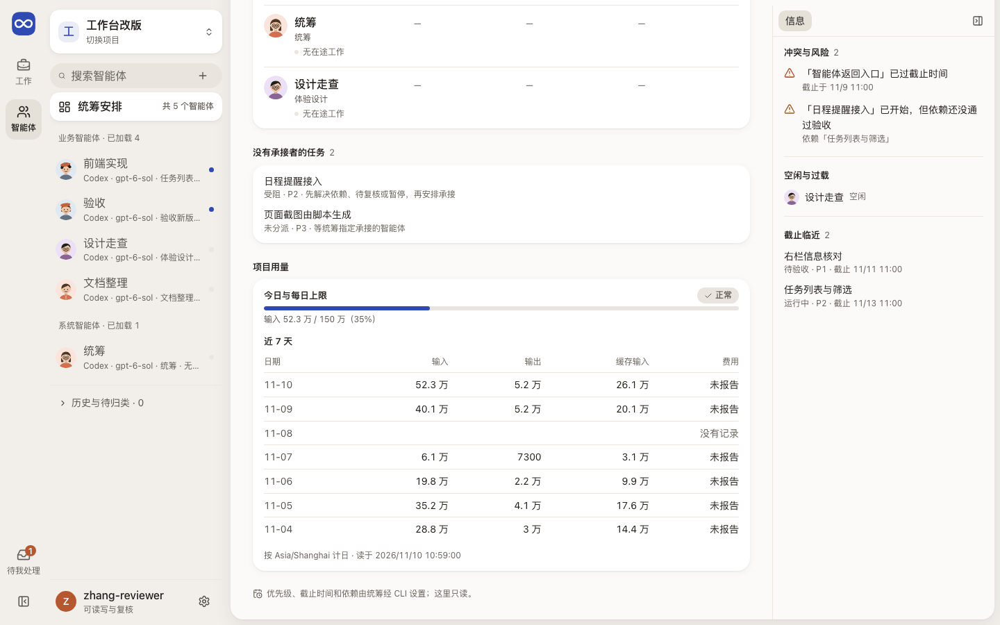
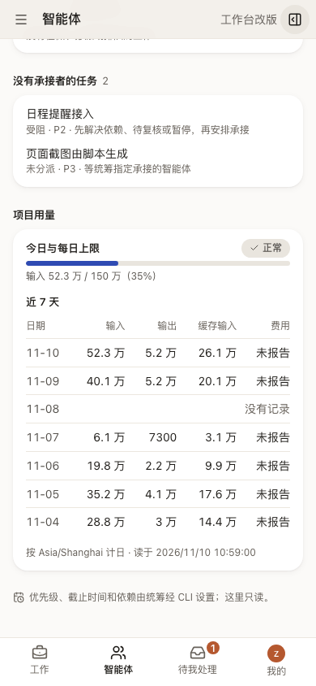
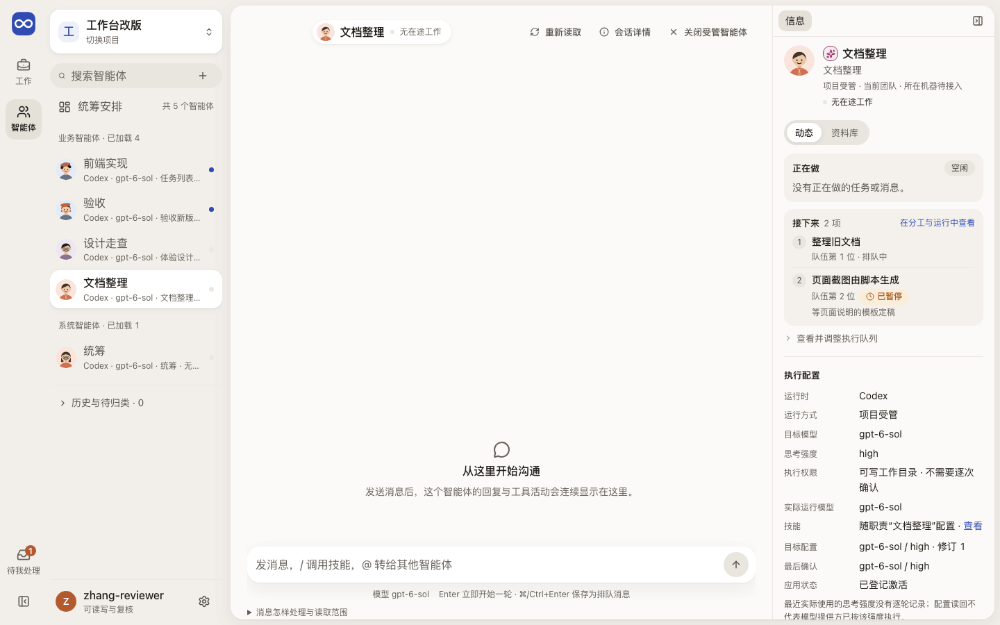

# Sessions：谁在做，做到哪里，Leader 怎样安排

Session 页说明一个具体实例此刻在做什么、做出了什么；“Leader 安排”说明这些 Session 和任务是怎样被组织起来的。

## 这一页回答什么

- 某项任务实际由哪个 Session 承接，现在做到哪、卡在哪？
- 这个 Session 的输入、Agent 活动、工具调用和回复按什么顺序发生，清单做到第几步？
- 它交付了什么，有没有问题在等我回答？
- Leader 怎样安排各个 Session 与任务，目标是什么，哪里有冲突？

## 布局

| 栏 | Session | Leader 安排 |
| --- | --- | --- |
| 内层栏（对象列表） | 顶部固定“Leader 安排”，下面是 Session 目录：搜索，分业务 / System / 待归类，历史可展开。已绑定职责的 Session（无论经 `session prepare` 还是 reserve + bind 建立）按职责类别归入业务或 System，不进待归类；每行写运行时与模型，没人命名的同职责 Session 写成“<职责> · Claude/Codex”，重名再加“标识 <8 位>” | 同左 |
| 中间 | 对话与 Agent 活动流（见下方“目标体验”），输入框固定在底部；从别处进来时页首写“返回任务：<名称>”“返回统筹安排”“返回文档：<名称>”等，点回原页面和页签 | 上半部分是当前的编排总览文档，下半部分是安排看板：每个 Session 一行，写职责、当前任务、排队任务和状态；没有承接者的任务单独一组。下一步是派发（待接手、可开始、返工）而分派固定在任务旧修订上的，写“分派（接手）属于旧修订 · 要重新指定”，不写“待接手”；规则同服务端派发时的 `ASSIGNMENT_STALE`，交付、运行中、待验收换了修订是正常流程，不算。从看板点进的任务和智能体页首写“返回统筹安排”。最后是“项目用量”块（锚点 `#project-usage`）：今日用量对每日上限，用与智能体“上下文”同一种进度条和状态（正常、接近上限、已达上限；未设上限时只写“未设上限”）；近 7 天按日历每天一行（到项目时区的今天为止），输入、输出、缓存输入用“万”，费用没报告写“未报告”，服务没有记账记录的日子写“没有记录”而不是 0（记了 0 才写 0）；计日时区和读取时间放在块底部小字 |
| 右栏（可收起） | 按下表“右栏信息层级”：实体卡 → 正在做 → 接下来（“动态”页签；“资料库”页签是成果）→ 运行环境 → 上下文与用量 → 详情与来源（收起）；所在机器 #219 之前写“待接入” | 数据能证明的冲突与风险：同一 Session 有多项进行中任务、依赖未通过验收就已开始、截止已过、待验收却未登记下一责任、下一步是派发而分派或接手属于旧修订（要重新指定；任务索引带回分派固定的修订、队列也读回、没有队列领取时才判断）；再下面是空闲与过载、截止临近 |

外壳与左栏见[布局](../layout.md)，场景见[场景 3](../scenarios.md#十个场景)与[场景 11](../scenarios.md#场景-11看清-leader-怎样安排-session)。

### 右栏信息层级

| 顺序 | 块 | 回答 | 数据来源 | 载体与理由 |
| --- | --- | --- | --- | --- |
| 1 | 实体卡 | 这是谁，现在怎样 | 名称、职责、受管或外部、归类、状态（与页首同一判断） | 不加框：头像和名字已能认出对象，页首胶囊也在说状态 |
| 2 | 正在做（“动态”页签） | 现在在做哪项任务 | 当前任务：执行队列的领取优先，其次是任务当前修订上的分派；没有时看未结束的 Run（含已预留）；状态取统筹索引的任务阶段，未读回时取 Run 状态 | 柔底色块（[事实卡片](../foundations.md#表面从后往前)）：标题、阶段、接手方式、用时是同一对象的事实，要读成一个单位；它是首屏的主答案。状态用 StatusTag |
| 3 | 接下来（“动态”页签） | 接下来做哪项，按什么顺序 | 先列智能体队伍（[DEC-045](../../decisions.md#用户已确定的方向) 的 session line，按位置），再列执行队列里未领取的项，最后列不在两者里的分派；分派按统筹索引的阶段分：待验收算已交出 | 同一种色块，块内一行一项，用细线分隔；序号是在自己队伍或执行队列里的位置，分派没有序号。超过 3 项折叠；已交出或已结束的分派另起一行折叠 |
| 4 | 运行环境 | 它在用什么跑 | 运行时；模型（最近一轮原生报告的实际模型，没有时用目标）；思考强度（没有逐轮记录，总是配置值）；有新目标待应用时改用最后确认的配置，并标出下一轮改成什么；执行权限（Session 执行配置）；技能（随职责，链到职责页）。修订、最后确认、应用状态、操作标识在“配置记录”里 | 和“正在做”同一种色块：一张卡片回答一个问题。主行一句“运行时 · 模型 · 强度”，每个值标“实际 / 目标 / 已确认”，都是目标时只写一次“目标，尚无实际报告”。目标还没生效时给状态标签。权限是小标签，技能标签可点，链到该职责页。“调整模型与强度”在右上角，不能用时在卡片底部写一行“不能调整：原因 · 去处”，去处是链接（例如“不是完整权限 · 去分工与运行”）。其余收进“配置记录”，说明只在相关时出现 |
| 5 | 上下文与用量 | 还能用多久；今天用了多少 | 用量读取里这个智能体的一项：上下文压力（当前大小 / 交接阈值）、今日与本会话累计；原生观察回报的这条线程用量 | 同一种色块，标题“上下文与用量”，里面先“上下文”、后“今日”。上下文用进度条加百分比和状态色（正常、接近交接、需交接新线程），需交接时直接给出处理说明和“去分工与运行”。“今日”是四个小数字格（输入、输出、缓存输入用“万”，费用没报告写“未报告”）。累计收进“本会话累计”。每日上限、近几天项目用量、用量时区属于项目，不放这里；只有项目用量接近或达到每日上限时写一行提醒，链到统筹安排的“项目用量”块（`#project-usage`） |
| 6 | 资料库（页签） | 交出了什么 | 关联的交付与使用观察 | 列表行加细线 |
| 7 | 详情与来源（收起） | 来源、诊断和低频设置 | 标识设置、原聊天入口、职责与分派、资源观察、恢复、活动与来源记录、完整标识 | 收起；标识设置是低频操作，从首屏移到这里 |

现状（#229 PR6a–PR6d）：
- **目录**：搜索、“统筹安排”、业务 / 系统分组，每项有头像、当前任务或职责、状态。
- **统筹安排**：看板每个智能体一行（正在做、已分派、排队），无承接者的任务单列并写下一步；另列待处理消息、待答问题与待验收数。
- **详情**（PR6d 起全部用 `@evoloop/ui`）：
  - 中间：对话流按目标体验实现；原生的英文说明改写成中文。
  - 输入框：Enter 只在运行时声明可补充时补充，否则排到下一轮并写明原因。
  - 右栏：按上面的层级实现。
  - “关闭受管智能体”在右栏列出阻断原因；窄屏下右栏只在点开时出现。
- **还没做的**：
  - 编排总览文档（合同缺“当前总览”标记）。
  - 看板对象在右栏打开速览。
  - 选中技能后运行时是否按技能执行待确认（现在在消息首行写明技能）。
  - 关联文档到消息（上下文字段只能带任务）。
  - Claude 的待办（TodoWrite）尚未接入。
  - 提问卡仍是逐题表单，没用 QuestionCard。
  - 所在机器等 #219。

## 内容与状态

通用的空、加载、失败、未知规则见[设计原则](../principles.md)。

- 目录按正式 RoleClass 分组；没有正式 Role、跨类或读取失败的进“待归类”并写原因。外部状态未知 ≠ 空闲。
- 首屏先认清实例：名称、真实状态、职责、受管还是外部接入。
- Session 就绪 ≠ Run 运行中；已发送 ≠ 已读 ≠ 已采用；Run 结束 ≠ 已交付；closing ≠ closed。
- 活动流按真实顺序和发送者显示，唯一有据的 Task 关系才给任务入口（[历史与实时读取](../../architecture/codex-integration.md#session-工作区的历史与实时读取)）。失败、待答和阻断不折叠。
- 加载更早内容时保持阅读位置，新进展不抢走阅读位置。
- 待答卡片区分待答、已保存、已发入原生连接、已清理（[原生提问](../../architecture/codex-integration.md#原生提问与业务问答)）。实时状态断线后标过期，Token 与费用无证据写未知（[原生观察](../../architecture/codex-integration.md#有界原生观察)）。
- 结果未知的输入保留原文；并发送入与不可补入回合见[即时输入](../../architecture/session-runtime.md#3-即时输入执行中收到的消息怎样处理)。模型配置、回执与实际运行分开写；外部会话只显示已核实能力。
- 关闭入口列出阻断原因：未完 Task、队列、Run、消息、待答问题、Session 忙碌；来源没读全时不按旧内容关闭。
- 从 Task 进来再返回，恢复页签和阅读位置；切换项目、身份或 Session 时清掉旧数据。
- Leader 安排：只写记录能证明的冲突，总览文档另写的以文档为准；任务或队列没读全时，空闲、冲突、无承接者写“?”或“无法判断”，重读失败标“上次读回，当前待核对”；调整安排找 Leader。

| 运行环境与上下文 | 页面上写 |
| --- | --- |
| 运行配置正在读取、读取失败或没有登记 | 主行写“正在读取运行配置…”“运行配置暂不可读取”或“未登记执行配置”，不显示空值 |
| 外部接入 | 主行写“外部接入”和外部宿主报过的模型；没有时写“模型与强度由外部宿主决定，没有同步到这里”；“配置记录”里目标模型、思考强度、执行权限写“外部接入不提供” |
| 没有交接阈值 | 标签“未设阈值”，写当前上下文大小，不画进度条 |
| 没有任何用量记录 | 上下文标“没有记录”；今日写“这个智能体还没有用量记录，不按 0 计” |
| 用量读取失败 | 写失败原因，并说明上下文和今日用量暂时无法判断 |

| 正在做与接下来 | 页面上写 |
| --- | --- |
| 有当前任务 | 任务链接；阶段（统筹索引未读回时用 Run 状态）；接手方式；已历时与等谁；有待答问题时另起一行 |
| 没有任务，原生回报正在回复消息 | “回复消息”；原生这一轮是消息时，不被仍标为运行中的旧 Run 记录盖过 |
| 没有任务，有未结束的 Run | Run 的任务和 Run 状态，并写“没有找到分派或领取，待核对” |
| 受管且没有在途工作 | “空闲”，附最近一次交付；技术结果与使用分开写 |
| 占用未知、外部接入、未就绪或已关闭 | “待核对”“外部接入”或生命周期，不写“空闲” |
| 队伍正在读取或读取失败 | 写“正在读取”或失败原因与“重试”；已读到的执行队列和分派照列，不写“没有排队的任务”；分派只写“已分派”，读回队伍后才写“未排进队伍” |
| 队伍里暂停的任务 | “已暂停”后接一句原因：服务端已知的暂停代码写成中文，纯中文原样；代码和英文原文放进可展开的“暂停代码与原文”，不出现在行上 |
| 都读到了，确实没有 | “没有排队的任务”；快照只读到部分时写“已读范围内没有…”；外部智能体写“没有队伍” |

| 服务端写的或没有的 | 页面上写 | 原文在哪 |
| --- | --- | --- |
| 读取范围的限制（`Native history is unsupported for this Session`、`Manual handoff records do not prove native delivery or reading`、`Live native updates unavailable` 等） | 已知的逐条写成中文，包括服务端带实现词的中文（“原生 Item / Turn”“原输入 ID”）；纯中文原样保留；不认识的英文和中英混写写“来源还说明了一项读取限制（原文未翻译，可展开“原文”查看）”；对话读取失败的错误行也一样 | “消息怎样处理与读取范围”、“来源限制与未确认信息”和读取失败提示下的“原文” |
| 外部智能体的目标模型、思考强度、执行权限 | “外部接入不提供”（外部主机报过的模型照写）。受管智能体读取中写“正在读取”，读取失败写“无法判断（读取失败）”，读到但没登记写“未登记执行配置” | — |
| 没登记名称的智能体（服务端生成“职责 · 外部 0aba35cb”或职责 ID） | “职责 · 外部接入的智能体”或“职责 · 受管智能体”（职责在前，窄栏截断时仍看得到）。目录第二行写服务端记录的时间：外部智能体是“接入更新于 …”（服务端不给外部智能体活动时间），受管智能体是“最近活动 …”。同名的几个在目录第二行开头加“标识 0aba35cb”，`@` 菜单里写成“名称（标识 0aba35cb）”，不会出现两项完全同名。任务页首、任务表格、手机列表和右栏用同一个名称。“设置展示信息”的名称默认值仍是服务端的名称，只改团队归属不会把通用称呼登记成名字 | 右栏“详情与来源”的完整标识（服务生成的名称） |
| 统筹安排旁的数字 | “共 N 个智能体”（含历史与待归类） | — |
| 统筹安排页首的空闲数 | 任务或队列没读全、或统筹以外的智能体占用都待核对（右栏写“暂不能确认谁空闲”）时写“无法判断”，不写 0；部分待核对时照数，旁注“另有 N 个待核对” | — |

**目标体验：像用 Claude Code 一样用 Session**

随时知道 Agent 在做什么、做到哪一步，发消息也一样顺手。参考是用户提供的两段录屏：Claude Code 桌面版（工作流、待办清单、输入框、右栏环境与产出）和一个 Bot 应用（提问卡、右栏实体卡、单行实时状态）。

| 交互 | 怎样做 | 数据来源与现状 |
| --- | --- | --- |
| 连续的工作流 | Agent 正文不包卡片；工具调用折叠成一行灰字（“已执行 5 个指令，已建立 1 个文件，1 个失败 ›”），展开后每步一行，失败标红，改动的文件带增删行数 | 已实现：折叠时失败与正在进行的一步仍可见，每步可原位看详情；增删行数需要工具详情 |
| 需要你决定 | Agent 停下来等人时，流末出现提问卡：一句问题、几个可点的选项（A、B、C…），最后一项“其他”可以直接写；选好后点“提交”，等于发出这条回复，卡片随后折叠成一行“已回答：…” | 原生提问与业务问答已有，但不在时间线里（见下表） |
| 输入框信息 | 输入框下方一行：当前模型、权限或执行配置、上下文用量 | Session 执行配置与用量部分已有 |
| 实时状态行 | 流末一行，前面是 Session 的身份标记：“正在运行测试 · 1 分 04 秒 ›”，点开看当前工具 | 已实现（头像、当前工具、耗时、关联任务）；连接过期时只写“上次读回” |
| 待办清单 | 固定在输入框上方，每步显示已完成、进行中、待做，随 Agent 更新；全部完成后折叠成一行 | 已实现：从 Codex 计划条目的分步文字和原生进度里的计划读出；合同仍宜保留结构化步骤。Claude 的 TodoWrite 尚未接入 |
| 发消息 | Enter 发送；运行中按 Enter 补充到当前这一轮（运行时支持时），Cmd/Ctrl+Enter 排到下一轮；已排队的消息显示在输入框上方，可取消：最多先显示 3 条，其余折叠成“还有 N 条”，展开后在区内滚动，所以排得再多也不会挤掉时间线或输入框；每条写中文摘要（通知类型 · 关联任务标题 · 时间），原文和标识在“原文与标识”里；发送者没有“发给这个 Session”的普通消息授权时，发送当场被拒并写明缺什么，消息不保存；已入队却因缺授权受阻的消息不占队列（后面的消息照常处理），页面上标“受阻：缺少消息授权”，并在上方写出缺哪条授权；停止按钮中断当前这一轮 | 已实现：统筹页面在它执行且两条路都开放时，右下是带名字的两个按钮“插入当前这一轮”和“排队”（快捷键不变），空闲只有“发送”；发送后写结果：已插入当前这一轮、已开始新的一轮、已排队，或“没有插入，已转排队”并写明原因（那一轮刚好换了或不接受补充，只存一条排队消息）；结果只说运行时已接收，不说智能体已阅读；补充只在当前 Session 的即时输入能力为 steer 时提供；`SESSION_INPUT_BUSY` 可重试，不清草稿并保留原输入编号，下一次发送重试同一意图；停止按这一轮的来源发消息中断或运行中断，需要复核权限 |
| `/` 与 `@` | 输入 `/` 弹出当前职责可用的技能和命令（停止这一轮、撤回排队消息、关联任务或文档）；输入 `@` 选择其他智能体，这条消息另发一份给对方，两边时间线各留一条记录（见[组件清单](../components.md#对话流组件)） | 已实现：技能来自职责的运行时视图；`/` 一定有回应：没有技能（Codex 职责常见）或读不到时仍列出三条命令，不能用的写明原因，并说明技能的情况，输入无匹配也会说明；`@` 另存一条普通消息给对方；技能的执行语义与关联文档仍待定 |
| 头像与称呼 | 界面上 Session 叫“智能体”、Leader 叫“统筹”（[界面用语](../principles.md#界面用语)）；每个智能体有按职责取底色的卡通头像，出现在目录、标题、状态行和 `@` 菜单里 | 头像由职责和实例推出，不需要新数据 |
| 每轮小结 | 一轮结束时，最后一条回复后跟一行本轮产出：改了什么、交付了什么、下一步等谁 | 已实现：只写记录能证明的（工具计数、本轮开始后关联任务的交付、失败或待答） |
| 右栏 | 顶部是实体卡：身份标记、名称、职责、所在机器与状态；“动态”页签先答正在做和接下来，“资料库”看产出与交付；再往下是运行环境（含模型与强度）、上下文与用量 | 已实现，见“右栏信息层级”；工作目录未显示，机器等 #219 |

**两种运行时的现状差异**

界面按 Session 自己的运行时判断能做什么，服务端时间线能力也按它计算（Claude 报历史、不报实时）。做不到的功能写明限制，不留空白。

| 能力 | Codex | Claude |
| --- | --- | --- |
| 时间线历史与实时 | 需开启实验性工作区读取且服务端支持 | 历史读适配器账本，刷新时更新；没有实时推送 |
| 思考过程 | 每轮一组“思考过程”，默认折叠，标回合（Turn ID 前 8 位与开始时间）和条目序号；摘要或可读推理文字照原文，不可读的写“不可显示”和原因；组标题写这一轮的推理 token（来自 Codex 用量事件），未观察到写“原生未报告” | 同样每轮一组；thinking 原文，空块与加密块写“不可显示”；推理 token 来自 Claude 结果用量 |
| 子 Agent | 主线程只有一条“Agent collaboration”工具条目和一条空的 notice；子线程未读取，读取它要按接收线程 ID 并单独设计授权范围 | 子消息与主流在同一个流里，但现在被丢弃；父级是发起它的工具调用 ID，可直接映射到计划中的 `parentEntryId` |
| 待答问题 | 开启原生提问时经单独通道读写，不在时间线里 | 不支持 |
| 运行中补充输入 | 经组合运行时的转向能力 | 不支持，只能排队到下一轮 |

## 截图

由 `npm run docs:screenshots` 用合成夹具生成，怎样重新生成见[页面截图](../architecture.md#页面截图)。

改版前真实使用的截图见[实景旅程](../journeys/current-work.md#3-从任务核对具体承接者)。

## 代码与测试

| 范围 | 源码（`apps/workbench/src/`） | 测试（`apps/workbench/test/`） |
| --- | --- | --- |
| 外壳 | `app/shell/AppShell.tsx` | `shell.test.ts`、`shell-browser.test.ts`（切换空间后保留各空间的地址与智能体目录搜索）、`session-directory-groups-browser.test.ts` |
| 智能体目录（内层栏） | `features/sessions/SessionNavigation.tsx`（新目录）、`features/sessions/sessionDirectoryPresentation.ts`、`features/sessions/useSessionDirectoryGroup.ts` | `session-directory-presentation.test.ts`、`session-directory-groups.test.ts`、`session-directory-groups-browser.test.ts` |
| 智能体详情 | `features/sessions/SessionWorkspace.tsx`（页首、右栏；执行队列由 `app/App.tsx` 传入 `features/workflow` 的面板）、`features/sessions/sessionWorkPresentation.ts`（正在做与接下来的判定与用语）、`features/sessions/RuntimeEnvironmentCard.tsx`（运行环境卡片）、`features/sessions/environmentPresentation.ts`（环境与用量的三种状态）、`features/sessions/SessionTimeline.tsx`（对话流）、`features/sessions/readingScopePresentation.ts` 与 `features/sessions/SourceLimitations.tsx`（读取限制的中文与原文）、`shared/agentNamePresentation.ts`（没登记名称时怎样称呼）、`features/sessions/conversationPresentation.ts`（工具、计划、状态行与每轮小结的用语）、`features/sessions/workspaceTimelineModel.ts`、`features/sessions/NativeSessionPanel.tsx`、`features/sessions/SessionModelControl.tsx`、`features/sessions/SessionClosePanel.tsx` | `session-work-presentation.test.ts`、`session-rail-browser.test.ts`（三类智能体在 1440 与 390 宽的首屏、溢出、队伍读取失败）、`session-wording-presentation.test.ts`、`agent-name-presentation.test.ts`、`session-external-wording-browser.test.ts`（`EVOLOOP_AGENT_WORDING_SCREENSHOT_DIR`）、`session-workspace-redesign-browser.test.ts`、`session-timeline-browser.test.ts`、`session-workspace-timeline-model.test.ts`、`session-conversation-presentation.test.ts`、`session-native-input-browser.test.ts`、`session-native-progress-browser.test.ts`、`session-close-entry-browser.test.ts`、`session-activity-narrow-browser.test.ts`、`task-session-return-browser.test.ts` |
| 上下文与用量 | `features/sessions/UsageBudgetPanel.tsx`（上下文与用量卡片）、`features/sessions/usagePresentation.ts`（进度、今日、项目上限提醒） | `usage-presentation.test.ts`、`usage-budget-panel.test.ts`、`runtime-environment-presentation.test.ts`（运行环境主行与上下文、今日、提醒的说法） |
| 输入框 | `features/sessions/SessionComposer.tsx`（待办、排队、`/`、`@`、停止）、`features/sessions/queuedMessagePresentation.ts`（排队项的中文摘要、授权受阻提示）、`packages/ui` 的 `QueuedMessages`（限高与折叠）、`features/sessions/composerPresentation.ts`（Enter 与 Cmd/Ctrl+Enter 做什么）、`features/sessions/useDirectInput.tsx`（即时输入与回执）、`features/sessions/sessionCommand.ts` | `session-grant-blocked-browser.test.ts`（授权受阻的消息可见且页面可用）、`session-queue-area-browser.test.ts`（12 条排队时 1195 与 390 宽：时间线可滚、输入框在屏内、折叠展开、摘要与原文、撤回；无排队不变）、`queued-message-summary.test.ts`、`session-composer-browser.test.ts`（三个宽度，`EVOLOOP_AGENT_SCREENSHOT_DIR` 存截图）、`session-direct-input-layout-browser.test.ts`、`session-message-entry-browser.test.ts`、`session-conversation-presentation.test.ts`、`leader-insert-queue-browser.test.ts`（统筹页面两个发送按钮与结果，1440 与 390 宽） |
| 统筹安排 | `features/sessions/ArrangementPage.tsx`（页面与右栏）、`features/sessions/ProjectUsageSection.tsx`（项目用量块）、`features/sessions/arrangementModel.ts`（看板、空闲与风险规则，含分派属于旧修订）、`features/sessions/arrangementPresentation.ts`（读取状态、页首空闲数与看板阶段用语；按阶段的下一步与总览共用，在 `shared/workPresentation.ts`） | `arrangement-model.test.ts`、`arrangement-presentation.test.ts`、`usage-budget-panel.test.ts`（项目用量块）、`work-presentation.test.ts`、`arrangement-browser.test.ts`、`cross-space-return-browser.test.ts` |
| 返回来处 | `features/sessions/sessionReturn.ts`（智能体页认哪些来处）、`shared/returnLink.ts`、`shared/ui/ReturnLink.tsx` | `return-link.test.ts`、`session-conversation-presentation.test.ts`、`cross-space-return-browser.test.ts` |
| Leader 安排的数据 | `shared/leaderWorkLoad.ts`（任务索引分页与阶段名）、`shared/queueClient.ts`；执行队列 `features/workflow/ResidentQueuePanel.tsx` 与分派、确认 `features/workflow/TaskRuntimeTab.tsx` 显示在任务详情的“运行与关联”，见[任务](tasks.md) | `leader-work-load.test.ts`、`leader-work-overview-browser.test.ts` |
| 数据来源 | `packages/contracts/src/session-timeline.ts`、`packages/adapter-claude-agent-sdk/src/index.ts`、`packages/adapter-codex-app-server/src/workspace-map.ts`、`apps/coordinator/src/runtime/routed.ts` | — |

## 相关

- 产品：[对象关系与能力职责](../../product/workbench.md#对象关系与能力职责)、[职责与 Session](../../product/functional-scenarios.md#职责session-与项目初始安排)、[从需求到 Leader 安排](../../product/functional-scenarios.md#场景-1从需求到-leader-安排)
- 合同：[Session 工作观察](../../architecture/contracts.md#session-工作观察有界读取同一份事实)、[RoleRegistry 与 SessionRuntime](../../architecture/contracts.md#4-roleregistry-与-sessionruntime)、[具体承接与职责分开](../../architecture/contracts.md#具体承接与职责分开)
- 运行时：[普通消息与业务执行](../../architecture/codex-integration.md#普通消息与业务执行共用原会话)、[执行配置](../../architecture/codex-integration.md#受控-session-恢复与执行配置)、[Session 关闭](../../architecture/codex-integration.md#端口合同拟议)、[消息额度](../../development/agent-cli.md#普通消息累计用量与旧试用-grant-转换)
- 团队与职责见[团队](team.md)。
