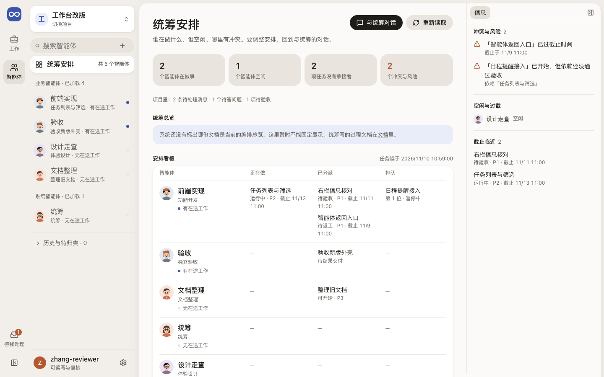
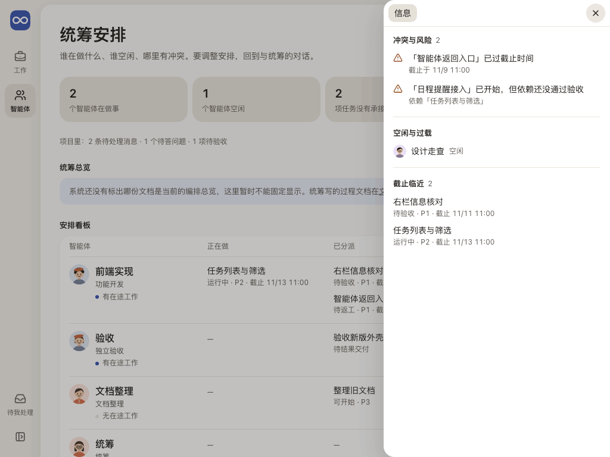
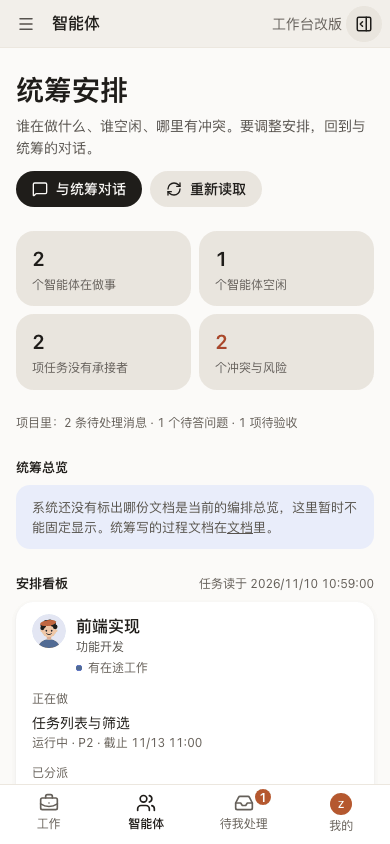
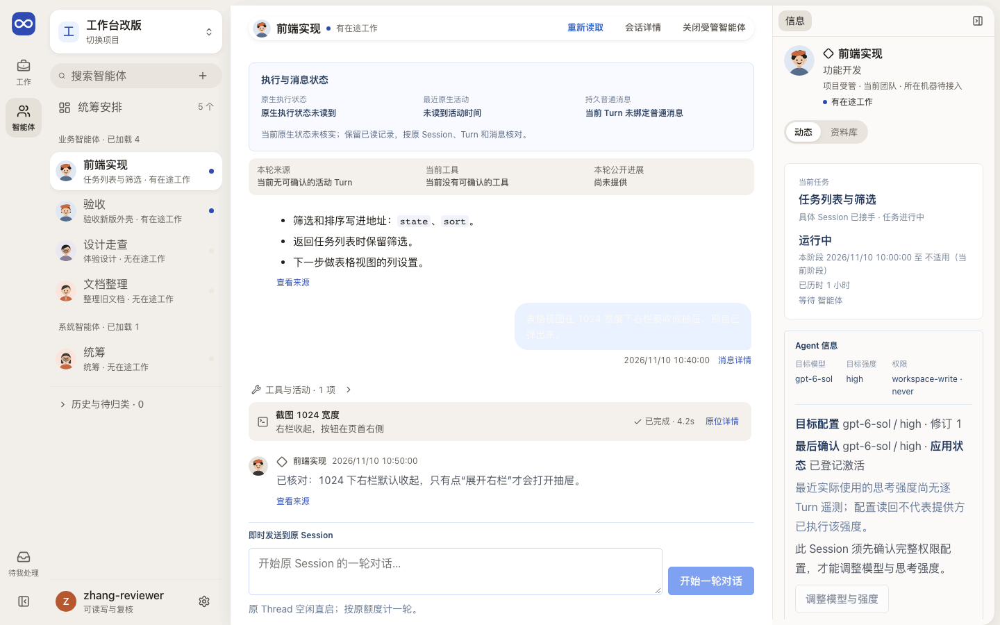
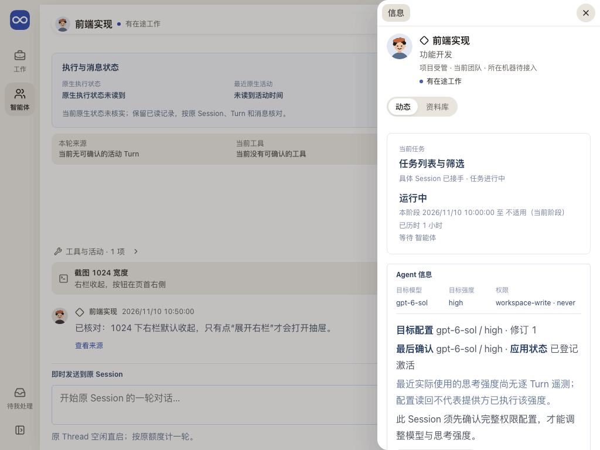
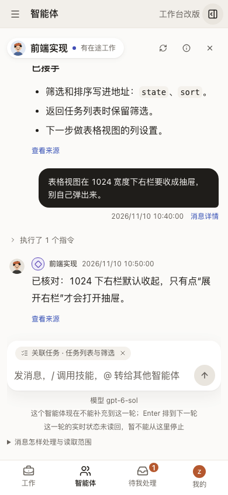

# Sessions：谁在做，做到哪里，Leader 怎样安排

Session 页说明一个具体实例此刻在做什么、做出了什么；“Leader 安排”说明这些 Session 和任务是怎样被组织起来的。

## 这一页回答什么

- 某项任务实际由哪个 Session 承接，现在做到哪、卡在哪？
- 这个 Session 的输入、Agent 活动、工具调用和回复按什么顺序发生，清单做到第几步？
- 它交付了什么，有没有问题在等我回答？
- Leader 怎样安排各个 Session 与任务，目标是什么，哪里有冲突？

## 布局

| 栏 | Session | Leader 安排 |
| --- | --- | --- |
| 内层栏（对象列表） | 顶部固定“Leader 安排”，下面是 Session 目录：搜索，分业务 / System / 待归类，历史可展开 | 同左 |
| 中间 | 对话与 Agent 活动流（见下方“目标体验”），输入框固定在底部 | 上半部分是当前的编排总览文档，下半部分是安排看板：每个 Session 一行，写职责、当前任务、排队任务和状态；没有承接者的任务单独一组 |
| 右栏（可收起） | 角色、运行时（读 Session 自己的绑定与执行配置）、所在机器（#219 之前显示“未知”）、当前任务、队列、成果 | 数据能证明的冲突与风险：同一 Session 有多项进行中任务、依赖未通过验收就已开始、截止已过、待验收却未登记下一责任；再下面是空闲与过载、截止临近 |

外壳与左栏见[布局](../layout.md)，场景见[场景 3](../scenarios.md#十个场景)与[场景 11](../scenarios.md#场景-11看清-leader-怎样安排-session)。

现状（#229 PR6a–PR6d）：
- **目录**：搜索、“统筹安排”、业务 / 系统分组，每项有头像、当前任务或职责、状态。
- **统筹安排**：看板每个智能体一行（正在做、已分派、排队），无承接者的任务单列并写下一步；另列待处理消息、待答问题与待验收数。
- **详情**（PR6d 起全部用 `@evoloop/ui`）：
  - 中间：对话流按目标体验实现；原生的英文说明改写成中文。
  - 输入框：Enter 只在运行时声明可补充时补充，否则排到下一轮并写明原因。
  - 右栏：实体卡与标识、动态（当前任务、分派、执行队列）、资料库（成果）、环境与用量（含调整模型）、详情与来源。
  - “关闭受管智能体”在右栏列出阻断原因；窄屏下右栏只在点开时出现。
- **还没做的**：
  - 编排总览文档（合同缺“当前总览”标记）。
  - 看板对象在右栏打开速览。
  - 选中技能后运行时是否按技能执行待确认（现在在消息首行写明技能）。
  - 关联文档到消息（上下文字段只能带任务）。
  - Claude 的待办（TodoWrite）尚未接入。
  - 提问卡仍是逐题表单，没用 QuestionCard。
  - 所在机器等 #219。

## 内容与状态

通用的空、加载、失败、未知规则见[设计原则](../principles.md)。

- 目录按正式 RoleClass 分组；没有正式 Role、跨类或读取失败的进“待归类”并写原因。外部状态未知 ≠ 空闲。
- 首屏先认清实例：名称、真实状态、职责、受管还是外部接入。
- Session 就绪 ≠ Run 运行中；已发送 ≠ 已读 ≠ 已采用；Run 结束 ≠ 已交付；closing ≠ closed。
- 活动流按真实顺序和发送者显示，唯一有据的 Task 关系才给任务入口（[历史与实时读取](../../architecture/codex-integration.md#session-工作区的历史与实时读取)）。失败、待答和阻断不折叠。
- 加载更早内容时保持阅读位置，新进展不抢走阅读位置。
- 待答卡片区分待答、已保存、已发入原生连接、已清理（[原生提问](../../architecture/codex-integration.md#原生提问与业务问答)）。实时状态断线后标过期，Token 与费用无证据写未知（[原生观察](../../architecture/codex-integration.md#有界原生观察)）。
- 结果未知的输入保留原文（[即时输入](../../architecture/session-runtime.md#3-即时输入执行中收到的消息怎样处理)）。模型的配置、生效回执和实际运行分开写；外部 Desktop 会话只显示已核实的能力。
- 关闭入口列出阻断原因：未完 Task、队列、Run、消息、待答问题、Session 忙碌；来源没读全时不按旧内容关闭。
- 从 Task 进来再返回，恢复页签和阅读位置；切换项目、身份或 Session 时清掉旧数据。
- Leader 安排：只写记录能证明的冲突，总览文档另写的以文档为准；任务或队列没读全时，空闲、冲突、无承接者写“?”或“无法判断”，重读失败标“上次读回，当前待核对”；调整安排找 Leader。

| 服务端写的或没有的 | 页面上写 | 原文在哪 |
| --- | --- | --- |
| 读取范围的限制（`Native history is unsupported for this Session`、`Manual handoff records do not prove native delivery or reading`、`Live native updates unavailable` 等） | 已知的逐条写成中文；不认识的英文写“来源还说明了一项读取限制（原文为英文，可展开查看）”；中文原样保留 | “消息怎样处理与读取范围”和“来源限制与未确认信息”下的“原文” |
| 外部智能体的目标模型、思考强度、执行权限 | “外部接入不提供”（外部主机报过的模型照写）。受管智能体读取中写“正在读取”，读取失败写“无法判断（读取失败）”，读到但没登记写“未登记执行配置” | — |
| 没登记名称的智能体（服务端生成“职责 · 外部 0aba35cb”或职责 ID） | “职责 · 外部接入的智能体”或“职责 · 受管智能体”（职责在前，窄栏截断时仍看得到）；目录第二行写最近活动时间，好区分同职责的几个 | 右栏“详情与来源”的完整标识（服务生成的名称） |
| 统筹安排旁的数字 | “共 N 个智能体”（含历史与待归类） | — |

**目标体验：像用 Claude Code 一样用 Session**

随时知道 Agent 在做什么、做到哪一步，发消息也一样顺手。参考是用户提供的两段录屏：Claude Code 桌面版（工作流、待办清单、输入框、右栏环境与产出）和一个 Bot 应用（提问卡、右栏实体卡、单行实时状态）。

| 交互 | 怎样做 | 数据来源与现状 |
| --- | --- | --- |
| 连续的工作流 | Agent 正文不包卡片；工具调用折叠成一行灰字（“已执行 5 个指令，已建立 1 个文件，1 个失败 ›”），展开后每步一行，失败标红，改动的文件带增删行数 | 已实现：折叠时失败与正在进行的一步仍可见，每步可原位看详情；增删行数需要工具详情 |
| 需要你决定 | Agent 停下来等人时，流末出现提问卡：一句问题、几个可点的选项（A、B、C…），最后一项“其他”可以直接写；选好后点“提交”，等于发出这条回复，卡片随后折叠成一行“已回答：…” | 原生提问与业务问答已有，但不在时间线里（见下表） |
| 输入框信息 | 输入框下方一行：当前模型、权限或执行配置、上下文用量 | Session 执行配置与用量部分已有 |
| 实时状态行 | 流末一行，前面是 Session 的身份标记：“正在运行测试 · 1 分 04 秒 ›”，点开看当前工具 | 已实现（头像、当前工具、耗时、关联任务）；连接过期时只写“上次读回” |
| 待办清单 | 固定在输入框上方，每步显示已完成、进行中、待做，随 Agent 更新；全部完成后折叠成一行 | 已实现：从 Codex 计划条目的分步文字和原生进度里的计划读出；合同仍宜保留结构化步骤。Claude 的 TodoWrite 尚未接入 |
| 发消息 | Enter 发送；运行中按 Enter 补充到当前这一轮（运行时支持时），Cmd/Ctrl+Enter 排到下一轮；已排队的消息显示在输入框上方，可取消；停止按钮中断当前这一轮 | 已实现：补充只在即时输入能力为 steer 时提供；停止按这一轮的来源发消息中断或运行中断，需要复核权限 |
| `/` 与 `@` | 输入 `/` 弹出当前职责可用的技能和命令（停止这一轮、撤回排队消息、关联任务或文档）；输入 `@` 选择其他智能体，这条消息另发一份给对方，两边时间线各留一条记录（见[组件清单](../components.md#对话流组件)） | 已实现：技能来自职责的运行时视图；`@` 另存一条普通消息给对方；技能的执行语义与关联文档仍待定 |
| 头像与称呼 | 界面上 Session 叫“智能体”、Leader 叫“统筹”（[界面用语](../principles.md#界面用语)）；每个智能体有按职责取底色的卡通头像，出现在目录、标题、状态行和 `@` 菜单里 | 头像由职责和实例推出，不需要新数据 |
| 每轮小结 | 一轮结束时，最后一条回复后跟一行本轮产出：改了什么、交付了什么、下一步等谁 | 已实现：只写记录能证明的（工具计数、本轮开始后关联任务的交付、失败或待答） |
| 右栏 | 顶部是实体卡：身份标记、名称、职责、所在机器与状态（在线 / 空闲 / 休眠）；下面两个页签，“动态”看当前任务、队列和最近活动，“资料库”看本 Session 的产出、交付和关联文档；再往下是环境（工作目录、执行配置）和上下文用量 | 工作目录与用量部分已有；机器等 #219 |

**两种运行时的现状差异**

界面按 Session 自己的运行时判断能做什么，服务端时间线能力也按它计算（Claude 不报历史与实时）。做不到的功能写明限制，不留空白。

| 能力 | Codex | Claude |
| --- | --- | --- |
| 时间线历史与实时 | 需开启实验性工作区读取且服务端支持 | 没有；中间栏目前只有 evoLoop 自己保存的输入消息 |
| 子 Agent | 主线程只有一条“Agent collaboration”工具条目和一条空的 notice；子线程未读取，读取它要按接收线程 ID 并单独设计授权范围 | 子消息与主流在同一个流里，但现在被丢弃；父级是发起它的工具调用 ID，可直接映射到计划中的 `parentEntryId` |
| 待答问题 | 开启原生提问时经单独通道读写，不在时间线里 | 不支持 |
| 运行中补充输入 | 经组合运行时的转向能力 | 不支持，只能排队到下一轮 |

## 截图

由 `npm run docs:screenshots` 用合成夹具生成，怎样重新生成见[页面截图](../architecture.md#页面截图)。

改版前真实使用的截图见[实景旅程](../journeys/current-work.md#3-从任务核对具体承接者)。

## 代码与测试

| 范围 | 源码（`apps/workbench/src/`） | 测试（`apps/workbench/test/`） |
| --- | --- | --- |
| 外壳 | `app/shell/AppShell.tsx` | `shell.test.ts`、`session-directory-groups-browser.test.ts` |
| 智能体目录（内层栏） | `features/sessions/SessionNavigation.tsx`（新目录）、`features/sessions/sessionDirectoryPresentation.ts`、`features/sessions/useSessionDirectoryGroup.ts` | `session-directory-presentation.test.ts`、`session-directory-groups.test.ts`、`session-directory-groups-browser.test.ts` |
| 智能体详情 | `features/sessions/SessionWorkspace.tsx`（页首、右栏；执行队列由 `app/App.tsx` 传入 `features/workflow` 的面板）、`features/sessions/environmentPresentation.ts`（环境与用量的三种状态）、`features/sessions/SessionTimeline.tsx`（对话流）、`features/sessions/readingScopePresentation.ts` 与 `features/sessions/SourceLimitations.tsx`（读取限制的中文与原文）、`shared/agentNamePresentation.ts`（没登记名称时怎样称呼）、`features/sessions/conversationPresentation.ts`（工具、计划、状态行与每轮小结的用语）、`features/sessions/workspaceTimelineModel.ts`、`features/sessions/NativeSessionPanel.tsx`、`features/sessions/SessionModelControl.tsx`、`features/sessions/SessionClosePanel.tsx` | `session-wording-presentation.test.ts`、`agent-name-presentation.test.ts`、`session-external-wording-browser.test.ts`（`EVOLOOP_AGENT_WORDING_SCREENSHOT_DIR`）、`session-workspace-redesign-browser.test.ts`、`session-timeline-browser.test.ts`、`session-workspace-timeline-model.test.ts`、`session-conversation-presentation.test.ts`、`session-native-input-browser.test.ts`、`session-native-progress-browser.test.ts`、`session-close-entry-browser.test.ts`、`session-activity-narrow-browser.test.ts`、`task-session-return-browser.test.ts` |
| 输入框 | `features/sessions/SessionComposer.tsx`（待办、排队、`/`、`@`、停止）、`features/sessions/composerPresentation.ts`（Enter 与 Cmd/Ctrl+Enter 做什么）、`features/sessions/useDirectInput.tsx`（即时输入与回执）、`features/sessions/sessionCommand.ts` | `session-composer-browser.test.ts`（三个宽度，`EVOLOOP_AGENT_SCREENSHOT_DIR` 存截图）、`session-direct-input-layout-browser.test.ts`、`session-message-entry-browser.test.ts`、`session-conversation-presentation.test.ts` |
| 统筹安排 | `features/sessions/ArrangementPage.tsx`（页面与右栏）、`features/sessions/arrangementModel.ts`（看板、空闲与风险规则）、`features/sessions/arrangementPresentation.ts`（读取状态用语；按阶段的下一步与总览共用，在 `shared/workPresentation.ts`） | `arrangement-model.test.ts`、`arrangement-presentation.test.ts`、`work-presentation.test.ts`、`arrangement-browser.test.ts` |
| Leader 安排的数据 | `shared/leaderWorkLoad.ts`（任务索引分页与阶段名）、`shared/queueClient.ts`；执行队列 `features/workflow/ResidentQueuePanel.tsx` 与分派、确认 `features/workflow/TaskRuntimeTab.tsx` 显示在任务详情的“运行与关联”，见[任务](tasks.md) | `leader-work-load.test.ts`、`leader-work-overview-browser.test.ts` |
| 数据来源 | `packages/contracts/src/session-timeline.ts`、`packages/adapter-claude-agent-sdk/src/index.ts`、`packages/adapter-codex-app-server/src/workspace-map.ts`、`apps/coordinator/src/runtime/routed.ts` | — |

## 相关

- 产品：[对象关系与能力职责](../../product/workbench.md#对象关系与能力职责)、[职责与 Session](../../product/functional-scenarios.md#职责session-与项目初始安排)、[从需求到 Leader 安排](../../product/functional-scenarios.md#场景-1从需求到-leader-安排)
- 合同：[Session 工作观察](../../architecture/contracts.md#session-工作观察有界读取同一份事实)、[RoleRegistry 与 SessionRuntime](../../architecture/contracts.md#4-roleregistry-与-sessionruntime)、[具体承接与职责分开](../../architecture/contracts.md#具体承接与职责分开)
- 运行时：[普通消息与业务执行](../../architecture/codex-integration.md#普通消息与业务执行共用原会话)、[执行配置](../../architecture/codex-integration.md#受控-session-恢复与执行配置)、[Session 关闭](../../architecture/codex-integration.md#端口合同拟议)、[消息额度](../../development/agent-cli.md#普通消息累计用量与旧试用-grant-转换)
- 团队与职责见[团队](team.md)。
