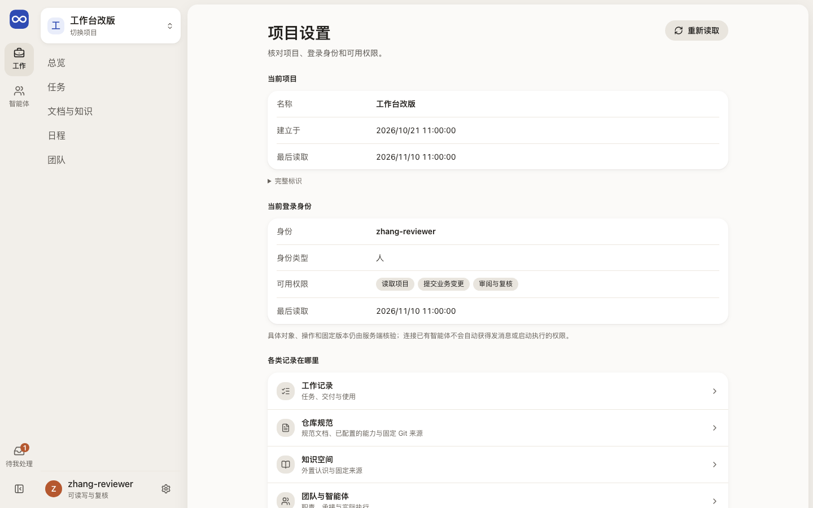
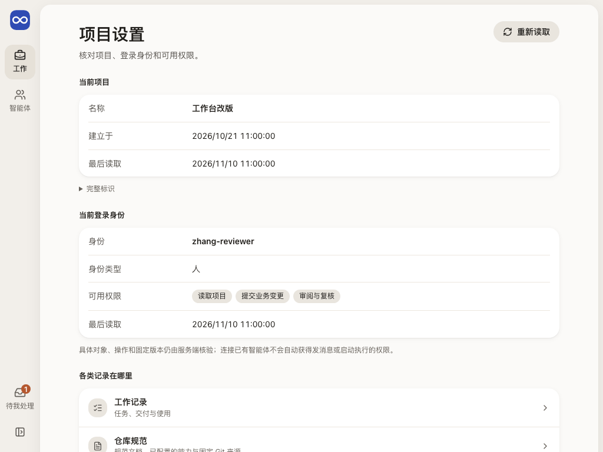

# 项目设置：哪个项目，以谁的身份，有哪些权限

项目设置让项目里的每个人核对三件事：现在在哪个项目，以哪个身份登录，能做哪些操作；再给出各类记录的入口。本页只读，没有写操作。

## 这一页回答什么

- 我现在在哪个项目里，项目信息是什么时候读回的？
- 我以哪个身份登录，是人还是智能体，有哪些权限，是什么时候读回的？
- 任务、仓库规范、知识、团队和结果未知的操作各在哪里？

## 布局

| 区域 | 放什么 |
| --- | --- |
| 内层栏 | 工作空间的分区导航；本页不属于任何分区，没有高亮项，也没有对象列表 |
| 中间（单栏） | 页首“项目设置”和“重新读取”；当前项目（名称、建立于、最后读取，项目的完整标识折叠）；当前登录身份（身份、身份类型、可用权限、最后读取）；各类记录在哪里（五个入口） |
| 右栏 | 没有 |

外壳与内层栏见[布局](../layout.md)。

现状（#229 PR9a）：账号菜单里的几页共用 `SettingsParts` 的单栏布局，[结果未知的操作](operations.md)、[仓库规范](repository.md)、[微信连接](connectors.md)相同。[场景与交互](../scenarios.md#现有页面在新布局里的位置)的目标是把仓库规范和连接器作为项目设置的分区，现状它们仍是账号菜单里的独立页。

## 内容与状态

通用的空、加载、失败、未知规则见[设计原则](../principles.md)。

- **项目**：和内层栏顶部的项目名用同一个按项目隔离的查询。首次读取时名称写“正在核对项目…”，建立于和最后读取写“待读回”。重读中，“最后读取”后标“正在重新核对”。
- **读取失败**：写“项目本次读取失败”和原因；有上次内容时保留，说明“下面是上次读回的内容”，“最后读取”后标“旧数据”。
- **身份与权限**：打开本页时按当前登录身份重读一次，“重新读取”同时重读项目和身份，“最后读取”写读回时间。读回前先显示登录时读回的内容，并写明“正在读取”。和登录时不同（权限增减、身份类型、身份或项目访问变了）时逐项说明，并写明其他页面仍按登录时的身份显示入口、提交时服务端按最新权限核验，要让各页按新权限显示请回项目列表点“刷新项目”。
- **身份读取失败**：保留上次读回的（或登录时读回的）身份与权限，标“上次读回，当前待核对”并写出原因。
- 权限写成中文：读取项目、提交业务变更、审阅与复核、接受与验收。没有声明权限写“未声明权限”，没有报告身份类型写“未报告”。
- 权限下面写明：具体对象、操作和固定版本仍由服务端核验；连接已有智能体，不会自动获得发消息或启动执行的权限。
- 项目的 UUID 收在“完整标识”里，展开后可复制给 CLI 用，正文不显示。

## 从哪里来，到哪里去

| 从 | 到 |
| --- | --- |
| 账号菜单 › 项目设置（宽屏是内层栏底部的齿轮，窄屏是底部标签栏“我的”） | 工作记录 → 工作 › 任务；仓库规范；知识空间；团队与智能体 → 团队 › 分工与运行；结果未知的操作 |

## 截图

由 `npm run docs:screenshots` 用合成夹具生成，怎样重新生成见[页面截图](../architecture.md#页面截图)。

## 代码与测试

| 范围 | 路径 |
| --- | --- |
| 源码（`apps/workbench/src/`） | `features/settings/ProjectSettings.tsx`、`features/settings/sessionRead.ts`（重读身份）、`features/settings/settingsPresentation.ts`（与登录时的差别、读取时间）；设置类页面的共用布局在 `shared/ui/SettingsParts.tsx` |
| 测试（`apps/workbench/test/`） | `settings-presentation.test.ts`、`entry-pages-browser.test.ts`、`settings-pages-browser.test.ts`（重读、权限变化与重读失败） |

## 相关

- 布局：[外层模块栏](../layout.md#外层模块栏)（账号菜单）
- 架构：[会话与权限边界](../architecture.md#4-会话与权限边界)
- 合同：[通用身份与结果](../../architecture/contracts.md#1-通用身份与结果)
- 前端：[登录与项目列表](entry.md)
